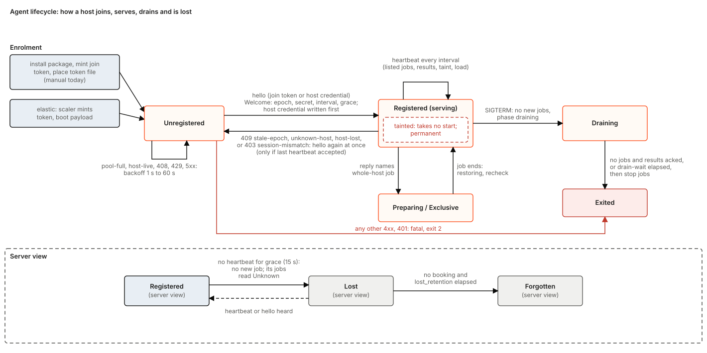
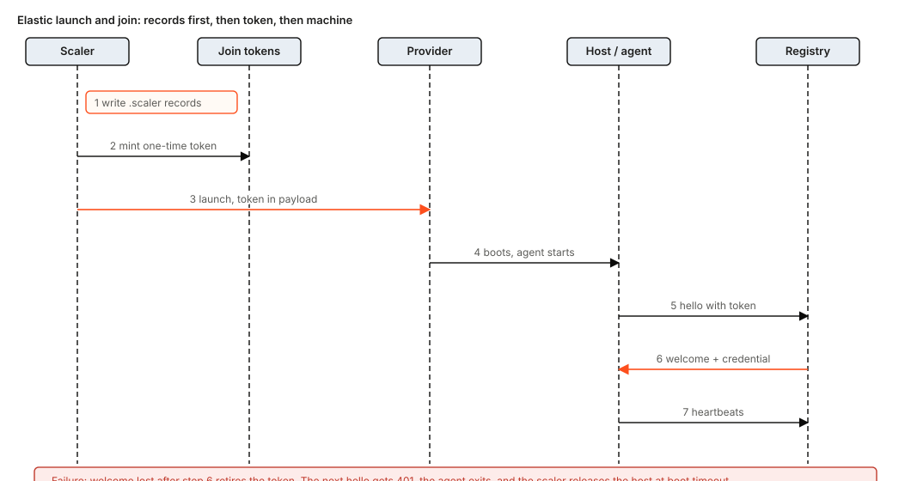
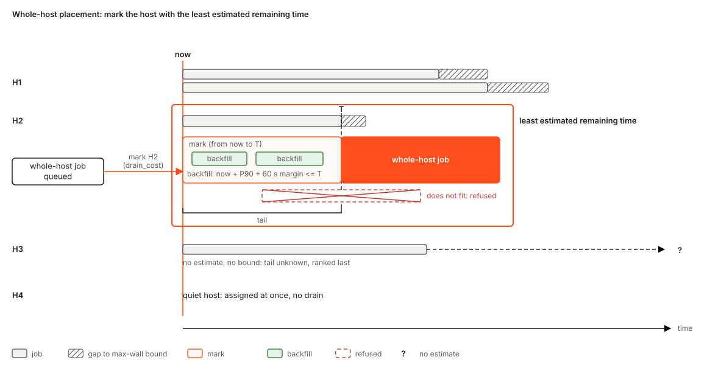
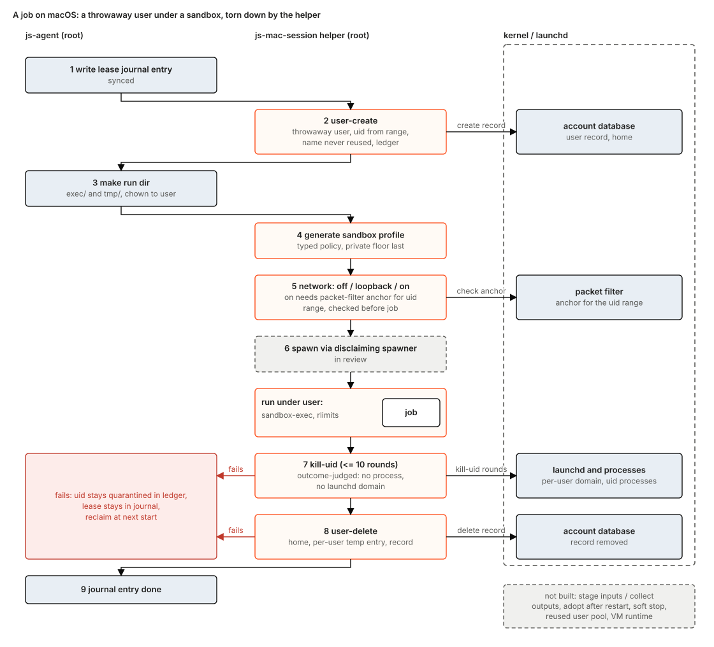
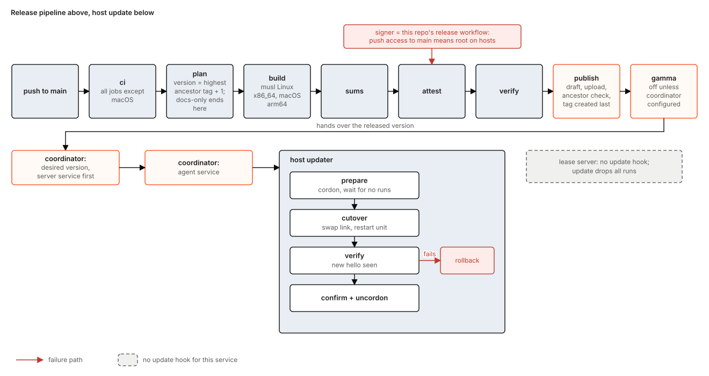
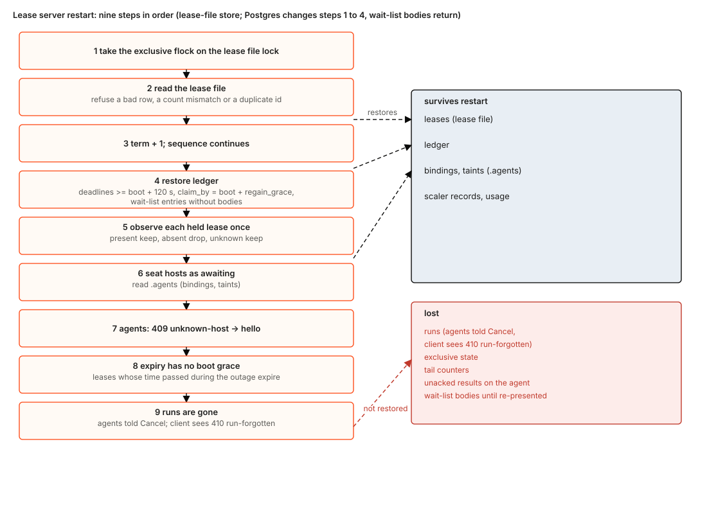

# jobscheduler: the design

jobscheduler is a generic, open-source scheduler that runs OCI images on Mac or Linux hosts. **The job is the one public concept.** A **job** is one OCI image run to completion: the client submits it (the image pinned by digest, a command, resource needs, constraints and a wall limit), the scheduler queues it and places it on a host, the host runs it, and the client reads the result. An **allocation** is the scheduler's private record that certain resources on one host are booked for one job; no client sees or touches it, and a client never holds, renews or releases capacity (section 3.2).

On Linux the agent launches each job with `crun` directly, with no container daemon in the path, so a job starts fast. On Linux this is built; on macOS the single image job definition is step 17 of section 12.1, and no launch time has been measured yet (step 18). A **pool** is a named set of capacity and the platforms that supply it (section 4.2); it names **container platforms** in priority order. The first kind is `Default`, which is ours: `js-agent` with `crun` on Linux and native runs on macOS, with our own placement. It takes an ordered list of **machine providers**: static hosts we install `js-agent` on, which reach out and register (your own bare-metal Linux and Macs), then cloud VM providers that start a machine that boots `js-agent` (Lambda Labs built; AWS EC2 and GCP Compute Engine planned). Kubernetes, Cloud Run and ECS are planned platform kinds with their own parameters (section 3.7). One capability vocabulary, owned by the scheduler, is how a job that needs a GB300 accelerator finds the machine that has it (sections 3.8, 5.6). v1 builds the Default platform only.

This is the design document. It describes the target design, and for every piece it says **Built**, **Partly built** or **Planned** and names the crate that holds it. A new engineer should be able to read it top to bottom and know what the system is, what the one picture shows, how each operation works, and what is left to do. Where today's code differs from the design, the difference is a numbered step in section 12.1, not part of the narrative.

Every statement about behaviour cites a file or crate. Paths are relative to the repository root; crate paths are under `crates/`. A statement marked Built describes what the code does. Anything else is a design and is marked Partly built or Planned. Where an older design document and the code disagree, this document follows the code and says so.

Eleven SVG diagrams in `docs/design/diagrams/` carry the pictures. Contents: 0 status and the other documents; 1 problem; 2 goals and non-goals; 3 the design in one picture (pieces and their status, jobs and allocations, layers, one placement engine, container platforms and machine providers and their interfaces, client surface, other platforms (later), one capability vocabulary); 4 configurations; 5 how each operation works (including placement with an accelerator request worked end to end, how a job runs, and job networking); 6 background work; 7 edge cases handled; 8 races the current code loses; 9 assumptions; 10 state; 11 limits; 12 future work and the gap list; 13 open questions; related work; 14 glossary.

## What changed in this revision

The maintainers decided the following. The text below follows these decisions; today's code is described only where a section says "today" or "as built", and the steps that close the gap are in section 12.1.

- **Jobs and allocations.** The job is the one public concept: a client submits a job, the scheduler queues, places and runs it, and the client reads the result (exit code, log tail, timing, resource usage). The allocation, the scheduler's record that given resources on a given host are booked for a given job, is internal: clients never create, renew or release one, and there is one per job. Whole-host work is a job whose need is the whole host. There is no renewal and no time to live, and reservations are not in v1 (section 13, question 24). This replaces the lease, kbf's heritage (kbf held capacity and fired many actions into it), which is wrong for a generic scheduler. Today's code is the as-built state (0.1 and the "as built" boxes), replaced by steps 1, 2, 8 and 27 to 30 of section 12.1.
- **Clients use a generated surface.** A client calls the service through a CLI or a client library that are both generated from one protobuf service definition. kbf is one client of that service among others: it submits each build action as a job.
- **kbf is a client only.** kbf no longer embeds the server crates (`js-server-core`, `js-sched`, `js-state` and the others). This reverses an earlier shape in which kbf linked them.
- **Postgres is the store** for jobs, allocations, hosts and usage history. SQLite stays only for tests and single-node development.
- **Container platforms, with Default first.** Where a job runs is a *container platform*: `Default`, `Kubernetes`, `Cloud Run` or `ECS`, each with typed parameters; a pool names platforms in priority order. `Default` is ours and the only kind v1 builds (sections 3.5, 3.7).
- **Machine providers belong to the Default platform.** Default takes an ordered list of machine providers: `static` (hosts we install `js-agent` on, which reach out and register; today's agentless operator-listed pool is removed as a production kind and kept only as a test fake, question 23) and dynamic VM providers that call a cloud's VM API to start a machine that boots `js-agent` (Lambda Labs built; AWS EC2 and GCP Compute Engine planned). Placement walks them in priority order. Every machine runs `js-agent`, the scheduler never branches on provider kind, and multi-cloud means a cloud's VM API only, never its job or container services.
- **One capability vocabulary,** owned by the scheduler and defined, with its accelerator aliases and each provider's catalog translation, in code; configuration only selects and limits, so a new accelerator needs a release (settled, section 13). A VM's detected capabilities are checked against its offer on hello (section 3.8).
- **One placement engine**, `js-sched`: load placement, tail placement for whole-host jobs, a CPU slack setting, a memory percent setting, and estimates that come from usage history. It owns the allocations.
- **The job is an OCI image on both platforms.** Linux runs it with `crun` directly. macOS runs it natively from the OCI bundle (a `js-bundle` is an OCI image manifest) under the sandbox. Docker and Podman are at most a fallback (section 5.7).
- **The picture shows the target only.** Section 3's picture has no registry, no separate scaler and no "today" notes (built and planned status is in the table of 3.1; the drift is in 0.1 and 12.1). Section 3.2 says what a job and an allocation are. Section 5.7 walks one job from submit to result and says why each step exists; constants and today-versus-target detail are in an "As built today" box at its end.
- **Per-job network policy.** A job asks for `network = none | allow-list | open` and declares a list of host ports; each declared port becomes one DNAT host-port forward, and there is no other ingress. The agent's flags are the ceiling a job cannot exceed. The Podman firewall path is retired, so there is one concept (section 5.8).
- **Live logs.** When the server's `[logs]` table names an object store, a job's whole output, stdout and stderr apart, is read with `GetLogs` while the job runs and for the retention window after it ends, from any byte offset and with `follow`. The agent uploads it in chunks with one upload credential per host that the scheduler mints; the scheduler never stores the bytes. The result's 8 KiB tail is unchanged. The detail is in `live-logs.md`; sections 3.6, 5.3 and 5.7 of this document summarise it.

---

## 0. Status and the other documents

### 0.1 Where the code is today

The design below is the target. The code that exists today is built around the lease: one `js-lease-server` process keeps leases in a file (`js-lease`); a client acquires a lease on a host (`POST /v1/leases`), renews it before its time to live runs out, posts runs inside it (`/v1/leases/{id}/runs`) and releases it. Around it are a registry of self-registered hosts (`js-registry`) that books leases, a scaler with one cloud provider (`js-scaler`), hand-written HTTP/JSON clients, and kbf linking the placement libraries. The target has no client-visible lease, no renewal and no time to live: it has the job and the scheduler's allocation, one scheduler (`js-sched`), and neither a separate registry nor a separate scaler (section 3 says where their duties go). No job API exists in code yet. Section 12.1 lists each difference and the steps that close it: the job API (step 1), the job and allocation tables (step 2), `js-sched` placing jobs and owning allocations (step 8), start, stop and report per job in the agent protocol (step 28), kbf submitting jobs (step 11), then removing renewal and deleting the lease API (steps 29, 30). There are no Kubernetes manifests, Dockerfile or helm chart in the repository. Whatever supervises the server (a service unit, a coordinator-managed service) is outside this repository.

### 0.2 Built, partly built, in review, planned

- **Built** means the code is in the main branch and a test exercises it.
- **Partly built** means some of the piece is Built and the rest is not; the text says which part.
- **In review** means an open pull request. At the time of writing one matters here: a change that lets `POST /v1/leases` carry a `request_id` (sections 5.3, 8). It is described as "in review", never as built. Its idempotency rule is carried into job submit as the job id (section 5.3); the lease form goes with the lease API (step 30).
- **Planned** means only a design document or an issue says it. Every planned item is a step in section 12.1.

### 0.3 How the older documents relate to this one

This document supersedes nothing by deleting it. Nothing is removed. The table says which document is now the authority for what.

| Document | Status relative to this one |
|---|---|
| `docs/design.md` | **Superseded as the entry point.** Still the record of the decision list (D-numbers) and the long-form rationale. Parts are stale: its crate map lists `js-config` and `js-provider-aws` as new crates (neither exists in `crates/`) and says the SQLite and Postgres state backends stay in kbf (they exist here, under `js-state`; this document makes Postgres the store); its protocol section describes a protobuf stream where the code is JSON polling; its Kubernetes target has no manifests; its claim that the agent holds no registry credential is false since private-registry pulls were added. Read it for why, not for what. |
| `docs/design/providers.md` | **Authority for the machine-provider hierarchy and admission rules** (D35, D59 to D61), which section 3.5 and 5.6 summarise; it predates the platform layer and the capability vocabulary. Planned, not built. |
| `docs/design/kbf-on-js-agent.md` | **Partly superseded.** It describes kbf's side of the integration. Where it has kbf embedding server crates, this document replaces that with kbf as a client of the service that submits jobs (section 3.6), and its lease-then-run shape with jobs and allocations (section 3.2). Nothing in it about upload grants, a task tool or an `--executor` flag is in this repository. |
| `docs/design/pools-providers-network.md` | **Reference; partly built.** The config file, scaler, elastic contract and the host-to-scheduler network layer it proposes now exist. Its first section ("there is no scaler") is stale. It is about how a host reaches the scheduler, not about job networking (section 4.4 against section 5.8). |
| `docs/design/whole-node.md` | **Reference; current in its contracts.** Authority for the whole-node rules, which this document calls whole-host jobs. This document summarises it (sections 5.4, 6.4). |
| `docs/design/placement.md`, `placement-by-load.md` | **Reference.** `placement.md` is current as a contract. `placement-by-load.md` names flags (`--placement sched`, `--placement lease-table`, `--placement-load`) that the lease server does not have; the design here makes load placement the only mode. |
| `docs/design/hosts.md`, `registration.md` | **Reference.** `registration.md` is stale on a deny-list of hosts (not built) and on agent self-fencing (not built, section 8). |
| `docs/design/agent-egress.md`, `docs/egress.md` | **`agent-egress.md` is the authority for the crun network mechanism** (section 5.8); it is stale in saying the crun runtime cannot be selected (the `js-agent` rustdoc has the same sentence). **`docs/egress.md` describes the Podman firewall path, which is retired** by this design. |
| `docs/design/live-logs.md` | **Authority for live logs** (Planned): the object layout, the host upload credential, the `[logs]` keys, the wire fields, and `GetLogs` with offsets and `follow`. This document summarises it. |
| `docs/design/agent-privilege.md`, `mac-lease-teardown.md`, `invariants.md`, `absence.md`, `lease-limits.md`, `agent-suite.md`, `configuration.md`, `bench-analysis.md` | **Reference; current.** |
| `docs/design/deployment.md`, `rollout.md` | **Design for a deployment that is not in the repository.** `deployment.md` chose a single-writer lease file; this document replaces that with Postgres (section 10). The flags it prescribes (`--term-floor`, `--verify-state`, a readiness endpoint, a generic `--boot-grace`) do not exist. |
| `docs/design/vm-backend.md`, `capabilities.md`, `sizing.md`, `retries-and-runs.md`, `ucdk.md`, `generalising.md`, `extraction-steps*.md`, `merged-code.md`, `risks-f.md`, `decisions.md`, `amendments.md`, `aws-iam.md`, `kbf-today.md` | **Design or history.** Mostly planned. `merged-code.md` carries the planned trait renames of section 3.5. `kbf-today.md` is stale on kbf's scheduler core flag. |
| `docs/release.md`, `docs/layering.md`, `docs/js-mdm.md`, `docs/runbooks/*` | **Current references** for release, layering, the MDM host layer, and operations. |
| Crate-level rustdoc of `js-lease-server`, `js-agent`, `js-sched`, `js-registry`, `js-lease`, `js-scaler`, `js-server-core`, `js-store` | **The most accurate source of detail**, with one known exception: the `js-agent` crate rustdoc (`js-agent/src/lib.rs`) still says the crun runtime cannot be selected, though `--runtime crun` exists. This document links to rustdoc rather than restating flags. |

---

## 1. Problem

A build farm, a benchmark rig and a CI system all need the same thing: run a piece of work on a machine that has enough free capacity, on its own, without leaving anything behind that changes the next piece of work. The hard parts are not the first run. They are:

1. **A client that disappears.** A client submits work and stops answering. The work must still end (a wall limit bounds it), the host must come back, and the result must wait for the client; none of that may depend on the client keeping something alive.
2. **Whole-host jobs starve behind small ones.** A benchmark that needs a quiet machine never gets one if small work keeps arriving. Draining a host costs the remaining time of the work on it; that cost must be chosen, not accidental.
3. **A host is an unreliable thing.** It can go silent, reboot, be reimaged, or be compromised by the job it ran. The scheduler must say "unknown" when it does not know, and never free a host it cannot see.
4. **Jobs must start fast and be contained.** A job is an image; launching it must not wait on a container daemon. It must be able to write exactly one thing, to exactly one place, once, and reach only the network it declares.
5. **Macs are different.** A Mac host has no container runtime that gives the isolation Linux has. Isolation is a user of the job's own (lent from a pool and reset between jobs), a sandbox profile and a firewall rule, and tearing it down must be proven, not assumed.
6. **Capacity comes from several places.** Machines you own, machines you rent by the hour, and machines a cloud's VM API starts for you are all capacity. A job must be placed on the first source that can serve it, and a machine that costs money needs hard caps and a brake, because the cost of a bug is measured in currency.

jobscheduler is the service that answers these. It is one scheduler service (`js-sched`) that accepts jobs, records which resources on which host are booked for each (allocations), decides which host (placement), and gets machines from machine providers; with an agent on each machine that runs the job, contains it and reports; and the release machinery that keeps all of it updated. Section 3.2 defines job and allocation.

## 2. Goals and non-goals

### 2.1 Goals

- **G1. A job is the only way to run work.** A client submits a job (defined in section 3.2); the service queues, places and runs it and keeps the result. The capacity it books is the scheduler's own allocation, committed before the host is asked (section 5.3). A client holds nothing, renews nothing and releases nothing; a wall limit bounds every job.
- **G2. Never free what cannot be seen.** The provider answers present, absent or unknown. Only absent frees an allocation. Silence reads as unknown.
- **G3. Whole-host jobs finish.** A whole-host job marks the host with the least estimated remaining time, drains it, and commits it when quiet. Smaller jobs may use the host meanwhile only if they will end inside the estimated tail (section 5.5).
- **G4. Contained jobs.** Digest-pinned images, empty capability sets, a dedicated unprivileged identity, scratch quotas, no network unless the job declares it and the agent allows it (sections 5.7, 5.8).
- **G5. Taint instead of trust.** A host whose post-job checks fail is marked tainted, permanently, and takes no further work.
- **G6. Macs run natively under a proven teardown.** A pool user lent to one job at a time, a generated sandbox profile, a network rule, and a kill-and-reset (a replacement when the reset is not clean) that judges outcomes rather than exit codes (section 5.9).
- **G7. Bounded spend.** Every elastic pool has instance, hourly, daily and total caps, and a brake that trips to plan-only after repeated launch failures (section 6.5).
- **G8. Updatable without ceremony.** Every push to shipped code is released, attested and byte-identical on rebuild; agents update themselves through a hook that drains first (section 6.6).
- **G9. One job, two platforms.** The job is an OCI image on Linux and on macOS; the host's operating system decides how it runs (section 5.7).
- **G10. One way to ask.** Every client uses a CLI or library generated from one service definition (section 3.6).
- **G11. Machines we control, in any cloud, found by capability.** Multi-cloud means a cloud's VM API starts a machine that boots `js-agent`; jobscheduler places and launches every job itself, and a job names what it needs in one vocabulary (sections 3.5, 3.8, 5.6).
- **G12. Other container platforms later, on the same vocabulary.** Kubernetes, Cloud Run and ECS map the same job onto their own knobs and refuse impossible jobs up front (section 3.7).

### 2.2 Non-goals

- Multi-tenant isolation beyond job ownership. The job service names its clients, each with its own token and a role: a `client` sees and cancels only its own jobs, an `operator` everything (`docs/http-gateway.md`, "Clients, roles and token reload"). The lease routes keep one token and one trust domain (section 11).
- High availability of the service in the first target. It is one active writer over Postgres; whether to add a standby is open (section 13, question 1).
- Hosting a public listener. The service is meant to sit on a private network.
- Being a workflow engine. It places and contains jobs; retry policy and result interpretation belong to the client.
- Holding capacity for a client: reservations of capacity or of a whole host for a time, with jobs sent into them. Not in v1 (section 13, question 24).
- Delegating execution to a cloud's batch or container service in v1. The Default platform's machine providers supply machines and never run a job. The other platform kinds (Kubernetes, Cloud Run, ECS) are planned (section 3.7) and not built in v1.
- A VM backend. The helper crates exist; the runtime does not (section 12).

## 3. The design in one picture


Read the picture from the left. Clients call one service API through a CLI or a library, both generated from the service definition; kbf is one of them and submits each build action as a job. Behind the API is **one scheduler, `js-sched`**: it keeps the queue of waiting jobs, decides where each job goes, books the resources it chose as an allocation (section 3.2), and uses estimates drawn from usage history. Everything it knows, the jobs and allocations and the hosts included (what exists, which are live, what each has), is state in Postgres. In the target there is **no `js-registry`**, no separate scaler and no second placement path. Arrows: the scheduler records its state in Postgres, asks the Default platform for capacity, and agents report to the scheduler.

On the right is a pool's list of container platforms, in priority order. `Default` is the only one v1 builds. It runs every job on a machine that runs `js-agent` (`crun` on Linux, native on macOS) and takes an ordered list of machine providers that supply those machines: `Static` (hosts we install `js-agent` on, which reach out and register) and the cloud VM providers that start a machine when asked (Lambda Labs, AWS EC2, GCP Compute Engine). Acquiring and releasing machines is the Default platform's and its providers' work, not the scheduler's: the scheduler decides that capacity is needed and which provider to ask, and the platform applies the caps and calls the provider. The dashed platforms are later; jobscheduler would hand them the OCI image directly and there is no `js-agent` on them (section 3.7). Every platform and provider describes what it can supply in the vocabulary of section 3.8. The object store is outside: a job reaches it through a URL the client minted, and, when live logs are configured, the agent writes the job's output there with its host's credential (not drawn; `live-logs.md`).

**Where today's registry and scaler duties go.** Host table -> scheduler state in Postgres. Whole-host marks -> `js-sched`. Job delivery -> the agent protocol. Caps, brake and acquire records -> the Default platform. Today's `js-registry` and `js-scaler` crates are removed by the steps in section 12.1; how the code differs today is in section 0.1, not in the picture.

### 3.1 The pieces

This table is where built and planned status is recorded; the picture above shows the target only. The duties that move out of `js-registry` and `js-scaler` are in the paragraph above and the Registry entry of the glossary. Status says how much of the piece exists today. The crate column says where it lives today, which for `js-registry` and `js-scaler` is structure the design removes.

| Piece | What it is | Status | Crate or path |
|---|---|---|---|
| Service definition | One protobuf service: jobs (submit, get, list, cancel, result, logs), hosts, pools, usage | Planned (step 1) | none yet |
| Generated CLI and library | The only clients; generated from the definition | Planned | replace `js-cli`, `js-client` |
| HTTP/JSON API | Hand-written routes today, all lease routes (`/v1/leases`, `/v1/leases/{id}/runs`); a generated gateway over jobs if kept (section 3.6) | Built (hand-written, lease routes, removed by step 30) | `js-lease-server/src/api.rs`, `run_api.rs`, `js-agent-wire` |
| Service binary | One process with a client listener and an agent listener | Built | `js-lease-server` |
| Jobs and allocations | The model of section 3.2: a job is submitted, queued, placed, run and read; its allocation books the host, committed before the host is asked | Planned (steps 1, 2, 8, 27, 28) | none yet |
| Leases and runs (as built) | Today's model, replaced by jobs and allocations and removed by steps 29, 30 (box at the end of 3.2) | Built over a file; runs in server memory | `js-lease` (table), `js-state` (store) |
| Postgres store | The store of jobs, allocations, hosts, usage history | Partly built: backend and CI job exist, server does not use it | `js-state` (`postgres` feature) |
| Placement engine | One engine for load, tail, slack, memory percent, estimates, and the walk over platforms and providers (section 3.4) | Partly built: load placement, CPU slack, memory percent and tail placement exist in `js-sched` and run in kbf's embedded engine; under `--placement js-sched` the server's `SchedPlacer` keeps one long-lived engine, built once and rebuilt only when its picture and the registry's books disagree, fed each heartbeat's load reading, with the CPU slack setting (`cpu_slack`, default 1.1x) and the pool's `memory_schedulable_percent` applied in it (`js-lease-server/src/sched/engine.rs`); the estimate feed is behind a flag and off by default; the walk is Planned; the server's default path is still the registry picker (steps 8, 11) | `js-sched`, `js-whole`; `js-registry` picker; `js-lease-server/src/sched` |
| Host table | Which hosts exist, which are live, what each has; sessions, taint, cordon, credentials. The design keeps it as scheduler state in Postgres; there is no registry component. | Built in memory in the registry; Postgres Planned (steps 2, 6) | `js-registry` |
| Queue and tail marks | Waiting jobs and whole-host marks | Partly built: live in the registry, not in `js-sched`; as built the waiting entry is a whole-node lease request | `js-registry/src/whole/` |
| Usage history and estimates | Per-minute usage, cost curves, P90 wall times, a record per ended allocation | Partly built: SQLite file, estimate feed behind a flag, no record of an ended allocation (as built: of an ended lease) | `js-usage`, `js-registry/src/lives.rs` |
| Container-platform layer | A pool's `platforms` in priority order, the `ContainerPlatform` trait, and the `Default` implementation that drives the machine providers (section 3.5) | Planned; a fixed static-then-registry order is Built | `js-lease-server/src/layered.rs` |
| Machine-provider interface | One `CapacityProvider` contract, the machine-provider trait (section 3.5) | Planned; `ElasticProvider` is its Built core | `js-elastic`, `js-provider` |
| Static machine provider | Hosts we install `js-agent` on, which reach out and register (bare-metal Linux and macOS); one kind for the registry's self-registered hosts, with the host book they keep; the agentless operator-listed pool is not part of it (removed as a production kind, section 3.5, question 23) (hosts, sessions, taint, cordon, credentials, bookings) | Partly built: the registry (`RegisteredProvider`) and `StaticPool` are two separate lease-level providers; the merged `CapacityProvider` form is step 6 | `js-registry`, `js-pool-static` |
| Lambda Labs provider | A dynamic VM provider (elastic) that launches machines through the cloud's VM API | Partly built: built as `ElasticProvider`; ported to `CapacityProvider` in step 5 | `js-provider-lambdalabs`, fake `js-elastic-fake` |
| AWS EC2, GCP Compute Engine providers | Dynamic VM providers (elastic) | Planned | none yet |
| Capability vocabulary | One set of terms for what a job needs and what a host or offer has (section 3.8) | Partly built: `Requirements` has os, arch, exec, disk, cpu, memory, a GPU count and a GPU class string; no structured accelerator, no alias table in code | `js-types`, `js-caps`, `js-elastic/src/offer.rs` |
| Catalog translation, verify-on-hello | A provider returns offers in our vocabulary; a new VM's detected capabilities are checked against its offer | Planned: Lambda Labs takes GPU facts from operator-written `[[option]]` rows today and moves them into its crate's code; hello checks only the pool's shape floor | `js-elastic`, provider crates, `js-registry` |
| Other container platforms | Kubernetes, Cloud Run, ECS, each with typed parameters (section 3.7) | Planned, after v1 | none yet |
| Acquiring machines | Caps, brake and records before any acquire, for any elastic provider. A part of the Default platform in the design; its demand logic folds into placement (step 9). It is not a fleet manager. | Built as the scaler | `js-scaler`, `js-lease-server/src/scaler/` |
| Agent | Registers, heartbeats, runs jobs, contains them, reports. Today it takes a start and a stop per run; per job is step 28 | Built | `js-agent` |
| Linux runtime | `crun` run directly by the agent as a non-root job user | Built | `js-agent/src/crun/`, `js-contain`, `js-oci` |
| Container-engine runtime | Docker or Podman; a fallback | Built | `js-agent/src/cli_runtime/` |
| macOS runtime | Native run from an OCI bundle under a pool user and sandbox | Partly built | `js-agent/src/native/`, `js-mac-session`, `js-mac-pool`, `js-mac-provision`, `js-bundle` |
| Job network policy | Per-job none, allow-list, open, and declared ports | Partly built: crun mechanism built, not wired; no job field | `js-agent/src/egress/`, `js-agent-wire` |
| Object store | Not part of jobscheduler. Jobs write their output there through the client's grant; with a log sink, agents upload live logs there and `GetLogs` reads them (`live-logs.md`) | outside; live logs Planned (step 31) | |
| Release machinery | Build, attest, publish, host-driven agent update | Built | `xtask`, `.github/workflows/release.yml`, `packaging/` |

### 3.2 Jobs and allocations


A **job** is one OCI image run to completion; the client submits it and reads its result. An **allocation** is the scheduler's private record that certain resources on one host are booked for one job; no client sees or touches it.

**Job.** A job asks for one OCI image to be run to completion. It carries:

- the image, pinned by digest, a command, arguments and environment;
- resource needs (cpu, memory, disk, accelerators, or the whole host) and constraints (`os`, `arch`, capabilities) in the vocabulary of section 3.8;
- a wall limit, a network policy and declared host ports (section 5.8), optional files (for example the upload URL the client minted, section 5.7) and a priority.

A job has an id, supplied by the client or minted by the service. Submitting the same id with the same job answers from the job already made, so a retry after a lost answer never runs the work twice (section 5.3). A job goes through these states:

- **Queued.** Recorded and waiting for placement. It books nothing.
- **Placed.** `js-sched` chose a host and made the job's allocation. The allocation is recorded before the host is asked (section 5.3). A whole-host job stays placed until the agent reports the host quiet and ready (section 5.4).
- **Starting.** The agent has the start and is fetching the image and making the container.
- **Running.** The container is running. The wall-limit clock runs from here.
- A whole-host job whose prepare fails goes from placed back to queued. That is the only requeue (section 5.4).
- Then one of **succeeded** (exit code 0), **failed** (nonzero exit, or stopped at the wall limit or for memory; the result says which), **cancelled** (the client asked) or **lost** (the job's container is gone and no result exists: the provider says the host is absent, or the host came back and does not list the job, section 6.3).
- **Failed to start**, with a code, when the job did not get to run: the agent refused it (for example the host is tainted or the image fetch failed), no capacity came within the pool's maximum queue wait (`no-capacity`), the start did not complete within the start timeout (`start-timeout`), or a whole-host prepare failed `max_replace` times (`exclusive-not-ready`).

A submit that no host, catalog or platform could ever serve is **refused at admission** with `no-capable-host` (section 5.6). That is an answer, not a state: nothing is recorded and the client may change the job and submit again.

The client reads the result (exit code, log tail, timing, resource usage). The result keeps the 8 KiB tail of each stream; when a log sink is configured, the job's full output is also read with `GetLogs` while the job runs and for the retention window after it ends (section 5.3, `live-logs.md`). The job record and result are kept for a **retention window** after the job ends, configurable, default seven days (section 13, question 14).

**Allocation.** An allocation is the scheduler's record that given resources on a given host are booked for a given job. It is internal: clients never create, renew or release one, and do not see one; a job's record only names its host once placed. An operator sees allocations read-only through the host and usage calls (booked resources per host in the host list, ended allocations in usage history, section 3.6). A job on a hostless platform (section 3.7) has no allocation; its record holds the platform's handle. An allocation is created when the job is placed, before the host is told. It lives in three steps (section 6.2): **booked**; **releasing**, when the job has ended or a cancel was sent and the host has not yet confirmed the container is gone; **freed**, when the host confirms the container is gone or the provider says the host is absent. A host that is only silent frees nothing. A placed job whose container was never made frees its allocation on a failed prepare (section 5.4), because there is nothing to confirm. There is one allocation per job at a time, keyed by the job id (a requeued job gets a new one at its next placement). Placement uses allocations to know what is booked and may not be exceeded (shape, memory percent, host ports) and uses the hosts' load readings to choose among the hosts that still fit (section 3.4); tail placement counts an allocation's estimated end; usage history records one row per allocation, with the job's queue wait, run time and the resources booked against the resources used. A job can end before its allocation is freed: the allocation is releasing until the host confirms.

**What bounds a job.** There is no renewal and no time to live. Each state has a bound:

- **Queued:** the pool's `max_queue_wait` (default 1 h, section 4.2). At the end the job fails to start with `no-capacity`.
- **Placed and starting:** the pool's `start_timeout` (default 15 min, counted from the placement commit). At the end the job fails to start with `start-timeout`, a stop is sent, and the allocation is freed once the host confirms the container is gone. This bounds a stuck image fetch and a start the host never lists.
- **Running:** the wall limit. The agent stops the job at the limit on its own clock (section 5.7). Every job must carry one: a submit without a wall limit, or with one above the server's ceiling, is refused.
- **Ended:** the result is deleted at the end of the retention window.

Liveness comes from the agent protocol: the host lists the jobs it holds on every heartbeat, so the scheduler learns what is running and what is gone from the host, not from the client. A client that disappears does not end its job: an orphan that is queued ends at the maximum queue wait with `no-capacity`, one that is running ends at its wall limit, and its result waits for the retention window. A client that wants it gone cancels it. The design needs no client-session option for orphaned jobs and does not have one.

One limit is accepted. A host that goes silent for good without the provider saying it is absent (for example a `static` host that dies and nobody removes) ends nothing by a clock: the wall limit is counted by the agent that is no longer there. Its jobs stay as they are and their allocations stay booked until the provider reads the host absent or an operator removes the host; the start timeout still ends a job that never started, but its allocation stays booked too (section 6.3, question 25).

**Whole-host work** is a job whose resource need is the whole host. Only placement differs: such a job is marked by tail, drained and backfilled (sections 5.4, 5.5). There is no separate whole-node lease concept.

**Not in v1: reservations.** Holding capacity, or a whole host, for a time and sending jobs into it is not part of this design. One host-sized job and the fast `crun` launch cover today's uses (section 13, question 24).

> **As built today.** The code has the lease and the run instead (`js-lease`, `js-lease-server`; section 0.1): a client acquires a lease on a host, renews its time to live, posts runs inside it and releases it. Runs are in server memory and swept when the lease ends (section 8, row 30), and the registry's booking for a lease is today's allocation: it is the lease's, not a separate record, and no history of an ended lease is kept. Steps 1 to 4, 8 and 27 to 30 replace this; step 11 moves kbf, its one client, to jobs first.

### 3.3 Layers

`layers.toml`, checked by `cargo test -p xtask --test layering`, assigns each crate to `types`, `pure`, `runtime`, `server` or `app`. A crate may depend on its own layer or lower. Pure crates may not use clock, sleep, hash maps with random order, or sockets (a clippy configuration denies them). This is why placement and the whole-node cost rules are testable as functions. The dependency rule for projects is one-way: a client project such as kbf depends on jobscheduler and never the reverse; a layering test refuses any `kbf-*` crate, except the `update-hook` and `update-rights` dev-dependencies.

### 3.4 One placement engine

`js-sched` is the only place a placement decision is made. It takes a queued job, the hosts in its state and the offers the providers can make, and the usage history, and answers a host, a wait, or a refusal. It is a pure function over its inputs: the same inputs give the same answer, which is why it is testable without a clock or a socket.

What it decides:

- **Load placement.** Allocations tell the engine what is booked on a host and may not be exceeded (shape, memory percent, host ports); the hosts' load readings choose among the hosts that still fit. A job is not placed by a booking count. There is one mode.
- **CPU slack.** A setting, default 1.1x, never deliberately above it. Tuned from data.
- **Memory percent.** `memory_schedulable_percent` is the share of a host's memory the scheduler may book, 1 to 100. An agent's claim never raises it.
- **Tail placement.** A whole-host job marks the host with the least estimated remaining time; backfill only inside the tail (sections 5.4, 5.5).
- **Estimates from history.** The tail needs an estimated end for each allocation. It comes from the P90 wall time of past jobs with the same profile key, kept in usage history (section 13, question 3).
- **Walking the platforms and providers.** The engine considers a pool's platforms in priority order and, inside Default, its machine providers in priority order, for ordinary and whole-host jobs (section 5.6).

Nothing else places: host facts are scheduler state in Postgres and the whole-host mark ledger and the allocations are `js-sched`'s. How far each rule is built, and the steps that close the gap, are in the Placement engine row of 3.1 and steps 8 and 11 of section 12.1.

### 3.5 Container platforms, machine providers and their interfaces

Two layers, two traits. A **container platform** is what runs a job's OCI image; a pool names platforms in priority order, and `ContainerPlatform` is the trait above. A **machine provider** exists only inside the `Default` platform: it supplies machines that run `js-agent`, and `CapacityProvider` is its trait. The word provider alone in this document means a machine provider. A machine provider never runs a job and never sees a job. **Every machine it supplies runs `js-agent`**, so the scheduler talks to every host the same way, and **the scheduler never branches on provider kind**: a provider answers the same calls whatever it is.

**Platform kinds.** `Default` (v1), `Kubernetes`, `Cloud Run`, `ECS`; their parameters are section 3.7.

**Machine providers of Default.** An ordered list. Placement walks it in priority order (section 5.6). These kinds exist or are planned:

| Provider | Machines come from | `acquire` | Status | Crate |
|---|---|---|---|---|
| `static` | Hosts we install `js-agent` on, which reach out and register themselves: bare-metal Linux (`crun`) and macOS (native). A deployment always has one. | Refused: it has nothing to launch | Partly built: two lease-level providers today (the registry and `StaticPool`), one kind in step 6 | `js-registry`, `js-pool-static` |
| `lambdalabs` | A cloud's VM API, starting a machine on request | Boots a VM that runs `js-agent` | Partly built: built as `ElasticProvider` | `js-provider-lambdalabs` |
| `ec2` (AWS), `gce` (GCP Compute Engine) | A cloud's VM API | Boots a VM that runs `js-agent` | Planned | none yet |

Multi-cloud means exactly this: a cloud's VM API starts a machine that boots `js-agent`, and jobscheduler places and launches the job. It never means the cloud's job or container services. Running `js-agent` on Kubernetes nodes as a machine source is not the plan.

**The platform interface (Planned; a sketch, not a final signature).** `Default` is one implementation. It owns the machine providers: it keeps the host table, books each job's allocation on a host, delivers the job's start and stop to the host's agent, and calls `acquire` when the engine decides to. The other kinds submit an image to the platform (section 3.7).

```rust
trait ContainerPlatform {
    fn id(&self) -> PlatformId;
    fn capabilities(&self) -> PlatformCaps;                   // flags in the vocabulary of 3.8: os, arch, accelerator models, whole host, host ports, network levels   (Planned)
    fn can_ever_serve(&self, r: &Requirements) -> bool;       // admission: from catalogs and registered hosts (Default), from capabilities (others)   (Planned)
    async fn submit(&self, s: SubmitSpec) -> SubmitAck;       // image by digest, resources, network policy, wall limit, submit id
    async fn observe(&self, r: &JobHandle) -> JobState;       // Pending | Running | Succeeded | Failed | Absent | Unknown   (Absent only after an explicit not-found)
    async fn cancel(&self, r: &JobHandle) -> CancelAck;
    async fn logs(&self, r: &JobHandle) -> LogStream;        // Default: a read of the object store (live-logs.md)   (Planned)
    async fn result(&self, r: &JobHandle) -> Option<JobResult>;
}
```

For `Default`, `submit` is the placement of the job's allocation on a host and the start sent to its agent (sections 5.3, 5.7), and `can_ever_serve` asks the machine providers' catalogs and the host table; `logs` reads the object store the host's agent uploads the job's output to (`live-logs.md`), and a hostless platform has its own log source, which this design does not change. A hostless platform takes the same job; it has no allocation and the job record holds the platform's handle, so one job API and one trait serve every platform (section 3.7).

**The machine-provider interface (Planned; a sketch, not a final signature).** One trait, `CapacityProvider`. Its Built core is `js_elastic::ElasticProvider` (`js-elastic/src/provider.rs`: `catalog`, `checks`, `host_prep`, `payload_limit`, `acquire`, `list`, `release`, `unresolved`, `is_gone`). The built `acquire` answers `Accepted`, `Refused`, `Unknown` or `Deferred { wait }` (`js-elastic/src/answer.rs`); `Deferred` means the call is not settled and a later `list` or retry settles it. `host_prep` and `payload_limit` shape the boot payload and stay in the target; `unresolved` and `is_gone` serve re-adoption and are subsumed by `list` and `observe`.

```rust
trait CapacityProvider {
    fn id(&self) -> ProviderId;                               // stable; the scheduler never branches on kind
    fn can_launch(&self) -> bool;                             // false for static
    fn capabilities(&self) -> ProviderCaps;                   // flags: what it can ever offer, so impossible requests are refused up front   (Planned)
    async fn catalog(&self) -> Result<Vec<Offer>, ProviderError>; // what a launch would give, translated into our vocabulary: accelerator, os, arch, image, zone, price, purchase option, quota. A failure is an error, never an empty list   (Built synchronously in ElasticProvider; the translation, the async refresh and the cache are Planned)
    fn capacity(&self) -> Capacity;                           // hosts supplied now; how many more could be acquired   (Planned)
    async fn acquire(&self, a: AcquireSpec) -> AcquireAck;    // Accepted{instance} | Refused(code) | Unknown | Deferred{wait}   (Built)
    async fn release(&self, i: &InstanceId) -> ReleaseAck;    // terminate, then read back                              (Built)
    async fn list(&self, scope: Scope) -> Vec<Instance>;      // for reaping and re-adoption                            (Built)
    async fn observe(&self, i: &InstanceId) -> Observed;      // Present | Absent | Unknown                             (Planned for elastic)
    fn verify_instance(&self, hello: &Hello) -> Option<InstanceId>; // match a first hello to an acquire            (Planned)
    fn events(&self) -> Option<EventStream>;                  // optional: reclaim notices        (Built: Reclaimed; Interruption planned)
}
```

The semantics, each of which needs a conformance case:

- **Idempotent on the acquire id.** A second `acquire` with the same id answers `Accepted` with the same instance and launches nothing. The instance carries the acquire id as a tag. (Built: the launched host name is derived from the scheduler and the acquire id.)
- **`Accepted` means launched, not ready.** The machine's own `js-agent` registers it. The provider's job ends at the first matching hello, or at failure.
- **`Refused(code)`** is a plain constant (`quota`, `capacity`, `shape`, `denied`; `js-elastic/src/answer.rs`). It is an answer: a cloud's quota error is reported here and is the platform's limit speaking. `capacity` is documented there as the signal for the caller to fall through to its next option or provider (section 5.6).
- **`Unknown`** is no answer (timeout, reset, throttle). It never launches a second instance and never frees one. (Built: `Released::Unknown` means "not known", callers retry and never read it as gone.)
- **`release`** terminates, then reads back, and reports what it read. **`observe`** says `Present`, `Absent` after an explicit not-found, or `Unknown`; only `Absent` frees a booking. **`list`** returns only instances carrying this scheduler's tags, and an error is not an empty list.
- **Commit before acquire.** The scheduler records the acquire intent (id, pool, shape) durably before it calls `acquire`, as a placement is recorded before the host is told. (Built in the scaler: records are written before any provider call.)
- **The provider owns the translation, in code.** `catalog` returns offers in the vocabulary of section 3.8. The provider crate translates its cloud's instance types and accelerator names into offers in Rust, covered by that crate's tests and the provider conformance suite. The scheduler core does not know any cloud's instance-type names, and no configuration file defines what an instance type provides.

**Flavours.** There are two behaviours, and they are data (`can_launch`), not kinds the scheduler branches on: a *registered* provider (`static`) never launches and answers `acquire` with `Refused(capacity)`; an *elastic* provider launches. A third flavour, *delegated* (a provider that runs the job itself, as a cloud batch service would), was dropped by an earlier amendment: a machine provider never runs a job, and handing an image to a service that runs it is a container-platform kind (section 3.7). The `Flavour` enum of `js-provider`, which has only `Delegated`, is deleted.

**What today's traits become.**

| Today | Becomes |
|---|---|
| `js_elastic::ElasticProvider` (`js-elastic`), implemented by `LambdaProvider` and `js-elastic-fake` | `CapacityProvider`, hosted in `js-elastic` (renamed there and widened with `capabilities`, `capacity`, `observe`, `verify_instance`). Lambda Labs and the fake implement it. This deliberately differs from `merged-code.md` step 23, which puts a new `CapacityProvider` in `js-provider` beside the renamed `Pool`; one crate for the contract and the existing implementations avoids moving them twice. |
| `js_provider::Provider` (`js-provider`), the synchronous lease-level trait with `start`, `stop`, `observe`, `capacity`, implemented by `RegisteredProvider`, `StaticPool`, `LayeredProvider`, `BoxedProvider`, `FakeProvider` | Stops being a provider. It becomes the scheduler's internal allocation port (`merged-code.md` step 23 names it `Pool`): "book this allocation on that host, stop it, observe it". Its `Flavour` is deleted and `LayeredProvider` is removed; the ordered walk of section 5.6 replaces it. |
| `js_registry::RegisteredProvider` | The host table behind the `static` `CapacityProvider`, with `acquire` refused. The host table is scheduler state in Postgres; there is no separate registry component and no placement outside `js-sched`. |
| The `joined` pool kind (hand-started agents) | The `static` provider. There is no separate kind. |
| The kind name `static` (`js-lease-server/src/kinds.rs`, config) | **The name is reused with a different meaning.** Today `static` is the agentless, operator-listed `StaticPool`. The target `static` machine provider is `js-agent` hosts that register themselves. A configuration that uses the old kind must be migrated (question 23); it is not unchanged. |
| `js_pool_static::StaticPool`, pool kind `static` in `js-lease-server/src/kinds.rs` | **Folded into `static`, then removed as a production kind (recommended).** It is a different thing from a registered host: hosts listed in a file with no agent, bookings in memory, whole-host leases only (its crate rustdoc: "a static pool has no agent"). An agentless host cannot be verified, tainted, drained, updated or measured, and the design has one way to run a job. Keep its booking logic only as a test fake for the lease-table, `js-conformance` and `js-cli` tests, which use it today. Whether any deployment relies on the agentless kind is question 23. |
| The `layered.rs` fixed order (static pool, then registered hosts) | The ordered walk of section 5.6; `LayeredProvider` is deleted in step 8, when the walk replaces it. |

**Adding a cloud.** Implement `CapacityProvider` in a new crate, translate that cloud's catalog into offers in code, pass the conformance suite, and register the kind. The core and the configuration schema do not change; configuration only selects the new provider and limits it.

Acquiring and releasing machines belongs to the Default platform, not to the scheduler: it applies the caps and the brake and writes the records, then calls `acquire` and `release`. It does not manage the fleet of registered hosts and does not know a provider's kind. A provider's selection and limits (credentials reference, regions, allowed instance types, caps, purchase options) are declared in the configuration file; what its machines provide is code in its crate, and a new kind is a new crate behind the trait. The service renders the boot payload (join token, pinned agent build, network step) and a provider delivers it as it is; a provider never sees a network mode or a boot plan.

### 3.6 The client surface

**The service definition (Planned).** One protobuf `service` names every call a client may make: `SubmitJob`, `GetJob`, `ListJobs`, `CancelJob`, `GetResult` and `GetLogs` (the tails, or with a stream a page of the job's output from `from_offset`, with `follow`; section 5.3) for jobs; list hosts and cordon one; read pools, providers and usage. There are no calls to acquire, renew or release capacity; nothing else is a client API. Clients do not see allocations: an operator sees them read-only through the host call (the resources booked on each host) and the usage call (ended allocations). `SubmitJob` is idempotent on the job id, `CancelJob` on the job, and the read calls change nothing. The agent's own protocol (`hello`, heartbeat, `js-agent-wire`) is separate: it is JSON polling today (Built) and whether it moves to the same toolchain is step 20.

**Live logs (Planned, `live-logs.md`).** The scheduler never stores log bytes, in Postgres or anywhere else. With a log sink configured, a job's agent uploads its output to the object store and `GetLogs` reads it from there for the client: the bytes pass through the service in bounded pages (at most 1 MiB a call) and are kept nowhere after the answer. `GetLogs` stays a unary call, because the service definition's evolution rule forbids changing a shipped method's shape: `follow` is a bounded long poll (the server waits up to 20 s for new bytes, then answers, and the client calls again from `next_offset`), never a stream. Returning presigned read URLs instead is listed as later work there.

**Generated clients (Planned).** The `js` CLI and a Rust client library are generated from the definition, and so are libraries for other languages when a client needs one. A new call in the definition appears in the CLI and the library without hand-written code.

**Transport.** gRPC is the service's native transport. The HTTP/1.1 and JSON routes that exist today (`/v1/leases`, `/v1/leases/{id}/runs`, and the rest) are Built, hand-written and lease-shaped. They are not carried forward. If an HTTP/JSON surface survives, it is a gateway generated from annotations on the job definition, under `/v1/jobs`, so there is one source of truth; whether it survives is open (section 13, question 2). The lease routes are served until kbf has moved, then deleted (step 30).

**What it replaces.** `js-client` is a hand-written HTTP/JSON client (`ureq`, `rustls`) and `js-cli` a hand-written `js` binary with its own `api.rs`, `command.rs`, `leases.rs`, `run.rs`. Both are Built and both are replaced.

**kbf is a client.** kbf calls the service through the generated library and submits each build action as a job: the image, the command, the needs, a wall limit, the read grant and the presigned upload URL for the output (section 5.7). It no longer holds capacity and fires actions into it. It does not link `js-server-core`, `js-sched`, `js-state`, `js-store`, `js-usage` or any other server crate. Today kbf does link them and uses the lease API (step 11 removes both). Any other program is a client in the same way; the service has no special client.

**Authentication** is one bearer token today (Built). Per-client tokens and quotas are Planned (section 11).

### 3.7 The other container platforms (later)

`Default` is the only platform v1 builds; nothing else in this subsection exists in code. The others are planned kinds of the same layer, each with its own typed parameters. For these, jobscheduler hands the platform the same OCI image and the platform places and runs it: there is no machine for jobscheduler to place on and no `js-agent`.

| Kind | Typed parameters (sketch) | Status |
|---|---|---|
| `Default` | `machine_providers`: an ordered list (section 3.5) | v1; partly built |
| `Kubernetes` | cluster (a kubeconfig reference or in-cluster), namespace, runtime class, node selectors, service account | Planned, later |
| `Cloud Run` | project, region, service account, VPC egress setting | Planned, later |
| `ECS` | cluster, launch type (Fargate or an EC2 capacity provider), subnets, security groups, task role | Planned, later |

Candidates, not commitments: Azure Container Apps, Nomad, Fly Machines. A kind is added when someone needs it.

**What is lost on these platforms**, stated plainly:

- **`crun` launch speed.** The platform's own start path applies (scheduling, image pull, sandbox start), not a direct `crun` start on a warm host.
- **Our host placement.** There is no host for us to place on, so our load placement, CPU slack setting, memory percent and history estimates do not choose where the job runs. The platform chooses.
- **Whole-host and tail placement.** A whole-host job has no meaning: there is no host the scheduler can reserve, drain or commit.
- **Per-job egress enforcement by our agent.** There is no `js-agent` on the job's machine, so the agent ceiling and the `network` and `ports` rules of section 5.8 do not apply. The platform's network policy applies instead, and the interface can only pass the request through.
- **Taint, post-job checks and the macOS path.** These belong to a host we control and have no counterpart.

What stays: the job and the queue (a job on one of these platforms has no allocation; its record holds the platform's handle, so the same job API serves every platform), caps and spend limits where the platform reports cost, usage history from reported jobs, and the generated client surface. The rules of section 3.5 carry over where they make sense: `submit` is idempotent on the submit id, the scheduler records the intent before it calls, `Unknown` is no answer and never frees an allocation or doubles a job, and only an explicit `Absent` frees an allocation or ends a job as lost. The image is pinned by digest as for any job.

**Where they fit in a pool.** A pool's `platforms` list names kinds in priority order. A job is served by the first platform that can serve it; one that needs what only hosts we control give (a whole host, a declared host port, `network = open` under our ceiling, macOS) is passed over by a platform that lacks the capability. Capability, not kind, decides: each platform publishes capability flags (`PlatformCaps`), and admission refuses at once a job no platform in the pool can ever serve (section 5.6).

**How they map the vocabulary.** Each platform's implementation translates the vocabulary of section 3.8 into its own knobs, in code:

| Request | Kubernetes | Cloud Run | ECS |
|---|---|---|---|
| accelerator model and count | the extended resource (`nvidia.com/gpu`) with the count, plus a node selector on the GPU product label | its GPU type field, which supports few models; others are refused | GPU count in the task definition, plus an instance-type placement constraint |
| cpu, memory | resource requests and limits | service CPU and memory settings | task CPU and memory |
| arch | node selector on the architecture label | refused unless the platform supports it | the task's runtime platform (CPU architecture) |
| network | their network policy (the request is passed through) | VPC egress setting | security groups and subnets |

These rows are the design's intent, not a checked mapping of each platform's current API; each is confirmed when its platform is built.

### 3.8 One capability vocabulary

The scheduler owns one set of terms for what a request needs and what a host, an offer or a platform has. Requests, the agent's report, provider offers and platform flags all use it, so matching is one function and no cloud's names reach the core.

| Term | Type and unit | Matching |
|---|---|---|
| `os` | `linux` or `macos` | exact |
| `arch` | `x86_64` or `arm64`. `aarch64` is accepted as an alias and normalised to `arm64` when a request, an offer or a hello is parsed (in `js-caps`), so everything inside holds one spelling | exact |
| ISA level | `x86-64-v1` to `v4`, or an Armv8 version | at least, within the family |
| `cpu` | cores (thousandths of a core in `Requirements`) | at least |
| `memory`, `disk` | bytes (GiB in request syntax) | at least |
| `exec` | `container` or `sandbox-exec` | exact |
| `accelerator` | `vendor` (open set of lower-case strings, `nvidia` first); `model` (canonical lower-case family name, such as `nvidia-gb300`); `count` (integer); `memory per device` (GiB); `interconnect` (optional, a kind and a size, for example `nvlink-domain>=72`) | `model` exact after alias resolution; `count` and `memory per device` at least; `interconnect` at least when given. A field the request omits matches anything |

**What is built.**

- `js_types::Requirements` (`js-types/src/job.rs`) holds `resources` (CPU in thousandths of a core, memory, a GPU count and a GPU class string), `disk_bytes`, `os`, `arch` and `exec`. It has no ISA level and no accelerator structure.
- `js-caps` (`matching.rs`) matches a capability request against a node: `arch` and `os` exact (`js-caps` spells ARM `arm64`, and the request syntax is `arch=arm64`; `js_elastic::Offer` and the pinned agent builds spell it `aarch64`, so today an `arm64` request and an `aarch64` offer never meet), `isa_level` at least within the family, `cpu.feature` as a subset, `cpus`, `mem_gib`, `disk-gib` and `gpu` as counts, and `gpu.kind` exact. Its GPU detection (`gpu.rs`) counts GPU functions from Linux PCI data and the macOS chip; it does not name a model.
- The agent names the GPU itself: `js-agent/src/facts.rs` reads `nvidia-smi` (index, uuid, model name, memory) and spells the class as the lower-case model name with words joined by `-`, so `NVIDIA A100-SXM4-80GB` is `nvidia-a100-sxm4-80gb`. It reports one class per host and refuses a host whose GPUs are of more than one model. An operator flag `--gpu-class` can override the class, so the class is reported, not strictly detected.
- `js_elastic::Offer` (`js-elastic/src/offer.rs`) carries `gpus` and `gpu_class: Option<GpuClass>` in that same full-model spelling, and `Offer::fit` checks a demand dimension by dimension (`Os`, `Arch`, `Exec`, `CpuMillis`, `MemoryBytes`, `DiskBytes`, `Gpus`, `GpuClass`), returning the first `Dimension` that fails. The class check is string equality. Availability is not part of the fit.
- The Lambda Labs provider does not translate GPU names in code. It joins Lambda's instance-type catalog (vCPUs, memory, storage, price, architecture, regions with capacity) with operator-written `[[option]]` rows in the configuration (`instance_type`, `gpu_class`, `gpus`; `js-provider-lambdalabs/src/options.rs`), and `select.rs` turns each row and region into an `Offer` whose GPU class is the row's. A row whose type is not in the catalog, or whose GPU count disagrees with it, is skipped with a warning. The catalog's free-text GPU description is deliberately not parsed. That is the opposite of the target: the rows supply GPU facts today.

**What changes (Planned, steps 25 and 26).**

- **Lambda Labs moves to code.** The GPU facts of each Lambda instance type become a translation in `js-provider-lambdalabs`, tested by the crate and the conformance suite. The `[[option]]` rows shrink to an allow list of instance types; they no longer carry `gpu_class` or `gpus`.

- **A structured accelerator** replaces the pair `gpus` and `gpu_class` in `Requirements` and `Offer`: vendor, model, count, memory per device, optional interconnect. The agent reports the same structure.
- **Model family against full name.** Today a request must spell the full agent name, and `nvidia-a100` matches nothing because no host reports exactly that. The canonical `model` is the family-level name (`nvidia-a100`, `nvidia-gb300`); the variant facts (memory per device, form factor) are separate fields. A job that names the model matches every variant, and `memory per device >= 80 GiB` narrows it. A job that names a full spelling resolves through the table to the family and that variant's facts and matches only that variant; `Offer::fit` compares the canonical model, then the count, then memory per device, then a form factor if the request fixed one.
- **Aliases, in code.** An alias table maps every spelling to the canonical model and its variant facts: the name `nvidia-smi` prints (today's agent spelling, for example `nvidia-a100-sxm4-80gb`), the text a provider's catalog uses for a GPU, and a cloud's GPU field. A job that names a full spelling resolves through the table and means exactly that variant, so today's requests keep working. A name the table does not know passes through as its own spelling and matches only an identical one, so a new accelerator works for exact-name requests before the table learns it. **Owners.** `js-caps` (pure, shared by the agent and by provider crates) owns the canonical model names and the agent's `nvidia-smi` spellings, and is the only place a canonical name is defined. Each provider crate owns, in its own code, the translation from its cloud's source spellings to a canonical name from `js-caps`. A conformance test checks that every canonical name a provider emits exists in `js-caps`. So the agent and every provider resolve to the same canonical model. No configuration defines or overrides an alias; a new accelerator ships in a release (settled, section 13).

Illustrative rows (the cloud spellings are examples to be confirmed against each cloud's data; the GB300 agent spelling is not known today and is read from a real machine when the row is written):

| Canonical model | Variant facts | Agent spelling (`nvidia-smi`) | Cloud spelling |
|---|---|---|---|
| `nvidia-a100` | 80 GiB, SXM4 | `nvidia-a100-sxm4-80gb` (the agent's spelling today) | EC2 GPU name `A100` with its memory size |
| `nvidia-a100` | 40 GiB, SXM4 | `nvidia-a100-sxm4-40gb` | EC2 GPU name `A100` with its memory size |
| `nvidia-gb300` | to be filled from the first machine | to be captured on a real GB300 | the cloud's GPU name for it |
- **One arch spelling.** `arm64` is canonical and `aarch64` is accepted and normalised at parse, so the request `arch=arm64` fits an `aarch64` offer. A test covers it (step 25).
- **ISA level** moves from `js-caps` matching into `Requirements`, so a request can ask for it and an offer can state it.

## 4. Configurations

### 4.1 Service

Two modes, never both: flags, or one `--config` TOML file (`[server]` plus `[[pool]]` tables). Any flag beside `--config` is refused with exit 2. The file holds paths to secrets, never secrets. Unknown fields are refused. Nothing is checked over the network at start. (All Built.)

Settings that matter for design:

| Setting | Default | Meaning | Status |
|---|---|---|---|
| store | required | The Postgres connection, as a path to a file that holds it. SQLite is accepted only for tests and single-node development. | Planned |
| `boot` | required | `initialise` creates the lease file; `resume` refuses a missing one. Goes away with the file (section 10). | Built |
| listen | loopback | A non-loopback address requires TLS; certificates reload on SIGHUP. | Built |
| agent listen | none | A separate port, required with an elastic pool. | Built |
| tick | 5 s | The one place time acts (section 6.1). | Built |
| default / max ttl | 600 s / 3600 s | Lease time-to-live, as built. Removed with renewal (step 29). | Built |
| `max_lease_wall` | none | Ceiling on a lease's wall time as built; in the design, the ceiling on the wall limit every job must carry. Required for pools with accelerators. Config file only. | Built |
| `placement` | `registry` | `registry` or `js-sched`. Goes away when `js-sched` is the one engine (step 8). | Built |
| `estimate_feed` | off | Use learned P90 wall times as allocation end estimates (section 5.5). | Built |
| `require_host_credential` | off | Refuse a first hello that does not ask for a host credential (`CredentialRequired`). It does not decide whether a credential is issued: an agent that asks, presenting a fresh one-time token, is issued one regardless (section 5.1). | Built |
| usage | on | `--usage-off` opts out. | Built |
| `[logs]` | `sink = "none"` | Where live logs go: `sink = "object_store"` with a `url`, the store's keys and the host-credential settings; config file only. The keys are in `live-logs.md`, section 6. | Planned |

### 4.2 Platforms, machine providers and pools

A pool is a named set of hosts with a shape, a class and caps. It names container platforms in priority order; the Default platform names its machine providers in priority order, and its hosts come from them. `shape`, `max_machines`, `join_token_file`, `memory_schedulable_percent` and the queue settings below describe hosts, so they apply to the Default platform's machines only; they are rejected for a pool that names only hostless platforms.

**Target (Planned).** Machine providers and platforms are declared once and a pool names platforms. The single `provider` key stays as shorthand: a pool that names one elastic provider gets a Default platform whose machine providers are `static` followed by it, so registered hosts are preferred and the elastic provider tops up. Operator limits per pool are `allowed_instance_types`, `max_price_cents_per_hour` and `max_machines`, per machine provider; they bound what pass 2 may acquire (section 5.6).

```toml
# Configuration selects and limits. It never says what an instance type provides
# and never defines an accelerator alias; both are code in the provider crate.
[[machine_provider]]
name = "rack"
kind = "static"                       # hosts we install js-agent on; they register themselves

[[machine_provider]]
name = "lambda"
kind = "lambdalabs"                   # an elastic provider (built)
api_key_file = "<path-to-key-file>"

[[machine_provider]]
name = "aws"
kind = "ec2"                          # planned
region = "<region>"
purchase = ["on-demand", "spot"]      # ordered; a reservation or capacity-block option is added if the newest GPU types are sold only that way (confirm before step 19)
images = { arm64 = "<image-id>", x86_64 = "<image-id>" }   # selection: which machine image to boot per architecture (it carries the GPU driver stack)

[[platform]]
name = "ours"
kind = "default"
machine_providers = ["rack", "lambda", "aws"]   # first to last

# Planned, later: each kind has its own typed keys.
# [[platform]]
# name = "cluster-a"
# kind = "kubernetes"
# kubeconfig_file = "<path>"
# namespace = "<namespace>"
# runtime_class = "<class>"
# node_selector = { "<label>" = "<value>" }
# service_account = "<name>"
#
# [[platform]]
# name = "run"
# kind = "cloud_run"
# project = "<project>"
# region = "<region>"
# service_account = "<name>"
# vpc_egress = "all-traffic"
#
# [[platform]]
# name = "tasks"
# kind = "ecs"
# cluster = "<cluster>"
# launch_type = "fargate"             # or "ec2", with capacity_provider
# subnets = ["<subnet>"]
# security_groups = ["<group>"]
# task_role = "<role>"

[[pool]]
name = "linux-build"
shape = "linux-x86-16"
platforms = ["ours"]                  # first to last
max_machines = 24                     # the pool's total, every provider counted
join_token_file = "<path-to-token-file>"
memory_schedulable_percent = 90

[[pool]]
name = "gpu"
shape = "<gpu-shape>"
platforms = ["ours"]
max_machines = 8
max_queue_wait = "30m"               # a queued job ends as no-capacity after this (default 1h)
start_timeout = "15m"                # a placed or starting job ends as start-timeout after this (default 15m)
join_token_file = "<path-to-token-file>"

[pool.provider_limits.aws]
allowed_instance_types = ["<instance-type>"]
max_price_cents_per_hour = 5000
max_machines = 4                      # a share of the pool's total
max_spot_machines = 2
quota_backoff = "1h"                 # after a quota refusal, pass over that instance type
acquire_retry = "60s"                 # how often pass 2 retries when every offer was refused
catalog_refresh = "1h"                # catalog cache refresh interval
offer_cooldown = "1h"                 # an offer that failed verify-on-hello is not picked for this long
size_tolerance_percent = 10           # verify-on-hello: measured sizes may be this far below nominal
```

The values shown for the settings after `max_machines` are proposed defaults, not built behaviour. Every pool has `max_queue_wait` (default `1h`) and `start_timeout` (default `15m`); the `gpu` pool shows them set.

`max_machines` counts every machine in every state, every provider, in-flight acquires and tainted hosts included. A registered host that says hello when the pool is at `max_machines` is refused with `pool-full`. Only the scheduler's own launches are refused for a cap; there is no minimum anywhere and no machine is kept warm. A pool admits registering hosts only when it has a `join_token_file`. A host belongs to the pool whose join token it presents, and the `static` provider's host table is partitioned by pool: two pools that name the same platform (here `linux-build` and `gpu` both name `ours`) share its machine providers' catalogs but not their registered hosts. `max_machines` and `pool-full` count the machines of that pool.

**As built.** There are no platforms or machine-provider tables. At most one elastic pool and one static pool per server, plus `joined` pools. Provider kinds compiled in: `static` (the agentless pool) and `lambdalabs` (`js-lease-server/src/kinds.rs`). The target `static` kind reuses this name for `js-agent` hosts that register themselves; it is not the same thing (section 3.5, question 23). A fixed order, static pool first and then registered hosts, is the only ordering (`layered.rs`). Each pool has `memory_schedulable_percent` (1 to 100, default 100).

Elastic pool keys (Built): `max_instances`, `max_spend_per_hour`, `max_spend_per_day`, `idle`, `max_age`, `min_host_lifetime`, `boot_timeout`, `launch = plan | live` (default plan), `live_until`, boot-failure brake keys, the pinned agent build (URL and checksum per architecture), and `network = default | tailscale`. The Lambda Labs `[[option]]` rows (`instance_type`, `gpu_class`, `gpus`) are the allow list and the GPU facts today; they are to be aligned with the target limits (`js-provider-lambdalabs/src/options.rs`).

### 4.3 Agent

Flags only; no environment variables (`js-agent/src/lib.rs` flag table). Required: server address, pool, and a token file or a stored host credential. The choices that change behaviour: `--runtime docker|crun` (without the flag the agent uses the container engine of `--container-bin`; step 22 makes `crun` the Linux default and `docker` an explicit opt-in, section 5.7; macOS selects the native runtime with the `--native-*` flags), `--drain-wait` (default the stop grace, at most 3600 s), `--scratch-quota`, `--image-allow` prefixes, `--egress` (the ceiling of job networking, section 5.8), `--log-file-cap` (Planned: the local file of each stream of a job with a log sink, default 64 MiB, from 1 MiB to 1 GiB; it bounds what is uploaded live, and there is no other backlog, `live-logs.md`), and the `--native-*` flags on macOS. Four modes: the agent, `image-pull`, `update-hook`, `cordon`.

The start check refuses to start rather than run half-configured. With `--runtime crun` it refuses container-engine flags, `--egress` other than `none`, mount roots, and native flags (the `--egress` refusal goes with step 12). `--allow-host-jobs` is refused in every configuration.

### 4.4 How a host reaches the scheduler

This layer is not job networking. It is one service-level layer with `default` and `tailscale` modes. A provider receives only an opaque boot payload. In tailscale mode the service mints an auth key per launch and deletes only a device whose hostname is the launched host's and whose tags include the configured tag. The service has no public listener by design, but the code enforces only that a non-loopback listener has TLS, and that status pages are served only to private peers. The wildcard bind address counts as private. Keeping the API off the public internet is operator posture today (section 13, question 9). What a job may reach is section 5.8.

## 5. How each operation works

### 5.1 Enrolment and registration of a host



This is how a host of the `static` machine provider joins a pool; an elastic provider's machines join the same way (section 5.2). Enrolment today is manual: install the package, run the packaged host setup script, mint a one-time join token (`POST /v1/agent/join-tokens`), and place the token file. A command that does this in one step is planned, in the host-management project rather than here.

1. Agent: `POST /v1/agent/hello` with host id, pool, labels, shape, capabilities, and an optional instance id (`provider:instance`). The default host id is derived from a salted hash of the machine id.
2. Server (`Registry::hello`, `js-registry/src/registry.rs`): in order, valid host id; protocol negotiated; pool exists; host not on the reserved list; credential binding (host id bound to another credential or instance is refused); no live session already (409 `host-live`); the host's execution contract (`HostContract::check`); shape at least the pool floor; room in the pool; then epoch plus one, a fresh session secret, and a record.
3. Welcome carries epoch, heartbeat interval (default 5 s), grace (default 15 s), session secret, and a 256-bit host credential when the hello said the agent keeps one (`accepts_host_credential`) and the token was a fresh one-time token, whatever `require_host_credential` says (`js-lease-server/src/agent_api.rs`, `agents.rs`). The agent writes the credential to the state root (temp file, rename, mode 0600) before using it. The token is retired in the same step that binds the host. The server writes the bindings file after the hello, but the result of that write is not checked and the Welcome is sent either way (section 8, row 33).
4. Agent: heartbeat every interval, carrying epoch, session secret, the jobs it lists, unacknowledged results, taint, and load. Reply: commands (start, stop, cancel), result acknowledgements, taint acknowledgement.

The agent's reaction to answers (`session.rs`): 409 `stale-epoch`, `unknown-host`, `host-lost`, or 403 `session-mismatch` means say hello again at once, but only if the last heartbeat was accepted (no hello loop). `pool-full`, `host-live`, 408, 429, 5xx and network errors back off (1 s base, 60 s cap, jittered, honouring `Retry-After`). Every other client error is fatal: the agent exits with status 2 and registers nothing.

Hello is rate limited per join token (burst 60, then one per second). A host id is bound to its first credential and instance, so a join-token holder cannot take a booked host's id after a restart (`.agents` file, section 10).

### 5.2 Acquiring capacity from an elastic provider: launch and join



This is what an `acquire` does for any elastic provider; today the only one is Lambda Labs (`js-provider-lambdalabs`). The order matters: records, then token, then machine. A crash at any point leaves either nothing launched or a launched machine the records already name.

1. The service decides to launch (today the scaler, section 6.5). Before any provider call it writes its records file.
2. The service mints a one-time join token (only a digest is kept; a scaler launch gives it `boot_timeout` plus a margin, 20 minutes by default, while a hand-minted token defaults to 30 minutes) and puts it in the boot payload with the pinned agent build and the network step.
3. The provider launches. The instance boots the agent, which says hello with the token and its instance id.
4. If the welcome is lost after the token is retired, the host holds nothing valid; its next hello returns 401, the agent exits, and the host sits until the scaler releases it at `boot_timeout`. It does not register twice. A launch retried after a crash is the same instance (same acquire id, same derived host name) but is handed a fresh token by its caller; whether the first token stays valid for it is not checked here (section 8, row 34).
5. On release the service deletes the instance's join tokens.

### 5.3 Submit, place, cancel

![Sequence of a job from submit to result, then a cancel: the client submits with a job id; the service commits the job as queued, answers, picks a host, and commits the placement with the allocation; the agent receives the start on a heartbeat reply, reports running and then the result; the service commits the result, acknowledges it, and frees the allocation when the host confirms the container is gone; the client reads the result; a cancel is an intent that the agent's next reply carries as a stop.](diagrams/job-sequence.svg)

The steps below are the job table's contract. Where they say "commit", today's store is a file and the target is a Postgres transaction (section 10); the order of the steps is the same.

**Submit** (`SubmitJob`; Planned, step 27):

1. Parse and validate the job: image by digest, resource needs, constraints, a wall limit, network policy, ports, files, and a job id of 1 to 63 bytes (letters, digits, dot, underscore, dash) or none, in which case the service mints one. A wall limit that is missing, not positive or above the server's ceiling is refused (`wall-time-not-positive`, `wall-time-above-ceiling`).
2. **Idempotency.** The same id with the same job (every field except the priority; for an ended job, whose record keeps only the SHA-256 of each file, each submitted file by its digest) is answered from the job it made, in whatever state it is now: this is what makes a retry after a lost answer safe. The same id with a different job is 409 `job-id-conflict`. An id is reusable once the retention window of the job that held it has passed.
3. **Admission** (section 5.6, step 2). A job that nothing could ever serve is refused with `no-capable-host` and nothing is recorded.
4. **Commit before anything else.** Insert the job as queued and commit. Only then answer 201 `{id, state: queued}`. A failed commit answers 500 `state-write-failed` and nothing was done. Submit never waits for placement.
5. **Place.** `js-sched` takes the queued job (section 5.6) and, in one transaction, marks it placed and inserts its allocation: the host and the resources booked. **Commit before start**: the host is not asked until the commit is done, so a crash leaves a placement the next boot can resolve by observation, never a booking nobody knows about.
6. **Start.** The start rides on the host's next heartbeat reply and is resent until the agent lists the job (section 5.7) or the start timeout ends the job (section 3.2). The agent's reports move the job to starting, running and its end; each is committed. After the cleanup checks the host confirms the container is gone and the allocation is freed.

**Get, list, result, logs.** `GetJob` returns the state, the host once placed, the times, and the job's **host silence** (since when the host holding it has missed its grace, section 6.3); `ListJobs` filters by state, label and time. For an ended job `GetResult` returns the exit code, the reason (exit, wall limit, memory, cancelled), the log tail (the last 8 KiB of stdout and stderr), the timing (queued, placed, started, ended) and the resource usage the agent reported; live logs do not change `GetResult`. `GetLogs` without a stream answers the tails as before: the result's tails once the job has ended, and empty tails with the job's state while it runs, never an error (the server holds no tail of a running job; a client that wants a running job's output asks for a stream). `GetLogs` with a stream (`STDOUT` or `STDERR`) reads the job's output from the object store from `from_offset`, a page of at most `max_bytes`, reports the gaps it skipped and the end of the stream (`eof`), and with `follow` waits for new bytes up to the server's cap (`live-logs.md`, section 8). Both are readable for the retention window after the job ends.

**Cancel** (`CancelJob`):

- A **queued** job becomes cancelled at once; it has no allocation.
- A **placed, starting or running** job gets a cancel intent, committed; no start is sent after it. The stop rides on the agent's next reply and is resent until the host stops listing the job; the agent ends it with SIGTERM, a grace period, then a cgroup kill. The job becomes cancelled when the host reports it stopped, and the allocation is freed when the host confirms the container is gone. A stop for a job the host does not list (its start was never delivered, or arrived after the stop) is answered by the agent retiring the id; that answer counts as stopped and gone, so the job becomes cancelled and its allocation is freed in one commit. A whole-host job in `preparing` has no container: it becomes cancelled, and its allocation is freed, when the agent leaves `preparing` (section 5.4). If the host is silent the intent waits for it and nothing is freed (section 6.3); if the provider reads the host absent first, the job is lost, not cancelled, and its result says that a cancel was requested (section 6.3).
- An **ended** job is unchanged and the answer says its state. Cancelling twice is the same as once.
- Cancel is the only thing that ends a job early. A drain never does (section 6.4).

**Expiry** is not a request. Time acts in one place, the tick (section 6.1): the wall limit, the start timeout, the maximum queue wait and the end of the retention window.

**After a failed commit.** The target changes memory only after the commit, so a failed commit means nothing happened and the answer says so. As built, each handler changes memory first and saves after (section 8, row 27).

> **As built today** (`POST /v1/leases`, `js-lease/src/table.rs`, `js-lease-server/src/api.rs`; the body and refusal codes are in their rustdoc). **Acquire** takes one mutex around the lease table (lock order: table, then registry), grants a time to live, checks the wall time against `max_lease_wall`, allocates an id `(term, sequence)`, inserts a pending record and saves the file, only then calls the booking port (the static pool first, then registered hosts), and saves again (`acquire-settled`, whose result is ignored, section 8, row 2). It answers 201, 202 pending or an error, and it is not idempotent: a client that loses the 201 must list `GET /v1/leases` and match by label before retrying. **Renew** grants a ttl to a held lease, never past its wall-time end, answers `host_reserved` when a whole-node request waits on the host, and does not consult the registry (section 6.3). **Release** marks the lease releasing, asks the provider to stop it, and answers 200 or 202; only a stop that reads back absent frees it. **In review: `request_id`.** A pull request adds an optional `request_id` (same format as the job id) to acquire: the same id and request is answered from the lease it made, a different request is 409 `request-id-conflict`, and a whole-node request with an id is queued, reserved, drained and committed when quiet, with the server re-presenting it on every tick. Until it merges, a whole-node request that finds no quiet host is answered 409 `no-capacity` and nothing is queued, reserved or drained from HTTP.

### 5.4 Whole-host jobs

A whole-host job is a job whose resource need is the whole host. This section is the contract of its placement, stated for the engine of section 3.4: a queue of whole-host jobs, a mark pass and host states, over the hosts of all the pool's providers (section 5.6). Today it runs in the registry (`js-registry/src/registry/start.rs`, `js-registry/src/whole/`) for a whole-node lease request; step 8 of section 12.1 moves it into `js-sched`, serving jobs. It is reached through HTTP today only once the in-review `request_id` lands.

The job is **queued** while it waits, including while a host is marked and drains: a mark books nothing, it only stops other starts on that host (except backfill, section 5.5). When the marked host is quiet, the scheduler commits it: the job becomes **placed**, its allocation is the whole host, and the agent is told to prepare. The agent goes `preparing`, starts nothing for other jobs, and reports ready when no job is held, post-job checks are clean and the host is untainted (or refuses with `host-unsafe` or `not-quiet`); the job then becomes starting. If the agent does not report ready within `prepare_timeout` (600 s), the prepare failed. This is the one case where an allocation is freed with no confirmation from the host, because no container was made: the allocation is freed, the host is excluded or tainted according to the cause, and the job goes back to queued (the only requeue, section 3.2); after `max_replace` (3) failed prepares it fails to start with `exclusive-not-ready`.

**A hello cannot reset a job that is already running.** A hello applied to a job in `placed` restarts its prepare and the 600 s timer. For a starting or running whole-host job the host's listing decides (section 6.7, step 6): a job it lists keeps its state and its allocation, and the timer does not apply; a job it does not list is lost, as after any agent restart.

**Cancel.** Cancelling a queued whole-host job drops its mark in the same commit. Cancelling a placed job in `preparing` ends it as cancelled and frees the whole-host allocation once the agent leaves `preparing` (section 5.3; section 8, row 39).

**As built.** `Registry::start` queues a whole-node request only if it is fresh, fits the pool, passes the gate and carries a request id. The wait list (`whole/queue.rs`) holds at most 1024 entries; an entry not presented within `regain_grace` (15 s) is dropped, because a presentation is how the list knows the client is alive (section 8, row 12). A job needs no presentation: it stays queued until it is placed, cancelled or past its maximum queue wait. **Queue order is advisory** as built: nothing makes placement follow it, so a later entry can take a host that freed before the front one presents itself again (section 8, row 11); step 8 makes it binding.

The mark pass (`whole/reserve.rs`) runs each tick and on each start:

1. Drop marks on hosts that became tainted or unknown, marks over the pool's ceiling (newest first), and the mark of a job that was cancelled or ended (committed hosts are never touched).
2. For each waiting job in order: if a quiet host exists, assign it (no drain). Else, after the job has waited `drain_after` (default 0), mark the capable, unallocated, unmarked, not-excluded host with the cheapest drain (section 5.5), with a deadline and the tail it was chosen on.
3. A marked host accepts no other start, except backfill (section 5.5); only the marked host can commit the job, so the pass runs first.
4. At the deadline, if not capped, give up: the host is excluded for this job for `reserve_backoff` (300 s) and the mark drops. After `max_reserve_attempts` (2) give-ups the deadline becomes the job's wall limit and cannot be given up.
5. When the marked host is quiet it is committed (as built, on the request's next presentation): the host becomes `Committed` and the job stays placed.

Host states for a whole-host job (`whole/exclusive.rs`, memory only): `Free`, `Committed` (reads unknown), `Ready` (the agent reported ready for exactly that job; reads present), `Restoring` (needs a second heartbeat after the stop; duplicates count, section 8, row 32). A hello turns `Ready` into `Committed` with the commit time reset to the hello time (deliberate), so a flapping or restarting agent gets a fresh `prepare_timeout`. As built that also holds for a whole-node lease already running on the host, which waits for ready again for up to 600 s (section 8, row 26; question 19); the design applies it only to a placed job (above).

### 5.5 Tail placement



The idea: a whole-host job should wait for the shortest time, and the time the marked host spends draining should not be wasted.

**The tail of a host** (`js-whole/src/cost.rs`) is the latest end among the allocations on it. An allocation's end is its job's learned estimate (start plus P90 wall minutes), cut to the job's wall limit; else the limit; else unknown. A host with no allocations has tail zero. A host with any allocation that has neither estimate nor limit has an unknown tail.

**Drain cost** orders candidates by: known tail before unknown, then smaller wait, then fewer allocations, then lower host id. "Mark the host with the least estimated remaining time." A caller takes the tail once, when it sets the mark, and keeps it.

**Backfill** is allowed only for a job that is not a whole-host job, and only when `now + duration + margin <= tail_end` (`fits_in_tail`). The margin is 60 s. It fails closed: unknown duration, unknown tail, or overflow means no. A job's duration is its P90 cut to its wall limit, else its wall limit; a limit above the server ceiling is treated as unbounded and never backfills. A host with an unknown or already passed tail takes none. The registry offers marked hosts to a start only for backfill, and the engine's adapter in the server (`SchedPlacer` today) calls `reserve_outside(worker, time_left)` for each marked host and sets the start's wall limit; a start placed elsewhere or nowhere never falls back to a marked host. A backfilled job's wall limit is set to the time left, so it overruns the tail by at most the stop grace, which the margin covers (section 8, row 40).

**Estimate feed** (`--estimate-feed`, `js-registry/src/lives.rs`): off by default. In the target a job carries a profile key and its estimated end is its start plus the P90 of its key. As built the lease has no profile key, its runs do, and the estimated end is the lease's start plus the largest P90 among the keys of the runs queued on it. With the feed off, tail ordering falls back to the wall-limit bounds. Tail counters (started on a marked host, backfilled, estimate error buckets) are kept in memory only.

### 5.6 Placement over ordered platforms and machine providers

One engine (`js-sched`, section 3.4) places every job. Status of the walk: Planned. What is Built today for it is the engine itself, the `no-capable-host` refusal over registered hosts, `Offer::fit` (an offer against a demand, naming the first failing dimension), a fixed static-then-registered order, pass 2's pick of the provider and offer (`js_sched::acquire::pick`, step 5), which the scaler stages for each pool with the pool as its one machine provider behind the `needs_acquire` gate, and the `capacity` refusal code that tells a caller to fall through. How today's server reaches a placement is in 12.1 step 8.

A job carries a size (a share of a host given by its resource needs, or the whole host), resources, typed constraints in the vocabulary of section 3.8 (operating system, architecture, ISA level, accelerator, disk, execution mode, and the network level and host ports its jobs will ask for), a wall limit and labels. The steps:

1. **Select the pool** by the job's size and labels. A job that matches no pool is refused at selection.
2. **Admission.** A host is *capable* of a job when it could serve it once it is free: it is not tainted and not draining; its total shape holds the allocation; its facts satisfy every constraint. Busy and lost hosts are capable (silence is unknown, not absent); tainted hosts are not, because a taint ends only when a person reimages the host. Then, in order:
   - If a capable host exists in the pool, the job is accepted and queued.
   - Otherwise, if some platform of the pool *could ever* serve it, the job is accepted. A catalog that cannot be read (never fetched and the fetch failed) counts as *may offer*: the job is accepted and queued, and an unreadable catalog is never read as an empty one. For Default that means some enabled machine provider with a share above zero has an offer in its catalog that satisfies the job and the pool's limits (allowed instance types, maximum price); an offer that is unavailable now still counts, because `Offer::fit` ignores availability and "ever" is the question. For another platform it means its capability flags admit the job.
   - Otherwise the job is refused at once with the plain constant `no-capable-host`. It is never queued: no host, catalog or platform, now or after any bounded wait, could serve it, and the caller can act (register a host, change the job, choose another pool). A suitable host that is only busy is not a refusal. A pool whose only machine provider is `static` has no catalog, so it is refused unless a capable registered host exists.
3. **Walk the platforms in order.** The first platform that can serve the job takes it. A platform is passed over when its capability flags lack something the job needs or when every offer it could use has been refused; a later platform is asked only then.
4. **Pass 1 (Default), use what exists.** Among the capable hosts that are free now and serving, take the first in machine-provider order; within one provider the engine's score decides (load placement with the CPU slack setting, and the memory percent). A free machine of a later provider is used before anything is launched: launching while a machine sits idle is waste. Hosts match on what their agents report (the agent measures the hardware itself), never on what a catalog says. A whole-host job does not use this pass; it is marked by tail (section 5.5), as below.
5. **Pass 2 (Default), acquire only if nothing can serve now.** If no free capable host exists in any provider and no machine already booting can serve the job, walk the machine providers in order. For each, take the offers from its `catalog()` that satisfy the job, are inside the pool's limits and are available. The first provider that has any, is enabled, not cooling down, not braked, and fits under its share of `max_machines` and the pool's, gets one acquire for the demand, for the offer picked by policy: provider order first (already applied), then price per hour, then the fewest accelerators, then the least spare CPU and memory, then the purchase order of the provider (`purchase`), then the offer id. This is the order the scaler already applies (cheapest, then fewest GPUs, then id; `js-scaler/src/caps.rs`) with the later ties added, and it replaces the scaler's choice. An offer with no price is dropped, as the scaler drops it today. An offer with more accelerators than the job books the whole machine for the job: sharing one machine's accelerators between jobs is not part of this design. A provider with no usable offer is passed over and a later one is asked only then.
   - A `capacity` refusal fails over to the next zone of the same offer, then to the next offer, then to the next provider.
   - A `quota` refusal invalidates the cache and passes over that instance type in that region for `quota_backoff`; the walk continues with the next offer and provider.
   - When every offer of every provider has been refused or passed over, the job stays queued. Pass 2 runs again every `acquire_retry` and after each catalog refresh. A job that is still unserved after the pool's `max_queue_wait` ends as failed to start with the code `no-capacity` (it could be served in principle, so it is not `no-capable-host`); `max_queue_wait` defaults to one hour, and nothing waits for ever.
6. **Book.** The placement and the job's allocation are committed before the host is told (section 5.3).

**Whole-host jobs.** The same engine places a whole-host job over the hosts of all the Default platform's machine providers, in order. Tail cost (section 5.5) picks among the capable hosts of every provider. If no capable host exists, or the cheapest tail would end after the job's drain deadline (by default its wall limit), pass 2 applies: the first provider that can acquire a whole machine gets the acquire, and the job waits for that machine to say hello. There is no second path beside the engine for whole jobs. Other platforms have no whole-host concept (section 3.7).

A pool whose only machine provider is `static` accepts a job only when a capable registered host exists (a busy one counts); otherwise it is refused with `no-capable-host`, as step 2 says. Once accepted, the job waits for that host to free. A queued job whose last capable path goes away (a host deregisters, is tainted or ages out) is not refused at once: it stays queued for `path_grace` (default 15 s) so a routine restart does not turn into failures, and ends as `no-capable-host` if the grace passes. When a host frees while a machine is booting, the job goes to the host that freed and the booting machine is kept: it was paid for, and the idle rule releases it after `idle` if nothing needs it.

#### 5.6.1 Worked example: `accelerator = nvidia-gb300, count >= 4`

![Sequence of a job that asks for an accelerator: the client asks for four or more nvidia-gb300; the engine admits it from catalogs and hosts, finds no free host, asks the EC2 provider's cached catalog, filters and orders the offers, acquires one, the cloud launches an arm64 VM that boots js-agent, the agent's hello carries its detected accelerator, the engine verifies it against the offer, and the job is placed; a capacity refusal fails over to the next zone and then the next provider, and a mismatch releases the machine and marks the offer bad for a cool-down.](diagrams/accelerator-request.svg)

1. **Admission.** The engine asks whether anything in the pool could ever offer four `nvidia-gb300`: registered hosts, the machine providers' catalogs (unavailable offers count), the other platforms' capability flags. If not, the answer is `no-capable-host` and nothing else happens.
2. **Pass 1.** Free hosts whose agents report an `nvidia-gb300` accelerator with count at least four, and the other constraints. The agent detects the hardware itself (`nvidia-smi`), and the alias table in `js-caps` turns the name it prints into the canonical model. If one exists, the job is placed on it and no machine is launched.
3. **Pass 2.** The engine walks the Default platform's machine providers in order. The EC2 provider's `catalog()` returns offers already in our vocabulary. The provider crate owns the translation: it reads the instance types and their GPU information from the cloud's instance-type description (for EC2, `DescribeInstanceTypes`), maps the GPU names in code, to the canonical names of section 3.8 through its own source spellings, and adds the zones where each type is offered, the price, the purchase option (spot, on-demand, or a reservation if that is how the type is sold) and the quota. The design names no instance type: the offers are those instance types whose GPU information names GB300, and which they are is decided in the provider crate's code, not in configuration. Each offer states its architecture; GB300 is Grace-Blackwell, so these offers are `arm64`.
4. **Filter and pick.** The engine keeps the offers that satisfy the job (accelerator model, count at least four, memory per device if asked), are inside the pool's limits (allowed instance types, maximum price, maximum machines) and are available. Among them the pick is the policy of 5.6 step 5: provider order, price, fewest accelerators, least spare CPU and memory, purchase order, offer id.
5. **Acquire.** The scheduler records the acquire, mints a join token, and calls `acquire` with the offer and a boot payload whose pinned agent build is chosen from the offer's architecture (an `arm64` build here). The offer names the machine image: the provider's configuration selects the image for each architecture (and region), an image that carries the GPU driver stack, so a GB300 offer boots an `arm64` image with the driver installed, and the boot payload installs the pinned `js-agent` build for that architecture. The cloud launches the VM. A `capacity` refusal moves to the next zone, then the next offer, then the next machine provider; a `quota` refusal passes over that instance type for `quota_backoff` (5.6 step 5).
6. **Verify on hello.** The VM boots `js-agent`, which says hello with the capabilities it detected. The engine compares them with the offer recorded for this acquire. Match means: accelerator model equal by canonical name after alias resolution; accelerator count at least the offer's count (more is a match, fewer is not); architecture equal; CPU, memory and disk each at least the offer's value less `size_tolerance_percent`, because the agent measures less than the nominal size. Anything else is a mismatch: the machine is released, the offer is marked bad for `offer_cooldown` keyed by (provider, instance type, zone), and the mismatch counts as a boot failure toward the pool's brake, so a wrong alias cannot loop acquire, release, acquire on paid machines. A match registers the host, and the job is placed. If the offer record is missing (section 10.1 keeps it, so this means a lost record), the hello is checked against the pool's shape floor only, and placing the job still matches it against the host's reported capabilities (pass 1). Binding gives a GPU job a GPU only after step 23: the `crun` path passes none today (section 5.7), so until then GPU jobs run on the container-engine fallback with `network = none`.

**Catalog freshness.** A provider's catalog is cached with a refresh interval (`catalog_refresh`) and invalidated when an acquire is refused for `capacity` or `quota`. Admission reads the cache and so is cheap; pass 2 reads the same cache, and a stale offer costs one refused acquire, not a wrong placement. A refresh that fails keeps the last good catalog and is reported; a catalog never fetched counts as *may offer* in admission (5.6 step 2). Nothing in `ElasticProvider::catalog` caches today: it is a synchronous call that returns `Result<Vec<Offer>, ProviderError>`; the target signature is the async form of section 3.5.

**What is Built and what is not.** Built: `Offer::fit`, offers from the Lambda Labs catalog (with GPU facts from operator rows in the configuration today, to move into the crate's code), the `capacity` refusal code, idempotent acquire, the agent detecting and reporting its GPU class, and an agent build chosen per architecture in the boot payload. Planned: the structured accelerator, the arch spelling and the alias table (step 25), catalog translation, caching, the offer cool-down and verify-on-hello (step 26), the provider walk (step 9), the EC2 provider with its image mapping and purchase options (step 19), and GPU passthrough into `crun` jobs (step 23; until then GPU jobs use the fallback runtime). Linux arm64 has no release archive today (section 6.6, question 18), so serving an `arm64` offer also needs that archive.

### 5.7 The job, and how it runs


A job is an OCI image pinned by digest, a command and arguments, environment, limits, optional files and a network policy (section 5.8). The same definition runs on Linux and on macOS; the host's operating system decides how. A digest names one platform's manifest, so a job also carries the `os` and `arch` that match the image, and the platform walk of section 5.6 honours them.

**What happens, step by step.** The numbers match the picture.

1. **The client submits the job.** The client prepares where the job may write: a URL on its own object store that accepts exactly one new object, and a URL to read inputs. It sends both with the job (image digest, command, needs, wall limit) as files. *Why:* jobscheduler never holds the credentials a client gives a job. The client decides what a job may write, and a create-only URL means the job writes once and cannot overwrite or delete.
2. **The service checks, records and places it.** It checks the job (section 5.3), stores it under its job id as queued, and when `js-sched` finds a host it records the placement and the allocation in one commit. *Why:* the allocation is the booking, and a host must never be asked for more than it has free. The job id names the job from here on.
3. **The service hands it to the host.** The agent only calls out and the service never connects in, so the service hands the start over on the agent's next call and repeats it until the agent lists the job. A stop is delivered the same way. *Why:* a host behind a firewall works, and repeating covers a lost reply.
4. **The agent starts it once.** A worker thread owns the lifecycle, and the heartbeat loop never calls the runtime, so a slow runtime call cannot make the host look silent and lost. A start whose image is still being fetched is held as `starting` (allocation and slot only) and asked again; the container is made when the image is here, or the start timeout ends the job. *Why the start is idempotent on the job id:* step 3 repeats, so the same start arrives more than once, and a repeat must not run the job twice. An agent that cannot honour a start (for example the host is tainted) creates nothing and answers `failed_to_start` with a code.
5. **The agent runs it contained.** `crun` starts the container as a dedicated non-root job user, with no capabilities, inside a cgroup that belongs to the job, with a scratch directory of its own. The wall limit ends it: SIGTERM, a grace period, then a cgroup kill; it is counted on the agent's monotonic clock from the moment the container is made. *Why non-root:* the agent stays root to manage the host, and a job that breaks out lands as an unprivileged user. *Why a per-job cgroup:* a job cannot use more than was booked, and one job cannot starve another. With a log sink the agent uploads the job's stdout and stderr while it runs, in chunks of at most 1 MiB about every 2 s, read from the capture files (`live-logs.md`, section 3). *Why from the files:* the job is never blocked by logging, and a restarted agent can resume.
6. **The job runs and may write one object.** It reads its files, mounted read-only, and, if its network policy allows, uploads through the URL of step 1. The object store refuses a second write to the key. *Why:* the output is fenced by the store, which jobscheduler does not check.
7. **The agent reports, then cleans up.** The result is reported as soon as the container exits, before cleanup and before the final log upload, and the agent holds it until the service acknowledges it. With a log sink the final log files are written and the chunks deleted after the result, in the background, within 5 minutes; the allocation never waits for them. Cleanup then removes the container and scratch and checks that nothing was left behind; a failed step is retried and the slot stays held until the checks run clean. A failed check writes the taint marker before the finding is reported (see Taint below). The agent returns the container's exit code; the client verifies what was stored before adopting it. When the checks are clean the host confirms the container is gone, and only then is the allocation freed. *Why:* the result must not wait on cleanup, a heartbeat can be lost so an unacknowledged result is sent again, and a host is given back only once it is clean.
8. **The client reads the result and the logs.** The result belongs to the job record, which is kept for the retention window, so the client may read it at once or days later (and the logs, with a sink, from the object store for the same window, question 26), and nothing it holds is waiting on the read. *Why:* a client that was away when its job ended must not lose what the job produced. The window is question 14.

#### Linux: crun

Purpose: start a job fast. The agent pulls the image with its own image-registry client, verifies every blob against its digest, unpacks it into a store beside the scratch root, writes an OCI runtime configuration and runs `crun` itself as a dedicated non-root job user (Built, `js-agent/src/crun/`, `js-contain`, `js-oci`). No Docker or containerd daemon, no Podman service and no per-job socket round trip sit in the path: between a start command and a running process there is a store lookup, a configuration file and one `crun` invocation.

#### macOS: the bundle

Purpose: run the same job where there is no container runtime (`crun` is Linux-only). A `js-bundle` is an OCI image manifest of one platform (`darwin/arm64`) whose layers are sibling directory trees; its config says which tree is which, the entrypoints, the environment and what the tools need from the host. The agent pins the bundle's trees for the job, clones the writable ones into the job's own directory and runs the entrypoint as a pool user lent to the job under a generated sandbox profile (section 5.9). Status is in the table of 3.1.

#### The fallback: Docker and Podman

Purpose: run a job on a host that cannot run `crun`. Docker or Podman runs a job only on a host that fails the `crun` host check (a kernel that restricts unprivileged user namespaces without an AppArmor profile for `crun`, or without delegated cgroup version 2 controllers), and only with `network = none`. `crun` is the default runtime, and the fallback is refused unless the operator opts in. When the fallback is dropped is section 13, question 7. The box below has today's flags.

#### Containment

Purpose: a job must not be able to harm the host, another job or the object store (`js-agent/src/crun/`, `js-contain`).

- The agent stays root; every container is started by `crun` as the job user, whose subordinate id range maps the job's namespace.
- The image must be pinned by digest and come from an allowed prefix. Private registry credentials, if configured, go only to the token realm the registry names, over https.
- Capability sets empty, no new privileges, a pinned seccomp profile, masked and read-only paths, a private cgroup namespace, core dumps off.
- A per-job cgroup with the allocation as limit; out-of-memory is reported only if the job's cgroup says so.
- A per-job scratch directory owned by the job identity, with an optional filesystem project quota.
- Network: the per-job policy of section 5.8.

#### Write fencing

Purpose: let a job write its output, once, without jobscheduler ever handling the credentials a client gives a job. The fence is a capability the client builds (step 1) and the agent carries. The server sends `files` only to a host that advertised the `run-files` capability. The agent keeps them in a memory-backed directory and mounts it read-only into the job; their contents are secret. The job's record keeps the contents only while the job is live: the write that ends the job replaces each with its SHA-256, so an ended job's record, kept for the retention window, holds the file names and no contents, and a resubmit of it is compared by those digests.

What this guarantees, provided the client builds the grant as described and the object store enforces it (jobscheduler checks neither): a job can write one object, once, and cannot delete or overwrite. jobscheduler never holds the credentials a client gives a job: the create-only write grant of step 1 is still the client's. For logs alone it holds two operator-provided keys (the `AssumeRole` key, or for a store with no STS the grant signing key, and a read-only key) and hands each host's agent a temporary credential that can only put and delete under that host's prefix of the configured log prefix (`live-logs.md`, sections 4 and 4.1).

#### Taint

Purpose: keep a host that may carry state from one job into the next from taking more work. After a job the agent checks that the container and scratch are removed, that the directories the agent watches for leftovers are unchanged and that no process is left over. A failed check writes a taint marker under the state root before it is reported. A tainted host takes no start and no job. The marker is permanent and nothing in the code clears it; reimage is the only clear.

> **As built today.** This box holds the constants and the differences from the design that the text above leaves out.
>
> - **Transport.** Runs travel by the interim run API (`js-lease-server/src/run_api.rs`, `js-registry/src/runs.rs`; step 28 makes them per-job calls) on heartbeat polling: a run rides on the reply to the host's next heartbeat and is resent on every reply until the host lists it. A stop is recorded as an intent on `DELETE .../runs/{run_id}` and resent on every reply until the host stops listing the run. Whether the agent protocol moves to the protobuf toolchain is step 20. A result is acknowledged with one of `accepted`, `duplicate`, `stale`, `unknown_lease`, `mismatch`. A run the host lists that the server has no record of is answered `Cancel` and never adopted.
> - **Submit.** Today a client must acquire a lease and then post a run (step 27 closes that). The client's upload grant has a size cap and an expiry of the run's wall limit plus a margin, and is presigned. The server sums the limits of the lease's live runs and refuses a run over the shape with `no-capacity`; nothing is queued.
> - **Wall limit.** The server recomputes it from the time left in the lease at each send (`valid_for_ms`), so renewing a lease cannot stretch a run that was waiting; a start that arrives later than `valid_for_ms` is dropped. It runs on the agent's monotonic clock from the moment the container is made, never past the end of the lease that `valid_for_ms` named, and counted from when the reply reaches the agent. A run can therefore outlast the lease end by transit time, queueing delay and the stop grace.
> - **Start refusals.** The agent answers `failed_to_start` with a code: for example `host-tainted`, `limits-exceed-shape`, `no-capacity` (the job does not fit what is free or names a booked GPU), `gpu-unsupported`, `egress-unchecked`, `invalid-mount`, `host-jobs-not-allowed`. A start whose image fetch fails ends every run waiting on that fetch as `failed_to_start`. The image-registry client (`js-oci`) refuses a multi-platform image index.
> - **Limits.** 256 live runs and 256 finished runs are kept per host; the log tail is the last 8 KiB of stdout and stderr. Runs are in server memory only (step 4 makes them durable).
> - **Results after release.** After a lease ends, its runs are swept and `ack` answers `stale`: a client that reads a result after releasing gets nothing, so a client must read results before releasing (section 8, row 30). The design keeps the result for the retention window; steps 4 and 27 close the gap.
> - **`NeverStarted`.** A run the server listed as `Queued` goes `NeverStarted` after a hello gap (`Runs::sync`, `next_life`). That is the server's observation that no heartbeat ever listed the run, and it does not prove the job never executed: a delivered `Start` can run before any heartbeat lists it, and if the `crun` agent then restarts, its new runtime lists nothing. Whether it ran stays uncertain across that window (section 8, row 4). A run the agent lost (for example after a `crun` agent restart) is `Ended` with no result; the absent `result` is the only thing that separates it from an exit.
> - **Agent side** (`js-agent/src/lifecycle/mod.rs`). Replies are handed to the worker without waiting and dropped when its queue is full (the server resends). The agent remembers retired run ids in memory, at most `RETIRED_CAP` (4096, equal to `MAX_HELD`); when full, the oldest id is forgotten and a start for it would run again, and the list is empty after an agent restart (section 8, row 31). The result is sent as soon as the container exits and stays in the heartbeat until acknowledged.
> - **Fencing.** The agent has no `fence` field on a start, so a job whose lease ended keeps running until its wall limit (section 8; step 21). A `crun` job cannot make its upload until networking is wired (steps 12 and 13), so the upload is the planned shape. The agent keeps `files` in a memory-backed directory and refuses to start if the root is not tmpfs; debug output prints names and lengths only.
> - **Linux and macOS.** The repository records no measurement of launch time yet; step 18 takes one on a reference node, and this document states no number until then. Of the macOS path, the bundle format, its extractor and the agent's bundle store are built (`js-agent/src/native/`, `js-bundle`, `js-mac-session`); the single job definition is not (step 17). A native (macOS) job is a different body of the start (`native`: program, arguments, environment, inputs, outputs, network), never combined with an `image`, and a native start with `files` is refused (`native-unsupported`). Step 17 makes the image reference the one definition, pulls the bundle by digest, and adds staging of inputs and collecting of outputs.
> - **Fallback.** `--runtime docker` (`js-agent/src/cli_runtime/`) also serves anything `crun` does not carry yet (it gives jobs no GPUs) and adopts a run after an agent restart by label, which the `crun` path does not yet. Its firewall path (`js_egress`, `--container-network`, `--container-egress-allow`) is retired by section 5.8. Until step 23 it also runs jobs that need GPUs, and `--runtime docker` is refused unless the operator opts in (step 22).
> - **Containment.** The `crun` network is loopback only until it is wired, and jobs get no GPUs.
> - **Taint.** The marker lives under the agent's state root.

### 5.8 Job networking

One concept covers both operating systems: a per-job policy and an agent ceiling.

**The policy (Planned as a job field).** A job asks for `network = none | allow-list | open`, and a list of declared ports, each `{host, container}`.

- `none` (the default): no route out. A Linux job has loopback only, in its own network namespace.
- `allow-list`: the job may reach the endpoints and DNS resolvers the agent is configured with and nothing else. The list is the operator's, set in the agent's flags; a job picks the level and cannot add endpoints. This is how a job reaches the object store: the operator lists the store's endpoint, and the job uses the URL its client minted (section 5.7).
- `open`: the job may reach any address except what the agent always denies: the cloud metadata range `169.254.0.0/16`, IPv6 (dropped), and spoofed source addresses.
- **Ports.** Each declared port becomes one DNAT host-port forward from the host's port to the job's address and container port, with one forward-accept rule for that single destination and port. **There is no ingress otherwise**: new traffic toward a job is refused by default and the declared ports are the only exceptions. A host port is a resource of the allocation: two jobs cannot hold the same port on one host, so placement treats a declared port as a constraint (section 5.6). Reaching a forward from the host's own loopback is not promised.

**The ceiling.** The agent's flags are the most a job may ask for: `--egress none|allow-list|open` for the level, and a list of host ports the agent may forward. A job that asks for more than the agent allows is refused at start with a code; it is never run with less than it asked for. (Today the macOS native path lowers a request to the agent's level instead (`NetworkLevel`, `js-agent-wire/src/native.rs`); the design unifies the two, and whether to refuse or lower is section 13, question 8.) The agent advertises its ceiling, and a job that needs more than a host's ceiling finds that host not capable.

**Linux mechanism (Partly built).** The `crun` runtime uses what `docs/design/agent-egress.md` calls option B, which is built in `js-agent/src/egress/` and tested as root against real containers (`crates/js-agent/tests/egress`, CI job `agent-egress`), but is **not wired into the runtime**: nothing calls it, and the agent refuses `--egress` other than `none` with `--runtime crun`.

- `crun` runs as the non-root job user and creates the container's user and network namespaces. The agent, as root, wires the namespace from outside: it makes a veth pair, takes a /30 from a pool (default `198.18.0.0/16`), moves the job's end into the namespace, and configures it with `nsenter` and one `ip -batch`. The job's init (`js-init --wait-route`) holds the job until a default route exists, so no packet leaves a half-wired namespace. It is not rootless because a root-made namespace cannot be joined by a rootless `crun` (proven by `tests/egress/premise.rs`).
- The firewall is two tables in the host's namespace, out of the job's reach: `inet js_crun_egress` for the forward rules and `ip js_crun_egress_nat` (`NAT_TABLE`, a masquerade of traffic that leaves the pool's addresses). In `inet js_crun_egress` replies are accepted, new traffic toward a job is refused, IPv6 is dropped, source spoofing is refused, `169.254.0.0/16` is refused, only the listed TCP endpoints and the listed resolvers' port 53 are accepted, and everything a job sends to the host is refused. `Egress::check` reads the tables back before every create and the job is refused if they differ.
- Limits of the allow-list today: TCP only (UDP is DNS to the listed resolvers), IPv4 `IP:PORT` or `CIDR:PORT` entries, at most 16, no hostnames.
- **What is not built:** the wiring into the `crun` runtime (call `check`, `attach` and `release` around the container start); a network field on the job (`ContainerSpec` has only an image and a command); the `open` level; the DNAT forward (in the NAT table `ip js_crun_egress_nat`) and its accept rule (in `inet js_crun_egress`), both read back by `Egress::check`; a root test that a declared port is reachable, an undeclared one is refused, and a job with no ports has no inbound path. The DNAT rule fits the lifecycle `attach` and `release` already have.
- **Cost.** The wiring is one veth and a few netlink calls per job. No start time has been measured for it; step 18 measures it. Rootless `pasta` and `slirp4netns` were compared in a spike and are not used: the agent already wires the namespace as root, and `pasta` forwards inbound ports on its own, which is the opposite of closed ingress.

**macOS mechanism (Partly built).** There is no network namespace, so no veth and no DNAT. The per-job level maps onto what exists: `none` is the sandbox profile with the network denied; `allow-list` is the packet-filter anchor keyed on the pool's uid range, installed by `js-mac-provision` and checked at agent start and before every job that asks for network (`egress-unchecked`); `open` is the sandbox profile with the network allowed and no filter rule. The ceiling is `--native-network` and the `--native-pf-*` flags. The mapping onto the flag:

| Job level | `--native-network` value | Needs |
|---|---|---|
| `none` | `off` (Built) | nothing |
| `allow-list` | `on` (Built) | the packet-filter anchor, checked before each job |
| `open` | `open`, a new value (Planned, step 15) | no anchor; the sandbox allows the network |

The existing `loopback` value has no job level and stays an agent ceiling. The sandbox cannot restrict hosts, which is why the filter exists. **Declared ports are refused on macOS** until a root test proves that the packet filter handles inbound traffic by uid. Known limits: loopback is shared by every run on the Mac, and DNS through the system resolver is outside the filter.

**The Podman path is retired.** Docker and Podman jobs today get egress from a different table, `js_egress`, installed by an operator script on a Podman bridge, with its own flags. It is one network per host and cannot vary per job. With the per-job policy there is one concept and one module (the `crun` egress module, with its two tables); the old path (`js-agent/src/cli_runtime/egress.rs`, `deploy/js-agent/egress-network.sh`, `--container-network`, `--container-egress-allow`) is removed once the `crun` runtime ships networking (step 16). A job that runs through the container-engine fallback gets `none` only.

| Level | Linux (`crun`) | macOS | Ports |
|---|---|---|---|
| `none` | own namespace, loopback only (Built) | sandbox denies network (Built) | none |
| `allow-list` | veth plus `js_crun_egress` (built, not wired) | packet-filter anchor by uid (Built) | DNAT forward (Planned); refused on macOS until a root test passes |
| `open` | the same wiring without the allow rules (Planned) | sandbox allows network, no filter rule (Planned) | as above |

### 5.9 Mac execution path



A Mac agent uses `NativeRuntime` (`js-agent/src/native/`) with a root helper, `js-mac-session`.

1. Write the journal entry for the booking (synced) **before** creating anything. As built the booking is the lease; in the design it is the job's allocation.
2. Helper `user-create`: the booking takes a free user of the helper's pool (`--pool-size`, 100 by default): slot `n` is the user `kbf-lease-pool-<n>` with the range's first uid plus `n`, made once by the helper's boot reset (`pool-create` repeats it; a user the ledger holds is adopted, never made again). No user is made or deleted per booking. A full pool is a typed refusal the caller can retry, never a new user. The ledger records each slot as free, leased (to which booking), resetting or broken, and each booking id is used once.
3. The agent creates the run directory (exec and tmp) as root and chowns it.
4. Helper `run`: executes the job (a program from the OCI bundle, section 5.7) under a generated `sandbox-exec` profile as that user, with file-size and process-count limits set in the child. The profile is generated from a typed policy: default allow, deny writes and network, grant back narrowly, private floor emitted last. The only supported read model is `open`.
5. Network: the job's level is mapped onto the agent's `--native-network` value, which is also its ceiling (the table in section 5.8: `none` to `off`, `allow-list` to `on`, `open` to a new `open` value). `on` requires a packet-filter anchor keyed on the pool's uid range (`js-mac-provision`), checked at start and before each job that asks for network (refusal code `egress-unchecked`); `open` needs none. The sandbox cannot deny hosts when network is on, which is why the filter exists. Declared ports are refused.
6. Every process the helper or agent starts for a job goes through one spawner that disclaims the parent's privacy-grant responsibility, so a permission granted to the daemon is not inherited by jobs. A source scan test (`spawn_sites`) rejects other spawn sites.
7. Teardown: `kill-uid` repeats up to 10 rounds, killing every process of the uid and booting out its launchd domains; the verdict is the outcome (no process, no domain printing), never an exit code. Then `user-delete` resets the pool user for the next booking: the same kill, its crontab and `at` jobs, its System V IPC objects, its files in the swept folders, its home (removed whole and made again empty) and its per-user temp entry (emptied). Each step is judged by its outcome; only a reset with every step clean returns the slot to free. A reset that is not clean deletes the user (as the old per-booking delete did) and makes a new one in the slot with the same name and uid; the slot is free once the new user exists. If that fails too, the slot is broken: lent to no one, shown by `pool-status` and in the pool-full refusal, and replaced again by the next `pool-create` or boot reset. The user of an administrator's booking is always replaced. Then the journal entry is marked done.
8. If a step fails, the slot is not lent again until a reset or a replacement succeeds, and the booking stays in the journal; the next worker start reclaims. A slot found leased to a booking that is not live, or resetting, after a restart is reset by the boot reset before it is free. POSIX shared memory and semaphores have no listing on macOS, so the reset cannot find them; the isolation test measures what a reused uid finds.

Evidence: an isolation test (`js-agent/tests/native_isolation/`) plants one item of each kind of leftover (files, processes, keychain, defaults, launchd agents, shared memory and semaphores), removes the run, starts a second run on the same uid and looks for the items. It prints one of four verdicts. It runs on a Mac only, on manual dispatch.

A bundle store (`--bundle-store`, `js-agent/src/native/bundle.rs`) already gives native jobs pinned toolchain trees. A native run carries a job start's environment, stages its mount inputs into `exec/` and runs in its `cwd` below it, is adopted by the agent's next process (the lease journal's run record and the helper's `watch`), is stopped softly (the helper's `stop`: `SIGTERM`, `kill-uid` after the grace), and is bounded by a deadline of its wall limit and the stop grace that the helper holds itself, so it ends while no agent runs (`native/mod.rs`). Not done: `stage` inputs (no store of stage trees; refused `native-unsupported`).

## 6. Background work

Sections 6.1 and 6.7 describe the target over the Postgres store, where a save is a commit (section 10), and say what the file store does today.

### 6.1 The tick

The service runs one loop every `tick` (default 5 s, missed ticks delayed, not bursted). It is the one place time acts. In the target, one tick does, in order:

1. End what ran out of time: a running job at its wall limit plus the stop grace that the host still lists is sent its stop again; a queued job past its maximum queue wait ends with `no-capacity`; a placed or starting job past its `start_timeout` ends as failed to start with `start-timeout` and is sent its stop; a job past its retention window is deleted.
2. Settle allocations: retry stops that were not confirmed, and observe an allocation whose placement the host has not acknowledged. Present keeps it, absent frees it, unknown keeps it (section 6.2).
3. Presence and marks (`registry.advance()` today): heartbeats lost, hosts forgotten after `lost_retention`, whole-host mark passes, prepare deadlines.
4. Place queued jobs (section 5.6).
5. Usage flush every five minutes; token files re-read; with a log sink, renew each host's log credential before it passes half its life and retry a failed mint with backoff. Mints run in the background, a few at a time, and a heartbeat never waits for a call to the store's STS endpoint (`live-logs.md`, section 4).
6. Offer the tick to the scaler over a bounded channel of one. If the scaler is still busy, the tick is finished without it; its demand is handled a tick later.

> **As built today** (`js-lease-server/src/server.rs`). The same loop hands the registry's mark ledger to the lease table if it changed; runs `table.tick()`, which for each lease does one of idle, expire (time to live or wall time), retry (stop again, and observe if the stop did not free it) or resolve (observe a pending lease: present becomes held, absent drops, unknown keeps; a whole lease at its prepare deadline is observed first so the provider can count a failed prepare), with one atomic file write covering the leases and the ledger; runs `registry.advance()` outside the table lock (so a renew between the two reads `host_reserved` from before the advance); then the usage flush and the offer to the scaler. Every save is synchronous file I/O (write, fsync, rename, directory sync) inside the table's async mutex with no `spawn_blocking`, so a slow disk stalls the heartbeat handlers too (section 8, row 29).

A panic in the table loop or the scaler task flips an alive flag and `/healthz` returns 503. Supervision and restart are outside the repository.

### 6.2 Allocation lifecycle

An allocation is created when a job is placed and committed before the host is asked (section 5.3). It lives in three steps:

- **Booked.** The host holds, or is about to hold, the job. It counts against the host in placement, load accounting and tail placement.
- **Releasing.** The job ended or was cancelled and the stop is not yet confirmed. Booked and releasing both stay booked.
- **Freed.** The host confirmed the container is gone, or the provider answered **absent**, or a whole-host prepare failed before any container was made (nothing to confirm, section 5.4). The row is kept as a history record (section 10); it books nothing.

Only `Absent` frees (and the failed prepare above); unknown never does. A host that lists a job with no booked allocation (a job already lost, ended or cancelled) is told to stop it, and lost is terminal: the job is never revived. A host that returns after the provider read it absent is seated as awaiting and takes no start until its listing is clean, so its capacity is not booked twice. The host's job listing on each heartbeat shows every allocation, so a booking the host no longer lists (a container lost with an agent restart) is seen at the next heartbeat. A job's state comes from the host's reports and the client's cancel and is committed with the allocation change that goes with it, so the two cannot disagree (section 8, row 25).

> **As built today.** The code names the lease states `Pending` (recorded, the provider has not confirmed; requested and placed), `Held` (active), `Releasing` and removal. A refused start deletes the record, a freed lease is deleted, and the server keeps no lease history. The tick observes only `Pending` and `Releasing` leases, so a `Held` lease is not observed before its ttl runs out: if the registry ends a held whole-node lease underneath it (a failed prepare, `Registry::advance_at` calling `Ending::fail`), the table keeps it `Held` and renewable, the registry may book the host to another lease, and the first `queue_run` returns `NotHeld` (section 8, row 25).

### 6.3 Presence and loss

A registered host that misses the grace (15 s) is **lost**: it takes no new job, but its jobs stay as they are and its allocations stay booked and read unknown, never absent, until the host is heard or the provider says it is absent. `GetJob` shows the host silence (since when) for each job on it, so a client sees it and can cancel; the cancel is recorded and waits for the host. A job becomes **lost** in two ways: the provider reads its host absent (for an elastic provider, an explicit not-found; for a `static` host, when an operator removes the host), and its allocation is freed at the same moment; or the host came back and does not list a starting or running job, as after an agent restart (section 6.7, step 6). Nothing times out for silence alone. **Cancel against absent:** a job with a committed cancel intent whose host the provider then reads absent becomes lost, not cancelled, because no host report exists; its result says that a cancel was requested (section 5.3; section 8, row 42). A tainted host takes no further start, but a job it already holds is untouched until it ends (`js-registry`). A lost host with no allocation is forgotten after `lost_retention`. Tainted and cordoned hosts are not forgotten for being silent. The accepted limit for a `static` host that dies and is not removed is in section 3.2 (question 25); an operator-removed host that re-registers starts with an empty listing.

> **As built today.** A lost host's leases stay booked and read unknown until the host is heard or the ttl runs out, which holds only for a client that stops renewing: renew never consults the registry, and the only signal a client gets is `host_reserved`, which covers reservation only (section 8, row 28).

### 6.4 Whole-host draining

Section 5.4 describes the pass. **Drain never cuts work:** a drain waits for jobs to end and kills none; the one exception today is the agent's own drain cap of 3600 s, after which a job is stopped (section 13, question 12). The cap settings (`js-whole/src/config.rs`): `max_whole_node`, `keep_for_ordinary`, `max_draining` (1), `drain_after` (0), drain deadline (default: the job's wall limit), `reserve_backoff` (300 s), `max_reserve_attempts` (2), `prepare_timeout` (600 s), `max_replace` (3), `path_grace` (15 s; `regain_grace` as built). There is no per-consumer cap in the single-token service.

On the agent, the whole-host prepare is: the reply names an `exclusive` allocation; the agent goes `preparing`, starts nothing for other jobs, reports `exclusive_ready` when no job is held, post-job checks are clean and the host is untainted (or `exclusive_refused` with `host-unsafe` or `not-quiet`); at the end it goes `restoring`, rechecks, and returns to `serving`.

### 6.5 The scaler

`js-scaler` is a pure function `step(state, input, now) -> (state, actions)`. The shell in the server reads the job tables (queued jobs, then live allocations), snapshots the registry and the provider's list, calls it, and performs actions in order. Demand is the registry's waiting whole-node requests and the queued jobs without an allocation (a whole-host job asks for the pool's floor), a host is busy while a live allocation or a lease is on it (the lease side goes with the lease API), and a job the step launched a machine for is held to that machine until it is placed or the machine cannot take it. `Save` comes first whenever the step changed the records or the hold-save timer is due (`js-scaler/src/scale.rs`): all records are written whole to the `.scaler` file before any provider call.

A step: reset brakes, end go if the pool is plan-only, reconcile, cover waiting demand (a mark, a free host, or a booting machine), undrain, drop unwanted, then launch up to a per-step limit to the cheapest priced offer that fits, if `launch = live` and every cap holds (instances, hourly, daily and total spend, boot-failure cooldown). Idle hosts drain and then release.

Failure brake: the cooldown after a failed boot is 10 minutes and doubles up to a ceiling of two hours; three failures in a row trip the pool to plan-only. The trip survives restart and is cleared only by `POST /v1/pools/{pool}/brake/reset`. Spend caps only block launches; they never release a machine, so overrun is bounded only if the pool also sets `max_age` and the server sets the wall-limit ceiling (`max_lease_wall` as built).

The first live launch with a real cloud account is a runbook (`docs/runbooks/first-live-launch.md`) with an explicit go step. This document does not claim a live launch has happened.

In the design the scaler's demand logic folds into pass 2 of the placement walk (section 5.6, step 9 of section 12.1): placement decides which provider is asked to acquire, and the scaler keeps the caps, the brake and the records.

### 6.6 Release and update



**Release** (`docs/release.md`, `.github/workflows/release.yml`): every push to main that changes shipped code is the next patch version once every `ci` job except the Mac one passes. Jobs, by their names in the workflow: `ci-passed` (waits for ci, polling), `plan` (version; refuses a commit with a later tag past it), `build` (static Linux x86_64 and macOS arm64 archives), `sums`, `attest`, `verify`, `publish` (draft, upload, ancestor check, publish creating the tag last), `deploy-tool`, `deploy` (the deploy step). The shipped set is computed from the dependency graph of the shipped binaries, not listed. Archives are byte-identical on rebuild (sorted names, commit time as mtime, zero owner, no gzip name). Docs-only pushes end at plan, green.

Shipped: Linux: `js-lease-server`, `js`, `js-agent`, `js-bundle`, `js-mdm`; macOS arm64: `js`, `js-agent`, `js-bundle`, `js-mac-session`, `js-mac-provision`. Not shipped: a Linux arm64 archive. Darwin binaries are not signed or notarized.

**Deploy step** (the `deploy` job): sets the desired version of the server service, then the agent service, on the update coordinator, and polls convergence every 30 s. It passes when converged with no lost hosts; it fails on a blocked host, lost hosts, 20 minutes with no change, 60 minutes total, an authorization error, or another writer replacing the desired version. It is off unless a repository variable names the coordinator.

**Host-driven agent update.** The agent is a hostkeeper package (service `js-agent`; `docs/release.md`, "The hostkeeper packages of js-agent"). The update is a hook, `js-agent update-hook prepare | cutover | verify | rollback | cleanup` (hostkeeper also runs the bare step word), whose inputs are the `[params]` of the package's `manifest.toml` (`packaging/js-agent/hostkeeper`, `packaging/js-agent-macos/hostkeeper`; the keys are `js_agent::update_hook::params::KEYS`): prepare cordons the host through the server and waits for no jobs, and compares the staged unit file with the installed one; cutover restarts the unit, hostkeeper having pointed the `current` link at the new release (the hook only reads it); verify waits for the new agent's hello; rollback restores. Exit codes: 0 done, 1 failed, 75 deferred, 76 halt. The manifest's timeouts (prepare about 65 minutes, cutover 72, verify about 10, rollback 137 on Linux) are above the agent's drain cap. The host's own flags are in `/etc/js-agent/flags` (`--flags-file`) and its join token in `/etc/js-agent/token`, both placed by an operator. hostkeeper and the coordinator live in other projects.

There is no update hook for the lease server. Its update path is open (section 13, question 10). As built an update of the server drops all runs, which are in memory; with jobs in Postgres it does not (question 10).

**Trust decision.** The trust entry hostkeeper's channel-sync holds for js-agent names this repository's release workflow, on main, as the signer, so whoever can push to main can ship code that runs as root on every host. The repository had no ruleset at the time of writing. Section 13 lists this as a decision.

### 6.7 Restart recovery



The picture shows the target over Postgres, in seven steps. Nothing a client holds is lost, because a client holds nothing: a restart ends no job on its own account, since no job has a time to live and the queue-wait and retention deadlines are raised at boot (step 7).

1. Take the Postgres advisory lock. A second process refuses to start or waits.
2. Read the store: jobs (with their results; a queued whole-host job is an ordinary row of the job table), allocations, hosts, marks. Job ids are the client's or random, so no id can repeat.
3. Restore the mark ledger: held deadlines are raised to at least boot plus 120 s (never stored plus grace, so restart loops do not stretch a drain); marks are stamped `claim_by = boot + path_grace`; marks on hosts that never say hello are dropped after `claim_by`.
4. Seat each host that holds an allocation as `awaiting`: unobservable, unbookable, counts toward the pool size, until the agent says hello again. The stored bindings restore credentials and taints.
5. Agents get 409 `unknown-host` on their next heartbeat, say hello, and list the jobs they hold. A placed whole-host job restarts its prepare; a starting or running one is decided by the host's listing (step 6).
6. Reconcile each job with its host's listing. A job the host lists keeps its state. A placed job the host does not list has its start resent. A starting or running job the host does not list after its hello is **lost**: the container went with the agent (section 8, row 4), and its allocation is freed once the host confirms it is clean. A job whose host never says hello stays as it is, its allocation booked, until the provider says the host is absent (section 6.3). A host that lists a job the store does not know, or one whose allocation is not booked (a job already lost, ended or cancelled; a restore of an older backup, section 8, rows 8 and 37), is told to stop it; lost is terminal and the job is never revived.
7. Resume the tick. Wall limits are counted by the agents. Queue-wait and retention deadlines are stored instants, raised at boot to at least boot plus 120 s, so an outage that outlasted them fails no queued job at the first tick and deletes no result before a client could read it; waits that had not run out keep counting (section 8, row 36).

> **As built today** (lease file, nine steps). Take the exclusive `flock`; read the lease file, refusing a count mismatch, a duplicated id or a bad row; take the next term (ids are `(term, sequence)`); restore the ledger as in step 3, with wait-list entries returning without their bodies; observe each held lease once; seat each lease's host as `awaiting`; agents get 409 `unknown-host` and say hello. **Lease expiry has no boot grace**: expiry is an absolute time in the file, so the first tick after boot expires every lease whose time passed during the outage, and an outage longer than the ttl drops every lease whose client could not renew; a lease whose host never says hello stays booked as `awaiting` until its ttl. **Runs are gone**: a host that lists one is answered `Cancel` and a client asking gets 410 `run-forgotten` (section 8, row 3). The job design has neither loss: no ttl to outlast, and jobs are durable (steps 2, 4).

## 7. Edge cases handled

Rows that name the lease file describe the file store as built; a Postgres transaction replaces the write, sync, rename sequence.

| Case | What the code does (as built, or the target where marked) | Where |
|---|---|---|
| Crash between recording a placement and telling the host | The record is committed first. As built the pending lease is on disk and the next boot or tick resolves it by observation, so no booking nobody knows about. Target: the placed job and its allocation are committed, and reconcile (section 6.7) resolves it. | `js-lease` |
| Provider says unknown | As built a start stays pending and a stop stays releasing; only absent frees. Target: the same for an allocation. | `table.rs`, `book.rs` |
| State write fails when a job is placed | Target: nothing is told to the host and nothing changed. As built, with the lease file: the provider is not called; the record stays in memory and is dropped at a later tick because the registry reads `Absent` for a booking it never made. A file replace is write temp, sync, rename, sync directory; a failure before the rename leaves the old file, one after it leaves the new file with uncertain durability, and restart refuses a short file. | `table.rs`, `store.rs` |
| Cancel races the start, or a silent host | The stop is idempotent. An agent that gets a stop for a job it does not hold retires the id, so a later start does not run it while the id is remembered. A job that ends before the stop arrives keeps the state it ended in. On a silent host the intent is committed and waits; if the provider reads the host absent first, the job is lost (section 6.3). A stop for an unlisted placed job ends it as cancelled and frees its allocation in one commit (section 5.3). | `lifecycle/mod.rs` |
| Whole-host ready report races the prepare deadline | Registry is asked first; expire only if still no answer a tick later; host restored. Job: stays placed until the answer; on a failed prepare it goes back to queued. Allocation: kept if the ready report wins, freed on a failed prepare (no container exists). | `book.rs` |
| Flapping agent during whole-host commit | A hello keeps the commit time of a `Committed` host. For a `Ready` host the time is reset to the hello time, so the deadline can be postponed (section 8, row 26). Job: a placed job restarts its prepare; a starting or running job keeps its state and the host's listing decides. Allocation: stays booked. | `exclusive.rs` |
| Scaler double launch | Records written whole before the provider call; acquire ids idempotent; panic flips health. | `scaler/` |
| Hello flood | Per-token bucket; session secret digest on every heartbeat; host id bound to credential and instance. | `registry.rs` |
| Taint | Written before reported; acknowledged only after the server wrote it; permanent. | `lifecycle/mod.rs`, `agent_state.rs` |
| Connection abuse | 256 connections max, permit before accept, handshake, header, read and write timeouts, max requests per connection, 64 KiB head and body caps, 10 s drain. | `lease-server` |
| Result lost | The agent holds results until acknowledged and resends. Job: stays running until the result is acknowledged. Allocation: booked until the result is acknowledged and the host is clean. | `lifecycle/mod.rs` |
| Duplicate start | Idempotent on the job id (the run id as built); retired ids do not run again while remembered (the newest `RETIRED_CAP`, 4096; in memory, lost on agent restart; section 8, row 31). Job: unchanged, still starting or running. Allocation: still the one allocation; a repeat never makes a second. | `lifecycle/mod.rs` |
| Welcome lost after token retired | Host holds nothing valid; hello 401; agent exits; scaler releases at boot timeout. Job: none is placed on it. Allocation: none. | `agent_api.rs` |
| Stop of an unknown job | Its id is retired, so a later start does not run while the id is remembered (same bound as above). Job: if it was placed and its start never arrived, it becomes cancelled. Allocation: freed in the same commit (section 5.3). | `lifecycle/mod.rs` |
| Mac teardown fails | Uid quarantined; booking stays in journal; reclaim at next start. Job: ended, with its result. Allocation: releasing, and the host takes no start, until the uid is reclaimed; then freed. | `native/mod.rs` |
| Image garbage collection under a job | A pin keeps an allocated image from removal until the allocation is freed (as built: until the lease is removed). | `js-contain` |

## 8. Races and failures the current code loses

This is the test list. "Open" means the code loses it today and a test should be written, first failing, then fixed. "Documented" means the code behaves as documented and a test should pin that behaviour. "Suspected" means read from the code but not confirmed; write the test before relying on it. "Accepted" means a deliberate limit with no test planned. "Partly proven" means some evidence exists and the rest is a gap. Nothing here is a claim that a test exists. Rows about today's lease, renew or run say "as built"; where the job and allocation design removes the cause, the row says so.

Rows 2, 7, 8, 27 and 29 are properties of the file store; step 2 of section 12.1 closes them by moving to Postgres transactions, and their tests are then written against the new store. Row 3 closes with steps 4 and 28, row 30 with step 4, rows 11, 12, 17, 21, 25, 39 and 40 with step 8, rows 1, 36, 38, 42 and 43 with step 27, row 28 with steps 27 and 28, row 37 with step 28, and rows 5 and 6 are in step 21. Row 41 is an accepted limit (question 25). Rows 44 to 51 are the live-log failures of `live-logs.md`, section 5; nothing of live logs is built, and step 31 closes them.

| # | Failure | State | What happens | Test to write |
|---|---|---|---|---|
| 1 | Submit answer lost | Open | As built a retry of acquire can book a second host that lapses only at ttl; the in-review `request_id` closes it only for clients that send one. The job id closes it by design (section 5.3). | Submit, drop the answer, retry with the same job id: one job. |
| 2 | Ignored second save on a booking | Open | As built, the `acquire-settled` and `release-settled` saves are ignored. A failed `release-settled` save converges (the lease is stopped again); a failed `acquire-settled` save leaves a pending lease with no host that the tick drops as `Absent`, so a client told 201 gets 404 on renew. Untested. | Fail the second save of each, restart, assert dropped (acquire) and stopped again (release). |
| 3 | Runs are not persisted | Open | As built a server restart cancels every run on every host and the work is lost; the client sees 410. Jobs are durable by design. | Restart with a job in flight: the host keeps it and lists it; the client reads the job. |
| 4 | Agent restart loses crun jobs | Open | Containers are in the runtime's memory. The new process removes what its predecessor left and lists none. The job becomes lost with no result (section 6.7); as built the lease stays held and renewable and the run is `Ended` with no result (section 5.7, item 7). The Docker and Podman path adopts by label. | Kill agent mid-job; assert cleanup and what the client reads. |
| 5 | No agent self-fence | Open | Documented in older designs; absent in code. A partitioned agent keeps running until the job's wall limit; a cancel or a given-up job is not stopped by any token. Native Mac jobs are bounded while the agent is down only by the deadline the helper holds (the wall limit plus the stop grace). | Partition an agent after a cancel; assert the job stops within a bound. |
| 6 | No fencing token on a start | Open | The wire's `fence` field is not built. A cancelled job's container can overlap the host's next job until its wall limit (as built, an expired lease's run). | Cancel a running job; assign the host; assert the old job cannot write. |
| 7 | Single writer is flock only | Open | Local `flock` stops a second process on one filesystem. On a network filesystem it may not hold and two tables could issue the same ids. | Not testable in CI; document. |
| 8 | Restoring an older store | Partly proven | A restored older job store (`<state file>.jobs`) forgets the jobs accepted since; the hosts that still list them are told to stop them and take no start until their listing is clean, nothing is booked twice, and no job or allocation id is issued again (ids are random, never from the store; a draw naming a job the restored store holds is drawn again). Pinned by `restart::a_restored_older_job_store_stops_unknown_jobs_and_reissues_no_id`; the procedure is `docs/runbooks/state-database.md`. As built, restoring an older lease file can still reissue `(term, sequence)`; the fix is hand-editing `term` (the runbook, section 4, step 6). | A restore verb; a term floor at boot. |
| 9 | Clock stepped | Open | Wall times are wall-clock instants. A step back stretches a wall limit or a retention window; a step forward cuts it. Host liveness (15 s grace), mark deadlines, wait-list expiry (as built) and join token expiry use the system clock too, and a forward step past the grace marks every host lost at once. Only the agent's wall-limit counting is monotonic, and it starts at the reply's arrival, not at send. | Injected clock test that pins current behaviour; step the clock forward past the grace and assert no host is lost, or document it. |
| 10 | Drain cost after restart without the estimate feed | Suspected | A restored allocation gets a recorded end bound only if the feed is on. A busy restored host may then show an empty bound list and tail zero, ranking as cheapest to drain. Unverified: write the test before relying on it. | Restart with an allocated host, feed off; assert the drain cost. |
| 11 | Wait-list order advisory | Documented | As built, a later entry can take a host before the front entry presents again. | Two waiters; free host; assert who gets it. |
| 12 | Waiting whole-node request dropped when not re-presented | Documented | As built, if `tick` is not below `regain_grace`, or a tick stalls, a waiting request is dropped and re-enters at the back; not enforced at start. A queued job needs no presentation. | Tick longer than grace; assert re-queue. |
| 13 | Restored marks before hello | Documented | A pass with no capable host drops a restored mark if no agent has said hello yet. | Restart with a mark; no hello; assert behaviour. |
| 14 | Mark ledger one tick behind | Documented | A crash may lose up to one tick of mark changes. | Crash after mark, before tick. |
| 15 | Whole-host preparation lost on restart | Documented | `Committed` and `Ready` are memory only; a hello voids ready; preparation restarts. | Restart during prepare. |
| 16 | Scaler tick skipped when busy | Documented | Demand handled a tick later. | Slow provider; assert demand covered next tick. |
| 17 | Large non-whole job starvation | Documented | No mark for share jobs by design. | Large share job vs steady small stream. |
| 18 | Join-token sharing | Open | A holder can say hello for made-up ids to fill the pool or exhaust the shared rate bucket. Closed per host once the host holds a credential; an agent that asks for one gets it. `require_host_credential`, off by default, refuses a first hello that does not ask. | Hello with made-up ids; assert pool-full only for the token holder's share. |
| 19 | Single trust domain | Accepted for the lease routes | The lease routes take one token: any holder can list and release any lease. On the job service a `client` reads and cancels only its own jobs and makes no fleet call; an `operator` (and `default`, the lease routes' token) may call everything. | Role matrix over both transports (`job_api/access_tests.rs`). |
| 20 | ETXTBSY on installed helper | Open (fix in review) | Writing an executable in a process that also forks can give a child the write descriptor; the exec fails with text busy. Rare. | Fork-while-writing stress test. |
| 21 | Scheduler rebuilt per start, under two locks | Open | Unmeasured beyond tens of hosts. | Benchmark at 1000 jobs. |
| 22 | TCC grant inherited by jobs | Partly proven | Every job process is started through the disclaiming spawner and a source scan test (`spawn_sites`) rejects other spawn sites. The hosted-runner readback of the responsible pid is still to be run. | Hosted-runner readback of responsible pid. |
| 23 | Mount-root symlink swap | Documented | Docker and Podman path with a read-write mount root can race a swap; checked after the fact. The crun path accepts no mount roots. | Swap during bind. |
| 24 | Mac uid reuse and shared memory | Partly proven | Profile does not deny SysV or POSIX shared memory; teardown removes them; verified by the dispatch-only isolation test. | Run isolation test on each release. |
| 25 | Registry ends a held booking the table does not observe | Open | As built, a failed prepare, or a hello that voids `Ready`, ends a held whole-node booking in the registry; the lease table does not observe held leases, keeps the lease renewable, the host can be booked to another lease, and `queue_run` returns `NotHeld`. A double-booking path. The design has one owner of job and allocation (section 6.2), so it does not exist there; until step 8 it is undecided whether to drop, keep or observe held leases each tick. | End a held whole lease in the registry; assert the table's state and what renew and a run call return. |
| 26 | Hello resets the commit time of a `Ready` host | Documented | Deliberate (`exclusive.rs`). A flapping or restarting agent gets a fresh `prepare_timeout`. As built this also holds for a whole-node lease already running on the host, which waits for ready again for up to 600 s and then ends as a failed prepare. In the design a hello restarts the prepare only of a placed whole-host job; a starting or running one keeps its state and allocation and the host's listing decides (sections 5.4, 6.7). | Ready, hello, ready, repeat past `prepare_timeout` for a placed job; assert the deadline moves. Hello under a running whole-host job; assert the job is not requeued and its allocation is not freed. |
| 27 | Failed save after the memory change | Open | As built, renew, release and acquire change memory before the save, so after a 500 the client cannot tell whether the operation happened. The target commits first, so a failed commit changed nothing. | Fail each save; assert memory, file after restart, and what a retry does. |
| 28 | Lost, tainted or booking-less host gives the client no signal | Open | As built, renew never consults the registry, so the lease lasts until a client stops renewing or wall time ends. Target: `GetJob` shows host silence, and a job ends as lost when the provider says the host is absent (section 6.3). | Lose a host under a job; assert what `GetJob` says. |
| 29 | Synchronous state-file writes on the async runtime | Open | As built each save is write, fsync, rename, directory sync inside the table mutex on a runtime worker. A slow disk stalls heartbeat handlers, and healthy hosts can pass the 15 s grace and read lost. No bound is decided between save time and grace. | Inject a slow save; assert heartbeats are still answered inside the grace. |
| 30 | Results unreadable after the lease ends | Open | As built, `ack` returns `stale` and `sweep` drops finished runs once the lease no longer holds the host. The design keeps a result for the retention window (question 14). | Release, then read a finished run's result. |
| 31 | Start resend and the retired-id list | Open | As built, a `Queued` run whose accepted result arrives before the server has seen it listed is resent; only the agent's in-memory retired list stops a rerun. It holds the newest 4096 ids (`RETIRED_CAP`); an older id can run again (`the_memory_of_stopped_runs_is_bounded`), and the list is empty after an agent restart. | Restart the agent, replay a stale Start; assert the job does not run again. |
| 32 | Heartbeat order around the second heartbeat after a stop | Documented | `Exclusive::after_beat` counts any admitted heartbeat, duplicates and retries included, and assumes one heartbeat in flight per agent. | Send a duplicate heartbeat after a stop; assert the restore count. |
| 33 | Bindings save result ignored on hello | Suspected | `save_bindings` is awaited and its result dropped; the Welcome, which may carry a new host credential, is sent either way. If the credential is persisted only in the bindings file, a crash after a failed save leaves the host at 401 until the scaler releases it. Where the credential is persisted is not confirmed. | Fail the bindings save on hello, restart the server; assert the next hello. |
| 34 | Token on a retried scaler launch | Suspected | A retry is the same instance, but the caller gives `Launcher::acquire` a fresh token. Whether the first token (in the payload the instance booted with) stays valid is not confirmed; the join-token store was not read. | Crash after launch, retry; assert which token the instance can use. |
| 35 | Host silent while a job is placed or starting | Documented | The job and its allocation stay as they are; a delivered start may have run before any heartbeat lists it, so the job is never requeued on silence (as built, `NeverStarted` does not prove it never ran, section 5.7). A cancel is recorded and waits. The start timeout ends the job as failed to start (`start-timeout`) and sends the stop; its allocation stays booked, releasing, until the host confirms or the provider says absent, which ends it as lost (section 6.3). | Place a job, silence the host before the start is listed; assert state, allocation, what cancel does and what the start timeout does. |
| 36 | Server outage longer than a queue wait or a retention window | Open | A restart ends no running job; hosts keep running them. Queue-wait and retention deadlines of stored jobs are raised at boot to at least boot plus 120 s (section 6.7, step 7), so the first tick does not fail every queued job with `no-capacity` or delete results before a client could read them. Job: a queued job keeps waiting, a running one is untouched. Allocation: unchanged. | Stop the server for longer than `max_queue_wait` and the retention window, restart; assert the queued job is still queued and the result still readable, and both expire after the raised deadline. |
| 37 | Host lists a job it holds no allocation for | Documented | A job already lost, ended or cancelled, or unknown to the store, is listed by a host that returned after a partition, restarted with adoption, or re-registered after an operator removed it. The host is told to stop it whatever state the job is in; lost is terminal and the job is never revived; placement does not count that capacity until the host's listing is clean. An operator-removed `static` host's jobs are lost at removal, and it re-registers with an empty listing. Job: unchanged. Allocation: none is made. Built: the stop (`per_job`, `a_listed_unknown_job_is_told_to_stop`) and the rule that placement skips a host whose last listing was not clean; the restore of an older job store pins both (`restart::a_restored_older_job_store_stops_unknown_jobs_and_reissues_no_id`, `docs/runbooks/state-database.md`). | Make the provider read a host absent under a running job, bring the host back with the container running; assert the job stays lost, the host is told to stop it and takes no start until clean. |
| 38 | Cancel of a placed job whose start the host never listed | Open | The start is no longer resent once the cancel intent is committed; the agent retires the id on the stop, and that answer counts as stopped and gone (section 5.3). Job: cancelled. Allocation: freed in the same commit; the host is not left booked. | Cancel a placed job before its start is listed; assert cancelled, allocation freed, and a late start does not run. |
| 39 | Cancel of a whole-host job while marked or preparing | Open | Queued and marked: cancelled at once and the mark dropped in the same commit. Placed and `preparing`: no container exists; the job is cancelled and the allocation freed once the agent leaves `preparing`, and the host returns to serving. Job: cancelled. Allocation: none while marked; freed after `preparing`. | Cancel while marked and assert the host takes starts again. Cancel while preparing and assert the allocation is freed and the host serves. |
| 40 | A backfilled job overruns the tail | Open | The backfilled job's wall limit is the time left in the tail, so it ends at the limit; the margin (60 s) covers the stop grace. Job: failed, reason wall limit. Allocation: freed once the host confirms; the marked host waits at most the margin plus the stop grace. | Backfill a job that runs to its wall limit; assert the marked host is ready within the margin plus the grace. |
| 41 | A host goes silent for good and the provider gives no signal | Accepted | A `static` host that dies and is not removed: its jobs stay as they are and their allocations stay booked until the operator removes the host or the provider reads it absent, then they are lost and freed. The wall limit does not help, because the agent that counts it is gone. A whole-host job holds the host this way. Question 25. Job: unchanged. Allocation: booked. | Kill a `static` host's machine; assert `GetJob` shows host silence, cancel is recorded and waits, and removing the host ends the job as lost. |
| 42 | Cancel intent, then the host reads absent | Open | Lost wins, because no host report exists; the result says that a cancel was requested (section 6.3). Job: lost. Allocation: freed at the same moment. | Cancel a running job, make the provider read the host absent before it reports; assert lost, with cancel requested in the result. |
| 43 | A start never completes | Open | An image fetch that sticks, or a start the host never lists: the start timeout ends the job (section 3.2). Job: failed to start, `start-timeout`. Allocation: releasing, freed when the host confirms the container is gone; kept while the host is silent. | Block the image fetch; assert that after `start_timeout` the job fails to start and its allocation is freed once the host confirms. |
| 44 | Object store down while a job with a log sink runs | Open | The uploader retries with backoff while the capture file fills up to its cap; when the store answers again the stream goes out in order. Bytes past the cap become a gap marker. The job is never blocked: the uploader reads files and takes no lock the capture or the worker takes. | A fake store that refuses puts, then accepts; assert the job ends with its own exit code and the objects are every byte up to the cap in order, then the marker. |
| 45 | Object store down at the job's end | Open | The result is reported at once with the lengths; the agent tries the finals for `FINISH_BUDGET` (5 minutes), never with an expired credential, then gives up and leaves the chunks. | Refuse puts after the exit; assert the result is acknowledged first and, past the budget on an injected clock, the chunks stay and no final exists. |
| 46 | Host log credential refused or expired | Open | The agent reports its grant state `stale` in its next heartbeat and keeps reading from the files; the scheduler mints a new one on its next tick and every uploader on the host switches to it. | Expire the credential in a fake store; assert one new mint and that every uploader of the host uses it. |
| 47 | The scheduler cannot mint for a host | Open | At registration or at renewal: the host's jobs start and run as usual; their uploaders wait as for a store that is down; the mint is retried with backoff until it succeeds. No start waits for a mint. | A fake STS that fails, then succeeds; assert starts are sent meanwhile and the uploads begin after the mint. |
| 48 | Agent restart while a job with a log sink runs | Open | The capture goes on in the supervisor and writes its files. The restarted agent resumes the upload from its progress record and uploads what was written meanwhile; without a record it uploads nothing more for the job, and the rest of the stream is a gap after the reader's settle window. | Restart the agent mid-job with and without the record; assert the objects and what `GetLogs` reports. |
| 49 | Scheduler restart with log sinks | Open | Host credentials are in memory only: the scheduler forgets them and mints them again on each agent's next beat; an agent keeps using the one it holds meanwhile. | Restart the server; assert one mint per host at its next beat. |
| 50 | A stream longer than the local cap | Open | The capture drops the rest; the agent writes a gap marker at the end and no final file; the result's `logs` says how many bytes were dropped. | Print past the cap; assert the marker, no final and the dropped count. |
| 51 | A log field the agent or server cannot use | Open | Ignored: a malformed `log_sink` starts the job without live logs, a bad `log_grant` is dropped, an inconsistent `logs` report is ignored. The job still starts and the heartbeat is still accepted. | Send each malformed field; assert the start runs and the heartbeat is accepted. |

## 9. Assumptions

- One service process is the active writer of the store. Today operator discipline enforces it, with `flock` on the lease file as a guard; the target is a Postgres advisory lock (section 10.2).
- Clients are trusted with each other's jobs.
- A host's own account is not hostile before a job runs. After a job runs, it might be; taint covers that.
- Wall-clock time moves forward. Only the agent's job limits use its own monotonic clock; the server's host liveness, mark, queue, join token, wall-limit and retention times are wall clock (row 9).
- The network between agent and server drops and delays but is not hostile on a private network; TLS and tokens apply off loopback.
- A heartbeat reply can be lost; every command is therefore repeated until acknowledged by the next heartbeat.
- The agent's package and its update hook are installed by a human or by the host updater, not by this service.
- The estimate of an allocation's remaining time is advisory. A wrong estimate wastes time; it never makes a job fail early, because backfill is bounded by the wall limit.

## 10. State

**The store is Postgres.** Jobs, allocations, hosts and usage history live in one Postgres database, behind the `js-state` `Store` trait (`js-state/src/store.rs`). Status: Partly built. The backend exists and is tested against a real Postgres in CI (`state-postgres`, feature `postgres`, off by default); `js-lease-server` does not enable the feature, and keeps its leases in a file and its usage in SQLite. Step 2 moves the server and creates the job and allocation tables.

**SQLite** stays in `js-state` as the backend of tests and of single-node development, where a database server is a burden. It is not a supported store for a deployment. **The lease file** and the other state files of today are removed with the lease API (step 30); leases are short-lived, so there is no import: the cutover happens when none is held (step 2).

### 10.1 What is stored

| Area | Contents | Today | Target |
|---|---|---|---|
| Jobs | Job records: id (the client's or minted), the job as submitted, state, times, the result (exit code, reason, bounded log tail, the log lengths and the bytes the agent dropped, timing, resource usage), whether its start carried a log sink, the cancel intent, the retention end | Leases (id as term and sequence, state, expiry, wall end, holder labels) in one TOML file replaced whole; runs in server memory only | Postgres rows, kept for the retention window |
| Allocations | One per job: the host, the resources booked (or the whole host), created, freed, why it ended | The registry's booking for a lease, in memory and the lease file; deleted when freed | Postgres rows, kept as history |
| Marks | Whole-host marks, give-ups and exclusions. A queued whole-host job is an ordinary row of the Jobs area, not a second record | Same file as the leases (wait-list entries, their bodies lost on restart) | Postgres rows |
| Hosts | Bindings (host id to credential and instance), host credential digests, taints, cordons, join-token digests | `.agents` and `.joins` files | Postgres rows |
| Acquires | Acquire intents, the offer chosen for each acquire, offer cool-downs, scaler records, unremoved machines, brake state | `.scaler` and `.scaler.unremoved` files (no offer record or cool-down) | Postgres rows |
| Tail counters | Started on a marked host, backfilled, estimate error buckets | Memory only | Postgres rows (step 3) |
| Usage history | Per-minute node and job usage, cost curves, P90 wall times by profile key, and a record of every ended allocation (job, host, queue wait, duration, why it ended, drain and give-up outcome, estimate against actual) | SQLite file (usage and curves only; ended leases are deleted) | Postgres rows |

Not in the database, by design: live sessions, session secrets, heartbeat times, the whole-host `Committed`, `Ready` and `Restoring` states. They are rebuilt by the agents' next hello or measured again; a heartbeat is not a write. Not in the database, by design: log bytes and log credentials. Log bytes are in the object store (`live-logs.md`); each host's upload credential is held in the server's memory only, never stored, and minted again after a restart.

On the host: host credential, taint marker, owed checks and ledger sidecars in the agent's state root (Built), with the results not yet acknowledged and the retired job ids (`js-agent/src/lifecycle/machine/held.rs`, Built), and the live-log progress record (Planned).

### 10.2 Rules

- **Commit before start** is a transaction. The queued job row is committed before anything else is done; the placement and allocation rows are committed before the host is asked; a failed commit answers an error and nothing was done. The "save the file" steps of sections 5.3 and 6 are commits.
- **Ids.** A job id is the client's (1 to 63 bytes) or a random 128-bit value the service mints; an allocation is keyed by its job id. Ids never repeat across boots and a restore of an older backup cannot reissue one; what a restore forgets is section 8, row 8. As built, ids are `(term, sequence)` with `term` and `sequence` persisted in the lease file.
- **One writer.** The active service holds a Postgres advisory lock for its life; a second process refuses to start or waits. This replaces `flock` on a local file, which does not hold on a network filesystem. Whether a standby takes over is section 13, question 1.
- **Fenced commits.** Taking the lock increments a one-row writer generation (`writer_generation`, schema version 2), and the holder's store reads that row `FOR SHARE` in every transaction just before it commits: a row that holds another generation rolls the transaction back as `StoreError::Fenced`. The lock's own check (`WriterLock::check`, on a session of its own) only tells the holder its session is gone; the fence is what stops a writer that lost the lock between that check and a commit from committing, since the new holder's increment waits for any commit holding the row and every later commit sees the new value (`js-state`, Built; the service does not run on Postgres yet). A service that meets `Fenced` stops: the tick loop ends, heartbeats are refused with 503 `state-fenced`, shutdown writes nothing, and the process exits with status 1 (`js-lease-server`, Built). The fence holds against a holder of this release or later: a process of an earlier release takes the lock without incrementing the row, so it does not fence the writer before it.
- **Schema changes are additive**: a new table, or a new column with a default. A build one release back must read the new schema.
- **Reads on the hot path** (heartbeat, host book) come from memory rebuilt at start; the database is written when a durable fact changes.

Today's file rules, for the as-built reader: the lease file format is additive; unknown fields are kept and written back; a higher version is accepted; there is no minimum reader version field.

## 11. Limits

- Jobs: a wall limit on every job, bounded by the server's ceiling (as built `max_lease_wall`, optional, required for pools with accelerators); job ids 1 to 63 bytes; results kept for the retention window (default seven days, question 14). As built: lease ttl default 600 s, max 3600 s; lease ids stop at the largest signed 64-bit value.
- Jobs per host, as built for runs: 256 live and 256 finished; run command cap per heartbeat reply 1024; log tail 8 KiB per stream.
- Live logs (Planned, `live-logs.md`, section 9): chunks of at most 1 MiB, put about every 2 s; the capture files polled every 250 ms; the local file of each stream of a job with a sink 64 MiB by default (`--log-file-cap`, at most 1 GiB), which bounds live coverage; a final file at most 64 MiB, in one put; the end's uploads within 5 minutes; a `GetLogs` long poll at most 20 s; a `GetLogs` page 256 KiB by default, at most 1 MiB. The result's tail stays 8 KiB a stream.
- Wait list (as built): 1024 entries.
- Connections: 256; head and body 64 KiB.
- Hello: burst 60 per join token, then one per second.
- Agent drain: at most 3600 s, defaulting to the stop grace. A job that outlives it is stopped at termination.
- Pool: at most one elastic and one static pool per server, as built (step 7 lifts it).
- Mac: uid range at most 10000 users; kill rounds 10.
- Throughput of the table, as built: one mutex; every change rewrites the whole file (the Postgres store removes the rewrite, step 2). Fine at tens of hosts; unmeasured above that. Each write is synchronous disk I/O on a runtime worker, and no bound is decided between save time and the 15 s heartbeat grace (row 29).
- Client token: one. No per-client quotas.
- Platforms shipped: Linux x86_64 and macOS arm64.

## 12. Future work

### 12.1 From today's code to the design

"Done" means: clients submit jobs and read results and hold nothing; every host class under the scheduler as a machine provider of the Default platform in ordered pools; a job by capability finds the provider that has it; one placement engine that owns allocations, with whole-host jobs marked by tail and fair; history that feeds the estimates; Macs under isolation we can prove; and jobs that start fast on both operating systems with the network they declared.

**How today differs.** Each row is a difference between the code and the design above, and the steps that close it.

| Today (as built) | Design | Steps |
|---|---|---|
| A client acquires a lease, renews it, posts runs inside it and releases it (`/v1/leases`); a whole-node lease is a separate request; no job API, no job table, no allocation record apart from the lease. | The job is the one public concept (submit, get, list, cancel, result, logs); the allocation is the scheduler's own, one per job; whole-host work is a job; no renewal, no time to live. | 1, 2, 4, 8, 27, 29, 30 |
| Placement happens in three places: the registry's first-free-host picker (default), `SchedPlacer` (`js-lease-server/src/sched/place.rs`, a `js-sched` scheduler rebuilt for every start under both locks, only with `--placement js-sched`, no load readings, no CPU slack), and `js-server-core` (a long-lived load-placement engine that kbf embeds and the server does not use). Whole-node marking lives in the registry. | One engine, `js-sched`, with queue, marks and the allocations. | 8, 9, 11 |
| Two models of compute: the registry (`RegisteredProvider`, implements `js_provider::Provider`) and the scaler with `js_elastic::ElasticProvider`, joined only because launched machines register themselves. A third, the agentless `StaticPool`, is a separate lease-level provider. The ordered hierarchy is a fixed static-then-registry order (`LayeredProvider`). One elastic and one static pool per server. No platform concept. | A `ContainerPlatform` layer with `Default`, whose ordered machine providers are one `CapacityProvider` interface and the kinds `static`, `lambdalabs`, `ec2`, `gce`; the other platforms later. | 5, 6, 7, 24 |
| Offers carry a GPU count and a class in the agent's full-model spelling, matched by string equality (`js-elastic/src/offer.rs`); Lambda Labs offers take their GPU class and count from operator-written `[[option]]` rows in the configuration; no alias table in code; hello is checked against the pool's shape floor, not against an offer; no cache or cool-down on catalogs; no Linux arm64 archive. | One vocabulary with a structured accelerator and an alias table in code; catalogs translated in code by the provider crates, with the configuration only selecting and limiting; verify-on-hello; cached catalogs with failover. | 9, 19, 25, 26 |
| One process with a lease file replaced whole on every change, files beside it for bindings and scaler records, SQLite for usage, runs only in memory, ended leases deleted. | Postgres for all of it: a job table and an allocation table with history. | 2, 3, 4 |
| Hand-written `js-client` and `js-cli` over HTTP/JSON, lease-shaped; no service definition. | A protobuf service of job calls; generated CLI and library. | 1 |
| kbf links `js-sched`, `js-whole`, `js-server-core`, `js-store`, `js-usage`, `js-caps`, `js-sizing`, `js-sim`, `js-agent-usage` and `js-state` (checked in its manifests at the pinned revision), and holds capacity to fire actions into it. | kbf calls the generated library and submits each build action as a job. | 11 |
| `crun` jobs have loopback only; the egress module exists and is refused at start; the job has no network field; the Podman path has its own firewall. Native jobs carry a `NetworkLevel` lowered to the agent's. | Per-job policy, ports, one concept; `crun` the default runtime. | 12 to 16, 22, 23 |
| A container job is an `image`; a native job is a different `native` body. | One image reference on both platforms. | 17 |
| Hosts, sessions, taint and the whole-node ledger live in `js-registry` memory and a ledger file; runs reach a host through the registry on heartbeat replies, keyed by lease; a lease on a lost host expires instead of ending as lost. | Hosts are scheduler state in Postgres; marks are `js-sched`'s; start, stop and report per job are part of the agent protocol; a job on a host the provider says is absent ends as lost. | 2, 4, 6, 8, 28 |

**The steps.** Each step names what it needs first. A step lands as its own change with its own tests.

1. **Service definition and generated clients.** Write the protobuf service for jobs (`SubmitJob`, `GetJob`, `ListJobs`, `CancelJob`, `GetResult`, `GetLogs`), hosts, pools and usage. No call acquires, renews or releases capacity. Generate the Rust library and the `js` CLI from it; if question 2 of section 13 resolves to B (the recommendation), generate the HTTP/JSON gateway under `/v1/jobs` from the same definition, with a test that runs the previous release's client against the new server and the reverse once a released client speaks jobs; otherwise leave the hand-written lease routes until step 30. Replace `js-client` and `js-cli`. *Needs: nothing.*
2. **Postgres store: the job table and the allocation table.** Create the job table (the job as submitted, state, result, cancel intent, retention end) and the allocation table (one row per job, kept as history), and the whole-host marks (queued whole-host jobs are already job rows), host bindings, join-token digests and scaler records over `js-state` with the `postgres` feature. Commit-before-start becomes a transaction; an advisory lock replaces `flock`; job ids are the client's or random. There is no import of the lease file: the cutover happens when no lease is held, and the lease table stays on its file until step 30. SQLite remains for tests and single-node development. This removes the file-save races of section 8 (rows 2, 7, 8, 27, 29). *Needs: nothing.*
3. **Usage and history in Postgres.** Move `js-usage` to the same store; record every ended allocation with the fields of section 10.1; persist the tail counters (the new row of section 10.1). *Needs: 2.*
4. **Durable job records and results.** Store job state, results and log tails in Postgres with the retention window (log bytes never land there: with a sink they land in the object store, step 31), so a server restart does not lose them and a result can be read for the window after the job ends (section 8, rows 3 and 30). *Needs: 2.*
5. **`CapacityProvider`.** Rename and widen `ElasticProvider` with `capabilities` (flags, so an impossible job is refused up front), `capacity`, `observe` and `verify_instance`; port `LambdaProvider` and `js-elastic-fake`; add a conformance suite every provider runs. *Needs: nothing.*
6. **Static machine provider (the merge).** Put the registry's host table behind one `static` `CapacityProvider` (hosts we install `js-agent` on, which register; `acquire` answers `Refused(capacity)`). Delete `Flavour`, rename the lease-level `Provider` to the internal allocation port, and delete the `joined` pool kind (`LayeredProvider` stays until step 8's ordered walk replaces it). Remove the agentless `StaticPool` as a production kind and keep its booking logic as a test fake for the lease-table, `js-conformance` and `js-cli` tests (section 3.5; question 23 first checks that no deployment uses it). *Needs: 5.*
7. **Platform layer with Default, ordered machine providers, configuration and admission.** The `ContainerPlatform` trait with `capabilities` and `can_ever_serve`, and the `Default` implementation that owns the machine providers; the `[[platform]]` and `[[machine_provider]]` tables, `platforms`, and `provider_limits` (allowed instance types, maximum price, maximum machines); several elastic providers and pools per server; admission with `no-capable-host` over registered hosts and catalogs (an unreadable catalog counts as *may offer*; until step 26's cache lands, admission calls `catalog()` directly), pool settings such as `max_queue_wait`, `start_timeout`, and `path_grace` for a queue that loses its last capable path (section 5.6). It wires configuration and admission over the current picker; the ordered walk itself is engine behaviour in step 8. *Needs: 5, 6.*
8. **One placement engine that owns jobs and allocations.** Move the registry's start path and wait list onto `js-sched` (a queued whole-host job becomes an ordinary queued job): it takes queued jobs, places them and owns the allocation table; queue order becomes binding, load readings and the CPU slack setting reach the server, the whole-host mark ledger moves out of the registry and serves whole-host jobs without any re-presentation, the give-up is removed, `SchedPlacer` and the registry picker and `--placement` go. `LayeredProvider` and `layered.rs` are deleted here, replaced by the ordered walk. The engine takes hosts per machine provider of the Default platform, in order (the ordered providers come from step 7), and implements pass 1 of section 5.6, including whole-host jobs over the hosts of all machine providers; the memory percent moves into the engine. The built sub-steps (tail rule in `js-whole`, one pick, backfill gate, estimate feed, counters) stay. Fix rows 11, 12, 17, 21, 25, 39 and 40 of section 8 here. *Needs: 6 (hosts arrive through the provider interface), 7 (the platform layer and the ordered machine providers), 2 (the queue and allocations are persisted).*
9. **Placement decides acquires (pass 2 of section 5.6).** Fold the scaler's demand logic into pass 2 of the walk: filter catalog offers by the job in the vocabulary of section 3.8, apply the pool's limits, pick by the policy of 5.6 step 5 (provider order, price, fewest accelerators, spare resources, purchase order, offer id, replacing the scaler's choice), fail over on a `capacity` refusal to the next zone, offer and provider, handle `quota` and the retry and maximum queue wait of 5.6; the scaler keeps caps, the brake and the records. *Needs: 7, 8, 26.*
10. **Estimate feed decision.** Persist the counters, collect evidence, decide the default (section 13, question 3). *Needs: 3, 8.*
11. **kbf submits jobs.** In kbf's repository, replace the embedded server crates and the lease calls with the generated library and submit each build action as a job; remove the dependencies; retire `js-server-core` in this repository if nothing else uses it. The service must give kbf what the embedded engine gave it: load placement, tail placement, whole-host jobs, job submission and results. *Needs: 1, 8, 27.*
12. **Wire `crun` networking.** Call `Egress::check`, `attach` and `release` around the container start; delete the refusal in `js-agent/src/lifecycle/mod.rs`, the "loopback only" text in the `js-agent` rustdoc and `crun/mod.rs`, and the stale sentences in `agent-egress.md`. *Needs: nothing.*
13. **Per-job network field.** Add `network` and `ports` to the container job in `js-agent-wire` and `js-types`, the agent ceilings as flags, the refusal above the ceiling, and the `open` level in `egress/config.rs` and `egress/ruleset.rs`. *Needs: 12.*
14. **DNAT forwards.** The forward goes in the NAT table (`ip js_crun_egress_nat`) and its single-destination accept rule in `inet js_crun_egress` (`egress/ruleset.rs`, `egress/host.rs`); `Egress::check` reads both back, and the root test in `tests/egress` (declared port reachable, undeclared refused, no inbound path without ports). Placement treats a declared host port as a constraint. *Needs: 13.*
15. **macOS mapping.** Add the `open` value to `--native-network`, map the job's level onto it as in section 5.8 (the `native` body carries the same `network` and `ports` until step 17 folds it in), accept `ports` and refuse it, and write the root test for inbound filtering by uid that would lift the refusal. *Needs: 13, 17.*
16. **Retire the Podman firewall.** Remove `cli_runtime/egress.rs`, `deploy/js-agent/egress-network.sh`, `--container-network` and `--container-egress-allow`. *Needs: 12, 13.*
17. **One job definition.** An `image` reference on both platforms; the macOS agent pulls the bundle by digest through `js-oci`; the `native` body is folded in; staging of inputs and collecting of outputs for native runs. *Needs: 1.*
18. **Measure launch.** Time from a start command received to the job process running on a reference node, for `crun` with and without network wiring, from the agent-egress CI path; publish the number. A `pasta` comparison only if the veth cost is a problem. *Needs: 12.*
19. **EC2 machine provider (GCP Compute Engine after it).** AWS EC2 (the recommendation of question 4) behind `CapacityProvider`, starting a VM that boots `js-agent`: its `catalog()` reads the instance types, their GPU information and the zones where each is offered, translates GPU names in code to the canonical names, adds price, purchase option and quota, and `acquire` launches the machine image the configuration selects for the offer's architecture with the agent build for that architecture. Check how the newest GPU types are actually purchasable (on-demand, spot, or a reservation or capacity block) and add that purchase option to `Offer` if needed. Add the Linux arm64 archive to the release (section 13, question 18), because the first accelerator offers are `arm64`. GPU jobs on these machines run on the fallback runtime until step 23. *Needs: 5, 7, 25, 26.*
20. **Agent wire.** Decide whether `hello` and heartbeat move from JSON polling to the protobuf toolchain of step 1. *Needs: 1.*
21. **Safety work that stands apart.** An agent self-fence on silence and a fencing token on a start (section 8, rows 5 and 6); adoption of `crun` jobs after an agent restart (row 4); per-client tokens; a lease-server update hook; `--allow-host-jobs` with taint recording. *Needs: 28 for the fence and adoption, 4 for the update hook; the rest nothing.*
22. **`crun` is the default Linux runtime.** Make `crun` the default `--runtime`; the start check refuses a host that cannot run `crun` instead of using Docker; `--runtime docker` is accepted only with an explicit opt-in flag and then runs with `network = none` (section 5.7). *Needs: 12, 16.*
23. **GPUs for `crun`.** Pass GPU devices into a `crun` job, or state in section 2.2 that GPU jobs stay on the fallback. This gates dropping the fallback (section 13, question 7). *Needs: nothing.*

24. **Later: the other container platforms.** The non-Default kinds of section 3.7 (Kubernetes, Cloud Run, ECS) behind `ContainerPlatform`: `submit`, `observe`, `cancel`, `logs` and `result`, a conformance suite, the mapping of the vocabulary onto each platform's knobs, and capability flags that refuse impossible jobs. One platform first (question 22). Not scheduled and not part of v1. *Needs: 7 and 8.*
25. **Capability vocabulary and alias table.** The structured accelerator (vendor, model, count, memory per device, optional interconnect) in `js_types::Requirements` and `js_elastic::Offer`, replacing `gpus` plus `GpuClass`; ISA level in `Requirements`; the agent reports the same structure; the alias table in `js-caps`, in code, the one place canonical names are defined (canonical model with variant facts, the agent's spelling, unknown names passing through; each provider crate holds its own source spellings in code), with a conformance test that every canonical name a provider emits is in the table; one arch spelling (`arm64`, `aarch64` accepted and normalised at parse) with a test that an `arch=arm64` request fits an `aarch64` offer; the comparators of section 3.8; `Offer::fit` matches on the canonical model. Today's full-spelling requests keep working. *Needs: nothing.*
26. **Catalog translation, cache and verify-on-hello.** Providers return offers in the vocabulary (Lambda Labs first: its GPU facts move from operator `[[option]]` rows into the crate's code, and the rows keep only the allow list of instance types); a per-provider catalog cache with a refresh interval and invalidation on `capacity` and `quota` refusals; an offer cool-down; the offer chosen for each acquire is stored (section 10.1); on hello the engine compares the agent's detected capabilities with the offer by the rule of 5.6.1 step 6 and, on a mismatch, releases the machine, marks the offer bad for `offer_cooldown` keyed by (provider, instance type, zone) and counts a boot failure toward the brake; a hello for a machine with no recorded offer is checked against the pool's shape floor only. *Needs: 5, 25.*
27. **Job calls served.** The service implements the job calls over the job and allocation tables: idempotent submit on the job id (`job-id-conflict`), admission (`no-capable-host`), the states of section 3.2, cancel, results readable for the retention window, `GetLogs` answering the tails (and, with a stream, the object store once step 31 lands), host silence on `GetJob`, and a job on a host the provider says is absent ending as lost (section 8, rows 1 and 28). It also implements the start timeout, the cancel rules of section 5.3 (a stop for an unlisted placed job, cancel against absent), and the lost rules of section 6.3 (rows 36, 38, 42 and 43 of section 8). *Needs: 1, 2, 4, 28.*
28. **Agent protocol per job.** Start, stop and report are keyed by job id: the heartbeat reply carries a job's start (with the allocation's booked resources and the job's wall limit) and its stop; the agent lists the jobs it holds and reports each one's state and result; a host that lists a job the store does not know is told to stop it. `js-agent-wire` drops the lease and run split, including the `valid_for_ms` derived from the lease's time left; the fencing field of step 21 is the job id with its allocation. A stop for a job the host does not list is answered with the retired id, and the job is cancelled and its allocation freed in one commit. A host that lists a job with no booked allocation is told to stop it (row 37). Whether the wire leaves JSON polling is step 20. *Needs: 1, 2.*
29. **Remove renewal.** Delete `renew`, `host_reserved`, the lease time-to-live flags (default and maximum) and the expiry path of the lease table. After this nothing in the service is kept alive by a client: liveness is the agent protocol and a job is bounded by its wall limit. *Needs: 11, 28.*
30. **Delete the lease API.** After kbf submits jobs: delete `/v1/leases` and `/v1/leases/{id}/runs`, the `js-lease` crate and the lease file and the other state files, the `js lease` commands of `js-cli`, the lease-level `Provider` port that step 6 renamed, and the in-review `request_id` on acquire if it has merged (the job id is its successor). *Needs: 11, 29.*
31. **Live logs.** The `[logs]` table; the host upload credential, minted by `AssumeRole` and delivered in heartbeat replies; the chunked upload from the capture files with its progress record; and `GetLogs` with a stream, offsets and `follow` (`live-logs.md`). Crates: `js-logstore` (the object-store client), `js-logmint` (the mint), the log fields of `js-agent-wire` and `js-proto`, the agent's `logs` module and the server's `job_api/logs`. It closes rows 44 to 51 of section 8. Status: Planned. *Needs: 27, 28.*

Order that follows from the dependencies: 1, 2, 5, 12 and 25 can start now. 3 and 4 follow 2; 28 follows 1 and 2; 27 follows 1, 2, 4 and 28. 6 and 26 follow 5 (26 also 25). 7 follows 5 and 6. 8 follows 2, 6 and 7, and is the largest. 9 follows 7, 8 and 26; 10 follows 8; 11 follows 1, 8 and 27. 13 follows 12, and 14, 15, 16 follow 13. 17 and 20 follow 1. 18 follows 12. 19 follows 5, 7, 25 and 26 (its GPU jobs use the fallback runtime until 23). 22 follows 12 and 16; 23 stands alone, though GPU jobs on any machine wait for it; 24 is later, unscheduled, and follows 7 and 8. 29 follows 11 and 28; 30 follows 11 and 29, and ends the lease API. 31 follows 27 and 28.

### 12.2 Other gaps, unchanged by this revision

**Whole-host jobs.** Built: the tail rule; registry marks, drain, give-up, caps; wait list; persisted ledger; estimate feed; tail counters; backfill gate. In review: `request_id` on a whole-node lease acquire, which makes the whole path reachable from HTTP today; the job API makes it reachable as a job (steps 8, 27). Remaining: a proof that queue order is respected (step 8); the restart test of section 8 row 10; rows 25 and 28 of section 8 close by design in steps 8, 27 and 28; rows 39 and 40 in step 8.

**Macs.** Built: native runtime; the pool of reused users (reset between bookings, replaced when a reset is not clean); Seatbelt profile; packet-filter rule; teardown verdicts; isolation test; package and updater hook; disclaiming privacy-grant responsibility for every job process; a job start's environment; mount inputs and `cwd`; adoption after restart; soft stop; a deadline the helper holds. Remaining: `stage` inputs (step 17); a VM runtime with a network path; read model `allow`; notarized binaries; automated isolation test per release. MDM placement is out of scope here.

**Cross-cutting.** A readiness endpoint; a Kubernetes or other supervisor definition in the repository; a deny list of hosts; spot reclaim handling; a Linux arm64 archive; a VM runtime; a safe restore verb; reservations of capacity (question 24).

## 13. Open questions

Settled by the maintainers and therefore not listed: the job and allocation model (a client submits jobs and holds nothing; the allocation is internal; whole-host work is a job; no renewal and no time to live; sections 3.2, 5.3), Postgres as the store, kbf as a client only that submits each build action as a job, the platform model (a pool names container platforms in priority order: `Default`, then Kubernetes, Cloud Run and ECS later; Default takes an ordered list of machine providers, of which `static` is hosts we install `js-agent` on; self-registered `js-agent` hosts are the `static` kind, and the agentless pool is removed as a production kind (recommended, question 23); sections 3.5, 3.7), one capability vocabulary owned by the scheduler with provider-owned catalog translation and verify-on-hello (section 3.8, 5.6), interfaces and mappings in code with configuration only selecting and limiting, and accelerator aliases shipping in code so that a new accelerator needs a release (operator alias rows were rejected), per-job networking with an agent ceiling, `crun` as the default Linux runtime with a Docker fallback (section 5.7), and live logs in an object store, uploaded by the agent with one credential per host and read with `GetLogs` (`live-logs.md`). Each question below needs an owner's decision before this document can state it as fact. Where there is a real choice, the options and a recommendation are given.

1. **One active writer, or high availability, on Postgres.**
   - *A. One active service holds an advisory lock; a person or a supervisor restarts it.* Simple; an outage lasts as long as the restart. An outage ends no running job: jobs have no time to live and the hosts keep running them; queue-wait and retention deadlines are raised at boot (section 6.7, step 7).
   - *B. A hot standby takes the lock when the active service's session ends.* All durable state is in Postgres, so takeover needs no copy; agents re-hello and live state is rebuilt. More moving parts, and the whole-host and host states that are rebuilt from hellos reset on every takeover.
   - *C. Several active services.* Needs partitioning of pools or a distributed queue; not justified by the load.
   - **Recommendation: A first, designed so that B is a matter of running a second process.** Keep the lock the only coordination and keep nothing durable outside Postgres.
2. **Does an HTTP/JSON API survive beside gRPC?**
   - *A. gRPC only.* One surface; every client must speak it; curl and shell scripts need a tool.
   - *B. A gateway generated from annotations on the job definition, under `/v1/jobs`.* Usable by scripts and a browser, with no second source of truth. The lease routes are not part of it.
   - *C. Keep hand-written routes.* Two sources of truth.
   - **Recommendation: B.** It costs a generator step, and once a released client speaks jobs the previous release's client must keep working against it (a test).
3. **Is the estimate feed on by default, and what evidence in the tail counters would justify it?** Off by default today. Recommendation: persist the counters (step 3), then turn it on for a pool once its estimate error is bounded by the margin that backfill uses.
4. **Which cloud machine provider comes after Lambda Labs: EC2 or GCE first?** Both start a VM through the cloud's VM API that boots `js-agent` (step 19).
   - *A. AWS EC2:* the largest user base and a signed instance identity that removes the join token; the design (`providers.md`) already specifies its launch and identity rules.
   - *B. GCP Compute Engine.*
   - **Recommendation: AWS EC2**, because it exercises the most of the interface (signed identity, tags, spot reclaim events) and its rules are already written; GCE second.
5. **Does the agent need a real self-fence?** What does the design promise about the gap between a cancel (or a given-up job) and the agent stopping a container? Today a job keeps running to its wall limit (section 8, rows 5, 6). Recommendation: a fence field on a start and an agent-side stop a bounded time after silence; decide the bound.
6. **Jobs and agent restart.** Job records become durable in Postgres (step 4), but a `crun` container lives in the agent's runtime memory: after an agent restart the new process removes its predecessor's containers and lists nothing, and the job ends as lost with no result. Options: *adopt* running containers by label as the container-engine path does, or *accept* the loss and have the client resubmit. Recommendation: adopt, because a restart of the agent for an update drains first and a crash should not cost a long job.
7. **When is the Docker and Podman fallback dropped?** It is kept for now (section 5.7). *Drop* when `crun` carries what it lacks (GPUs, step 23; job adoption after restart, step 21) and every supported host meets `crun`'s requirements; *keep* longer if some host class cannot. Recommendation: drop it once steps 21 (adoption) and 23 land, so there is one runtime to reason about.
8. **Above the ceiling: refuse or lower?** A job that asks for more network than the agent allows could be refused (the client sees why) or run with less (it may fail later and confusingly). macOS lowers today. Recommendation: refuse on both, with a code that names the ceiling.
9. **Should the API listener refuse a public non-wildcard address unless an explicit flag is set?** Today only status pages are private-gated; keeping the API off the public internet is operator posture.
10. **What is the service's update procedure?** With state in Postgres a restart no longer drops jobs, so the choice is drain to zero running jobs or restart in place. Today there is no update hook for the service and an update drops all runs. Recommendation: an update hook that restarts in place once jobs are durable (step 4).
11. **Host-updater trust.** The trust entry hostkeeper's channel-sync holds for js-agent names this repository's release workflow, on main, as the signer, so whoever can push to main can ship code that runs as root on every host. Is that accepted, or must the client republish under its own signer, with branch protection first? The repository had no ruleset at the time of writing.
12. **Remove the agent drain cap of 3600 s, or keep it and document that it cuts work?** Section 6.4 states that drain never cuts work; a job that outlives the cap is stopped. Recommendation: no default cap, a configurable one, so a drain never fails a build.
13. **Idempotency scope.** Job ids are single-tenant and the comparison is on the whole job (every field except the priority). Is a per-client scope needed before a second token exists?
14. **Retention.** How long are job records and results kept in Postgres after the job ends? A client can read a result for that whole window (section 8, row 30). Recommendation: a configurable window, default seven days; allocation history kept as long as estimates need it. Log objects are not deleted by the scheduler; their bucket lifecycle rule must be at least this window (question 26).
15. **Should the agent offer a command that records a reimage?** A taint is permanent until reimage (G5, section 5.7). The open point is whether the server learns of the reimage from a new host credential only, or from an explicit command.
16. **Where is MDM owned?** The Mac device-management server is still in this repository; the host-management project is meant to own it. This document treats it as out of scope.
17. **Coverage rule.** Should this repository keep its zero-uncovered-lines ratchet (`coverage-baseline`), or use a percentage gate?
18. **Linux arm64.** Planned or dropped? The release has no archive for it, and the first accelerator offers we want to serve (GB300 is Grace-Blackwell) are `arm64`, so the Default platform cannot serve them without it (section 5.6). Recommendation: planned, as part of step 19.
19. **Should a flapping agent be able to postpone the prepare deadline of a placed whole-host job,** or should the commit time survive a hello? A hello never resets a starting or running job (sections 5.4, 8 row 26).
20. **How rich is the allow-list?** Today it is the operator's list of IPv4 `IP:PORT` and `CIDR:PORT` entries, TCP only, at most 16. Options: add hostnames (needs a resolve-and-refresh loop), add UDP, let a job narrow the list. Recommendation: no change until a use case needs one; the object-store case is served by a listed endpoint.
21. **Quota check before a slow launch.** The platform-and-vocabulary design already takes from SkyPilot's provider layer: capability flags so an unsupported job is refused up front (step 5), failover over zones and providers on a `capacity` refusal (step 9), and a cached catalog (step 26). Section 5.6 states what a quota refusal does (the instance type is passed over for `quota_backoff`). Left open: a cheap quota check before a slow launch. Recommendation: decide with the EC2 provider (step 19).
22. **Which other container platform first, when they are built (step 24)?** Kubernetes is the most common and runs on customers' own clusters; Cloud Run and ECS are simpler to submit to and bill per run. The choice decides which network-policy mapping and which log and result path the first implementation has to carry. Not needed for v1; no recommendation until a user needs one.
23. **Does any deployment rely on the agentless static pool?** Step 6 removes `StaticPool` as a production kind (its kind name `static` is reused by the `js-agent` host provider, so an old configuration must be migrated), because a host without `js-agent` cannot be verified, tainted, drained or updated.
   - *A. Remove it; migrate any such host to run `js-agent` (it becomes a `static` machine provider host).*
   - *B. Keep it as a separate, unmanaged kind.* Two ways to own a host, and the agentless one has none of the safety rules.
   - **Recommendation: A**, after checking which projects list hosts in a pool file today; `js-lease-server`, `js-conformance` and `js-cli` use it in this repository.
24. **Reservations: should a client be able to hold capacity, or a whole host, for a time and send jobs into it?** Not in v1; this is the one place the old lease idea could return.
   - *A. Not in v1.* A client submits jobs; a whole-host job covers a quiet machine and the fast `crun` launch covers many short jobs. Nothing is held that the scheduler cannot take back.
   - *B. A reservation object:* a client asks for capacity or a host for a time, gets an id, submits jobs that name it, and releases it or lets it end. It brings back a client-held resource and what comes with it (what a vanished client leaves behind, what bounds the hold).
   - *C. A warm pool the scheduler manages for a client,* so images stay pulled and hosts stay warm without the client holding anything.
   - **Recommendation: A, until a client needs it.** The job API and the allocation record do not change for B or C.

25. **What bounds a job on a host that goes silent for good?** Nothing times out for silence alone (section 6.3), so a `static` host that dies without being removed keeps its jobs as they are and its allocations booked, and a whole-host job holds the host.
   - *A. Accept it for v1.* The operator removes the host (or the provider reads it absent), and its jobs become lost. `GetJob` shows the host silence so a client can see it and cancel, and the cancel waits for the host.
   - *B. A `silence_limit`:* a job whose host has been silent that long becomes lost, but its allocation stays booked until the host is absent or removed, so capacity is never booked twice.
   - *C. Free the allocation on silence too.* Rejected: a returning host would run a job nobody counts.
   - **Recommendation: A for v1,** with B added if operators report hosts dying unnoticed. The job API and the allocation record do not change.

26. **Log retention.** Who deletes the final log files, and the chunks of streams that got no final or that an agent left behind? The scheduler never deletes a log object. **Recommendation:** a bucket lifecycle rule on the log prefix, set by the operator, of at least `--job-retention`, so a log lives as long as the job record `GetLogs` needs to find it; a job whose record was swept answers `unknown-job` whatever the store still holds (`live-logs.md`, section 10).
27. **Live log coverage.** A stream is uploaded live only up to the local file cap (`--log-file-cap`, default 64 MiB); bytes past it are dropped by the capture and are a gap to the reader. The alternatives are *A.* a larger default (more disk per job) or *B.* a capture that frees what was uploaded, so the cap bounds the backlog rather than the stream (a change to the capture, and to the final file, which needs the whole stream on the host). The owners decide.
28. **Object stores without `AssumeRole`.** Decided: *B.* The scheduler has a second minting kind, `credentials = "presigned_prefix"`: each host's credential is a prefix grant derived from a signing key the store also holds, scoped to the host's prefix and expiring at the scheduler's clock plus `credential_ttl` (`live-logs.md`, section 4.1). One object layout serves both kinds, with the host in every job's prefix. Checking grants in tierstore, and the test against it, belong to the tierstore side.

## Related work

Several systems schedule work across heterogeneous compute. We found none that combines scheduling onto both Linux and macOS hosts, launching OCI images directly through a low-level runtime, and placing by learned per-job cost. The statements about other projects were checked against their public pages and source at the time of writing and may have changed. What follows separates what is built here from what is only designed.

- **SkyPilot** (https://github.com/skypilot-org/skypilot) places jobs on the cheapest feasible infrastructure across clouds, Kubernetes clusters and user-supplied machines, with failover. *History-based placement:* its optimizer prices a candidate from static per-cloud catalogs and a runtime that is either a user-supplied estimator or a default of one hour; we found no learned runtimes or per-job profiles in it. It keeps within-launch failover memory (a blocked-resources set) and tracks preemptions per location for spot services, which is hedging, not learned cost. Here, usage history fits a per-key cost curve (P90 cores, maximum working set, P90 wall time) that is charged at admission and feeds tail estimates (`js-usage`, `js-sizing`; partly built, section 3.4). *Provider interface:* SkyPilot's is broader and proven by use, with over twenty clouds behind a catalog and pricing class plus a provisioner module per cloud, a quota probe on two clouds, capability flags, failover loops and a plugin hook. It is dispatched by name and signalled by exceptions: we found no typed closed set of refusals, no idempotent-acquire contract and no conformance suite. Ours is stricter about correctness (idempotent acquire id, `Unknown` never launches or frees, read-back on release, tag-scoped `list`, section 3.5) and narrower in implementations: one real elastic provider is built, and the ordered hierarchy is designed, not built. Its machines you own run through a Kubernetes layer on Debian-family Linux hosts; we found no macOS execution hosts. Its pre-warmed sandbox pools for fast launch are the nearest goal to ours and the thing to measure against (step 18).
- **dstack** (https://github.com/dstackai/dstack) offers cloud and Kubernetes backends together with SSH fleets for existing machines.
- **HashiCorp Nomad** (https://github.com/hashicorp/nomad) is a general scheduler. Its `raw_exec` driver runs a task with no isolation under the agent's own account (https://developer.hashicorp.com/nomad/docs/deploy/task-driver/raw_exec) and is available on every operating system Nomad supports.
- **Orchard** (https://github.com/cirruslabs/orchard) orchestrates Tart virtual machines across Apple Silicon hosts: it schedules Mac virtual machines, not containers or native processes.
- **Kueue MultiKueue** (https://kueue.sigs.k8s.io/docs/concepts/multikueue) dispatches jobs from a manager cluster to worker clusters; every worker is a Kubernetes cluster.
- **crun** (https://github.com/containers/crun) is the OCI runtime this design drives directly on Linux.

Where the systems overlap with this design, the overlap is the provider model and failover, which we adopt in the same spirit. SkyPilot spans both of our layers: its cloud backends provision VMs, like the machine providers of our Default platform, and its Kubernetes backend submits to a cluster, like our later Kubernetes platform kind (section 3.7); Kueue MultiKueue is container-platform orchestration only. Our Default platform uses a cloud solely to start a VM that boots `js-agent`, and places and launches every job itself. The differences are the learned cost model, the macOS execution path, and whole-host jobs placed by remaining drain time. All of these are designs until the steps of section 12.1 land; section 3.1 says which parts are built.

## 14. Glossary

- **Acquire (provider).** A provider's call that launches a machine for a pool.
- **Agent.** `js-agent`, the process on every host, whatever provider supplied it.
- **Accelerator.** In the vocabulary: `{ vendor, model, count, memory per device, interconnect }`, with `model` the canonical lower-case name such as `nvidia-gb300` (section 3.8).
- **Alias table.** The map from every spelling of an accelerator to its canonical model and variant facts. The canonical names and the agent's spellings are code in `js-caps`; each provider crate holds its own cloud's spellings in code (section 3.8). No configuration defines an alias.
- **Allocation.** The scheduler's own record that given resources on a given host are booked for a given job. Created at placement, committed before the host is told; releasing from when the job ends or a cancel is sent until the host confirms the container is gone; freed when the host confirms, when the provider says the host is absent, or when a whole-host prepare fails before any container exists; one per job at a time; never created, renewed or released by a client; none for a job on a hostless platform (section 3.2).
- **Allow-list.** A job network level: the endpoints and resolvers the agent is configured with and nothing else.
- **Awaiting.** A host seated from the store after restart, not yet heard.
- **Backfill.** Short work placed on a reserved host because it will end inside the tail.
- **Bundle.** The macOS form of a job image: an OCI image manifest of one platform whose layers are directory trees (`js-bundle`).
- **Capable.** A host that could serve a job once it is free.
- **CapacityProvider.** The machine-provider interface (section 3.5).
- **Ceiling.** The most network a job may ask for; set by the agent's flags.
- **Capability vocabulary.** The one set of terms for what a job needs and what a host, offer or platform has (section 3.8).
- **Catalog.** A machine provider's list of offers, already in the capability vocabulary (`catalog()`).
- **Commit before start.** The queued job is committed before anything else, and the allocation is committed before the host is told.
- **Cordon.** A host takes no new job; its current work continues.
- **Container platform.** What runs a job's OCI image; a pool names them in priority order. Kinds: `Default` (ours, v1), then Kubernetes, Cloud Run and ECS (section 3.7). Each has its own typed parameters and publishes capability flags.
- **Default (platform).** Our container platform: `js-agent` with `crun` on Linux and native runs on macOS, with our own placement. It takes an ordered list of machine providers. The one platform v1 builds.
- **Drain.** Waiting for a marked host to become quiet. Drain never kills work.
- **Elastic provider.** A machine provider that launches and terminates machines through a cloud's VM API (a dynamic VM provider).
- **Epoch.** Counter of an agent's sessions; stale epochs are refused.
- **Exclusive.** The whole-host state of a host (committed, ready, restoring).
- **Grace.** Silence allowed before a host is lost (agent). `path_grace` (15 s; `regain_grace` as built) is how long a queued job whose last capable path went away waits before it ends as `no-capable-host`.
- **Hierarchy.** The order of a pool's platforms, and of a Default platform's machine providers.
- **Host shape.** The size of the machines a pool wants (cores, memory, disk); the pool's `shape`.
- **Job id.** The name of a job: the client's (1 to 63 bytes) or minted by the service; the key of its allocation and the basis of idempotent submit.
- **Job size.** What a job needs of a host: a share given by its resource needs, or the whole host (a whole-host job).
- **Job.** What a client submits: an OCI image pinned by digest, a command, arguments, environment, resource needs, constraints, a wall limit, a network policy and declared ports, optional files, a priority. Queued, placed, starting, running, then succeeded, failed, cancelled or lost (the container is gone and no result exists), or failed to start with a code (section 3.2).
- **Join token.** One-time credential for a first hello.
- **Chunk.** A piece of a job's stdout or stderr, 1 byte to 1 MiB, that the agent uploads while the job runs, named by the byte offset of its first byte (`live-logs.md`, section 2).
- **Final log file.** `stdout.log` or `stderr.log`: a job's whole stream as one object, written by the agent after the job ends when the stream is whole on the host and at most 64 MiB; it replaces the chunks.
- **Gap marker.** An object that says a range of a stream was never uploaded (`{"length": N}` at the range's offset); `GetLogs` reports it as a gap.
- **Log sink.** Where live logs go: the server's `[logs]` table (`sink = "object_store"` with a URL), and per job the start's `log_sink`, which tells the agent where to upload; `none` keeps logs on the host.
- **Machine provider.** What supplies a Default platform's machines, every one of which runs `js-agent`: `static` (hosts we install `js-agent` on, which register), or a dynamic VM provider (Lambda Labs; AWS EC2 and GCP Compute Engine planned). It never runs a job. The `CapacityProvider` trait is its interface (section 3.5).
- **Mark.** The choice of a host to drain for a waiting whole-host job. It books nothing. (Not a client reservation of capacity, which is not in v1, section 13, question 24.)
- **Cool-down.** The time an offer that failed verify-on-hello, or an instance type refused for quota, is not picked again.
- **Offer.** What one launch of a machine provider would give: shape, accelerator, os, arch, zone, price and availability (`js-elastic/src/offer.rs`).
- **Open.** A job network level: any address except what the agent always denies.
- **Placement engine.** `js-sched`, the one place a placement is decided.
- **Pool.** A named set of capacity, with the container platforms that supply it in priority order, its limits, `max_queue_wait` and `start_timeout` (section 4.2).
- **Profile key.** What groups jobs for the estimate feed: jobs with the same key share a P90 wall time and a cost curve.
- **Provider.** Short for machine provider.
- **Quiet.** A host with no allocations and no running jobs.
- **Registry.** `js-registry`, today's host book. The design has no registry: host facts are scheduler state in Postgres (section 3).
- **Retention window.** How long an ended job's record and result are kept (default seven days, section 13, question 14).
- **Result.** What a client reads when a job has ended: exit code, reason, log tail (8 KiB a stream), the log lengths and dropped bytes, timing, resource usage (with a log sink the whole output is read with `GetLogs`); kept for the retention window (default seven days, section 13, question 14).
- **Static (machine provider).** Hosts we install `js-agent` on, which reach out and register; bare-metal Linux and macOS. It never acquires.
- **Tail.** The latest estimated end among a host's allocations.
- **Taint.** A permanent mark that a host failed a post-job check.
- **Tick.** The loop step where time acts.
- **Start timeout.** The pool's bound on a placed or starting job (`start_timeout`, default 15 min); it ends the job as failed to start with `start-timeout`.
- **Unknown.** The provider's answer when it cannot see; never frees anything.
- **Wall limit.** The most time a job may run; every job must carry one; the agent stops the job at it.
- **Whole-host job.** A job whose resource need is the whole host; marked by tail, drained, committed when quiet, and started only when the agent reports the host ready (sections 5.4, 5.5). "Whole-node" is the as-built name, in `whole-node.md` and the code.
- **Lease, run, renew, held, pending, booking, probe (as built).** Terms of today's code, which the design does not use. A *lease* is a client's hold on capacity of a given shape, or on a whole host, on one host, kept alive by *renewing* it and capped by a wall time; it is *pending* until the provider confirms it and *held* after; a *run* is one execution of a job inside a lease; the *booking* is the record that a lease owns part or all of a host (the design's allocation); a *probe* is a lease pinned to one named host, even a cordoned one (the job model has no equivalent). The lease API is deleted in step 30.
