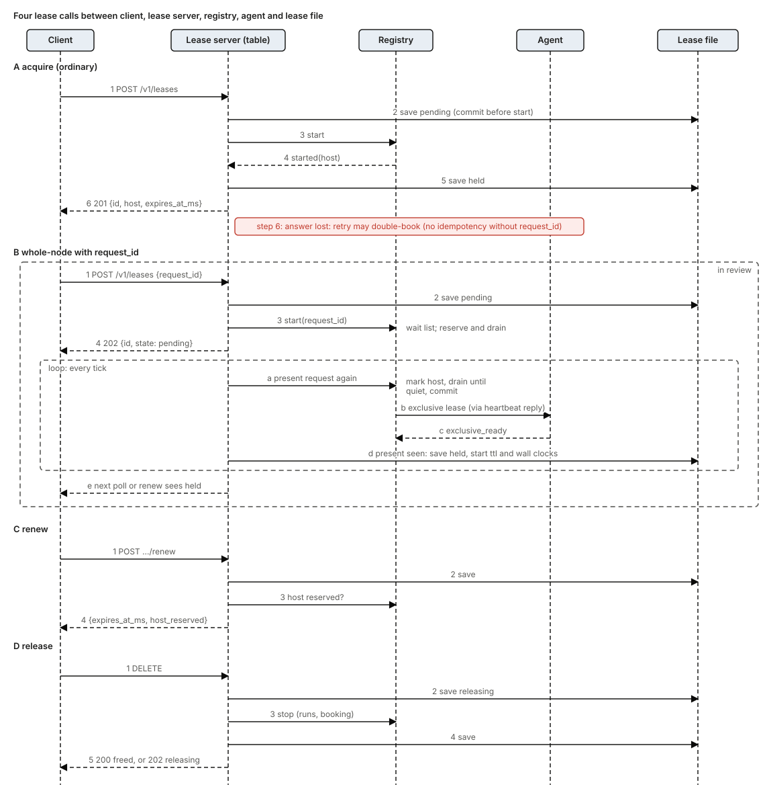
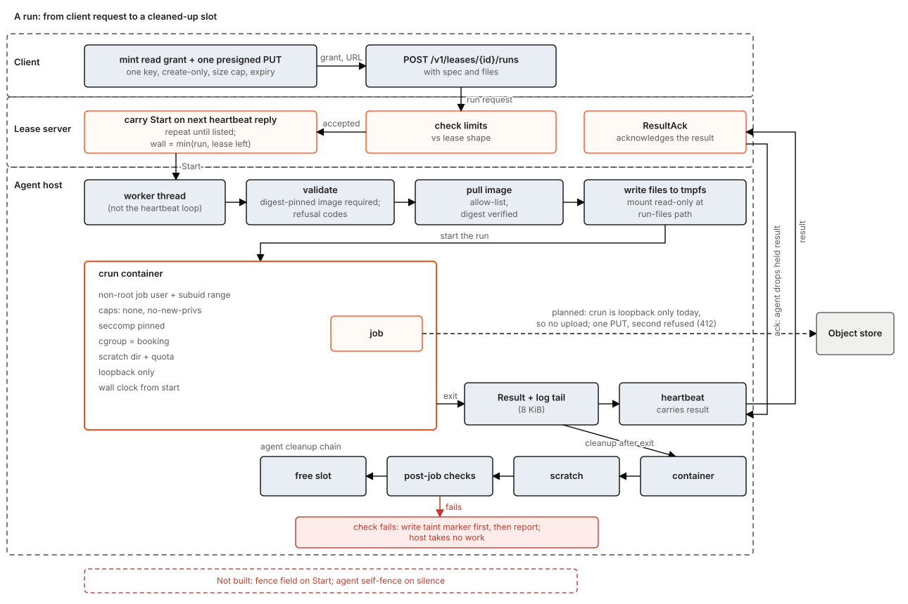
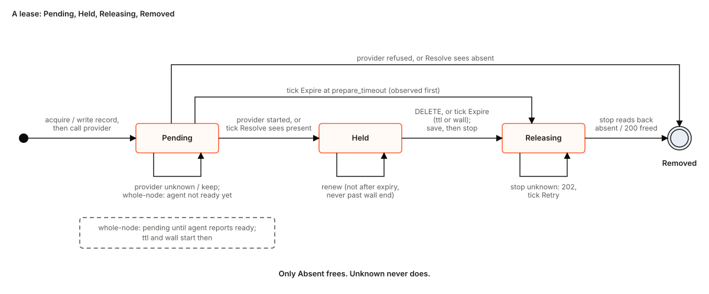

# jobscheduler: the design

This is the current design document for jobscheduler. It is the entry point: start here, then follow the links to the older documents that carry detail. It describes what the code does today, marks what is built and what is planned, and lists the races the code still loses (that list is the test list) and the gaps between today and "done".

Every statement about behaviour cites a file or crate. Paths are relative to the repository root; crate paths are under `crates/`. Where a design document and the code disagree, this document follows the code and says so.

Ten SVG diagrams in `docs/design/diagrams/` carry the pictures. Contents: 0 how to read this and the other documents; 1 problem; 2 goals and non-goals; 3 the design in one picture; 4 configurations; 5 how each operation works; 6 background work; 7 edge cases handled; 8 races the current code loses; 9 assumptions; 10 state; 11 limits; 12 future work and the gap list; 13 open questions; 14 glossary.

---

## 0. Status and the other documents

### 0.1 What is deployed today

The system that exists today is:

- One `js-lease-server` process, started with `--boot initialise` or `--boot resume`, holding all lease state in one file (section 10).
- Any number of `js-agent` processes on hosts, polling the server over HTTP/1.1 with JSON bodies (not a stream, not protobuf; `js-agent-wire/src/lib.rs`).
- Clients that call the lease API with one bearer token. The main client is kbf (public), which leases whole hosts and submits each action as a run through the run API.
- An optional elastic pool (a scaler plus a cloud provider) that launches and releases machines.
- A continuous release pipeline that builds, attests and publishes every change to shipped code, and an optional deploy step that sets desired versions on a farm update coordinator.

There are no Kubernetes manifests, Dockerfile or helm chart in the repository. Whatever supervises the server (a service unit, a coordinator-managed service) is outside this repository.

### 0.2 Built, in review, planned

- **Built** means the code is in the main branch and a test exercises it.
- **In review** means an open pull request. At the time of writing one matters here: a change that lets `POST /v1/leases` carry a `request_id` (section 5.3). It is described as "in review", never as built.
- **Planned** means only a design document or an issue says it. Every planned item is in section 12.

### 0.3 How the older documents relate to this one

This document supersedes nothing by deleting it. Nothing is removed. The table says which document is now the authority for what.

| Document | Status relative to this one |
|---|---|
| `docs/design.md` | **Superseded as the entry point.** Still the record of the decision list (D-numbers) and the long-form rationale. Parts are stale: its crate map lists `js-config` and `js-provider-aws` as new crates (neither exists in `crates/`) and says the SQLite and Postgres state backends stay in kbf (they exist here, under `js-state`); its protocol section describes a protobuf stream where the code is JSON polling; its Kubernetes target has no manifests; its claim that the agent holds no registry credential is false since private-registry pulls were added. Read it for why, not for what. |
| `docs/design/kbf-on-js-agent.md` | **Target for the kbf integration.** A draft. Nothing in it about upload grants, a task tool or an `--executor` flag is in this repository. Remains the reference for kbf's side. |
| `docs/design/pools-providers-network.md` | **Reference; partly built.** The config file, scaler, elastic contract and network layer it proposes now exist. Its first section ("there is no scaler") is stale. |
| `docs/design/whole-node.md` | **Reference; current in its contracts.** Authority for whole-node rules. This document summarises it (sections 5.4, 6.4). |
| `docs/design/placement.md`, `placement-by-load.md` | **Reference.** `placement.md` is current as a contract. `placement-by-load.md` names flags (`--placement sched`, `--placement lease-table`, `--placement-load`) that the lease server does not have. Load placement exists only in `js-sched` and in embedders (section 3.3). |
| `docs/design/hosts.md`, `registration.md` | **Reference.** `registration.md` is stale on a deny-list of hosts (not built) and on agent self-fencing (not built, section 8). |
| `docs/design/agent-privilege.md`, `agent-egress.md`, `mac-lease-teardown.md`, `invariants.md`, `absence.md`, `lease-limits.md`, `agent-suite.md`, `configuration.md`, `bench-analysis.md` | **Reference; current.** `agent-egress.md` is stale in saying the crun runtime cannot be selected (the `js-agent` rustdoc has the same sentence). |
| `docs/design/deployment.md`, `rollout.md` | **Design for a deployment that is not in the repository.** The flags `deployment.md` prescribes (`--term-floor`, `--verify-state`, a readiness endpoint, a generic `--boot-grace`) do not exist. |
| `docs/design/vm-backend.md`, `capabilities.md`, `sizing.md`, `retries-and-runs.md`, `ucdk.md`, `generalising.md`, `extraction-steps*.md`, `merged-code.md`, `risks-f.md`, `decisions.md`, `amendments.md`, `aws-iam.md`, `kbf-today.md` | **Design or history.** Mostly planned. `kbf-today.md` is stale on kbf's scheduler core flag. |
| `docs/release.md`, `docs/layering.md`, `docs/egress.md`, `docs/js-mdm.md`, `docs/runbooks/*` | **Current references** for release, layering, the Podman egress path, the MDM host layer, and operations. |
| Crate-level rustdoc of `js-lease-server`, `js-agent`, `js-sched`, `js-registry`, `js-lease`, `js-scaler`, `js-server-core`, `js-store` | **The most accurate source of detail**, with one known exception: the `js-agent` crate rustdoc (`js-agent/src/lib.rs`) still says the crun runtime cannot be selected, though `--runtime crun` exists. This document links to rustdoc rather than restating flags. |

---

## 1. Problem

A build farm, a benchmark rig and a CI system all need the same thing: run a piece of work on a machine that has enough free capacity, on its own, without leaving anything behind that changes the next piece of work. The hard parts are not the first run. They are:

1. **Who owns a host right now.** A client asks for a host, then stops answering. The host must come back, but not while the client is still using it, and not so late that the farm starves.
2. **Whole-host requests starve behind small ones.** A benchmark that needs a quiet machine never gets one if small work keeps arriving. Draining a host costs the remaining time of the work on it; that cost must be chosen, not accidental.
3. **A host is an unreliable thing.** It can go silent, reboot, be reimaged, or be compromised by the job it ran. The scheduler must say "unknown" when it does not know, and never free a host it cannot see.
4. **Jobs must be contained** and must be able to write exactly one thing, to exactly one place, once.
5. **Macs are different.** A Mac host has no container runtime that gives the isolation Linux has. Isolation is a throwaway user, a sandbox profile and a firewall rule, and tearing it down must be proven, not assumed.
6. **Machines cost money.** An elastic pool that launches machines needs hard caps and a brake, because the cost of a bug is measured in currency.

jobscheduler is the service that answers these. It is a lease server (who holds which host, until when), a placement engine (which host), an agent (run the job, contain it, report), an elastic scaler (more or fewer machines), and the release machinery that keeps all of it updated.

## 2. Goals and non-goals

### 2.1 Goals

- **G1. A lease is the only way to own a host.** A lease has a time-to-live that the holder renews and a wall-time ceiling that renewal cannot extend. It is recorded before anything is done for it (section 5.3).
- **G2. Never free what cannot be seen.** The provider answers present, absent or unknown. Only absent frees a booking. Silence reads as unknown.
- **G3. Whole-host requests finish.** A whole-node request reserves the host with the least estimated remaining time, drains it, and commits it when quiet. Smaller work may use the host meanwhile only if it will end inside the estimated tail (section 5.5).
- **G4. Contained jobs.** Digest-pinned images, empty capability sets, a dedicated unprivileged identity, scratch quotas, no network by default (section 5.7).
- **G5. Taint instead of trust.** A host whose post-job checks fail is marked tainted, permanently, and takes no further work.
- **G6. Macs run natively under a proven teardown.** A throwaway user per lease, a generated sandbox profile, a network rule, and a kill-and-delete that judges outcomes rather than exit codes (section 5.8).
- **G7. Bounded spend.** Every elastic pool has instance, hourly, daily and total caps, and a brake that trips to plan-only after repeated launch failures (section 6.5).
- **G8. Updatable without ceremony.** Every push to shipped code is released, attested and byte-identical on rebuild; agents update themselves through a hook that drains first (section 6.6).

### 2.2 Non-goals (today)

- Multi-tenant isolation. There is one client token and one trust domain (section 11).
- High availability of the lease server. It is one process and one writer.
- Durable runs. Runs live in the server's memory and in the agent's process (section 8).
- A VM backend. The helper crates exist; the runtime does not (section 12).
- Hosting a public listener. The service is meant to sit on a private network.
- Being a workflow engine. It places and contains work; retry policy and result storage belong to the client.

## 3. The design in one picture

The picture shows one lease server process with two listeners. Clients reach the client listener; agents reach the agent listener. The lease table, registry, placement engine, scaler and usage store are inside the process; the lease file and the other state files (section 10) are the only durable things. Providers launch machines that run agents. The object store is outside: only a job reaches it, through a URL the client minted.

### 3.1 The pieces

- **Lease server** (`js-lease-server`). The one service binary. It is an HTTP server with two listeners: a client listener (leases, runs, hosts, usage) and an agent listener (hello, heartbeat). `main.rs` is five lines; `lib.rs` is the program and its rustdoc lists every flag and route.
- **Lease table** (`js-lease`). The records of who holds what, in one file replaced whole on every change.
- **Registry** (`js-registry`). The server's knowledge of hosts: who said hello, who is live, what each is running, which are tainted or cordoned, and the whole-node reservation machinery. It is the default provider for leases.
- **Placement engine** (`js-sched` through the `sched/` adapter in the server, plus the registry's own host picker). Section 3.3 explains why there are two.
- **Scaler** (`js-scaler`, pure, and its shell in the server). Launches and releases machines through an elastic provider.
- **Providers**. `static` (a fixed list of hosts), `joined` (hand-started agents, no provider), `lambdalabs` (a cloud). The elastic contract is `js-elastic`.
- **Agent** (`js-agent`). One per host. Registers, heartbeats, runs jobs through a runtime, reports results.
- **Runtimes**. `crun` (rootless, Linux), Docker or Podman (Linux), native (macOS, through `js-mac-session`).
- **Usage store** (`js-usage`, SQLite, running over `js-state`; this is the one place the server uses `js-state`). Per-minute node and lease usage and learned cost curves. Feeds the estimate that tail placement needs.
- **Object store.** Not part of jobscheduler. A job writes its output to one presigned URL minted by the client; jobscheduler carries the URL into the job and nothing more (section 5.7).
- **Clients.** The `js` CLI, `js-client` (a library), and kbf.

### 3.2 Layers

`layers.toml`, checked by `cargo test -p xtask --test layering`, assigns each crate to `types`, `pure`, `runtime`, `server` or `app`. A crate may depend on its own layer or lower. Pure crates may not use clock, sleep, hash maps with random order, or sockets (a clippy configuration denies them). This is why the scheduler core, the scaler step and the whole-node cost rules are testable as functions.

### 3.3 Why placement lives in three places

This is the part most likely to surprise a reader.

1. **The registry** (`js-registry/src/registry/start.rs`, `whole/reserve.rs`, `whole/queue.rs`) holds the live whole-node reservation and, by default, picks the first free host by id.
2. **`SchedPlacer`** (`js-lease-server/src/sched/place.rs`) is a `js-sched` scheduler built fresh for every start. It is used only with `--placement js-sched`. It picks among the hosts the registry already found bookable; the registry still checks room and books. It is what enables `share_class` leases (several leases on one host) and backfill into a reserved host's tail. It is not given load readings and has no CPU slack setting; under the lease server, placement is booking-based.
3. **`js-server-core`** (`js-server-core/src/engine.rs`) is a long-lived, stateful `js-sched` scheduler with load-based placement, a memory percent, and cost curves. kbf embeds it. The lease server does not use it.

The seam between 1 and 2 is the `Placer` trait (`js-registry/src/placer.rs`): `pick(spec, open, marked)` returns an index. The trait exists because `js-registry` is in the runtime layer and the server is above it, so the registry cannot name the placer. A registry with no placer books the first candidate.

The planned direction (section 12.1) is that `js-sched` becomes the one placement engine for the lease server, with the registry keeping host facts and the reservation ledger.

## 4. Configurations

### 4.1 Lease server

Two modes, never both: flags, or one `--config` TOML file (`[server]` plus `[[pool]]` tables). Any flag beside `--config` is refused with exit 2. The file holds paths to secrets, never secrets. Unknown fields are refused. Nothing is checked over the network at start.

Server settings that matter for design:

| Setting | Default | Meaning |
|---|---|---|
| `boot` | required | `initialise` creates the lease file; `resume` refuses a missing one. |
| listen | loopback | A non-loopback address requires TLS; certificates reload on SIGHUP. |
| agent listen | none | A separate port, required with an elastic pool. |
| tick | 5 s | The one place time acts (section 6.1). |
| default / max ttl | 600 s / 3600 s | Lease time-to-live. |
| `max_lease_wall` | none | Ceiling on a lease's wall time; required for pools with accelerators. Config file only. |
| `placement` | `registry` | `registry` or `js-sched` (section 3.3). |
| `estimate_feed` | off | Use learned P90 wall times as lease end estimates (section 5.5). |
| `require_host_credential` | off | Refuse a first hello that does not ask for a host credential (`CredentialRequired`). It does not decide whether a credential is issued: an agent that asks, presenting a fresh one-time token, is issued one regardless (section 5.1). |
| usage | on | `--usage-off` opts out. |

### 4.2 Pools

At most one elastic pool and one static pool per server, plus `joined` pools. Provider kinds compiled in: `static`, `lambdalabs`. Each pool has `memory_schedulable_percent` (1 to 100, default 100): the share of a host's memory the scheduler may book. An agent's claim never raises it.

Elastic pool keys: `max_instances`, `max_spend_per_hour`, `max_spend_per_day`, `idle`, `max_age`, `min_host_lifetime`, `boot_timeout`, `launch = plan | live` (default plan), `live_until`, boot-failure brake keys, the pinned agent build (URL and checksum per architecture), and `network = default | tailscale`.

### 4.3 Agent

Flags only; no environment variables (`js-agent/src/lib.rs` flag table). Required: server address, pool, and a token file or a stored host credential. The choices that change behaviour: `--runtime docker|crun`, `--drain-wait` (default the stop grace, at most 3600 s), `--scratch-quota`, `--image-allow` prefixes, `--egress`, and the `--native-*` flags on macOS. Four modes: the agent, `image-pull`, `update-hook`, `cordon`.

The start check refuses to start rather than run half-configured. With `--runtime crun` it refuses container-engine flags, `--egress` other than `none`, mount roots, and native flags. `--allow-host-jobs` is refused in every configuration.

### 4.4 Network

One service-level layer with `default` and `tailscale` modes. A provider receives only an opaque boot payload. In tailscale mode the service mints an auth key per launch and deletes only a device whose hostname is the launched host's and whose tags include the configured tag. The service has no public listener by design, but the code enforces only that a non-loopback listener has TLS, and that status pages are served only to private peers. The wildcard bind address counts as private. Keeping the API off the public internet is operator posture today (section 13).

## 5. How each operation works

### 5.1 Enrolment and registration of a host

Enrolment today is manual: install the package, run the packaged host setup script, mint a one-time join token (`POST /v1/agent/join-tokens`), and place the token file. A command that does this in one step is planned, in the host-management project rather than here.

1. Agent: `POST /v1/agent/hello` with host id, pool, labels, shape, capabilities, and an optional instance id (`provider:instance`). The default host id is derived from a salted hash of the machine id.
2. Server (`Registry::hello`, `js-registry/src/registry.rs`): in order, valid host id; protocol negotiated; pool exists; host not on the reserved list; credential binding (host id bound to another credential or instance is refused); no live session already (409 `host-live`); the host's execution contract (`HostContract::check`); shape at least the pool floor; room in the pool; then epoch plus one, a fresh session secret, and a record.
3. Welcome carries epoch, heartbeat interval (default 5 s), grace (default 15 s), session secret, and a 256-bit host credential when the hello said the agent keeps one (`accepts_host_credential`) and the token was a fresh one-time token, whatever `require_host_credential` says (`js-lease-server/src/agent_api.rs`, `agents.rs`). The agent writes the credential to the state root (temp file, rename, mode 0600) before using it. The token is retired in the same step that binds the host. The server writes the bindings file after the hello, but the result of that write is not checked and the Welcome is sent either way (section 8, row 36).
4. Agent: heartbeat every interval, carrying epoch, session secret, held runs, unacknowledged results, taint, and load. Reply: commands (start, stop, cancel), result acknowledgements, taint acknowledgement.

The agent's reaction to answers (`session.rs`): 409 `stale-epoch`, `unknown-host`, `host-lost`, or 403 `session-mismatch` means say hello again at once, but only if the last heartbeat was accepted (no hello loop). `pool-full`, `host-live`, 408, 429, 5xx and network errors back off (1 s base, 60 s cap, jittered, honouring `Retry-After`). Every other client error is fatal: the agent exits with status 2 and registers nothing.

Hello is rate limited per join token (burst 60, then one per second). A host id is bound to its first credential and instance, so a join-token holder cannot take a booked host's id after a restart (`.agents` file, section 10).

### 5.2 Elastic launch and join

The order matters: records, then token, then machine. A crash at any point leaves either nothing launched or a launched machine the records already name.

1. The scaler decides to launch (section 6.5). Before any provider call it writes its records file.
2. The service mints a one-time join token (only a digest is kept; a scaler launch gives it `boot_timeout` plus a margin, 20 minutes by default, while a hand-minted token defaults to 30 minutes) and puts it in the boot payload with the pinned agent build and the network step.
3. The provider launches. The instance boots the agent, which says hello with the token and its instance id.
4. If the welcome is lost after the token is retired, the host holds nothing valid; its next hello returns 401, the agent exits, and the host sits until the scaler releases it at `boot_timeout`. It does not register twice. A launch retried after a crash is the same instance (same acquire id, same derived host name) but is handed a fresh token by its caller; whether the first token stays valid for it is not checked here (section 8, row 37).
5. On release the service deletes the instance's join tokens.

### 5.3 Acquire, renew, release

**Acquire** (`POST /v1/leases`, `js-lease/src/table.rs`, `js-lease-server/src/api.rs`):

1. Parse the body: class, resources, labels, `max_wall_seconds`, optional `probe_host`, `disk_bytes`, capabilities needed.
2. Take the one mutex around the lease table. Lock order is fixed: table first, registry second.
3. Grant a ttl (default and max clamp; zero refused), check wall time against `max_lease_wall`, allocate the next id `(term, sequence)`, check the class.
4. **Commit before start.** Insert a pending record and save the file. Only then call the provider. A failed save answers 500 `state-write-failed` and the provider was not called.
5. The provider (static pool first, then registered hosts) answers started, refused, or unknown. Started becomes held and the clock starts; unknown stays pending; refused deletes the record.
6. Save again (`acquire-settled`). The result of this second save is ignored (section 8, row 2). A pending record whose booking the registry never made is dropped at the next tick only because the registry answers `Absent` for a booking it does not know.
7. Answer 201 `{id, host, expires_at_ms}`, or 202 `{id, state: pending}`, or an error. Error codes: 409 `no-capacity`, `no-fit`, `unsupported-class`, `no-capable-host`, `exclusive-not-ready`, `lease-ended`; 409 `probe-unsupported` and the `probe-host-*` refusals for a `probe_host` request; 400 for an invalid `disk_bytes`; 422 `wall-time-not-positive`, `wall-time-above-ceiling`, `reserved-label`, `invalid-label`, `unknown-class`, `below-class-minimum`.

A held lease expires at the earlier of now plus ttl and its wall-time end. A whole-node lease is always answered 202: it is held only when the host's agent reports it ready, and its ttl and wall clock start then. If the agent does not report ready within `prepare_timeout` (600 s), the lease ends and the host is excluded or tainted according to the cause.

**Acquire is not idempotent on the main branch.** A client that loses the 201 must list `GET /v1/leases` and match by label before retrying; otherwise it may take a second host that lapses only at its ttl.

**In review: `request_id`.** A pull request adds an optional `request_id` (1 to 63 bytes of letters, digits, dot, underscore, dash) to the acquire body. Same id and same request (class, resources, capabilities, wall time, labels, validation run, probe host; not ttl) is answered from the lease it made: 201 while held, 202 while pending, 409 `lease-ended` while releasing. Same id with a different request is 409 `request-id-conflict`. A whole-node request with an id is queued: the registry reserves a host, drains it, commits it when quiet, and the server re-presents the waiting request on every tick so the client need not poll. Release of the pending lease cancels the request in the same file replace. Without an id the behaviour is byte-identical to today. This section describes the change as proposed; until it merges, a whole-node request that finds no quiet host is answered 409 `no-capacity`, nothing is queued, reserved or drained from HTTP, and the reservation machinery of section 5.5 is exercised by tests and by embedders only.

**Renew** (`POST /v1/leases/{id}/renew`): granted ttl; only a held, unexpired lease (an expired lease is not revived); the new expiry is the earlier of now plus ttl and the wall-time end, and never earlier than the current one. The answer carries `host_reserved` when a whole-node request is waiting on the lease's host: the holder is asked to place no more work and release. Renewal is not refused for it. Drain never kills. Renew does not consult the registry: it says nothing of a host that is lost, tainted or has lost its booking (section 6.3).

**Release** (`DELETE /v1/leases/{id}`): mark releasing and save; ask the provider to stop (stop the runs, free the booking, move the host to restoring); save; answer 200 freed, or 202 releasing when the provider has not yet confirmed absence. Only a stop that reads back absent frees the lease. Releasing an already releasing lease stops it again.

**Expiry** is not a request. It is a step of the tick (section 6.1).

**After a failed save.** Each handler changes memory first and saves after, so a save error does not undo the change (section 8, row 28). Renew: the expiry is extended in memory, the client gets 500, and the extension is lost on restart. Release: the lease is already releasing and the tick will stop it, though the client got an error. Acquire: the id is consumed and the pending record stays in memory. The rule today: a client that gets a 500 from renew or release should treat the operation as possibly done and read `GET /v1/leases`; it must not assume it still holds a lease it asked to release.

### 5.4 Whole-node request, as built in the registry

This is the registry's behaviour (`js-registry/src/registry/start.rs`, `whole/`), reached through HTTP only once `request_id` lands.

Gate order in `Registry::start`: a lease already pending-ready answers unknown; whole plus probe is unsupported; a request id held by another lease is `no-capacity`; a request that used its tries is `exclusive-not-ready`; then queueing, only if the class is whole, the request is fresh, it fits the pool and the gate passes, and a request id is present.

The wait list (`whole/queue.rs`) holds at most 1024 requests. An entry not presented within `regain_grace` (15 s) is dropped; a presentation is how the list knows the client is alive. **Queue order is advisory**: nothing makes placement follow it, so a later request or one not yet listed can take a host that freed before the front request presents itself again.

The reservation pass (`whole/reserve.rs`) runs each tick and on each start:

1. Drop marks on hosts that became tainted or unknown; drop marks over the pool's ceiling, newest first (held leases are never touched).
2. For each waiting request in order: if a quiet host exists, assign it (no drain, not counted against the draining cap). Else, after the request has waited `drain_after` (default 0), choose among capable, unheld, unmarked, not-excluded hosts the one with the cheapest drain (section 5.5) and mark it with a deadline and the tail it was chosen on.
3. A marked host accepts no other start, except backfill (section 5.5). An unmarked host refuses a whole request that has an id: only the marked host can commit it, which is why the pass must run first.
4. At the deadline, if not capped, give up: the host is excluded for this request for `reserve_backoff` (300 s) and the mark drops. After `max_reserve_attempts` (2) give-ups the deadline becomes the lease's wall and cannot be given up.
5. When the marked host is quiet, the request's next presentation commits: the host becomes `Committed`, the start answers unknown, the lease stays pending (202).

Host states for a whole lease (`whole/exclusive.rs`, memory only): `Free`, `Committed` (lease reads unknown), `Ready` (the agent reported ready for exactly that lease; reads present), `Restoring` (needs a second heartbeat after the stop). A hello turns `Ready` into `Committed` with the commit time reset to the hello time (`after_hello`, deliberate, explained in `exclusive.rs`); only a host that was already `Committed` keeps its time. So a host that goes `Ready`, says hello, reports ready again and repeats gets a fresh `prepare_timeout` each time: a flapping agent can postpone the prepare deadline, and a whole-node lease that was held with runs goes back to waiting for ready for up to 600 s after an agent restart. On timeout it ends as a failed prepare (section 6.2). `Restoring` needs a second heartbeat after the stop; the count assumes one agent has one heartbeat in flight at a time, and the code counts a duplicate or retried heartbeat too (section 8, row 35).

### 5.5 Tail placement

The idea: a whole-node request should wait for the shortest time, and the time the reserved host spends draining should not be wasted.

**The tail of a host** (`js-whole/src/cost.rs`) is the latest end among the leases on it. A lease's end is its learned estimate (start plus P90 wall minutes), cut to its max-wall bound; else the bound; else unknown. A host with no leases has tail zero. A host with any lease that has neither estimate nor bound has an unknown tail.

**Drain cost** orders candidates by: known tail before unknown, then smaller wait, then fewer leases, then lower host id. "Reserve the host with the least estimated remaining time." A caller takes the tail once, when it sets the mark, and keeps it.

**Backfill** is allowed only for a lease of the pool's share class, never a probe, and only when `now + duration + margin <= tail_end` (`fits_in_tail`). The margin is 60 s. It fails closed: unknown duration, unknown tail, or overflow means no. A lease's duration is its P90 cut to max wall, else max wall; a wall above the server ceiling is treated as unbounded and never backfills. A host with an unknown or already passed tail takes none. The registry offers marked hosts to a start only for backfill, and `SchedPlacer` calls `reserve_outside(worker, time_left)` for each marked host and sets the start's max wall; a start placed elsewhere or nowhere never falls back to a marked host.

**Estimate feed** (`--estimate-feed`, `js-registry/src/lives.rs`): off by default. A lease has no profile key of its own, a run does; the estimated end is the lease's start plus the largest P90 among the keys of the runs queued on it. With the feed off, tail ordering falls back to the max-wall bounds. Tail counters (started on a marked host, backfilled, estimate error buckets) are kept in memory only.

### 5.6 Placement of an ordinary lease

Default `registry`: first free host by id, one lease per host. A class that books part of a host is refused with `unsupported-class`. With `js-sched`: `SchedPlacer` receives every qualifying host and picks one (section 3.3), except for a whole-host lease, which is not scored and takes the first free host by id as under `registry` (`sched/place.rs`). Held leases are fed to the scheduler as recovered operations; every host is a worker that came up at time zero. If the scheduler cannot be built or places nowhere though the registry found room, the first unmarked host is booked and a counter is incremented, so a lease does not retry forever; a probe never falls back. Cost: the scheduler is rebuilt for every start, under both locks. It is linear in hosts plus leases, and unmeasured beyond tens of hosts.

### 5.7 A job's execution, containment and write fencing

**Run delivery** (interim run API, `js-lease-server/src/run_api.rs`, `js-registry/src/runs.rs`):

1. Client: `POST /v1/leases/{id}/runs` with a job spec. The server sums limits against the lease's shape (over means `no-capacity`, not queued).
2. The run is carried to the host on its next heartbeat reply as `Start`, repeated on every reply until the host lists it. The wall limit is recomputed from the time left in the lease at each send, so renewal cannot stretch a queued run.
3. `DELETE .../runs/{run_id}` records a stop intent, resent on every reply until the host stops listing the run.
4. A host-listed run with no server record is answered `Cancel` and never adopted.
5. The result rides the next heartbeat and is acknowledged (`accepted`, `duplicate`, `stale`, `unknown_lease`, `mismatch`). The agent holds a result until acknowledged.

Limits: 256 live runs and 256 finished runs kept per host; the log tail is the last 8 KiB of stdout and stderr. Runs are in server memory only.

6. After the lease ends (release or expiry) its runs are swept and `ack` answers `stale`: a client that reads a result after releasing gets nothing. Read results before releasing (section 8, row 33).
7. A run the server listed as `Queued` goes `NeverStarted` after a hello gap (`Runs::sync`, `next_life`). That is the server's observation: no heartbeat ever listed the run. It does not prove the job never executed. A delivered `Start` can run before any heartbeat lists it; if the crun agent then restarts, its new runtime lists nothing, and the still-`Queued`, unlisted run is classified `NeverStarted` after the gap. Whether it ran stays uncertain across that window (section 8, row 4). A run the agent lost (for example after a crun agent restart) is `Ended` with no result; `result` absent is the only thing that separates it from an exit.

**Agent side** (`js-agent/src/lifecycle/mod.rs`): the heartbeat loop never calls the runtime. A worker thread owns the lifecycle; replies are handed over without waiting and dropped when its queue is full (the server resends). A start is idempotent on run id; the agent remembers retired ids in memory, at most `RETIRED_CAP` (4096, equal to `MAX_HELD`); when full, the oldest id is forgotten and a start for it would run again, and the list is empty after an agent restart (section 8, row 34); a start later than its `valid_for_ms` is dropped. Refusals create nothing and return `failed_to_start` with a code (for example `host-tainted`, `limits-exceed-shape`, `gpu-unsupported`, `egress-unchecked`, `invalid-mount`, `host-jobs-not-allowed`).

**Containment with the crun runtime** (`js-agent/src/crun/`, `js-contain`):

- The agent stays root; every container is started by `crun` as a dedicated non-root job user, whose subordinate id range maps the job's namespace.
- The image must be pinned by digest and come from an allowed prefix; the agent pulls it with its own registry client and verifies digests. Private registry credentials, if configured, go only to the token realm the registry names, over https.
- Capability sets all empty, no new privileges, a pinned seccomp profile, masked and read-only paths, a private cgroup namespace, core dumps off.
- A per-lease cgroup with the booking as limit; out-of-memory is reported only if the lease cgroup says so.
- A per-run scratch directory owned by the job identity, with an optional filesystem project quota.
- Loopback only: no network, no GPUs. The allow-list egress module exists but is refused at start (`--egress` other than `none` is refused with `--runtime crun`), so a crun job cannot reach an object store today; the upload below is the planned shape for a runtime with configured egress (section 13, question 9). (The Podman path has its own shipped nftables allow-list, re-verified before every container create.)
- The wall limit runs on the agent's monotonic clock from container start. It is computed from the time left in the lease when the reply is sent (`valid_for_ms`) and counted from when the reply reaches the agent, so a run can outlast the lease end by transit time, queueing delay and the stop grace. Stop is SIGTERM, a grace period, then a cgroup kill.

**Write fencing.** jobscheduler does not mint or check object-store credentials. The fence is a capability the client builds and the agent carries:

1. The client (kbf) mints a read grant and one presigned create-only upload URL for exactly one key, with a size cap and an expiry equal to the action timeout plus a margin. The object store refuses a second write to the key.
2. The URLs travel as `files` in the job spec. A server sends `files` only to a host that advertised the `run-files` capability.
3. The agent writes the files to a memory-backed directory (it refuses to start if the root is not tmpfs) and mounts it read-only into the job. File contents are secret: debug output prints names and lengths only.
4. The agent returns the container's exit code. The client verifies what was stored under the key before adopting it.

What this guarantees, provided the client's grant is built as described and the object store enforces it (jobscheduler checks neither): a job can write one object, once, and cannot delete or overwrite. A crun job cannot make the upload at all until egress is wired (see Containment above); the Podman path with its allow-list can. What it does not: the agent has no `fence` field on a start; a job whose lease ended keeps running until its wall limit (section 8).

**Taint.** After a job, the agent runs checks: container and scratch removed, watch directories unchanged, no leftover process. Any failure writes a taint marker under the state root before it is reported. The marker is permanent; nothing in the code clears it. A tainted host takes no start, no run, no lease. Reimage is the only clear.

### 5.8 Mac execution path

A Mac agent uses `NativeRuntime` (`js-agent/src/native/`) with a root helper, `js-mac-session`.

1. Write the lease journal entry (synced) **before** creating anything.
2. Helper `user-create`: a throwaway user named from the lease, with a uid from a configured range; names are never reused (a ledger).
3. The agent creates the run directory (exec and tmp) as root and chowns it.
4. Helper `run`: executes the job under a generated `sandbox-exec` profile as that user, with file-size and process-count limits set in the child. The profile is generated from a typed policy: default allow, deny writes and network, grant back narrowly, private floor emitted last. The only supported read model is `open`.
5. Network: `--native-network off | loopback | on`. `on` requires a packet-filter anchor keyed on the pool's uid range (`js-mac-provision`), checked at start and before each job that asks for network (refusal code `egress-unchecked`). The sandbox cannot deny hosts when network is on, which is why the filter exists.
6. Every process the helper or agent starts for a job goes through one spawner that disclaims the parent's privacy-grant responsibility, so a permission granted to the daemon is not inherited by jobs. This is in review; a source scan test (`spawn_sites`) rejects other spawn sites once it lands.
7. Teardown: `kill-uid` repeats up to 10 rounds, killing every process of the uid and booting out its launchd domains; the verdict is the outcome (no process, no domain printing), never an exit code. Then `user-delete` removes the user, its home and its per-user temp entry. Then the journal entry is marked done.
8. If a step fails, the uid stays quarantined in the helper's ledger and the lease stays in the journal; the next worker start reclaims.

Evidence: an isolation test (`js-agent/tests/native_isolation/`) plants one item of each kind of leftover (files, processes, keychain, defaults, launchd agents, shared memory and semaphores), removes the run, starts a second run on the same uid and looks for the items. It prints one of four verdicts. It runs on a Mac only, on manual dispatch.

A bundle store (`--bundle-store`, `js-agent/src/native/bundle.rs`) already gives native jobs pinned toolchain trees. Not done: staging inputs and collecting outputs for a native run (a start with `files` is refused `native-unsupported`, `native/mod.rs`), adopting a run after an agent restart, soft stop (the helper only kills), and the reuse pool of fixed users. Native runs are not stopped when the agent stops; the wall limit runs only while an agent runs.

## 6. Background work

### 6.1 The tick

`js-lease-server/src/server.rs` runs one loop every `tick` (default 5 s, missed ticks delayed, not bursted):

1. Hand the registry's reservation ledger to the table if it changed.
2. `table.tick()`: for each lease, one of idle, expire, retry, resolve. Expire marks releasing and stops. Retry stops again, and observes if the stop did not free the lease (`table.rs`). Resolve observes a pending lease (present becomes held, absent drops, unknown keeps). A whole lease at its prepare deadline is observed first so the provider can count a failed prepare; only if still unknown does the next tick expire it. One atomic file write covers the leases and the ledger.
3. `registry.advance()` outside the table lock (so a renew between steps 2 and 3 reads `host_reserved` from before the advance): heartbeats lost, hosts forgotten after `lost_retention`, reservation passes, prepare deadlines.
4. Usage flush every five minutes; token files re-read.
5. Offer the tick to the scaler over a bounded channel of one. If the scaler is still busy, the tick is finished without it; its demand is handled a tick later.

Every save in step 2 is synchronous file I/O (write, fsync, rename, directory sync) inside the table's async mutex with no `spawn_blocking`, so a slow disk stalls the heartbeat handlers too (section 8, row 31).

A panic in the table loop or the scaler task flips an alive flag and `/healthz` returns 503. Supervision and restart are outside the repository.

### 6.2 The lease lifecycle

States: `Pending` (recorded, provider not yet confirmed), `Held`, `Releasing`, and removal. A refused start deletes the record. A freed lease is deleted; **the server keeps no lease history** (section 10).

The picture shows the tick transitions. One thing it cannot show: the tick observes only `Pending` and `Releasing` leases. A `Held` lease is not observed before its ttl runs out, so if the registry ends a held whole-node lease underneath it (a failed prepare, `Registry::advance_at` calling `Ending::fail`, which stops the booking and frees the host), the table keeps the lease as `Held` and renewable, the registry may book the host to another lease, and the first `queue_run` on it returns `NotHeld`. The client learns only then. Which of drop, keep or observe-each-tick is intended is undecided (section 8, row 26). The table's ordinary drop-on-`Absent` path applies to `Pending` leases only.

### 6.3 Presence and loss

A registered host that misses the grace (15 s) is lost: it takes no new lease, but any lease it holds stays booked and reads unknown, never absent, until it is heard or the ttl runs out. "Until the ttl runs out" is true only for a client that stops renewing: renew never consults the registry, so a client that keeps renewing keeps the lease until its wall time end while the host is lost. A tainted host takes no further start, but a lease it already holds is untouched until it ends (`js-registry`). The only signal a client gets is `host_reserved` on renew, which covers reservation only (section 8, row 29). A lost host with no booking is forgotten after `lost_retention`. Tainted and cordoned hosts are not forgotten for being silent.

### 6.4 Whole-node draining

Section 5.4 describes the pass. The cap settings (`js-whole/src/config.rs`): `max_whole_node`, `keep_for_ordinary`, `max_draining` (1), `drain_after` (0), drain deadline (default: the request's max wall), `reserve_backoff` (300 s), `max_reserve_attempts` (2), `prepare_timeout` (600 s), `max_replace` (3), `regain_grace` (15 s). There is no per-consumer cap in the single-token service.

On the agent, the whole-node prepare is: the reply names an `exclusive` lease; the agent goes `preparing`, starts nothing for other leases, reports `exclusive_ready` when no run is held, post-job checks are clean and the host is untainted (or `exclusive_refused` with `host-unsafe` or `not-quiet`); at the end it goes `restoring`, rechecks, and returns to `serving`.

### 6.5 The scaler

`js-scaler` is a pure function `step(state, input, now) -> (state, actions)`. The shell in the server snapshots the registry and the provider's list, calls it, and performs actions in order. `Save` comes first whenever the step changed the records or the hold-save timer is due (`js-scaler/src/scale.rs`): all records are written whole to the `.scaler` file before any provider call.

A step: reset brakes, end go if the pool is plan-only, reconcile, cover waiting demand (a reservation, a free host, or a booting machine), undrain, drop unwanted, then launch up to a per-step limit to the cheapest priced offer that fits, if `launch = live` and every cap holds (instances, hourly, daily and total spend, boot-failure cooldown). Idle hosts drain and then release.

Failure brake: the cooldown after a failed boot is 10 minutes and doubles up to a ceiling of two hours; three failures in a row trip the pool to plan-only. The trip survives restart and is cleared only by `POST /v1/pools/{pool}/brake/reset`. Spend caps only block launches; they never release a machine, so overrun is bounded only if the pool also sets `max_age` and the server sets `max_lease_wall`.

The first live launch with a real cloud account is a runbook (`docs/runbooks/first-live-launch.md`) with an explicit go step. This document does not claim a live launch has happened.

### 6.6 Release and update

**Release** (`docs/release.md`, `.github/workflows/release.yml`): every push to main that changes shipped code is the next patch version once every `ci` job except the Mac one passes. Jobs, by their names in the workflow: `ci-passed` (waits for ci, polling), `plan` (version; refuses a commit with a later tag past it), `build` (static Linux x86_64 and macOS arm64 archives), `sums`, `attest`, `verify`, `publish` (draft, upload, ancestor check, publish creating the tag last), `deploy-tool`, `gamma` (the deploy step). The shipped set is computed from the dependency graph of the shipped binaries, not listed. Archives are byte-identical on rebuild (sorted names, commit time as mtime, zero owner, no gzip name). Docs-only pushes end at plan, green.

Shipped: Linux: `js-lease-server`, `js`, `js-agent`, `js-bundle`, `js-mdm`; macOS arm64: `js`, `js-agent`, `js-bundle`, `js-mac-session`, `js-mac-provision`. Not shipped: a Linux arm64 archive. Darwin binaries are not signed or notarized.

**Deploy step** (the `gamma` job): sets the desired version of the server service, then the agent service, on the farm update coordinator, and polls convergence every 30 s. It passes when converged with no lost hosts; it fails on a blocked host, lost hosts, 20 minutes with no change, 60 minutes total, an authorization error, or another writer replacing the desired version. It is off unless a repository variable names the coordinator.

**Host-driven agent update.** The agent update is a hook, `js-agent update-hook prepare | cutover | verify | rollback | cleanup`, declared in a root-owned file (`packaging/js-agent/updater.d/js-agent.toml`): prepare cordons the host through the server and waits for no runs; cutover moves the release link and restarts the unit; verify waits for the new agent's hello; rollback restores. Exit codes: 0 done, 1 failed, 75 deferred, 76 halt. The declared timeouts (prepare about 65 minutes, cutover 72, verify about 10, rollback 137) are above the agent's drain cap. The generic updater and coordinator live in another project.

There is no update hook for the lease server. Its update path is open (section 13). An update of the server drops all runs.

**Trust decision.** The declaration names this repository's release workflow as the signer, so whoever can push to main can ship code that runs as root on every host. The repository had no ruleset at the time of writing. Section 13 lists this as a decision.

### 6.7 Restart recovery

1. Take the exclusive `flock` on `<file>.lock`.
2. Read the lease file. Refuse it if the count of leases differs from the stored count, an id is duplicated, or a row is bad.
3. Take the next term. Ids are `(term, sequence)` and sequence only grows, so ids never repeat across boots.
4. Restore the reservation ledger: held deadlines are raised to at least boot plus 120 s (never stored plus grace, so restart loops do not stretch a drain); marks are stamped `claim_by = boot + regain_grace`; wait-list entries return without their request body and wait to be presented again.
5. Observe each held lease once: present stays, absent drops, unknown keeps.
6. Seat each lease's host as `awaiting`: unobservable, unbookable, counts toward the pool size, until the agent says hello again. The `.agents` file restores bindings and taints.
7. Agents get 409 `unknown-host` on their next heartbeat and say hello. Whole-node bookings must report ready again.
8. Lease expiry has no boot grace. Expiry is an absolute wall-clock time in the file, so the first tick after boot expires every lease whose time passed during the outage and stops it; its runs are cancelled when the agents say hello. A server outage longer than the ttl therefore drops every lease whose client could not renew. Only the reservation deadline has a boot grace (120 s). A lease that was valid at the crash but whose host never says hello stays booked as `awaiting` until its ttl (section 8, row 30).
9. Runs are gone. A host that lists one is answered `Cancel`; a client asking gets 410 `run-forgotten`.

Marks on hosts that never say hello are dropped after `claim_by`.

## 7. Edge cases handled

| Case | What the code does | Where |
|---|---|---|
| Crash between pending write and provider start | Pending record is on disk; next boot or tick resolves it by observation; no booking nobody knows about. | `js-lease` |
| Provider says unknown | Start stays pending; stop stays releasing; only absent frees. | `table.rs`, `book.rs` |
| Lease file write fails on acquire | Provider not called; the record stays in memory and is dropped at a later tick because the registry reads `Absent` for a booking it never made. | `table.rs` |
| Lease file replace fails | Write temp, sync, rename, sync directory. A failure before the rename leaves the old file. A failure after it (opening or syncing the directory) returns an error with the new file already in place and its crash durability uncertain. Restart refuses a short file. | `store.rs` |
| Renewal not saved | In-memory expiry only; the tick retries the save while unsaved. | `table.rs` |
| Whole-node ready report races the prepare deadline | Registry is asked first; expire only if still no answer a tick later; host restored. | `book.rs` |
| Flapping agent during whole-node commit | A hello keeps the commit time of a `Committed` host. For a `Ready` host the time is reset to the hello time, so the deadline can be postponed (section 8, row 27). | `exclusive.rs` |
| Scaler double launch | Records written whole before the provider call; acquire ids idempotent; panic flips health. | `scaler/` |
| Hello flood | Per-token bucket; session secret digest on every heartbeat; host id bound to credential and instance. | `registry.rs` |
| Taint | Written before reported; acknowledged only after the server wrote it; permanent. | `lifecycle/mod.rs`, `agent_state.rs` |
| Connection abuse | 256 connections max, permit before accept, handshake, header, read and write timeouts, max requests per connection, 64 KiB head and body caps, 10 s drain. | `lease-server` |
| Result lost | The agent holds results until acknowledged and resends. | `lifecycle/mod.rs` |
| Duplicate start | Idempotent on run id; retired ids do not run again while remembered (the newest `RETIRED_CAP`, 4096; in memory, lost on agent restart; section 8, row 34). | `lifecycle/mod.rs` |
| Welcome lost after token retired | Host holds nothing valid; hello 401; agent exits; scaler releases at boot timeout. | `agent_api.rs` |
| Stop of an unknown run | Its id is retired, so a later start does not run while the id is remembered (same bound as above). | `lifecycle/mod.rs` |
| Mac teardown fails | Uid quarantined; lease stays in journal; reclaim at next start. | `native/mod.rs` |
| Image garbage collection under a lease | A pin keeps a leased image from removal until the lease is removed. | `js-contain` |

## 8. Races and failures the current code loses

This is the test list. "Open" means the code loses it today and a test should be written, first failing, then fixed. "Documented" means the code behaves as documented and a test should pin that behaviour. "Suspected" means read from the code but not confirmed; write the test before relying on it. "Accepted" means a deliberate limit with no test planned. "Partly proven" means some evidence exists and the rest is a gap. Nothing here is a claim that a test exists.

| # | Failure | State | What happens | Test to write |
|---|---|---|---|---|
| 1 | Acquire answer lost | Open | A retry can book a second host that lapses only at ttl. The proposed `request_id` closes it for clients that send one. `js lease run` adds a random label, so it stays unsafe. | Acquire, drop the answer, retry with the same id: one lease. |
| 2 | Ignored second save on acquire and release | Open | `acquire-settled` and `release-settled` saves are ignored. After a crash following a failed `release-settled` save, a freed lease is found releasing and stopped again: that side converges. After a failed `acquire-settled` save, the lease on disk is pending with no host; the registry's booking was in memory and is gone, so the tick reads `Absent` and drops it. It converges to **dropped**, not held: a client that was told 201 gets 404 on renew. Untested. | Fail the second save of each, restart, assert dropped (acquire) and stopped again (release). |
| 3 | Runs are not persisted | Open | A server restart cancels every run on every host and the work is lost; the client sees 410. | Restart with a run in flight: agent told to cancel; client gets `run-forgotten`. |
| 4 | Agent restart loses crun runs | Open | Containers are in the runtime's memory. The new process removes leases its predecessor left and lists none. The server keeps the booking and the lease stays held and renewable; the missing runs become `Ended` with no result (section 5.7, item 7). The Docker and Podman path adopts by label. | Kill agent mid-job; assert cleanup and re-run budget. |
| 5 | No agent self-fence | Open | Documented in older designs; absent in code. A partitioned agent keeps running until the run's wall limit; a lease the server gave up is not stopped by any token. Native Mac runs are unbounded while the agent is down. | Partition an agent past lease expiry; assert the job stops within a bound. |
| 6 | No fencing token on a start | Open | The wire's `fence` field is not built. An expired lease's job can overlap the host's next lease until its wall limit. | Expire a lease with a running job; assign host; assert the old job cannot write. |
| 7 | Single writer is flock only | Open | Local `flock` stops a second process on one filesystem. On a network filesystem it may not hold and two tables could issue the same ids. | Not testable in CI; document. |
| 8 | Restoring an older lease file | Open | Can reissue `(term, sequence)`. The only fix is hand-editing `term` and `next_sequence`. | A restore verb with a term bump. |
| 9 | Clock stepped | Open | Wall times are wall-clock instants. A step back stretches a lease; a step forward cuts it. Not only leases: host liveness (15 s grace), reservation deadlines, wait-list expiry, join token expiry and a run's end all use the system clock, and a forward step past the grace marks every host lost at once (row 32). | Injected clock test that pins current behaviour. |
| 10 | Drain cost after restart without the estimate feed | Suspected | A restored lease gets a recorded end bound only if the feed is on. A busy restored host may then show an empty bound list and tail zero, ranking as cheapest to drain. Unverified: write the test before relying on it. | Restart with a leased host, feed off; assert the drain cost. |
| 11 | Wait-list order advisory | Documented | A later request can take a host before the front request presents again. | Two waiters; free host; assert who gets it. |
| 12 | Tick as the poll | Documented | If `tick` is not below `regain_grace`, or a tick stalls, a waiting request is dropped and re-enters at the back. Documented only; not enforced at start. | Tick longer than grace; assert re-queue. |
| 13 | Restored marks before hello | Documented | A pass with no capable host drops a restored mark if no agent has said hello yet. | Restart with a mark; no hello; assert behaviour. |
| 14 | Reservation ledger one tick behind | Documented | A crash may lose up to one tick of mark changes. | Crash after mark, before tick. |
| 15 | Whole-node preparation lost on restart | Documented | `Committed` and `Ready` are memory only; a hello voids ready; preparation restarts. | Restart during prepare. |
| 16 | Scaler tick skipped when busy | Documented | Demand handled a tick later. | Slow provider; assert demand covered next tick. |
| 17 | Non-whole large request starvation | Documented | No reservation for share-class requests by design. | Share request vs steady small stream. |
| 18 | Join-token sharing | Open | A holder can say hello for made-up ids to fill the pool or exhaust the shared rate bucket. Closed per host once the host holds a credential; an agent that asks for one gets it. `require_host_credential`, off by default, refuses a first hello that does not ask. | Hello with made-up ids; assert pool-full only for the token holder's share. |
| 19 | Single trust domain | Accepted | One token; sequential lease ids; any holder can run work on and read any lease's runs. | Documented, not tested. |
| 20 | ETXTBSY on installed helper | Open (fix in review) | Writing an executable in a process that also forks can give a child the write descriptor; the exec fails with text busy. Rare. | Fork-while-writing stress test. |
| 21 | Lost `exclusive-not-ready` | Documented | The failure is reported once; a retry is a fresh request. | Retry after lost answer. |
| 22 | Scheduler rebuilt per start, under two locks | Open | Unmeasured beyond tens of hosts. | Benchmark at 1000 leases. |
| 23 | TCC grant inherited by jobs | Open (fix in review) | Until the disclaimer spawner merges, a privacy grant given to the Mac helper reaches every native job. | Hosted-runner readback of responsible pid. |
| 24 | Mount-root symlink swap | Documented | Docker and Podman path with a read-write mount root can race a swap; checked after the fact. The crun path accepts no mount roots. | Swap during bind. |
| 25 | Mac uid reuse and shared memory | Partly proven | Profile does not deny SysV or POSIX shared memory; teardown removes them; verified by the dispatch-only isolation test. | Run isolation test on each release. |
| 26 | Registry ends a Held lease the table does not observe | Open | A failed prepare, or a hello that voids `Ready`, ends a held whole-node booking in the registry. The table does not observe held leases, so it keeps the lease renewable; the host can be booked to another lease; `queue_run` returns `NotHeld`. Double-booking path. Undecided: drop, keep, or observe held leases each tick, and what the client sees. | End a held whole lease in the registry; assert the table's state and what renew and a run call return. |
| 27 | Hello resets the commit time of a `Ready` host | Documented | Deliberate (`exclusive.rs`). A flapping or restarting agent gets a fresh `prepare_timeout`; a whole lease that was held waits for ready again for up to 600 s, then ends as a failed prepare (row 26). | Ready, hello, ready, repeat past `prepare_timeout`; assert the deadline moves. |
| 28 | Failed save after the memory change | Open | Renew extends in memory then 500; release marks releasing then errors; acquire consumes the id and keeps the pending record. The client cannot tell whether the operation happened. | Fail each save; assert memory, file after restart, and what a retry does. |
| 29 | Lost, tainted or booking-less host gives the client no signal | Open | Renew never consults the registry. The lease lasts until a client stops renewing or wall time ends. | Lose a host under a renewing client; assert what renew and `GET /v1/leases` say. |
| 30 | Server outage longer than the ttl | Open | The first tick after boot expires every lease whose time passed; clients that could not renew lose their work. A lease whose host never says hello stays `awaiting` until its ttl. No generic boot grace (question 13). | Restart after a gap longer than the ttl; assert which leases survive. |
| 31 | Synchronous lease-file writes on the async runtime | Open | Each save is write, fsync, rename, directory sync inside the table mutex on a runtime worker. A slow disk stalls heartbeat handlers, and healthy hosts can pass the 15 s grace and read lost. No bound is decided between save time and grace. | Inject a slow save; assert heartbeats are still answered inside the grace. |
| 32 | Wall-clock step beyond leases | Open | See row 9. Host liveness, reservation, wait-list, join token and run end use the system clock. Only the agent's `valid_for_ms` counting is monotonic, and it starts at the reply's arrival, not at send. | Step the clock forward past the grace; assert no host is lost, or document it. |
| 33 | Results unreadable after the lease ends | Open | `ack` returns `stale` and `sweep` drops finished runs once the lease no longer holds the host. Undecided: may a result be read after release, and for how long. | Release, then read a finished run's result. |
| 34 | Start resend and the retired-id list | Open | A `Queued` run whose accepted result arrives before the server has seen it listed is resent; only the agent's in-memory retired list stops a rerun. The list holds the newest 4096 ids (`RETIRED_CAP`); an older id is forgotten and can run again (`the_memory_of_stopped_runs_is_bounded`), and the list is empty after an agent restart. | Restart the agent, replay a stale Start; assert the job does not run again. |
| 35 | Heartbeat order around the second heartbeat after a stop | Documented | `Exclusive::after_beat` counts any admitted heartbeat, duplicates and retries included, and assumes one heartbeat in flight per agent. | Send a duplicate heartbeat after a stop; assert the restore count. |
| 36 | Bindings save result ignored on hello | Suspected | `save_bindings` is awaited and its result dropped; the Welcome, which may carry a new host credential, is sent either way. If the credential is persisted only in the bindings file, a crash after a failed save leaves the host at 401 until the scaler releases it. Where the credential is persisted is not confirmed. | Fail the bindings save on hello, restart the server; assert the next hello. |
| 37 | Token on a retried scaler launch | Suspected | A retry is the same instance, but the caller gives `Launcher::acquire` a fresh token. Whether the first token (in the payload the instance booted with) stays valid is not confirmed; the join-token store was not read. | Crash after launch, retry; assert which token the instance can use. |

## 9. Assumptions

- One lease server process owns the lease file. Operator discipline enforces it, with `flock` as a guard.
- Clients are trusted with each other's leases.
- A host's own account is not hostile before a job runs. After a job runs, it might be; taint covers that.
- Wall-clock time moves forward. Only the agent's job limits use its own monotonic clock; the server's host liveness, reservation, wait-list, join token and lease times are wall clock (row 32).
- The network between agent and server drops and delays but is not hostile on a private network; TLS and tokens apply off loopback.
- A heartbeat reply can be lost; every command is therefore repeated until acknowledged by the next heartbeat.
- The agent's package and its update hook are installed by a human or by the host updater, not by this service.
- The estimate of a lease's remaining time is advisory. A wrong estimate wastes time; it never makes a job fail early, because backfill is bounded by max wall.

## 10. State

| Thing | Where it lives | Who writes it | Lost on restart? |
|---|---|---|---|
| Leases, term, next sequence | The lease file (one TOML document, replaced whole) | Lease table, after every change | No |
| Reservation ledger (marks, give-ups, wait-list entries, exclusions) | Same file, same replace | Table, at tick and in release handlers | Bounded: up to one tick |
| Request records (`request_id`, in review) | A row beside each lease in the same file | Table | No |
| Host bindings, taints, cordons | `<state file>.agents` (TOML, mode 0600, replaced whole) | Registry | No |
| Scaler records | `<state file>.scaler` | Scaler, before any provider call | No |
| Unremoved machines | `<state file>.scaler.unremoved` | Scaler | No |
| Join token digests | `<state file>.joins` | Join-token store | No |
| Usage, cost curves | SQLite database | Usage store | No |
| Hosts, sessions, secrets, runs, wait-list bodies, exclusive state, tail counters | Memory | Registry | Yes |
| Host credential, taint marker, owed checks, ledger sidecars | Agent state root | Agent | No |
| Run results not yet acknowledged, retired ids | Agent memory | Agent | Yes |
| Lease history | Nowhere | | Ended leases are deleted |

Lease file format rules: additive; unknown fields are kept and written back; a higher version is accepted; there is no minimum reader version field.

A database-backed store with epoch, owner and fencing (`js-state`, `js-store`, `js-server-core`) exists as libraries with in-memory, SQLite and Postgres backends. The lease server does not use it for leases; it does use `js-state`'s SQLite store underneath the usage database (`js-usage`). kbf embeds it.

## 11. Limits

- Leases: ttl default 600 s, max 3600 s; wall ceiling from `max_lease_wall`; ids stop at the largest signed 64-bit value.
- Runs: 256 live and 256 finished per host; run command cap per heartbeat reply 1024; log tail 8 KiB per stream.
- Wait list: 1024 requests.
- Connections: 256; head and body 64 KiB.
- Hello: burst 60 per join token, then one per second.
- Agent drain: at most 3600 s, defaulting to the stop grace. A run that outlives it is stopped at termination.
- Pool: at most one elastic and one static pool per server.
- Mac: uid range at most 10000 users; kill rounds 10.
- Throughput of the table: one mutex; every change rewrites the whole file. Fine at tens of hosts; unmeasured above that. Each write is synchronous disk I/O on a runtime worker, and no bound is decided between save time and the 15 s heartbeat grace (row 31).
- Client token: one. No per-client quotas.
- Platforms shipped: Linux x86_64 and macOS arm64.

## 12. Future work

### 12.1 Path to "done": the gap list

"Done" means: every host class in the farm under the scheduler; whole-host requests reserved by tail and fair; history; and Macs under isolation we can prove. Each gap says what is built and what remains.

**All hosts**

- Built: static, joined and one elastic pool; Linux crun, Docker, Podman; native macOS; hello and registration with host credentials.
- Remaining: several pools; enrolment that does not need a hand-minted token; a deny list; spot hosts and price data; an arm64 Linux archive; a VM runtime; a second cloud provider; a lease-server update hook.

**Whole-host reservations**

- Built: the tail rule; registry reservation, drain, give-up, caps; wait list; persisted ledger; estimate feed; tail counters; backfill gate.
- In review: `request_id` on acquire, which makes the whole path reachable from HTTP.
- Remaining: a proof that queue order is respected; persisting counters; default-on estimate feed (needs evidence from counters); the restart test in section 8 row 10; deciding rows 26, 29 and 30 of section 8.

**Placement engine (steps to the planned design)**

The planned direction is that `js-sched` is the lease server's placement engine, using load placement only. Step status:

| Step | State |
|---|---|
| Tail rule in `js-whole` | Built |
| Client carries max wall | Built on the kbf side |
| Load placement the only mode in the client's core | Built on the kbf side |
| `js-sched` takes the tail rule and one pick | Built |
| Booking model from one lease per host to many | Partly built: share classes under `js-sched` |
| Placement wiring in the server | Partly built: a per-start picker, not the owner of queue and reservation |
| Estimate feed behind a flag | Built |
| Evaluation counters | Built, memory only |
| Backfill gate | Built |
| Client revision bump | Not verified here |
| Move registry start and wait path onto the scheduler | Not built |
| Flip the default | Not built |
| Remove the give-up | Not built |

Load readings and a CPU slack setting (default 1.1x, a setting, never deliberately above) are implemented in `js-sched` and used by embedders. They are not reachable through the lease server.

**History**

- Built: usage and cost curves; reservation counters (memory); request records.
- Remaining: a durable record of every ended lease (holder, host, duration, reason it ended, drain and give-up outcome, estimate against actual); persisted tail counters; durable run records with retention; retry budgets and an `evicted` outcome (designed in `retries-and-runs.md`).

**Macs**

- Built: native runtime; throwaway users; Seatbelt profile; packet-filter rule; teardown verdicts; isolation test; package and updater hook.
- In review: disclaiming privacy-grant responsibility.
- Remaining: staging inputs and collecting outputs for native runs, so a write grant can reach them; the pool of reused users; adoption after restart; soft stop; a VM runtime with a network path; read model `allow`; MDM placement (out of scope here); notarized binaries; automated isolation test per release.

**Cross-cutting**

- A durable run service replacing the interim run API; per-tenant tokens; a fence on starts and a self-fence on silence; a safe restore verb; a generic boot grace; a readiness endpoint; Kubernetes or another supervisor definition in the repository; an AWS provider; `--allow-host-jobs` with taint recording.

## 13. Open questions

Each needs an owner's decision before this document can state it as fact.

1. Which deployment is live, and what supervises the server? The repository has none.
2. Is the estimate feed meant to be on by default, and what evidence in the tail counters would justify it?
3. Is wait-list order advisory acceptable, meaning a later waiter can win a freed host, or must the scheduler's queue replace it?
4. Does the agent need a real self-fence? What does the design promise about the gap between lease expiry and the agent stopping a job?
5. Must runs be durable, or is "the client requeues" the permanent contract? Agent restart under crun and server restart both lose runs.
6. What is the lease server's update procedure? Draining to zero runs, or persisting runs?
7. The host-updater trust: the declaration trusts this repository's release workflow directly. Is that accepted, or must the client republish under its own signer, with branch protection first? The repository had no ruleset at the time of writing.
8. Should the API listener refuse a public non-wildcard address unless an explicit flag is set? Today only status pages are private-gated.
9. Network for jobs: the crun runtime is loopback-only, yet a job must reach the object store for its presigned upload. Which runtime carries it: Podman with the allow-list, or crun with the unwired module? Does a job spec need a network profile?
10. Does the agent drain cap of 3600 s conflict with a "drains never cut work" rule? A run outliving the cap is stopped.
11. Idempotency scope: ids are single-tenant; the comparison excludes ttl. Is a per-client scope needed before a second token exists?
12. History: what must be retained after a lease ends, and is it in scope here?
13. Should a generic boot grace exist so a restart does not expire leases whose clients could not renew during the outage? Today there is none for leases (section 6.7).
14. Taint clear: is reimage the end state?
15. Where is MDM owned? The Mac device-management server is still in this repository; the host-management project is now meant to own it. This document treats it as out of scope.
16. Coverage rule: this repository's zero-uncovered-lines ratchet versus the 99 percent coverage gate used elsewhere.
17. Linux arm64: planned or dropped?
18. Does a pending whole-node lease with a `request_id` survive a rollback to an older build? The in-review change says it is served as a lease without an id, with no re-presentation.
19. When the registry ends a held lease (failed prepare, voided ready), must the lease table drop it, keep it, or observe held leases every tick? What does the client see? (row 26)
20. What does a client learn when its host is lost, tainted or has lost its booking? A field on renew, a state on `GET /v1/leases`, or lease end? (row 29)
21. After a failed save, may the client retry, and is the operation done or not? Should a failed `renew` or `release` save undo the memory change? (row 28)
22. May a result be read after release, and for how long? (row 33)
23. What bound is accepted between a lease-file save and the heartbeat grace, and should saves leave the runtime worker? (row 31)
24. Should a flapping agent be able to postpone a whole-node prepare deadline, or should the commit time survive a hello for a `Ready` host? (row 27)

## 14. Glossary

- **Acquire.** `POST /v1/leases`. Asks for a host.
- **Agent.** `js-agent`, the process on a host.
- **Awaiting.** A host seated from the lease file after restart, not yet heard.
- **Backfill.** Short work placed on a reserved host because it will end inside the tail.
- **Booking.** The registry's record that a lease owns part or all of a host.
- **Class.** What a lease asks for: a share class (part of a host) or a whole-node class.
- **Commit before start.** The pending record is saved before the provider is called.
- **Cordon.** A host takes no new lease; its current work continues.
- **Drain.** Waiting for a marked host to become quiet. Drain never kills work.
- **Epoch.** Counter of an agent's sessions; stale epochs are refused.
- **Exclusive.** The whole-node state of a host (committed, ready, restoring).
- **Grace.** Silence allowed before a host is lost (agent); delay before a presentation is dropped (`regain_grace`).
- **Held.** A lease whose provider confirmed it.
- **Join token.** One-time credential for a first hello.
- **Lease.** The right to a host until an expiry, renewed by the holder, capped by a wall time.
- **Mark.** A reservation of a host for a waiting request.
- **Pending.** A lease recorded but not confirmed.
- **Probe.** A lease pinned to one named host, even a cordoned one.
- **Provider.** The thing that starts, stops and observes a lease's host, or launches machines.
- **Quiet.** A host with no leases and no runs.
- **Registry.** `js-registry`; the host book and whole-node machinery.
- **Run.** A job inside a lease, delivered through heartbeats.
- **Tail.** The latest estimated end among a host's leases.
- **Taint.** A permanent mark that a host failed a post-job check.
- **Tick.** The loop step where time acts.
- **Unknown.** The provider's answer when it cannot see; never frees anything.
- **Whole-node.** A lease that owns an entire host and is held only when the agent reports it ready.
