# kbf on js-agent: design for the owner model

Status: design only, DRAFT for the owner. Nothing here is built or approved to run. No build, probe or live command was run to write it. This revision applies three reviews (architecture and acceptance bar, security, cost) then the owner's decisions of 2026-10-29 and the storage author's corrections of the same day (12:19Z), and finally the owner's later ruling of the same day (12:30Z, through the P0 plan) that the whole task holds the presigned URL, which supersedes the corrections on exactly one point: who uploads. Section 20 records what changed and what was rejected.

Marks: **NEW** = proposed here, exists in no repo. **INFERRED** = my reading, not a repo statement. **VERIFY** = needs a farm probe. **DECIDED** = ruled by the owner, with the date.
Citation forms: `path:line@commit`: kbf `89af8f2ef` (kbf main when written) and jobscheduler `6c3dca1ec` (main when written; the agent ships from main) unless stated. The server library kbf embeds is pinned at jobscheduler `a826aba49` (`Cargo.toml:76-90`@kbf), so a fact about the embedded server holds at that revision, not at main; this doc says so where it matters. Line numbers of jobscheduler code were spot-checked at `6c3dca1ec`; other citations are as the parts that wrote them recorded them. Also: "farm map §N" (the kbf Farm Map page, live-checked 2026-10-29 about 10:40Z, §1-4; I did not re-run those checks), "owner model" (10:42Z, 10:50Z, 10:54Z, 10:55Z, 11:07Z), "rev 7 §N" (the decided object-store design, revision 7), "tierstore note" (the design-versus-reality note and its two checks), "the storage design" (the separate tierstore and kbf-outputs design that is the authority for the storage and output half), "the upload grant wire spec" (the one wire for writing a build's outputs, agreed between the storage and Mac authors and revised at 12:30Z for the whole-task holder; it wins over this doc on any wire detail, except that its own section 6 (Mac) still describes the superseded handover directory and relay and is the Mac side's to update, see 10.2), "the Mac packaging design" (draft 2, the OCI bundle and VM base design), "Mac design rev 2" (the earlier native Mac design), "VM guests doc", "Mac packaging research" (the research note behind farm map §8). The farm map, tierstore note, rev 7, the storage design, the upload grant wire spec, the Mac packaging design, Mac design rev 2, the VM guests doc and the Mac packaging research are companion documents that are not in this repository; the PR that carries this doc lists them, and the storage design and the wire spec in particular should land beside this doc before either is approved.

---

## 1. Summary

**The model, in five lines.**
1. The js-server libraries run inside the kbf frontends (as the scheduler-core flip does). No separate jobscheduler server runs on the farm. (owner model 10:42Z)
2. `js-agent` is standalone on every host: no kbf process beside it, no library embedding. (owner model 10:42Z)
3. kbf asks js to launch a task: a container on Linux now (a Firecracker VM later, same OCI image); on the Mac both a sandbox (`sandbox-exec` + per-lease user) and a VM (Virtualization.framework, 2-VM limit). (10:50Z, 10:55Z)
4. The launch carries an **upload grant** to js-agent: one standard SigV4 presigned PUT per pack slot, minted by the frontend for keys it chose (create-only, under `cas/b/`, at most 128 MiB, no multipart, short expiry). The **whole task holds it** (owner ruling 12:30Z): js-agent writes it as a 0400 file of the run's uid on a per-run tmpfs mounted into the task, never in env or args, and the kbf task tool (the container's entrypoint, which runs the action as its child) writes the outputs as kbf packs and PUTs each to its slot itself. The task's egress is the store and the frontend only. There is no separate trusted upload step in the agent. (upload grant wire spec §1-2; D1, decided)
5. The task writes its `PackReport` manifests to a fixed report path; the agent reads the report after the container is dead, caps its size and relays it in the result frame without trusting or verifying it. The frontend's untrusted-input `CommitPack` hashes every byte, requires the pack footer to equal the manifest and the key to be one of the lease's slots, and adopts the pack in place. The task's claims (digests, manifest, exit code) are never trusted: a task that lies, writes garbage or writes twice gets a refused PUT or a failed CommitPack, never a wrong cache entry.

**Decided by the owner on 2026-10-29 (folded in; not asked again).**
- **Storage: branch A with Silo (DECIDED 2026-10-29).** Tierstore on the storage nodes now. The hot tier is native Silo under systemd on the shared root SSD, 200 GB per node as a fixed loopback XFS image. The cold tier is Silo after the takeover window, and the existing MinIO HDD pods until then. Branch B (MinIO per-job identities) is out: IAM is not portable across stores (section 6.2).
- **Write fence: a standard SigV4 presigned PUT (DECIDED 2026-10-29).** It replaces bespoke tokens and the asymmetric-signing requirement. Packs are in kbf-pack format plus manifests; tierstore verifies the URL (kbf#1922). A presigned URL is a bearer secret, so TLS before URLs cross hosts, or the storage design's declared private-network posture (its decision 4): section 6.4 states both.
- **Memory (DECIDED 2026-10-29).** One js setting, `memory_schedulable_percent` (90%), the share of a host's memory that js may schedule. No other memory limit appears anywhere in this design.
- **Silo, not MinIO, everywhere (DECIDED 2026-10-29).** MinIO appears here only to describe today.
- **Mac packaging: OCI distribution per the Mac packaging design, draft 2 (DECIDED 2026-10-29).** Its questions C1-C8 are already with the owner (referenced in section 10, not repeated).
- **Who holds the grant: the whole task (DECIDED 2026-10-29, 12:30Z, owner via the P0 plan).** The task, through the kbf task tool inside its container or sandbox, receives the grant, writes the packs and PUTs them; the agent relays the report. It replaces the trusted post-exit upload step and the claim that the job never sees a URL (section 6.9, X7). What does not change: tierstore's presign-only role and the frontend's CommitPack.

**Resolved by this design (with the winning citation).**
- *Who holds the credential.* Reconciling the owner's "the launch carries the write credential" with the trust boundary: the launch carries the grant to **js-agent**, which delivers it to the task as a 0400 file on a per-run tmpfs; the task tool uploads (upload grant wire spec §1-2 as revised at 12:30Z). The earlier reading, a credential-free job and an agent-side post-exit step (the corrections of 12:19Z), is superseded. Decision D1 is closed.
- *Executor.* No `kbf-executor`. jobscheduler design.md 5.4/9.2, D42-D45, extraction step 34 and Mac design rev 2 §10 are superseded (section 17). There is also no `job-io` upload container and no agent-side upload step: the task tool inside the task container uploads.
- *Update path.* The coordinator is already multi-service (`docs/design/updates.md:28-30`, `crates/kbf-coordinator/src/services.rs`@kbf); `js-agent` is a service ordered `after = ["kbf"]` (section 12).
- *Inputs.* A frontend endpoint authorises each digest against the action's input closure, computed server-side; bytes are served by the store under a per-digest capability, so they do not funnel through the frontend host (section 7, S4); never a node-wide read key (storage design §E).
- *Hot store physically.* Silo under systemd on each storage node's root SSD, decided (section 6.6 keeps only the analysis behind the shape).
- *Drain.* js-agent's SIGTERM drain stops jobs after `--drain-wait` (`crates/js-agent/src/lib.rs:127-132`), so the updater must wait for zero runs, and the task's upload counts as part of a run (section 12).
- *Memory.* One setting, above.

**Remaining decisions** (section 15; numbers kept, D1 is closed): D2 how the task fetches its inputs (reshaped by the 12:30Z ruling); D3 Mac default and interim; D4 signer trust for the root helper (O2 before any install); D5 co-location of tasks and store credentials; D6 canary node and benchmark lock owner; D7 whether the host updater counts as "beside" the agent; D8 removal of the old cache pods (one-way); D9 where the elastic provisioner runs, and the Lambda spend go. The storage design's own decisions (retirement, TLS posture, the multi-tenant stance now that the task uploads, the decommission window, the per-instance action-cache namespace) go to the owner there; section 6.5 points at each. Open between authors, not owner decisions: the Mac handover and VM route under the 12:30Z shape (Q21).

---

## 2. Requirements with sources

| Id | Requirement | Source | What code gives today | What it forces |
|---|---|---|---|---|
| R1 | jobscheduler stays generic (kbf first, ucdk second); no kbf type in js-agent or the lease API | js design §1, §9; `docs/design/lease-limits.md:33`@js | kbf already uses an adapter (`crates/kbf-server/src/farm_js/adapter.rs`@kbf) | Ingest, AC, REAPI types live in kbf. js gets only generic fields (`upload`, `secrets`, `network` profile) and a generic pack-format crate (section 6.3). |
| R2 | js security stays simple | owner model 10:50Z (1) | No "trusted job" class in js | No new trust class in js and no new trusted act: the agent writes a grant file and relays a report, and trusts neither the report nor the task. kbf trust sits in tierstore's bounds and in the frontends' CommitPack |
| R3 | The writing launch carries a write-scoped grant, delivered by reference (a file mount) to the task and never in env or args | owner model 10:50Z (2); upload grant wire spec §1 | `JobSpec` has no env, secret, network or upload field (`crates/js-agent-wire/src/command.rs:144-190`) | NEW additive `JobSpec.upload: Option<UploadGrant>` (secret in the encoding), plus `secrets` for the read grant or input token and `network`; all gated by a `Hello` capability, not version text |
| R4 | Write-only, no delete, no other prefix, no overwrite | owner model 10:42Z | Tierstore keys are full or read-only: "a key that may write under one prefix only is not built yet" (`crates/tierstore/src/server/mod.rs:54-55`), and a request with no `Authorization` header is refused with 403 (`auth.rs:211`, as read by the research, not re-read here) | The presigned PUT per slot, verified by tierstore under a presign-only key (kbf#1922; storage design §B) |
| R5 | js-agent standalone on every host: no kbf process beside it, no library embedding | owner model 10:42Z | Agent HTTP API lives in `js-lease-server` (`crates/js-lease-server/src/agent_api.rs:36-37`); `js-server-core` depends on neither `js-registry` nor `js-agent-wire` | NEW agent listener in the kbf frontend (section 5, I2). Reading: the agent has no kbf supervisor, library or sidecar on the task path. The kbf task tool runs inside the task container as the job's entrypoint, so it is job-side code, not a process beside the agent. The host updater and its root helper are host management, not part of the task path, and stay (D7); storage processes sharing a host with tasks is D5. Both are departures from the letter and are decisions, not assumptions. |
| R6 | Config-file services | js D20 (`decisions.md:64`): one TOML, `deny_unknown_fields`, secrets as paths; kbf validates `kbf.toml` before start (`kbf-storage-and-daemon.service:53-58`) | `js-agent` is flags only (`crates/js-agent/src/lib.rs:28-41`); `js-lease-server` has a `--config` file with `[server]` and `[[pool]]` tables (jobscheduler `1ee7e26a2`, `f8f7f84fd`) | Every NEW service gets one validated config file with secrets as paths. The presign key is a file (0600), flag only (storage design §B). Primary ruling text not read: open question Q2. |
| R7 | No booking; load-based placement | `docs/design/placement-by-load.md:4,59-62`@js | js-sched implements it; ucdk Jobs book by design (D56) | One arbiter per host (js-sched). No static CPU split between kbf and other work, no reservation hook. |
| R8 | Lambda elastic hosts | js design §5.18; D37 | `js-provider-lambdalabs` and the pure scaler step (`crates/js-scaler/src/lib.rs`, `daf3dba4e`) exist; no live launch recorded; design §15 calls API facts unverified | Elastic host carries nothing of kbf; the task is self-contained. It needs a route to the store and the input endpoint (section 4.5), and a home for the provisioner (D9). Live launch spends money: owner's go. |
| R9 | The Macs | owner model 10:50Z, 10:55Z | `--container-bin` refused on a Mac (`crates/js-agent/src/lib.rs:45`); `js-vmm` holds probes and an image builder, no `VmRuntime` | Section 10 |
| R10 | Drains never cut work/uploads | `crates/kbf-daemon/src/drain.rs:9-16`; rev 7 §6; farm map §5 | js-agent stops jobs after `--drain-wait` (max 3600 s) | NEW: updater waits for zero runs |
| R11 | Storage under its own uid, with a test that an action cannot read the key | `architecture-v2.md:143` (decided, not built) | One uid today (`User=kbf`, `kbf-storage-and-daemon.service:29`) | Needed on any host running storage beside tasks; a root agent weakens it (say so, do not claim isolation) |
| R12 | Migration reversible, no node taken from benchmark runs | acceptance bar | n/a | Section 13 |
| R13 | One tenant's result must never answer another's identical action | storage design decision 10 (blocking prerequisite) | The action-cache key is the action digest; no instance component found in `crates/kbf-front/src/cache.rs` (keyword result, VERIFY) | Gate on A4 (section 13, C7); pointer in 6.5 |
| R14 | One memory setting | owner 2026-10-29 | Not present in jobscheduler at the revision read (a keyword search for the name finds nothing) | `memory_schedulable_percent` (default 90) is the only memory knob; this design adds no per-job, per-step, per-container or per-service memory limit |

**Carried requirements (farm map §5, adapted).**

| Id | Carried requirement | Where it applies now |
|---|---|---|
| C1 | No-follow reads by any trusted step; regular files only; size caps; read after the container is dead; inputs read-only | The task tool collects outputs inside the container under the `kbf-outputs` rules (`O_NOFOLLOW`, name rules, `OutputLimits`). The agent reads only the report, after the container is dead, by descriptor, no-follow, regular file, capped in size. The frontend's CommitPack re-checks every byte (upload grant wire spec §2). |
| C2 | Lease verified independently of the agent; storage checks the epoch on AC writes | CommitPack accepts only a key that is one of the accepted lease's slots; the AC commit re-checks the epoch (storage design §F). NEW `Role::Ingest` beside `Role::Daemon` (`crates/kbf-front/src/cache.rs:672-684`). |
| C3 | Agent taint stops kbf work | All kbf work goes through the agent, so the taint marker (`Taint`, `crates/js-agent-wire/src/heartbeat.rs`) gates it. During migration a host with both daemon and agent needs the gate on both. |
| C4 | Trust classes | Pool labels: which pools serve which client; no other client's job on a host holding store credentials (D5). |
| C5 | Instance metadata blocked on cloud hosts | The agent default network is `none`; a named network opens egress including metadata (`crates/js-agent/src/lib.rs:34`). NEW per-run `network` profile for the task (the store endpoint and the frontend only), and a host firewall (nftables) that drops `169.254.0.0/16` and every destination outside the profile's allow-list; enforced on the host, not by the container engine, with a planted-allow test. The task now holds a credential, so this allow-list is a precondition of the design, not hygiene. On a cloud host the metadata block must also hold for the agent (it is dropped before the agent starts: section 4.5). |
| C6 | Version and capability handshake; defined restart order | Section 12 rules S2, S3, S4; gate security fields on `Hello.capabilities`. |
| C7 | Storage under its own uid | R11. |
| C8 | The Mac | Section 10. |

---

## 3. Current state (farm map §1-4, cited)

**Hosts today.**

| Host type | Count | Runs | Source |
|---|---|---|---|
| Linux node | 6 | One `kbf --mode=storage-and-daemon` (storage half: CAS + action cache, R=2 local SSD block files; daemon half: crun actions, in-process `LocalDataPlane`); `kbf-updater-agent` + `kbf-host-install`; a MinIO pod (cold, HDD; 6 pods in k3s on the same nodes); old `bzlcache` and `rbe-cache` pods | farm map §1, §3 |
| Mac Studio | 2 | `kbf` daemon only (native, `sandbox-exec`), updater; holds no cold-store credential, reads/writes blobs on storage nodes over the network | farm map §1 |
| Frontend host | 1 | Envoy, two kbf frontend containers, Postgres (scheduler state), `kbf-signer`, `kbf-coordinator`, MDM stack | farm map §1 |
| js-agent / js-lease-server | 0 | Nothing | farm map §5 |
| tierstore | 0 | Deployed nowhere. No kbf crate depends on it: the only mention outside its own crate is the workspace entry (`Cargo.toml:274`@kbf), and `crates/kbf-integration-test/tests/layering.rs:721-735` asserts the other direction (tierstore depends on no other workspace crate). Farm map §2 says `kbf-front` and `kbf-server` list it; a grep of every `Cargo.toml` at `89af8f2ef` finds no such entry, so the map is stale there. Decided (2026-10-29): tierstore goes on the storage nodes now, with Silo as its hot tier (section 6.2). | farm map §1-2 |
| Silo | 0 | Planned, not running as far as the repo and memory show: the owner replaces MinIO with Silo under systemd, hot first and cold at the takeover window. I did not check live farm state. | storage design; not re-checked |
| Elastic host | 0 | No live launch recorded | js design §15 |

**Code facts that change how the farm map reads.**
- **The js scheduler core is in flight, not running.** `SchedulerCore::RUNNING = Legacy` (`crates/kbf-server/src/scheduler_core.rs:26`); `--scheduler-core js` is refused by builds without the js core (`config.rs:744-773`); `farm-core-js` is test-only (`crates/kbf-server/Cargo.toml:15-19`); `farm_js/mod.rs:27-30` says it is not wired into the running server. The flip (kbf#1900 and related) is open. "kbf-server runs js-server-core in-process" is true of the flip, not of main@89af8f2ef (contradiction X1).
- **Action-cache writes** are accepted only from `Role::Daemon` (`cache.rs:672-684`); the daemon uploads outputs from outside the sandbox (`crates/kbf-driver-container/src/runtime.rs:718`).
- **Trust today:** `storage-and-daemon` holds the cold-store credential beside untrusted actions; its unit says "for a trusted network only … until a test proves an action cannot read the key" (`kbf-storage-and-daemon.service:51`; `docs/deploy/kbf-units.md:383-388`). Separate uid decided, not built. Container breakout "accepted" only in trusted-network mode, in a superseded document (`cluster.md:46-48`).
- **js-agent** needs root or `CAP_SYS_PTRACE` plus a rootful Docker/Podman, runs containers as `65534:65534`; rootless and userns-remap unsupported (`lib.rs:33-35`). Container jobs are Linux-only (`lib.rs:45`). Placement waits up to one heartbeat (default 5000 ms, `js-agent-wire/src/lib.rs:124`) each way.
- **tierstore as built:** stateless S3 proxy over two S3 backends; ack after hot put plus a journal object (`crates/tierstore/src/tiered.rs:127-130`); static full/read-only keys, a plain-HTTP front (no TLS code under `crates/tierstore/src/server`, a keyword result; `server/cli.rs:110,123` say "TLS is not built yet" for the backend endpoints), a single PUT held in memory up to 256 MiB (`crates/tierstore/src/server/cli.rs:72`); it refuses query-string (presigned) auth today, which kbf#1922 adds; no hot object store exists on the farm yet (farm map §6).
- **kbf-pack** is wired but default off: kbf#1706 (frontend packs behind `--pack-store-*`), #1710 (daemon `--pack-read`), #1747 (CommitPack) and #1750 (daemon `--pack-write`) are merged, contrary to `ARCHITECTURE.md:210`; every flag is off unless set, and whether any is set on the farm is not established (Q4). CommitPack today authorizes a certified node writing `cas/d/<node>/`, samples two blobs and does not read the footer; the build path needs the untrusted-input variant of section 6.3.
- **Sandbox parity at jobscheduler main** (re-derived, the draft's "no pinned seccomp" is stale): every contained job gets `--cap-drop ALL`, `no-new-privileges`, a pinned seccomp profile (#319, `6c3dca1ec`), `--read-only`, `--network none` by default, and `/tmp` as a `noexec,nosuid,nodev` tmpfs (`crates/js-agent/src/cli_runtime/args.rs:151-165`, `seccomp.rs`). kbf's crun `/tmp` is exec-capable, so an action that runs a program from `/tmp` works today and fails under js-agent; this is a parity gap to test before A4, not a known-good.
- **Local-owner share:** farm map §3 says "about a third (to be measured)". My arithmetic is one rank-1 owner among 6 nodes, about 1 in 6 (INFERRED). The code that orders owners is `crates/kbf-map/src/map.rs:491` (`read_order_with_history`) and `crates/kbf-route/src/router.rs:331` (`write_order`); neither states the share. No measurement exists; stage S1 settles it.

**One action today (summary).** buck2 → frontend commits operation + lease row (Postgres) → Start on the worker stream → daemon fetches inputs (in-process if it owns them) → runs in crun, loopback only, no keys → daemon uploads outputs to the rank-1 owner (R=2 fdatasync + metadata commit, then ack) → Result → frontend commits and writes the action cache → background flush to MinIO (farm map §3).

---

## 4. Component diagrams

### 4.1 Today
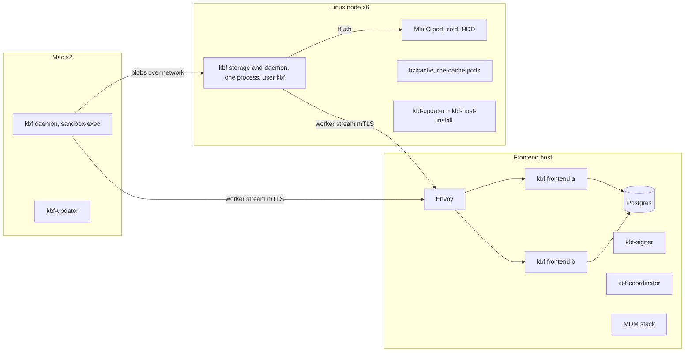

### 4.2 Target (branch A, decided)
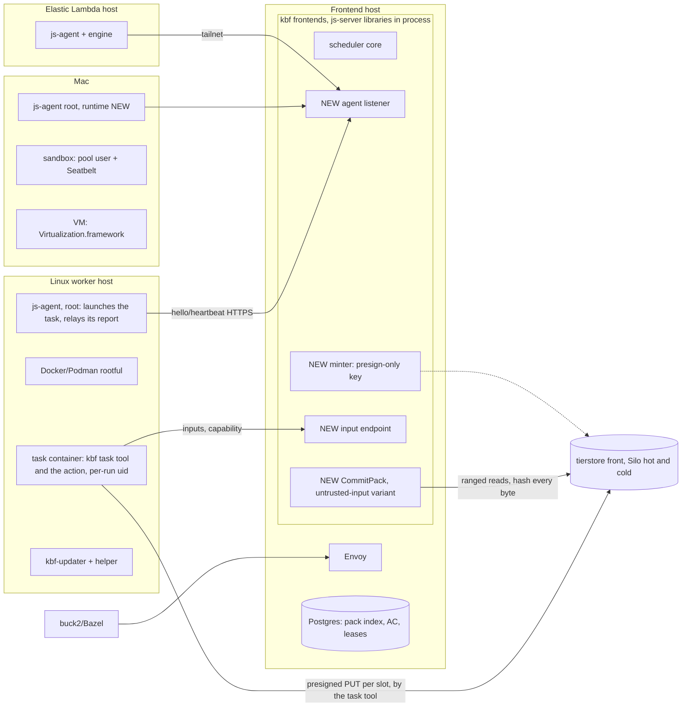

### 4.3 Storage shape (decided; the storage design owns the detail)
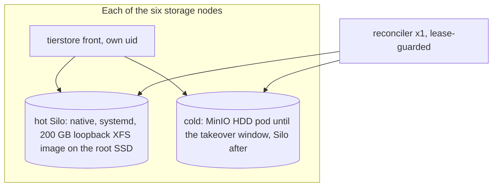
Whether the six hot images form one Silo deployment behind every front (the shared shape rev 7 §10 assumed) or one per node is the storage design's call; section 6.6 records why only the first is coherent for the CAS.

### 4.4 Processes per host type (owner, package)

| Host type | Process | Owner | Package | uid | Today / NEW |
|---|---|---|---|---|---|
| **Frontend** | Envoy | operator | image | envoy image user | today |
| | kbf frontend ×2 with js-server libs | kbf | `kbf` image, `--mode=frontend` (`docs/deploy/kbf-modes.md:22`) | container user (kbf image) | js core in flight |
| | agent listener (hello, heartbeat) | kbf, using `js-agent-wire` | inside frontend | container user (kbf image) | NEW (cannot reuse `js-lease-server`; kbf's layering test forbids `js-agent`/`js-client` in the graph, `layering.rs:608-626`; whether `js-agent-wire` and the pack-format crate may enter is Q6) |
| | minter (presign-only key file, 0600), input endpoint | kbf | inside the frontend process | container user | NEW |
| | CommitPack (untrusted-input variant) | kbf | inside the frontend process, bounded by a byte-weighted semaphore; may move to a `--mode=ingest` process if S5 shows the frontend host lacks headroom | container user | NEW variant of merged code (kbf#1747) |
| | CAS garbage collector, with the `cas/b/` rule (unindexed keys after a grace period) | kbf | the existing GC role (`cas-gc`: delete on `cas/`, never create) | own identity | rule NEW |
| | Postgres, signer, coordinator, MDM | operator / kbf | existing | as deployed (not re-checked) | today |
| **Linux worker-only host** | js-agent (writes the grant file, relays the report) | jobscheduler | musl tarball today; `.deb` is jobscheduler#300 (open); no unit in tree (only boot-script heredoc, `bootstrap/mod.rs:286-305`) | root or `CAP_SYS_PTRACE` | package/unit NEW; grant file and report relay NEW |
| | Docker/Podman (rootful) | operator | distro | root | per host |
| | task container: the kbf task tool as entrypoint, the action as its child (a separate `job-fetch` container only if D2 picks it) | kbf (the task tool), the job (the action) | digest-pinned images (`--container-pull never`, `lib.rs:36`); how the tool reaches an arbitrary action image is Q22 | a per-run uid, caps dropped, no-new-privileges, read-only root | NEW tool; image distribution unsolved (Q4) |
| | kbf-updater + `kbf-host-install` | kbf | `packaging/host-agent/linux/*` | agent unprivileged, helper root | exists for kbf; js-agent verb needs kbf#1826 (open) |
| | host firewall for task networks | operator | nftables fragment | root | NEW |
| **Storage node (the six; Linux)** | `kbf --mode=storage` (until retirement) | kbf | `kbf` deb | `kbf` (split NEW) | split decided, not built |
| | tierstore front, one reconciler per environment | kbf | release tarball + example unit, not managed by the host updater | `tierstore` | NEW delivery |
| | hot Silo (native, systemd, 200 GB loopback XFS image on the root SSD) | operator | Silo release pinned by the takeover scripts | its own user | NEW |
| | cold object store (MinIO HDD pod now, Silo at the takeover window) | operator | k3s today | pod / its own user | exists, replaced |
| | js-agent, updater, engine | as worker | | | NEW |
| **Mac** | Today: kbf daemon (native) as a LaunchDaemon, updater agent and root local helper; actions run as pool users `kbf-pool-N` (100 per Mac) | kbf | Mac kit, releases under a `current` link (Mac packaging research, live read-only) | daemon user; pool users for actions | exists |
| | Target: js-agent (root LaunchDaemon), sandbox runtime and/or VM runtime; the task tool runs in the sandbox; the VM's route to the store is open (10.2, Q21) | jobscheduler | tarball; macOS asset only in open PR #297 | root | NEW |
| | Mac task bundle and VM base, in OCI registries by digest | kbf | NEW artifacts (section 10.3) | read-only, root-owned trees | NEW |
| **Elastic Lambda host** | js-agent + engine, tasks | jobscheduler | binary fetched by boot script with pinned sha256 (`bootstrap/mod.rs:284`) | root | never launched live |
| | scaler / provider | jobscheduler | `js-scaler` and `js-provider-lambdalabs`; the join and provider routes live only in `js-lease-server`; kbf pins neither | | NEW placement (D9) |

### 4.5 Elastic Lambda host: join sequence, route and cost

The bar asks for the whole life of an elastic host, which the first draft left to a word in a diagram.

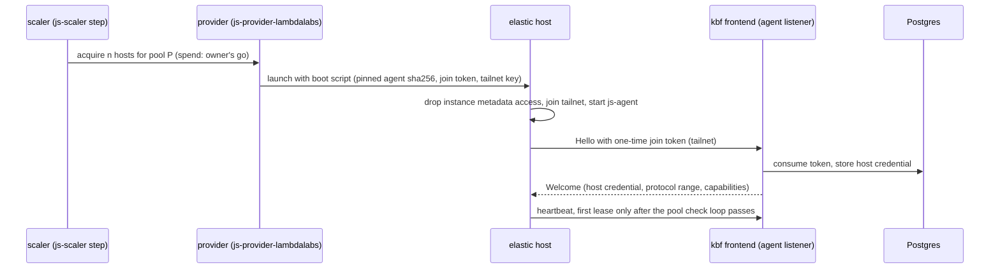

- **Citations.** Boot script and pinned agent hash: `crates/js-lease-server/src/bootstrap/mod.rs:284`. Metadata dropped before the agent starts, tailnet join: `docs/design/pools-providers-network.md:1035-1041` and jobscheduler `6473b9dd3`. Pool check loop: jobscheduler `394482a3b`. One-time join token then host credential: `docs/design/registration.md:28-73`. Pure scaler step: jobscheduler `daf3dba4e`. No live launch is recorded (R8).
- **Route to the farm.** The host reaches the agent listener, the input endpoint and the store over the tailnet (INFERRED from the join design; the store and input endpoints must be reachable on the tailnet, which is a NEW ACL decision). The task's PUTs go straight from the cloud host to the farm store with the presigned URL. Whether the tailnet counts as the declared private-network posture for that leg or TLS is required on it is the storage design's decision 4 (section 6.4).
- **Cost, unmeasured.** Output bytes leave the cloud provider (egress is typically charged by the provider; rate not verified), input bytes enter it; the WAN bandwidth bounds the task's fetch and upload, so big-output actions are a poor fit for elastic hosts (INFERRED). Stage S9 measures fetch and upload throughput from an elastic host; budget: report, and the owner sets a ceiling before elastic hosts take real work (D6, D9).
- **Where the provisioner runs.** kbf links none of `js-lease-server`, so the scaler, provider and join-token routes have no home in the owner model (D9).

---

## 5. Every interface

| # | Caller → callee | Protocol / listener | Authentication | Status |
|---|---|---|---|---|
| I1 | Client → Envoy → frontend | REAPI gRPC; frontend `--listen` 127.0.0.1:8980 default (`kbf-modes.md:246`) | `--reapi-auth-policy` | today; Execute reply now waits for CommitPack |
| I2 | js-agent → frontend: `POST /v1/agent/hello` | HTTP/1.1 JSON, `jobscheduler.agent.v1`, agent dials out only; https off loopback (`crates/js-client/src/server_url.rs:19-26`). Listener: a NEW agent listener on each frontend (its own port, TLS off loopback; neither `--listen` 8980 nor the daemon `--worker-listen` 8981, so job and host credentials never share a listener with daemon mTLS). Both frontends serve it behind Envoy or by DNS to both (INFERRED) | pool join token → host credential (`docs/design/registration.md:19-22,57-73`); a join token is one-time, expiring, revocable, bound to one pool (so the pool's trust class binds the host) | wire today; server side in kbf NEW; join-token rows must move from `js-registry`'s single-writer file to Postgres (two frontends) |
| I3 | js-agent ↔ frontend: heartbeat, `Command::{Start,Stop,Cancel}`, `RunResult`, `Taint` | `POST /v1/agent/heartbeat` (`crates/js-agent-wire/src/command.rs:279-302`, `heartbeat.rs:67-94`); same NEW agent listener | host credential over TLS | wire today. `js-server-core` assumes a stream per worker (`crates/js-server-core/src/lib.rs:12-13`); a polled heartbeat needs a NEW adapter, two frontends may hear the same host, and the reply must be answerable at once when a Start is queued (a long-poll or wake, NEW, additive; section 7 S3) |
| I4 | Launch with grant: `Start(JobSpec)` | inside I3 reply | lease id, `valid_for_ms` | NEW generic fields (section 2, R1): ordered container `steps` (fetch, run) in one lease, each with `{image, args, network profile, secrets, mounts, limits, when}` where `limits` are wall time and log bytes only (memory has one setting, R14); log capture; a shared `work` root between steps; and **`upload: Option<UploadGrant>`**, which the agent writes as a 0400 file of the run's uid on a per-run tmpfs and mounts into the task, and reads nowhere else. `upload` and `secrets` are redacted in `Debug`, logs, state root and persisted run records. The result frame gains `upload: Option<UploadOutcome>`. |
| I5 | js-agent → engine | CLI at `--container-bin`, unix socket only | root | today |
| I6 | Task fetch phase (or a fetch step: D2) → frontend input endpoint (manifest), then → store (bytes) | HTTPS on the same NEW job-facing listener family as I2, separate from daemon mTLS. The manifest is computed server-side from the `Action` the frontend holds; the client never supplies a list. Bytes: the frontend resolves digest to pack key and range from the pack index and signs a ranged GET; fallback: the frontend streams bytes | frontend-signed input token (instance, action, lease, epoch, not-after, single action); ranged and batch reads count against the same closure | NEW; today ByteStream/Locate admit only daemon certs |
| I7 | Task (the kbf task tool) → tierstore front (one PUT per pack, in slot order) | S3 PUT with a standard SigV4 query-string presign (`UploadSlot.put_url`); TLS, or the declared private-network posture (section 6.4) | the URL itself (bearer, create-only, one key, short expiry); tierstore's role for the presign-only key bounds it; the task's egress is limited to the store and the frontend by a host firewall | NEW; tierstore refuses query-string auth today (kbf#1922 adds it) |
| I8 | CommitPack → store (ranged reads of each reported pack, streamed once) | S3 ranged GET inside the farm | frontend's read identity | NEW |
| I9 | CommitPack → pack index (Postgres rows) and AC | in-process; `Role::Ingest` (NEW) for the AC entry | in-process | pack index tables exist; the build-path variant is NEW |
| I10 | Minter → store | none: the frontend signs each URL locally with the presign-only key | key file, 0600, rotated by key id | NEW; no network call, so no mint cost beyond a signature |
| I11 | CAS GC → store | S3 delete of unindexed `cas/b/` keys after the grace period | `cas-gc` identity | rule NEW |
| I12 | Front ↔ hot Silo and cold, reconciler ↔ hot and cold | S3 over HTTP, static credential files 0600 | own credentials | tierstore code exists, deployed nowhere; Silo deployment NEW |
| I13 | Storage ↔ peers chain replication; storage → cold flush (until retirement) | mTLS role `storage`; S3 localhost | node certs | today |
| I14 | Mac daemon → frontend and storage (until Mac runtime) | worker stream `--worker-listen` 8981; blobs over network. The same `UploadGrant` rides kbf's `Start` on this path (upload grant wire spec §1) once kbf adds it | mTLS role `daemon` | today; grant NEW |
| I15 | Updater → coordinator; updater → helper; updater → frontend drain | mTLS; unix socket `/run/kbf-host-install/local.sock` 0600; four fixed routes (`updates.md` §5) | updater cert; file mode | today for kbf. A js host drain/idle route is NEW |
| I16 | Release workflows → coordinator | OIDC (`kbf-oidc`) | GitHub identity | kbf today; jobscheduler "off until configured" |
| I17 | Metrics | frontend `GET /metrics`; storage `--metrics-listen` | none; bind internally | js-agent has none (usage rides heartbeat; frontend exports); tierstore has `/healthz`,`/readyz` only. NEW required series for the new components: minter (mints, failures), input endpoint (bytes/s, closure refusals), CommitPack (queue depth, seconds/GB, refusals by reason, orphaned keys), GC (keys reaped, refused keys), tierstore (presign refusals by reason, create-only conflicts), and `legacy_read_total` for A7 |
| I18 | Elastic registration | one-time join token → host credential; tailnet (`docs/design/registration.md:28-73`); same agent listener as I2 | token then host credential | routes live only in `js-lease-server`: NEW in kbf; provisioner placement D9 (section 4.5) |
| I19 | Image supply | operator preload (`docker load`); agent pulls nothing | n/a | unsolved for kbf action images and `job-fetch` |

---

## 6. Storage and the write path

Authority: the **storage design** (the presigned-PUT fence, packs and CommitPack, retirement gates, probes, work items) and **the upload grant wire spec** (the one wire; it wins on any conflict). This section summarises both, records the decision that fixed the branch, and keeps three pieces of analysis that no other document states and that are marked as such. It does not duplicate the storage design.

### 6.1 What the two documents say, in brief
- Each build writes its outputs as kbf packs (the kbf-segments layout: records back to back from offset 0, then fan-out, index and trailer). For each pack slot the frontend mints a standard SigV4 presigned PUT for a key it chose. There is no bespoke token, no claims-in-key-id credential, no MAC ceilings and no asymmetric signing.
- The task (the kbf task tool inside the container or sandbox) writes the packs and PUTs them itself; the agent relays the task's report as a claim. The frontend verifies every byte and adopts in place. This is the shape the owner ruled at 12:30Z; the storage design's body still carries the earlier post-exit-step text and says to substitute this reading (6.9).
- Retirement of the storage nodes is the last gated step (section 6.5, section 13 A7).

### 6.2 Decided: branch A with Silo (2026-10-29)
**Decision (the owner, 2026-10-29).** Tierstore goes on the storage nodes now. Its hot tier is native Silo under systemd on the shared root SSD, 200 GB per node as a fixed loopback XFS image. Its cold tier is Silo after the takeover window, and the existing MinIO HDD pods until then. Retirement of the kbf storage processes stays the separate, gated, last step (section 6.5).

**Considered and rejected: branch B (keep kbf storage, fence with per-job MinIO identities).** The owner's reason: IAM is not portable across stores. A per-job identity is a MinIO-administration artefact (account creation, inline policy, deletion at terminal); it does not survive the move to Silo, to tierstore's own role model or to S3, and it ties the task path to one store's admin API. The presigned PUT is the same bytes on every store that speaks SigV4, so the fence moves with the store. (Earlier drafts also carried B-fall, a presigned POST policy, and two hybrids that put tierstore on job staging only; all are dropped with B. The one piece of the hybrid analysis that still matters is in 6.6.)

### 6.3 The write path (this is the design, not an option)
**1. Grant, frontend to host, at lease grant, before Start.** `JobSpec.upload: Option<UploadGrant>` (upload grant wire spec §1):
- `UploadGrant { slots: Vec<UploadSlot>, max_pack_bytes (at most 128 MiB), max_blobs_per_pack (at most 16,384), expires_unix_ms }` and `UploadSlot { key: "cas/b/<build>/<nonce>-<i>", put_url }`. `max_slots` is a frontend flag, default 1, ceiling 8.
- The grant is a secret: never logged, never echoed in an error, never in args or env. js-agent writes it as a 0400 file owned by the run's uid on a per-run tmpfs mounted into the task at one fixed path (read-only); that file is the only copy, and it is not in the state root or run records. The read grant is delivered the same way. The task's network allows only the store endpoint and the frontend (host firewall: section 8.3). On a Mac sandbox the same file sits in the pool user's lease directory; the VM case is open (10.2). Debug output prints `<upload grant: N slots>`.
- The frontend signs each `put_url` with a presign-only key. The URL lives for the lease validity plus slack (default 10 min), capped by tierstore's max-expiry flag. `expires_unix_ms` is advisory on the host; tierstore's refusal is the authority.
- Additive on the wire: an old agent ignores the field and never uploads, and returns `upload: None`. The frontend treats `None` as a failed action, never as "no outputs". `NothingToUpload` is the only "no outputs" answer. So an agent that cannot run the step needs no extra refusal code (and the storage design's decision 3 is satisfied by construction for multi-tenant instances, section 6.5).

**2. Upload, by the task, after the action command exits.** The kbf task tool, the entrypoint of the task container (it runs the action as its child; the same tool runs in the Mac sandbox, and the kbf-daemon native path does the same), collects the declared outputs under the `kbf-outputs` rules (`O_NOFOLLOW`, regular files only, name rules, `OutputLimits`) plus stdout and stderr as blobs. It writes one or more kbf-segment packs of at most `max_pack_bytes` and `max_blobs_per_pack`, PUTs each pack once to its own slot in slot order, then writes the report to a fixed path the agent reads after the container exits. Outputs that need more slots than granted, or one blob above `max_pack_bytes`, upload nothing and report `TooLarge { needed_slots, needed_bytes }`, never a truncated pack. A PUT refused because the grant lapsed is `GrantExpired`, else `UploadRefused { status }`. Stdout and stderr are blobs inside the pack, named `stdout` and `stderr` in the report; the agent still keeps its capped tail in the result frame for operators, never authoritative. Because the task holds the URL, the action's own code could PUT to a slot too. That is accepted: the PUT is create-only per slot and bounded, and CommitPack accepts only a well-formed pack whose every blob hashes to its digest and whose footer equals the reported manifest.

**3. Report, task to frontend, in the result frame.** The agent, after the container is dead, reads the report, caps its size and sends it in the result frame as is; it does not verify it. A missing or unparseable report is `UploadRefused { status: 0 }` from the agent (a failed action). The result frame carries `upload: Option<UploadOutcome>`: `Uploaded(Vec<PackReport>)`, `PackReport { key, size, manifest: Vec<PackEntry { digest, size, offset }> }`, `NothingToUpload`, `TooLarge`, `GrantExpired` or `UploadRefused`. The manifest is a claim.

**4. CommitPack, the frontend's untrusted-input variant.** Today's CommitPack authorises a certified node writing `cas/d/<node>/`, samples two blobs and never reads the footer. The variant for a build's packs (storage design §F; kbf-pack facts as read by the research, not re-read here):
- authorises "key is one of this accepted lease's slots" under `cas/b/`, not "writer is a certified node";
- hashes every byte of the object, streamed once in sequential ranged reads (at most 128 MiB per pack), with a per-record cap and a total read budget per commit;
- reads the trailer and footer, checks magic, version, entry count, `index_offset` and the footer CRC, and requires the footer to equal the manifest exactly, with records contiguous from offset 0, non-overlapping, ending at `index_offset`, in ascending (hash, size) order, and `index_offset` plus the footer length equal to the object size (today's `NewPack::checked` does not check overlap);
- enforces 128 MiB per pack and 16,384 blobs (the 128 MiB cap is not checked in the commit today);
- is idempotent per key (same contents, no change; other contents, conflict);
- adopts in place: one pack-index row per blob as (pack key, offset), no copy. Reads re-hash every blob before serving, so an untrusted writer can make a read fail but never return wrong bytes.

The CommitPack is also what makes create-only matter: an action that could rewrite its key after verification would swap bytes (a time-of-check gap). Tierstore's create-only publish closes it, so a leaked URL after first use is inert, and a leaker racing the real writer is caught by the full hash against the manifest.

**5. Tierstore (kbf#1922 and companions), the store-side half.** Query-string SigV4 verification (credential, date, expires, signed headers, signature; `UNSIGNED-PAYLOAD`; only `host` required); a presign-only key whose role allows a create-only single PUT under `cas/b/`, at most 128 MiB of received bytes counted by the front (not trusted from `Content-Length`), no multipart and no other method, and an expiry ceiling set by a flag in the verifier, so a valid signature above the ceiling is still refused; the object appears only after a complete body (a dropped connection leaves nothing); the front never logs the query string. Whether tierstore's PUT path can publish with an atomic no-replace step today is unread (research open item): VERIFY in `ops.rs` before relying on it. A Silo conformance target on the farm (a presigned PUT works; `If-None-Match` on a presigned PUT; whether the signature binds `Content-Length`; the 7-day cap) matters only if Silo is ever written directly; with tierstore in the path the guarantees are tierstore's.

**6. One pack format in one crate.** The kbf-segments format (layout, limits, writer, footer reader) moves to jobscheduler as `js-pack-format`, which holds `UploadGrant`, `UploadSlot`, `PackReport`, `PackEntry` and `UploadOutcome` too; kbf re-exports it from `kbf-segments` (kbf depends on jobscheduler, never the reverse). Two-PR rule: jobscheduler adds the crate with the code named by its kbf source, then kbf re-exports. js-agent-wire re-uses the types for `JobSpec.upload` and the result frame; kbf's `Start` and `Result` messages carry the same fields on the native path. Whether this enters kbf's graph under the layering test is Q6.

**7. Prefix and garbage.** Keys are `cas/b/<build>/<nonce>-<i>`; the nonce is random, chosen by the frontend, so a key cannot be pre-created by anyone who has not seen the grant. A cancel, a stale epoch, a refusal or a retry leaves unindexed keys. The CAS garbage collector collects unindexed keys under `cas/b/` after a grace period of at least the URL ceiling plus the lease maximum wall time plus the commit time; its identity holds delete on `cas/` and cannot create; it never deletes an indexed key (test: an indexed key survives, a young unindexed key survives, an old unindexed key goes). A re-minted grant on retry uses new nonces.

**Quotas.** A grant bounds a lease to `max_slots` × 128 MiB (at most 1 GiB at the ceiling of 8). That is the whole junk volume an unexpired URL set can write; there is no bucket-wide per-prefix quota to rely on, so the GC age and the front's concurrent-PUT cap are the other limits. Tierstore's single PUT is held in memory up to 256 MiB today (`server/cli.rs:72`); the streaming PUT is still on the work list.

**Wire gaps (for the storage and Mac authors, not owner decisions).** (a) The wire spec reports blobs, not the output tree: which declared path is which digest, the executable bit, symlink targets, and the Directory and Tree protos. Proposal: the pack carries the Directory and Tree blobs the host built, and the report names the output root digests; the frontend decodes them only after every blob is verified, applies the declared-output rules, and builds the `ActionResult` itself. (b) The exit code: the report carries the task tool's claim; the frontend uses the container's exit status that the agent reports independently (wire spec §2), never a value read from a pack. (c) Field names and where `UploadGrant` lives (the Mac side proposes the shared crate).

### 6.4 Transport posture: TLS, or the declared private-network posture
A presigned URL is a bearer secret and the host-to-store leg now carries whole packs. Today the tierstore front is plain HTTP (`server/cli.rs:110,123`). Two acceptable postures, per the storage design's decision 4, and the owner picks one there:
1. **TLS on the tierstore front,** built before any presigned URL crosses a host. Recommended by the storage design.
2. **A declared private-network posture:** a stated exception that the leg runs on a private network, with unencrypted URLs and bytes accepted, recorded as an exception (the "kbf TLS optional" ruling names kbf, not tierstore). The cost is URLs and output bytes in clear on that network. Short expiry, create-only and not logging the query string hold in both.
Either way no URL crosses an untrusted network; an elastic host's leg over the tailnet is covered only if the owner counts the tailnet as private (section 4.5). The task's egress allow-list (store and frontend only, 8.3) is the other half of the posture, because the task now holds the URL.

### 6.5 Pointers to the storage design's decisions this design depends on
These stay in the storage design; the owner decides them there. Each is stated here so a reader of this doc can see what the plan assumes.
- **Decision 3: the multi-tenant stance on the uploader.** Written for a trusted post-exit step: refuse a job that uploads itself on multi-tenant instances, because the action and the uploader would share a trust domain and a hostile command could forge its own result for its own action digest. The 12:30Z ruling makes the task tool the uploader by design, so that residual is now accepted and bounded rather than refused: what a hostile action can forge is its own result for its own action digest (8.1), bounded by tierstore's create-only presign role, by CommitPack, by the exit status the agent reports independently, and by the per-instance action-cache namespace (decision 10, blocking). The storage design's author restates decision 3 in that light (Q21 lists the open items); until then this doc keeps the pointer and the C7 gate. An old agent that ignores `upload` returns `upload: None`, which still fails the action.
- **Decision 8: retirement gates, rollback and the 30-day window.** Retirement is gated by all of: `legacy_read_total` zero for 7 consecutive days (the counter does not exist in code yet), clean sampled digest re-reads, staged blocks zero on every node, every daemon on the packer, every live AC closure resolving from the new index, plus the 7-day all-pack write window before the frontend switch, plus the rollback path (packs keep the segment layout so legacy nodes re-adopt from footers; after retirement, re-enable the disabled services and run the footer rebuild) and a 30-day decommission window with packages disabled and disks untouched. Not only `legacy_read_total`.
- **Decision 10: per-instance action-cache namespace is a blocking prerequisite** (untrusted jobs must not share an action-digest key across tenants; whether the AC is already instance-scoped is VERIFY). Gate C7 in section 13.
- Also there, and not repeated: decision 2 (retire the storage nodes at all), decision 4 (the TLS posture, 6.4), decision 5 (job staging bytes: with packs adopted in place under `cas/b/` there is no separate `jobs/` staging, so the hot-only-or-copy question becomes "adopted packs are CAS and copy to cold like any CAS object"; the storage design should confirm), decision 9 (amend the jobscheduler design; section 17 here does the doc edits, the amendment owner is Q11).

### 6.6 Analysis kept in this section only (not stated in the storage design; it should adopt or drop it)
**The hot store physically.** The hot tier is Silo, decided; what the analysis records is which shapes are coherent.
- **H1, one Silo deployment across the six node images, behind every tierstore front.** Coherent: every front sees the same objects, one reconciler tails every front's journal from it (`crates/tierstore/src/reconciler.rs:91-130`). It is the shape rev 7 §10 assumed. Capacity: six 200 GB images are 1.2 TB raw; usable capacity after erasure parity is not computed (Q13). At the reference 300 executions per second and 1 MB of output each (storage design, ui-data U3; unmeasured) the hot tier takes about 300 MB/s, so 1.2 TB raw is roughly an hour of input before parity and before eviction (INFERRED arithmetic): the reconciler's copy to cold and its eviction above 80% down to 70% are load-bearing, not an optimisation, and the copy-lag alert is a launch gate. `cas/b/` is under `cas/`, so adopted packs are journaled and copied like any CAS object (VERIFY the reconciler's prefix filter).
- **H2, a separate Silo (or `--hot dir:`) per node.** Incoherent for the CAS: the single reconciler tails every front's journal from one hot backend, so per-node stores are single-copy until cold and recreate what R=2 replication solves. Not recommended for the CAS (INFERRED, high confidence).
- **H-sharded, for job packs only.** The minter pins each lease's keys to one front and returns that front's endpoint; each front has its own hot store and no cold tier, no reconciler. Keys are disjoint, so no cross-front coherence is needed, but adopted packs would be CAS and single-copy: a node loss loses them and the actions rerun. **H-sharded has no cold bucket, so the cold-side backstops (an abort-incomplete-multipart rule, expiry, `ListMultipartUploads`) do not exist there:** the GC rule of 6.3 item 7 is the only collector of unindexed `cas/b/` keys, and if it stalls the hot SSD fills. Presign keys refuse multipart, so the multipart backstops matter little for this path, but the expiry backstop does. H-sharded is carried as analysis only; the owner's decision is the shared Silo hot tier.

**Branch A facts that still shape the plan** (the A-versus-B table of the earlier draft is dropped with B; its rows for fence, mint cost, revoke and signing key are gone because the presigned PUT removes them):
| Topic | Fact |
|---|---|
| Where a put lands | Hot Silo behind the front: ack after hot put plus journal object (`crates/tierstore/src/tiered.rs:127-130`) |
| Digest trust | Optional store rule "key == sha256(body)" is cheap for digest-keyed CAS writes (the front already hashes bodies it reads, `server/mod.rs:57-78`) but does not apply to `cas/b/` pack keys; CommitPack is the control (6.7) |
| Ingest cost | CommitPack reads and hashes every byte of a pack and writes index rows; it does not copy or re-write the bytes (adopt in place), so the earlier draft's R=2 CAS write and replication for job output disappear (INFERRED saving, unmeasured) |
| Unbuilt before the first routed job | Presigned-PUT verifier and presign-only role (kbf#1922), TLS or the declared posture, streaming PUT, create-only atomic publish check, hot Silo deployment, front packaging and updater management, CommitPack variant, `cas/b/` GC rule, `Role::Ingest`, the pack-format crate, `legacy_read_total` |
| Credential gap on a task-hosting node | Backend (Silo) credentials and the presign verification secret sit beside the root agent and tasks unless storage nodes run no tasks (D5) |
| Reversibility | Retirement is one-way (last step); everything before it is additive |
| Operational planes | Hot Silo, cold store (MinIO then Silo), fronts, one reconciler, plus the kbf storage nodes until retirement |

### 6.7 Digest enforcement is CommitPack-only; the ingest invariant
- A proxy rule "refuse a put whose sha256(body) differs from its key" works only for digest-keyed single PUTs. `cas/b/` pack keys are not digest-named, a pack's bytes hash to nothing the key says, and a pack that hashes right can still be malformed. So digest enforcement for job output is CommitPack's, in both the frontend and the store path. The proxy rule is defence in depth for daemon CAS writes (relevant at A5), not a control for job output.
- **Invariant:** the CAS key and every AC key and value come from the frontend's own hashing and the lease row, never from a host-supplied name, digest, marker, manifest or exit code. `Role::Ingest` may write only the AC entry whose key is the action digest in the lease row, in that lease's instance. The exit code is the run step's, from `RunResult` as the agent saw the container exit, never read from a pack. Stdout and stderr are untrusted blobs, bounded and escaped before any display, and a cache write never depends on a log.

### 6.8 Security requirements the storage half must meet (the storage design owns the detail)
- The invariant of 6.7. A zombie test: epoch N+1 accepted while the epoch N task keeps running; CommitPack ignores N's keys (they are not in the accepted lease's slots).
- **Presign key.** SigV4 is symmetric, so every verifier host holds the presign secret. The role ceiling is the whole damage: a create-only PUT under `cas/b/`, 128 MiB, no multipart, no read, no delete. A root escape on a storage node can therefore mint URLs and write junk packs that no CommitPack will adopt, which the GC collects; it cannot overwrite, read or delete. The larger exposure on such a node is the backend (Silo) credentials, which is D5. Asymmetric signing is no longer a requirement.
- **Rotation.** The presign key is a file, rotated by key id; the front accepts current and previous.
- **TLS or the declared posture** before any URL crosses a host (6.4); the query string is never logged by the front, the agent or the minter.
- **Grant handling** on the host: section 8.3.
- **Credential renewal.** A re-leased run at a new epoch gets a new grant with new nonces. A URL's expiry is part of its signature, so the agent cannot extend it: a run that outlasts its grant needs the slack (default 10 min) or a new lease, and a late PUT is `GrantExpired`. An agent restart does not touch the grant: the file lives with the run, the task keeps uploading, and the adopting agent reads the report when the container exits (a Mac sandbox is the same).

### 6.9 Reconciliation with this doc (conflicts)
1. *Credential holder.* Owner: "the launch carries a credential" and the task writes. The storage author's corrections of 12:19Z, the storage design body and the wire spec's first revision: the job holds none and the agent's post-exit step uploads. **The owner ruled otherwise at 12:30Z (via the P0 plan): the whole task holds the URL, with no separate trusted upload step.** The wire spec header and the storage design header both record it, and the storage design says to substitute that reading for its decision 3, D.1-D.4, H, probe 1 and work rows 12-13. **This doc follows the 12:30Z wording.** The storage design's body text is its author's to fold in; this doc does not cite it for a point it contradicts. Decision D1 is closed.
2. *Delivery.* A redemption-handle exchange (an earlier part of this work) vs a 0400 file. **The wire spec wins**: a 0400 file of the run's uid on a per-run tmpfs mounted into the task, never env or args. The `/proc/<pid>/root` argument of the first draft (a sibling at the shared uid reading a bind-mounted secret) **returns**, because the grant is mounted into the task again; the per-run uid is required for it (section 7, S5).
3. *Hot ack.* Owner: put lands on hot. Under A it does (hot Silo plus journal).
4. *"Storage nodes run tierstore"* is now decided (6.2); tierstore is a proxy over S3 backends, not a disk owner, and the hot backend is Silo.
5. *10-24 decision wording.* Rev 7's log has 13:28Z (shape approved) and 14:19Z (build service and packing); retirement appears only as the gated final step in a document saying "nothing here is approved to run". The 2026-10-29 ruling fixes the branch and the fence, not retirement.
6. *Hot-bucket expiry.* Rev 7 §10 sets a 7-day expiration on the hot bucket's `cas/` prefix as a safety net that does not check cold, so an uncopied object older than 7 days is lost. Adopted `cas/b/` packs are CAS, not transient staging, so this matters: the copy-lag alert (1 day warn, 3 page, 7 expiry) applies to them, and a pack whose copy lags past expiry is lost data that only a rerun of its producing action can rebuild.
7. *Mac handover and relay.* The wire spec's section 6 (Mac side) and the Mac packaging design (draft 2, D10 and 6.5) describe a root-owned handover directory, an agent-side uploader and a vsock put-only relay for a guest that never holds a URL. The 12:30Z ruling supersedes the agent-side uploader and the "guest never holds a URL" rule, and a guest with no network device cannot PUT. **This is a conflict between companion documents that the Mac native and packaging authors resolve (Q21).** Section 10.2 says what this doc assumes in the meantime and leaves the VM route open.

---

## 7. Sequence per operation (all 11)

Actors: C client, F kbf frontend (js libraries, minter, input endpoint, CommitPack), D Postgres, G js-agent, X the task container (the kbf task tool: fetch phase, then the action as its child, then pack and PUT), O the tierstore front over Silo, GC the CAS garbage collector.

**New js primitives (NEW, generic, R1).** (1) `JobSpec.upload: Option<UploadGrant>`: the agent writes the grant to a 0400 file of the run's uid on a per-run tmpfs, mounts it read-only into the container at one fixed path, and after the container exits reads the report from a fixed path, caps it and relays it. There is no upload code in the agent. (2) Ordered container `steps` in one lease, like init containers, each `{image, args, network profile, secrets, mounts, limits, when}` with `limits` wall time and log bytes only and `when` one of `on_success` or `always`. This is needed only if D2 picks a separate fetch step; with the task tool fetching in the same container (D2 (c), the recommendation) kbf needs one container per action and the primitive stays a generic js option. Either way it answers whether js can sequence runs (Q7): it cannot today.

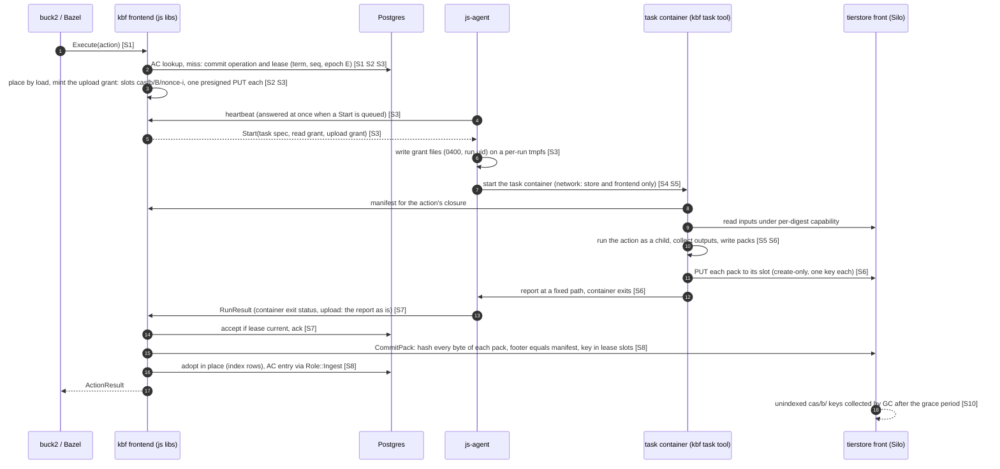

### S1 Submit
C → Envoy → F: Execute(action). F reads Action/Command, validates, pins the image digest (`JobSpec::require_pinned`; tag-only is refused, jobscheduler#311), looks up the AC (closure check on a hit). A miss commits the operation and submits to js-sched (cpu, memory, gpu, platform). No agent is involved. AC and blob rows are in Postgres (rev 7 §J, design only). The AC key must be instance-scoped before untrusted tenants share a farm (R13, storage design decision 10, gate C7).

### S2 Place
Actors F, G. In process, js-sched picks the worker with the least booked share among workers whose capabilities match, and admits by measured and predicted load (`docs/design/placement-by-load.md`). Memory admission uses the one setting, `memory_schedulable_percent`. Load arrives on the heartbeat, up to 5 s stale (`crates/js-agent-wire/src/lib.rs:124`); stale load invites herding, so the 5 s default is a number to lower, measured in S2. There is no reservation (R7). An agent can misreport usage (trusted base).

### S3 Lease
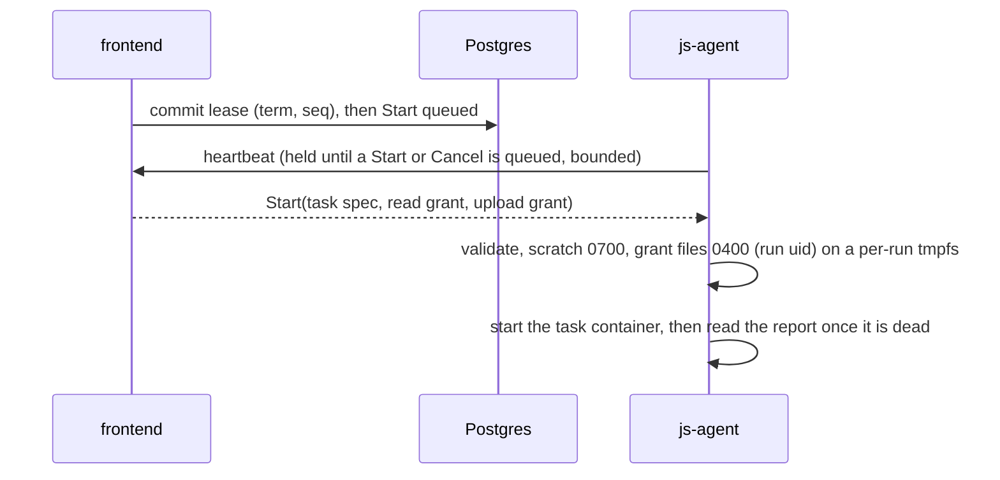
Commit before Start; one accepted result per operation, fenced by lease id. The mint is a local signature per slot (I10), so it costs no store call. The grant files are mounted read-only into the task container at one fixed path and nowhere else; they are not in env, args, the state root or the run records. Today's delivery waits up to one heartbeat each way; a held (long-poll) heartbeat reply is NEW and additive, with the plain interval as fallback. Under a rootful engine a container start replaces one under crun (two, if D2 picks a separate fetch step): lease overhead is stage S2, and S2 must measure the shape that D2 chooses, not a bare start.

### S4 Stage inputs
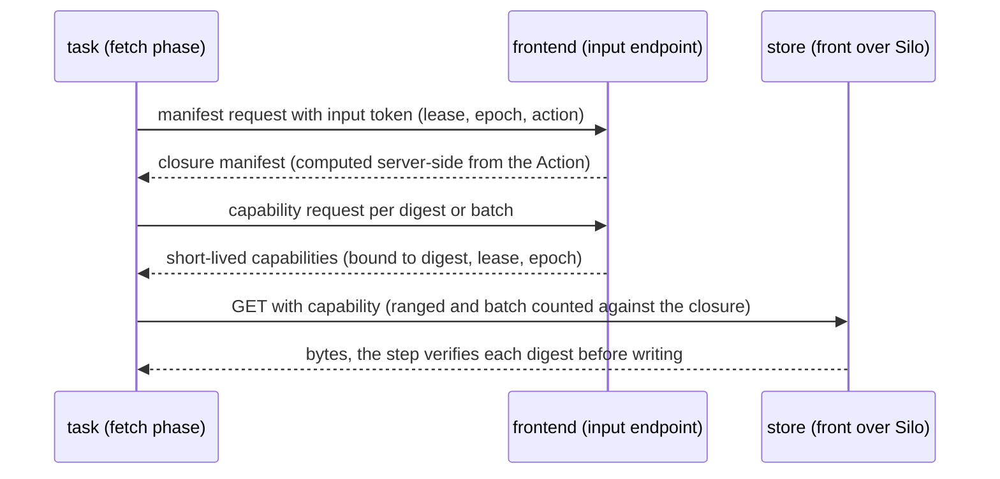
- **Rules.** The closure is computed from the `Action` the frontend already holds and never from a client-supplied list. The token is bound to lease and epoch, short-lived and single-action. A node-wide read key (`--pack-read`; tierstore read-only keys are bucket-wide) is never used.
- **Where bytes flow.** The frontend authorises and the store serves, so input bytes do not funnel through the frontend host. The frontend resolves digest to pack key and range through the pack index and signs a ranged GET. Fallback: the frontend streams the bytes, which is simplest and is used if the capability work slips; stage S3 records frontend bytes per second and a direct-fetch comparison so the funnel's cost is visible.
- **Who runs it.** The task tool's fetch phase, under a read grant delivered like the upload grant (the wire spec's shape), a separate `job-fetch` container, or a trusted agent step: D2.
- **Lost.** The node input cache, hard links and shared trees; every job refetches. A host-shared, digest-verified, read-only cache populated only by operator-side code is later work and needs a read-only mount root first (roots are read-write today; storage design §E); it must not be writable by the run uid.

### S5 Run
Actors G, X. The task container runs the digest-pinned image with the kbf task tool as its entrypoint; the tool runs the action as its child (how the tool reaches an arbitrary action image is Q22). Its network allows only the store endpoint and the frontend (a host firewall rule, 8.3). It holds the read grant and the upload grant as 0400 files of its uid (S3). The container runs as a **per-run uid** (NEW; today 65534 for all runs), caps dropped, no-new-privileges, pinned seccomp, `--read-only` root, a `noexec` `/tmp`, `/scratch` bind (`crates/js-agent/src/cli_runtime/args.rs:151-165`@`6c3dca1ec`). The exit code that counts is the container's as seen by the agent, reported independently of the task's report; stdout and stderr are captured by the agent for the operator tail (NEW; today none) and by the tool as blobs for the pack. Against kbf's crun container the remaining gaps are host user namespace and no delegated cgroup subtree (parity table), plus the `noexec /tmp` difference of section 3. Memory has one setting (`memory_schedulable_percent`); this design adds no per-container limit, so a job that outgrows its booking is the host's problem, not a configured cap, and OOM stays a farm fault to retry with more memory (the owner's failure-class ruling). Mac: section 10.

**Why the per-run uid is required (the `/proc/<pid>/root` argument returns).** The grant is mounted into the task again, so a sibling run at the shared uid 65534 that escapes its container could read another run's grant file through `/proc/<pid>/root` and PUT to that run's slots. Create-only and CommitPack mean it could only race the real writer (a refused PUT, so a failed action: a denial of service on that run, never a wrong entry), but it should not be possible. A distinct uid per run closes it, with the 0400 mode and the per-run tmpfs mount that is visible to that container only. Two further reasons:
1. *No process outlives the run holding a URL.* A process that escaped its container into the host's process namespace can outlive container removal. With a per-run uid the agent kills every process of that uid and verifies none remain before it reads the report and before the tmpfs is removed, as the Mac sandbox does.
2. *Cross-run output integrity.* A sibling that escapes as the shared uid can write into another run's scratch through `/proc/<pid>/root` and so change the bytes of its pack or its report before the PUT. CommitPack would refuse a pack that does not match its manifest, but a distinct uid per run closes it earlier.
If the owner prefers to drop the requirement, the grant-theft and integrity cases become residual risks (bounded as above); it is cheap to keep (an allocator in the agent) and there is no wire change.

### S6 Upload
```mermaid
sequenceDiagram
  participant T as task tool (in the container)
  participant O as tierstore front
  participant G as js-agent
  T->>T: action command exited; collect outputs under kbf-outputs rules
  T->>T: write packs (js-pack-format), hash
  T->>O: PUT pack 1 to slot 1 (presigned, create-only)
  O-->>T: ack (object visible only after a complete body)
  T->>O: PUT pack n to slot n
  T->>G: report at the fixed path, then the container exits
  G->>G: container removed, uid's processes killed and verified gone
  G->>G: read the report by descriptor, no-follow, capped; relay it unverified
```
The ack follows the hot put plus the journal object; puts are create-only; reserved `_journal/` and `_tiering/` keys are refused; multipart is refused for presign keys. The tool opens outputs with `openat2(RESOLVE_BENEATH)` and `O_NOFOLLOW`, accepts regular files only, and checks link count and device. One PUT per pack, in slot order; no retry on the same slot after any answer other than a transport failure before the first byte (a retry of a half-sent body risks a create-only conflict that the frontend would read as another writer). A grant that expired is `GrantExpired`; the frontend re-mints on retry. The agent reads the report only after the container is removed and the run uid's processes are verified gone, opening it with `openat2(RESOLVE_BENEATH)` from the scratch root and `O_NOFOLLOW`, regular file only, capped in size; it never parses more than it relays, and a missing or unparseable report is `UploadRefused { status: 0 }`. The tmpfs holding the grant files is removed with the run. Because the action runs in the same container as the tool, it can also PUT to a slot, rewrite the report or take over the tool: all of that stays inside its own lease's slots and its own result, and the exit code that counts is the container's. The task's egress is host-level; a cloud host's metadata block must hold for the container and the agent (C5). On a Mac sandbox the same tool runs under the pool uid and the agent reads the report after the uid is dead (section 10.2); the VM route is open (Q21).

### S7 Report
```mermaid
sequenceDiagram
  participant G as js-agent
  participant F as frontend
  participant D as Postgres
  G->>F: RunResult (resent each heartbeat until ResultAck)
  F->>D: lease current? record result
  F-->>G: ResultAck, or FENCED (the packs' keys are never indexed; GC collects them)
```
The result carries outcome, per-step status, the run step's exit code, and `upload: Some(UploadOutcome)` when the JobSpec carried a grant. `upload: None` after a grant is a failed action, never "no outputs". Taint from a failed removal stops that host's work. Proposed rule (js owner decides, Q8): the host's lease slot frees when the last step, including the upload, ends, not at `ResultAck`; an unacknowledged result is resent without holding a slot. If the agent loses the server mid-step, the running step continues to its own limit and `valid_for_ms` bounds when a next step may start; the URLs' expiry is the hard bound on a late upload (Q7).

### S8 Cache write
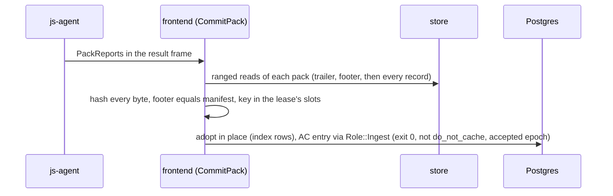
- **Placement.** CommitPack runs in the frontend, bounded by a byte-weighted semaphore and the per-commit read budget (6.3 item 4). Per output byte there is one PUT by the task, one read and SHA-256 by the frontend, and index rows: no copy and no R=2 re-write, which is less data movement than the earlier draft's list, read-back, hash and CAS write. At 300 executions per second and 1 MB outputs that is about 300 MB/s into the store and 300 MB/s back to the frontend, which is a lot for one frontend NIC; S5 measures it, and the same code can run as a separate `--mode=ingest` process next to the store if the frontend host lacks headroom.
- **Latency.** Execute waits for the commit, so the hash and index write are on the critical path of every uncached action. This is a latency cost of the owner model (no kbf process beside the agent hashes first), reported in S5, not hidden as throughput.
- **Refusals.** A pack that fails any check is refused: the action is an uncached infrastructure failure and is rerun with a new grant; its keys are garbage. Refusals are counted by reason and by host; a host whose packs are repeatedly refused is an operator alert.
- **Never cached.** Nonzero exit, `do_not_cache` (read from the Action, not from the host), infrastructure error, fallback mode without the namespace rule.

### S9 Cold flush
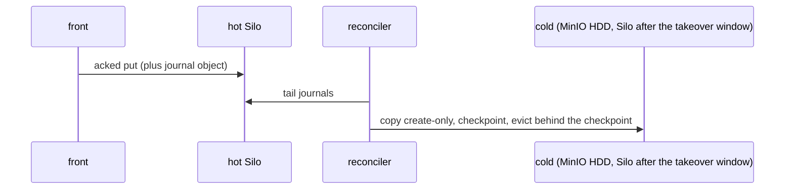
One lease-guarded reconciler tails journals, copies hot to cold create-only, checkpoints, and evicts behind the checkpoint above 80% down to 70% (`crates/tierstore/src/reconciler.rs:98-130`, `crates/tierstore/src/lease.rs:10-23`). Adopted `cas/b/` packs are CAS: they are copied like any CAS object (6.6, VERIFY the prefix filter).

### S10 Cancel
```mermaid
sequenceDiagram
  participant F as frontend
  participant G as js-agent
  participant O as store
  F->>F: js-sched cancel, attempt marked dead
  F-->>G: Cancel in the next heartbeat reply
  G->>G: SIGTERM, then --stop-grace (default 10 s, max 3600 s), then forced removal; an in-flight upload is dropped
```
A presigned URL cannot be revoked. What bounds it: a short expiry; create-only, so a late write can never replace an object; the epoch, since CommitPack adopts only keys of the accepted lease's slots; and the GC, which collects the unindexed keys of a dead epoch after the grace period. A dropped connection leaves no visible object. Nothing under a dead epoch is ever indexed.

### S11 Drain
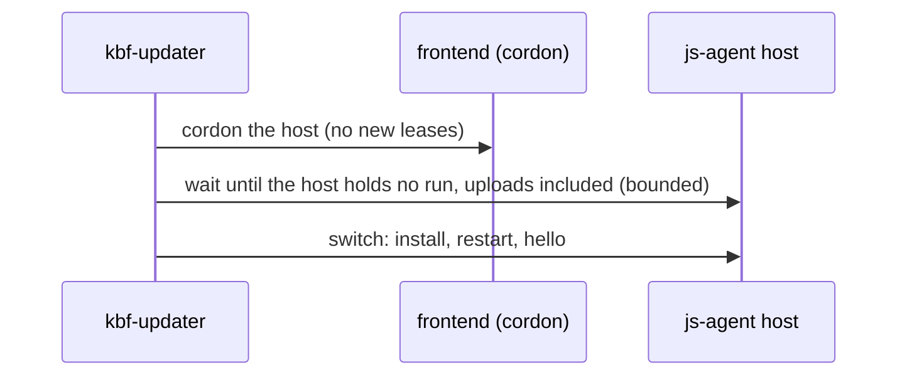
Cordon through the scheduler first, signal the process last. **Worker host:** the updater cordons the host id, waits until the host holds no run (the task's upload is part of its run), and only then switches. A js-agent SIGTERM alone stops jobs after `--drain-wait` (`crates/js-agent/src/lib.rs:127-132`). The wait has an upper bound (a configured cap, default one lease max wall); past it, the updater does not signal, leaves the host cordoned and reports the exact blocker, and the owner rule "never remove a stuck host from role counts" holds. **Frontend:** `/readyz` 503, lb-wait, refuse new, wait for open executions (15 minutes per rev 7 §6; the coordinator path waits with no default deadline, kbf#1881); uploads go to the store, not through the frontend; a commit in flight is re-driven from the result, which the agent resends until acknowledged. **Tierstore front:** readyz 503, lb-wait 10 s, in-flight up to 15 min (`crates/tierstore/src/server/mod.rs:95-106`); an upload longer than that is cut (INFERRED), which a 128 MiB pack does not reach. **Storage (until retirement):** the existing storage drain. **Mac:** wait for leases.

---

## 8. Trust table

**Escape levels (legend).** **L0**: code in an action or task container, no escape. **L1**: escaped from its container to the host as the container's uid (a non-root host user; with the per-run uid of S5, one uid per run). **L2**: root on the host, which includes the agent's own compromise because the agent is root. Rows say what each level reaches.

**What an escaped job can reach now that the whole task holds the URL (owner ruling, 12:30Z).** At L0 the task holds the read grant and the upload grant for its own lease, and its network reaches the store and the frontend only. It can read its own action's input closure, and write its own lease's slots once each, create-only, at most 128 MiB each, and nothing else: the URLs give no read, no delete, no overwrite, no other key. What a hostile action can do with them: PUT garbage or a second write (refused or failed by CommitPack), PUT a self-consistent pack of its own choosing, rewrite the report or take over the task tool (same uid and container). What it can forge is its own result for its own action digest: its output bytes, and, since it can take over the tool, the tool's exit claim; the exit status that counts is the container's, which the agent reports independently. That forgery stays inside the tenant's own action key, which is why the per-instance action-cache namespace (storage design decision 10, gate C7) is a blocking prerequisite. At L1 (escaped to the host as the run's uid) the escape reaches the run's own grant file, which the task already holds, and, if runs shared a uid, other runs' grant files through `/proc/<pid>/root`; the per-run uid closes that (S5). A leaked grant is therefore an L0 outcome, bounded as above, and an L2 outcome (agent compromise) adds only the in-flight grants of that host, each bound to one lease.

### 8.1 Per component

| Component | Identity | Credentials held | uid | An escaped action reaches |
|---|---|---|---|---|
| Task container: the action and the kbf task tool | none | the read grant (one action's closure) and the `UploadGrant` (one presigned PUT per slot), as 0400 files of the run's uid on a per-run tmpfs | per-run uid (NEW; 65534 today) | L0: its scratch, its own closure, its own slots; egress to the store and the frontend only. Can forge its own result for its own action digest (above) |
| Fetch step (only if D2 picks a separate `job-fetch` container or an agent step) | none | input token, one action's closure; per-digest capabilities. **No write grant** | per-run uid | That closure |
| Report relay | the agent | none of its own: it writes the grant files and relays the report; it reads the report by descriptor, no-follow, capped, after the container is dead, and does not trust it | root (the agent) | n/a: nothing it reads is trusted, so a hostile report is a failed or refused commit, never a cache entry |
| Task container (Linux) | n/a | as above | host userns | L1: world-readable host files; with a shared uid, a sibling's grant file and scratch through `/proc/<pid>/root` (S5); the per-run uid closes this |
| Input endpoint | frontend | signing key for capabilities and input tokens; reads the Action | frontend user | Not reachable from tasks except as a client |
| js-agent (Linux) | pool token → host credential | host credential; in-flight grants (each one lease's slots) as files on per-run tmpfs, input tokens in per-run tmpfs files; no store credential at rest; secrets and the grant redacted in `Debug` and `Serialize` and excluded from the state root and run records | root / `CAP_SYS_PTRACE` | L2: trusted base. Agent state, engine, all in-flight grants and tokens on that host (each bounded to one lease), updater cert |
| js-agent (Mac) | as Linux | as Linux; the grant file sits in the lease directory, owned by the lease's pool user, and is removed with it | root LaunchDaemon | L2: as Linux, plus the pool-user home trees |
| Engine | root socket | none | root | n/a |
| kbf-updater / helper | updater cert / closed verb grammar | updater cert | agent unprivileged, helper root | n/a |
| Frontend (+js libs) | farm-CA certs | Postgres, CAS write role, AC write, the presign-only key file | container user | Not reachable; runs no tasks |
| Minter | frontend | the presign-only key: create-only single PUT under `cas/b/`, 128 MiB, no multipart, expiry ceiling | frontend user | Bounded by the ceiling; cannot read, delete or overwrite |
| CommitPack / ingest | frontend (or its own process) | read identity on `cas/`, pack-index writes, `Role::Ingest` for the AC entry of the lease's action | frontend user or own | n/a |
| CAS garbage collector | own | `cas-gc`: delete on `cas/`, never create; refuses indexed keys | own user | n/a |
| Tierstore front / reconciler | node identity | hot and cold backend keys (0600) and the presign verification secret (symmetric) | `tierstore` | L2 on a task-hosting node: all backend keys, the whole store, and the ability to mint junk-pack URLs (6.8) |
| Hot Silo, cold store | operator | its own root credential | its own user / pod | n/a |
| kbf storage (until retirement) | storage cert | cold-store key, block files | `kbf` (shared with actions today) | L1 today: key readable. After the uid split, L2 only |
| Elastic host agent | host credential | host credential; cloud instance identity if the metadata block fails | root | L2: plus the cloud identity unless the block holds (prove live, 8.2) |
| Mac sandbox pool user | per-lease `kbf-pool-N` | its own lease's grant files (0400, its uid); no other lease's, no store credential | pool user | L1: that user and the host's world-readable files; reads are open today (Mac research). Egress needs the `pf` allow-list (10.2) |
| Mac VM guest | none | none today: no network device. Whether the guest holds a URL, or a host relay does the PUT, is open (10.2, Q21) | guest user | Hypervisor escape |
| Envoy, Postgres, signer | as deployed | as deployed | as deployed (not re-checked) | Not reachable from tasks |

### 8.2 Escape level by host type

| Host type | L0 / L1 (container) | L2 (root) |
|---|---|---|
| Linux worker-only | A write path to its own lease's slots and a read path to its own closure, nothing else; egress limited to the store and the frontend by the NEW network profile and host firewall | Agent state, in-flight grants (each one lease's slots) and tokens, updater cert. No store credential, no kbf node cert |
| Storage node co-located with tasks | Same | All backend credentials and the presign verification secret (6.8). This is the old accepted risk relocated (D5); a root agent defeats the uid split, so the split covers L1 only |
| Dedicated storage host (no tasks) | n/a | n/a (cost: the node loses worker capacity) |
| Elastic Lambda | Same; metadata endpoint dropped before agent start (`docs/design/pools-providers-network.md:1035-1041`) | Plus instance cloud identity unless the block holds (prove with a live check) |
| Mac VM | Open under the 12:30Z shape: a guest with no network device cannot PUT (10.2, Q21) | Hypervisor escape |
| Mac sandbox | Pool user holds its own lease's grant files; `On` network is open with best-effort denies, which now matters for a credential: the `pf` allow-list is a precondition (10.2) | uid boundary only |
| Frontend | Not reachable by design | n/a |

### 8.3 Grant handling requirements (agent as trusted base)
- The `upload` field is redacted in `Debug`, logging and every echo (heartbeat, `RunResult.detail`, run API reads); Debug prints `<upload grant: N slots>`. A test round-trips a full `JobSpec` through `Debug` and JSON logging and finds no URL or signature byte; another test finds it in no env, no args, no mount and no result frame.
- It is excluded from the state root and from persisted run records. The only copy is the 0400 file of the run's uid on a per-run tmpfs, in a root-only directory, with one read-only file mount into that run's container and no other mount. It is removed with the run. Because the task keeps the file for the whole run, an agent restart changes nothing: the task keeps uploading and the adopting agent reads the report when the container exits. Mac sandbox: the same file in the lease directory, owned by the pool user; the VM is open (Q21).
- The heartbeat transport is TLS to the frontend with the host credential. The same rule covers the read grant or input token's tmpfs file (0400, in a 0700 per-run directory, owned by the run's uid).
- Host egress of the task container is an allow-list of the store endpoint and the frontend (with the capability-serving endpoints), in nftables on the host and keyed to the run's network, not enforced by the engine; the metadata endpoint and every other destination are dropped. A planted allow must go red. The agent's own egress is separate (the frontend, and on a cloud host the metadata block). The allow-list is what keeps a URL held by hostile code from being sent anywhere but the store it is bound to.

Residual, stated honestly: a hostile action holds its own lease's URLs by design. The bound is tierstore's presign-only role (create-only, one key, 128 MiB, no read, no delete, short expiry), the egress allow-list, CommitPack and the independent exit status. What remains is a forged result for the tenant's own action digest, and a denial of service on its own lease. Storage design decision 3 (refuse a job that uploads itself, in multi-tenant instances) was written for the superseded post-exit step; it is restated, not applied (6.5).

---

## 9. Failure table

| Event | What happens; what is lost; how it recovers |
|---|---|
| Worker host dies | Running tasks vanish; heartbeats time out; the scheduler re-leases at epoch+1; the client sees a retry. Lost: running work. A pack half-written to the store leaves no visible object (the object appears only after a complete body); a complete pack of the dead epoch is never indexed and the GC collects it |
| js-agent restarts | Containers are engine-owned; the agent adopts matching labels, evicts others, resends unacked results; taint persists (`crates/js-agent/src/lib.rs:29,53-62`); no keeper, so scratch of non-adoptable runs is not swept. The grant file lives with the run, so the task keeps uploading across the restart and the adopting agent reads the report when the container exits (a Mac sandbox is the same). A drain with the default `--drain-wait` 10 s could cut an upload |
| Frontend (and with it the embedded js server) restarts | These are one process under the owner model. Leases and epochs are in Postgres; agents re-register to either frontend; undelivered Starts are resent; Execute streams are cut (the client reruns); a commit in flight is redriven from the resent result and is idempotent per key. **Rule where behaviour is not verified** (the embedded server's run state, Q15): assume it does not survive, treat every lease the new process did not load as lost, and re-lease at epoch+1. The presign key is a file, so a restarted frontend mints again; URLs already minted stay valid to expiry |
| Postgres down | No new leases or results; Execute for uncached actions fails or waits; running steps finish and their results queue in the agent; AC hits that need no row may still answer; CAS closure checks and pack rows are also unavailable, so reads of adopted packs stop: the whole farm |
| Storage node down | Co-located tasks fail as for a worker death. Hot Silo degrades within erasure tolerance; clients fail over; hot-only objects are lost beyond tolerance (rev 7 App K); a reconciler on the dead host pauses copying and eviction until lease takeover (30 s) |
| Store wholly down | Uploads fail: the task reports `UploadRefused` or a transport error, which the frontend treats as an infrastructure failure, never an action failure, and reruns. The farm cannot serve CAS bytes either; closure checks answer from Postgres |
| Cold down | Hot keeps accepting until full, then puts fail; copy-lag alert |
| Hot image full | The 200 GB image per node is fixed. A PUT that cannot be stored fails; the upload is an infrastructure failure and reruns. Alert on hot fill well before the eviction threshold; do not rely on the 7-day expiry (6.9 item 6) |
| Network partition | Agent to frontend: the scheduler loses the lease and re-leases at epoch+1; the partitioned container keeps running, and the task may still PUT with URLs live to expiry (the hard bound). Those keys belong to a dead epoch and are never indexed. Host to store: the upload fails, infrastructure failure, rerun |
| URL expiry | A grant that lapses before or during the upload is reported by the task as `GrantExpired`; tierstore's refusal is the authority and `expires_unix_ms` is advisory on the host, so a skewed host still tries. The frontend re-mints with new nonces on retry. The expiry is lease max wall plus slack, so this happens only past the lease limit or on a long-delayed upload |
| Partial or malformed pack | A dropped connection leaves nothing. A complete object that is truncated, misordered, overlapping, over 128 MiB, or whose footer differs from the manifest is refused by CommitPack: uncached infrastructure failure, rerun, GC collects the keys |
| Outputs too large | The task uploads nothing and reports `TooLarge { needed_slots, needed_bytes }`. If the need is within the ceiling of 8 slots the frontend may re-mint with more; beyond it the action fails with a clear error (outputs exceed the per-action upload limit). Never a truncated pack |
| Ingest refusal by reason | Counted by reason and by host; repeated refusals from one host are an operator alert. A refusal is never cached |
| Clock skew | Expiry is checked by the store on its own clock; `valid_for_ms` is measured on the agent's clock alone, so skew moves neither bound. Alert on host clock error (the updater already reports clock) |
| Escaped action | Taint at post-job checks and at grant; the host takes no work. L2 on a co-located node means all backend keys |
| URL or grant leak | The task holds its URLs by design (the 12:30Z ruling), so "leak" means beyond its own lease: egress is limited to the store and the frontend. One URL writes one key once (create-only), under `cas/b/`, 128 MiB, until it expires. A leaker racing the real writer is caught by CommitPack's full hash against the manifest; a bad pack is refused and the action reruns. A leaked presign key writes junk `cas/b/` packs until rotated; it cannot read, delete or overwrite. Never a cache poison |
| CommitPack or GC down | Results wait; Execute latency grows; unindexed keys accumulate; the hot fill alert is the backstop (H-sharded would have no cold backstop: 6.6) |
| Reconciler down | Copies and eviction pause; stale usage counts as "not full" (`crates/tierstore/src/tiered.rs:157-165`): alert needed |
| Mac host dies | Running leases vanish; the scheduler re-leases at epoch+1. Pool user homes and lease directories (grant files included) are cleaned at next start |
| Elastic host fails to launch or dies | The pool check loop does not admit it; the scaler retries within its budget; running work re-leases at epoch+1; the provider terminates an idle or broken host. Spend continues until termination: alert |

---

## 10. The Mac

### 10.1 What the sources say
- **Owner (10:50Z, 10:55Z):** two options are needed today, a sandbox (`sandbox-exec` plus a per-lease user) AND a VM (Virtualization.framework, two VMs per host). This supersedes the earlier note that said "VM" only.
- **Mac design rev 2:** a pool of users, one bound to one run, one Seatbelt profile per action, no overlay, VMs only when needed; a root agent; a trusted `kbf-executor` beside the agent holding storage credentials (§0, §3.1, §6.2, §10, §13).
- **The Mac packaging design (draft 2, DECIDED as the packaging direction on 2026-10-29):** OCI distribution for a darwin task bundle and a VM base, a root-owned content-addressed host store, two read models in the Seatbelt profile, and a vsock put-only relay for a no-network guest. Sections 10.2 and 10.3 follow it.
- **Live Macs (Mac packaging research, read-only):** the "base" of a Mac action is the host itself: Xcode in `/Applications` picked per action with `DEVELOPER_DIR`; the only kbf file distributed to the Macs is the `kbf` binary (about 41 MB) in a digest-named release directory; 100 `kbf-pool-N` users per Mac on a separate APFS volume; no VM tooling or VM images on either Mac.
- **js:** the Mac agent refuses container jobs (`crates/js-agent/src/lib.rs:45`); there is no `VmRuntime`; `js-vmm` has probes and the base-image builder (`crates/js-vmm/src/lib.rs:1-5`); `VmSpec` has no network device (`crates/js-vmm/src/spec.rs:25-26`); the VM design is a fresh VM per run, one `Exec` per VM, no credential in a guest, network none by default, NAT refused until a LAN-deny design exists (`docs/design/vm-backend.md`; VM guests doc §4). `kbf-vmm` is a stub. Open PR jobscheduler#313 is a probe crate with a workflow on hosted macOS runners (not an empty draft, as the research note first said); read what it proves before planning a new probe.

### 10.2 Reconciliation of rev 2 and the owner model (NEW)
The task contract is runtime-neutral: a launch of container-or-native steps and an upload grant, a run and a result. A Mac pool declares its runtime (`exec = sandbox-exec` or `runtime = vm`) and refuses the other (rev 2 §13). The two options are two pools behind one contract.

| Point | Mac design rev 2 | Owner model and wire spec | Resolution |
|---|---|---|---|
| Isolation | sandbox default, VM when needed | both, today | Both pools; the default for kbf's own builds is D3 |
| Executor | `kbf-executor` beside the agent | none beside the agent | Dropped. The task tool runs inside the sandbox as the job's entrypoint, not beside the agent, and fetches inputs under its read grant and uploads under its upload grant (12:30Z; D2 (c)). If D2 picks an agent-side fetch instead, the root agent stages inputs into the lease directory under the extraction rules. Hash and AC are CommitPack in the frontend. Slot clean and fence stay in the agent |
| Credential | executor holds it outside pool uids; "no secret but join token and executor credentials" | the launch carries the grant to the agent, which gives it to the task (12:30Z) | Rev 2's claim is contradicted. In the sandbox the grant is a 0400 file owned by the lease's pool uid in the lease directory, removed with it; no other pool uid and no agent state path is readable by that uid (Seatbelt). The VM case is open (below) |
| Network | `On` is best-effort; `pf` deferred | the task needs the store and the frontend | The sandbox task now holds a credential, so the `pf` anchor (egress limited to the store and the frontend) is again a precondition for a credential-bearing sandbox task; the earlier reading, that nothing in the sandbox is credential-bearing, is superseded. A no-network guest cannot PUT: see below |
| Guest agent | `kbf-guest` | no kbf process beside the agent | `js-guest` exists; retire `kbf-guest` as a duplicate (INFERRED) |

**Output order on a Mac (conflict between companion documents; the Mac side resolves it, Q21).** The wire spec's section 6 and the Mac packaging design (6.5, D10) describe a root-owned handover directory, an agent-side uploader and a vsock put-only relay, with a guest that never holds a URL. The 12:30Z ruling supersedes the agent-side uploader and that rule. What this doc assumes until the Mac side updates them:
1. *Sandbox.* The task tool runs as the sandbox entrypoint under the lease's pool uid, runs the action as its child, collects the declared outputs under the `kbf-outputs` rules, writes the packs inside the lease directory and PUTs them under the egress allow-list. The run exits; the agent kills the uid's processes, verifies that none remain, reads the report as on Linux (by descriptor, no-follow, capped) and relays it. The grant file and the packs go with the lease directory. The packs count against the run's disk quota; outputs above `max_slots × max_pack_bytes` upload nothing and report `TooLarge`.
2. *VM. Open.* A guest with no network device cannot PUT, and NAT is refused until a LAN-deny design exists. The options are a guest route limited to the store and the frontend (the Linux shape, needs that design), or a host relay that performs the PUT for the guest, which is the agent-side uploader the 12:30Z ruling superseded and must be re-ruled by the owner if wanted. Recommendation: do not ship VM leases that take an upload grant until one is decided; the Macs stay on the daemon (D3 (c), 10.6).
3. *Clock.* `expires_unix_ms` is advisory on the host; a skewed Mac still tries the PUT and tierstore's refusal is the authority.
4. *Defaults.* `max_slots` defaults to 1 for a native action and up to 4 when the action declares large outputs; the slack is 10 minutes, enough to cover the collect and the upload after the action.
5. *Tests on the Mac side* (hosted macOS runner plus Linux): the task tool against a fake tierstore (create-only, size cap, an expired URL), covering `TooLarge` with no partial upload, `GrantExpired` and `UploadRefused` with its status; the grant file is 0400, owned by the lease's pool uid and unreadable by any other pool uid; the report is not read before the uid is verified dead; the grant never appears in env, args, logs or the result.

### 10.3 Packaging (DECIDED 2026-10-29: OCI distribution per the Mac packaging design, draft 2)
There is no usable Mac-native container standard, and none is needed. OCI is the transport and the pin (distribution protocol, image manifests with `artifactType`, content digests); it is not a runtime format. The Mac has no namespaces and no bind or overlay mounts, and a change of root followed by an exec is killed (komira-ai/kbf#1902), so the private root a container format exists for cannot be had. The useful half, content-addressed digest-pinned distribution, is kept and the runtime is dropped.

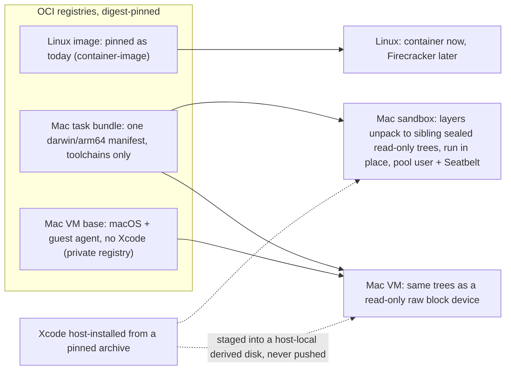

- **Bundle.** An OCI image manifest with `artifactType: application/vnd.komira.js.bundle.v1`. Layers are deterministic tar+zstd and are sibling trees, never a union. The config declares what the bundle needs from the host in a closed vocabulary, never as profile text or a path. **It holds toolchains only (the Mac packaging design E2).** That design decided it carries no kbf job-side program because the upload was the agent's step. Under the 12:30Z ruling the task tool uploads, so the tool must reach the sandbox or the VM some other way (the agent places it by digest from its own store, or a bundle layer carries it): the Mac side decides (Q21, Q22).
- **One darwin manifest digest is the pin; an index is never pinned or accepted by the agent.** A job pins one darwin/arm64 manifest digest in a new `JobSpec.bundle` (`name@sha256:<digest>`, at most one per job; an index digest is refused as `bundle-index`). An index digest in the action key would couple Linux and Mac cache keys. This supersedes the earlier draft's "one image index digest names Linux and Mac content together". Linux and Mac keep separate pins; the bundle digest reaches kbf's action key as a platform property `bundle` (a reservation until an action needs a bundle tool), because the tools live outside the input root.
- **VM base.** A separate artifact type (chunked sparse disk, aux, hardware model, machine identifier, sizing), Xcode-free, preloaded and not pulled at task time; at most two VMs per host. The derived Xcode disk is host-local and the export function refuses it. The task bundle enters the VM as a read-only raw block device, not a virtiofs share, until a probe clears virtiofs.
- **Sandbox run.** No root switch: the task runs from the sealed, root-owned read-only trees by absolute path as a pool user under Seatbelt, writes only inside its lease directory, and gets a writable APFS clone only if a tool needs one. The profile has two read models: `Open` (what kbf runs today, the default and what every action without a bundle keeps) and `Allow` (an allow-list, only for bundle actions, in a pool that enables it, after a trace on the farm's macOS and a startup self-test).
- **Xcode.** Never in a registry, bundle layer or pullable base. Sandbox: installed on the host from a pinned archive. VM: staged into a host-local derived disk that is never exported.
- **Registry and build.** Bundles live in a public GitHub-hosted registry; the macvm base in a private one. Bundles are built, signed, pushed and attested by one job on a hosted macOS runner; the farm is not a builder in the first version. Build and tests are Rust or Zig, with no shell or Python.
- **Trust.** The digest is the trust root for bytes. Farm hosts run with a root-owned allow list of manifest digests that the kbf updater writes from the signed release manifest (`--bundle-trust list`, `--bundle-pull never`, a prefetch file), plus a deny file; `digest` trust is for developer hosts only. Rolling a bundle is a release.
- **Extraction is hostile-input handling.** Root verifies the compressed digest before decoding and runs only the zstd decoder; the tar parser runs in a forked helper under an unprivileged uid; root re-checks the stage by descriptor and seals it.
- **Corrections to the research note** (from its own check pass): the OCI client to extend for js-agent is `crates/js-contain/src/oci/image.rs:59-61` (it refuses indexes today), not kbf's; the shipped slot profile denies `lsopen` and writes outside the lease (`kbf-driver-native/src/network.rs:116-129`), and the `mach-register` and `file-mount` denies are designed in `macos-end-state.md`, not shipped; cross-volume `clonefile` gives `EXDEV` and a non-APFS volume gives `ENOTSUP`, and kbf's fast-sandbox design falls back to per-file copy; Apple's `container` 1.0 (per several secondary sources) runs Linux containers only and does not help macOS targets.

### 10.4 Status of the Mac decisions
- **Packaging format and distribution: decided** (10.3). The earlier draft's D4 is closed.
- **The Mac packaging design's questions C1-C8 are already with the owner there** (hosting the Xcode-free VM base in a registry we operate, Xcode in a VM, VM leases for other parties, registry choice and spend, the trust root, Developer ID, attestation visibility, and the one manual package-visibility step). They are referenced, not re-asked. The earlier D4a is its C1. The earlier D4b (deny sandbox reads of host tool directories) is its `Allow` read model, which that design carries as a maintainers' question (E9). The earlier D4c (a no-network guest uploads through a host put-only relay) was decided in that design and the wire spec, and is now in conflict with the 12:30Z ruling (10.2, Q21).
- **Still open here: the Mac default for kbf's own builds (D3, section 15).**

### 10.5 VM cost (assumed, unmeasured)
At most two VMs per host, so the farm's two Macs hold four guests. Boot is 20 to 60 s (assumed), 3 to 4 GiB idle memory, clone growth up to about 40 GiB, cold caches, a reduced Metal device (GPU work stays a bare-metal lease), and a licence that excludes service-bureau use (review before a second consumer). A VM per action is 10 to 100 times the action time and is infeasible; **a VM must be per lease or per build**, which conflicts with the VM design's "fresh VM per run" and must be reconciled in that design. V1 adds a boot and restore-from-snapshot probe. The throughput bound is about 2 × 3600 / (boot + run) per Mac per hour for per-run VMs (INFERRED). Memory in a VM follows the one memory setting; no VM-specific cap is added here.

### 10.6 Until a Mac runtime exists
The Macs stay on the kbf daemon (`Role::Daemon`). This is a departure from "two options today" and it is flagged: no runtime exists, so building both pools is the work, not the starting state. The frontends keep the kbf worker stream and a kbf process stays on the Macs; the doc must not claim "only js-agent" for the Macs. The wire spec lets the daemon's native path carry the same `UploadGrant` in kbf's `Start` and report the same `PackReport`s, so once kbf adds that message the Macs write packs through the same presigned PUT and the same CommitPack, instead of keeping a second output surface (INFERRED; it is the intent of the wire spec, not code). The retirement gates count every daemon on the packer, Mac daemons included.

### 10.7 Work order
V0 Macs unchanged. V1 probes P0-P9 (VM guests doc §11; P5, a VM from a launch daemon's child with nobody logged in, is the biggest risk; no recorded result shows a guest reaching userspace on the Mac Studios). V2 the runtime(s) in js-agent: OCI client with index refusal and `artifactType`, a store on one APFS volume, delivery of the task tool and the grant file to the sandbox, and the VM route (Q21). V3 one Mac in a pool. Hosted macOS runners cannot boot a guest. The Mac packaging design's own PR sequence (its section 8) orders the bundle work and is not repeated.

---

## 11. Firecracker (Linux, later)
The same digest-pinned OCI image runs inside a Firecracker microVM, behind the same step contract (owner model 10:55Z). Prerequisites, none built: KVM on the host, and nested virtualization on elastic Lambda hosts (unverified that the provider exposes it); a rootfs converted from the OCI image; and delivery of the grants (like the input token) by vsock or a read-only block device, since a microVM has no host bind mount. The task tool inside the microVM holds the grants and PUTs, so the microVM needs a route to the store and the frontend only (an allow-listed tap device; the same host-firewall rule as a container); the agent reads the report after the microVM stops. Nothing in `upload`, `secrets` or `network` may assume a container engine.

---

## 12. Updates and rollback

**Who releases what.**

| Component | Released by | Artifact | Note |
|---|---|---|---|
| kbf frontend with embedded js libs | kbf `artifacts.yml` then `release.yml` | attested tarballs/deb/image | js libs are git deps at one revision, raised by a PR of its own (`Cargo.toml:76-90`@kbf, currently `a826aba49`, thirteen commits behind jobscheduler main when this was written); the embedded server version is whatever kbf pins, while the agent ships from main, so skew between them is the normal case (rule S2) |
| js-agent | jobscheduler `release.yml`, every push to main that ships code (`docs/release.md`) | `js-agent-X.Y.Z-x86_64-unknown-linux-musl.tar.gz` + `SHA256SUMS`; no bundle, arm64 or macOS asset; deb is jobscheduler#300 (open) | asset names do not match the helper's `<prefix>-<commit>-<platform>` + `.sigstore.json` |
| `js-pack-format` | jobscheduler (then re-exported by kbf) | `js-pack-format` crate in jobscheduler, re-exported by kbf | the writer (task tool) and verifier (frontend) share one crate; see skew rule S6 below |
| Task tool and action images | kbf (the task tool; `job-fetch` only if D2 picks it), the job (action) | digest-pinned | frontend names the digest in each `JobSpec`; how the tool reaches an arbitrary action image is Q22 |
| Tierstore front | kbf `artifacts.yml` (already builds and attests tarballs) | tarball + unit, not started at install | not managed by the host updater |
| Hot and cold Silo | operator | the Silo release pinned by the takeover scripts (hot first, cold at the takeover window) | update and rollback path is the storage design's; upstream MinIO is archived, which is why the pin matters |
| Mac task bundle and VM base | a hosted macOS runner job (bundle) and the release workflow (base) | OCI artifacts by digest, in the signed release manifest and the host allow file | hosting the base is the Mac packaging design's C1, with the owner there |
| Elastic host | not updated, replaced | boot pin (sha256) | rollout = change the pin |

**How each host gets it.** Host-driven and pull-shaped: the unprivileged `kbf-updater` resolves the version, verifies the attestation and asks the root helper `kbf-host-install` (`docs/design/updates.md` §2, 4, 5). The coordinator already has services as data with roles, limits, `after` (kbf#1818-#1825 merged). `js-agent` needs: kbf#1826 (described services; open, Linux local socket only; Mac helper "serves kbf only"), a `[[service]] name="js-agent" after=["kbf"]` entry, `--version --json` (neither js-agent nor tierstore prints it), a unit with `Restart=always` (js-agent exits 0 on SIGTERM and 2 on refusal and leaves containers for adoption, `crates/js-agent/src/lib.rs:109-118`; kbf units use `RestartPreventExitStatus=2`), and `TimeoutStopSec` above `drain-wait + 30 s`.

**Order.** Code wins over rev 7 App A (which says frontends first): the built-in `kbf` service updates storage and daemons first, frontends last (`crates/kbf-coordinator/src/services.rs:99`). The js rule is servers before agents, and the server is the kbf frontend, so `js-agent` is `after = ["kbf"]`. Tierstore's presign verifier (kbf#1922) before the minter that signs for it, set by the release job (the built-in `kbf` service cannot be redefined). Never two services on one host at once (kbf#1825).

**One js-agent host.** Update ordered only after kbf converged → updater installs on trial → NEW cordon and wait-for-zero-runs on the host (a fifth route, host id equal to updater node id, INFERRED), bounded by a cap (S11) so a long action cannot block an update indefinitely → switch → Hello (protocol range; refusal `unsupported-protocol` ends the agent with exit 2, fails closed) → ready URL → confirm or helper reverts → uncordon.

**Skew rules.**

| # | Pair | Rule |
|---|---|---|
| S1 | frontend N / N-1 | Additive schema on shared Postgres; N-1 runs on N schema (test NEW) |
| S2 | embedded server (pinned revision) / standalone agent | Protocol major in Hello/Welcome; additive fields in a major; skew test in jobscheduler CI: newest agent vs kbf's pinned server and reverse (NEW) |
| S3 | security fields | Gate on `Hello.capabilities`, never version text (old receivers silently ignore unknown fields). `upload` is sent only to an agent that advertises it; an older agent that would ignore it returns `upload: None`, which fails the action rather than passing it |
| S4 | frontend / task tool or `job-fetch` image | The frontend names the task image digest in each `JobSpec`; an image on every host before frontend N places work needs an image capability in Hello (NEW). Disappears if D2 chooses an agent step, and shrinks to the tool's own version if D2 chooses (c) |
| S5 | minter / tierstore verifier | The URL is standard SigV4, so there is no token format version. The presign key carries a key id; the verifier accepts current and previous. The frontend's `max_slots` and expiry must stay within the verifier's ceilings; a URL outside them is refused with a valid signature (a refused upload is an infrastructure failure, so a ceiling lowered under a running frontend shows as a rise in `UploadRefused`) |
| S6 | pack writer (task tool) / CommitPack (frontend) | One crate, `js-pack-format`, with the footer's version field. The frontend verifies versions N and N-1; a pack written in a newer format than the frontend verifies is refused as an uncached infrastructure failure. The tool lives in the task image, which the frontend pins by digest, so the frontend sends `upload` only with a task image whose tool writes a format it verifies (the image digest-to-format mapping is the release job's) |
| S7 | agent N / N-1 on one host | N-1 adopts containers N started and reads N's state root (test NEW) |
| S8 | `steps` primitive / older agent | A `Start` with `steps` goes only to an agent whose Hello advertises the capability; an older agent is never sent a one-container spec that silently drops `secrets` |

**Rollback.** kbf service: set an older version (helper installs older; revert if `/readyz` fails). Embedded js libs: revert the pin PR; agents keep older range. js-agent: helper trial-and-revert per service; containers adopted; taint sticky. Images: re-issue D(N-1). Tierstore: helper `previous` link; objects immutable, packs keep the segment layout. Silo: the takeover's rollback is the storage design's. Mac: detached launchd apply reverts; images immutable by digest. Elastic: change the pin back.

**Signer trust (K36, D45(4); D4).** The old assumption that js-agent ships inside the kbf package is gone. Options: O1 trust jobscheduler's `release.yml` via the root-owned `trusted_workflows` (`docs/deploy/host-install.md`); jobscheduler has no rulesets and `main` is unprotected at drafting, and js-agent runs as root, so whoever can push main gets root on every host. O2 kbf republishes js-agent under its own signer (paired with the embedded server; agent fixes wait for a kbf bump). **O2 is required before any production install, not a lean**: with O1 and an unprotected `main`, the right to push `main` is root on every host. Even under O2, jobscheduler needs rulesets or branch protection before kbf republishes its agent. Reopen O1 only after rulesets and a protected release environment exist.

**Owner rules.** No update logic in any service (all in updater/coordinator/helper). Frontends never restart on their own (only an ordered, drained switch). Alert with the exact fix: no alert emitter exists in coordinator/updater (failures show as `blocked` on `GET /v1/convergence`, `crates/kbf-coordinator/src/converge.rs:11,189`); NEW text per signal, e.g. `channel_not_allowed` → "add the release workflow to `trusted_workflows` on host X"; `service_not_configured`, `no_current`, `unsupported-protocol` (state both major ranges), host tainted. Never remove a stuck host from role counts to converge.

---

## 13. Migration from section 3 (today)

**Rules every step obeys.**
1. Reversible: each step names its undo; two one-way doors are labelled (A7 retirement, F1).
2. Benchmark guard classes (NEW). A benchmark lock exists as a single holder line (session, host class, run label, UTC time) kept by the farm operator outside both repositories; no definition, owner or enforcement of it, and no definition of the frozen sets, is in jobscheduler or kbf at the revisions read (a keyword result), so Q9 stays open and D6 asks the owner to name the lock's owner: **G0** nothing a counted run can see; **G1** one named node outside the benchmark set (step fails if the node is in the set); **G2** a node in the set, a frontend, or a shared store: only in a gap with the lock taken, never preempting a counted run, one uncounted warm run after; **G3** a fleet release roll, G2 rules, as few rolls as possible, a roll without the lock discards the run.
3. A node is in daemon mode or agent mode, never both (both would double-book capacity, breaking "no reservation").
4. Benchmark nodes stay in daemon mode until js-agent can quiesce: counted runs reserve a whole node (`docs/design/reserve-node.md`) and the agent has no `Quiesce`, so a whole-node lease refuses every start (`lib.rs:136-148`@jobscheduler `f8f7f84fd`).
5. Cluster writes, uploads, cloud spend: the owner's go per action. That includes installing Silo and creating the loopback images on the storage nodes.
6. Do not touch the flip's files or kbf-updater PRs #1817-#1832; no pin bump during a counted run.
7. Every step ends in a gate that can go red, and a step with no budget set by the owner does not advance (section 14 pass rule).
8. A4 (the first real actions through the new path) is blocked until the per-instance action-cache namespace gate passes (R13, storage design decision 10).

**Common steps.**

| Step | Change | Undo | Guard | Go | Gate |
|---|---|---|---|---|---|
| C0 | Owner answers D1-D6. Conformance targets on the farm for the presigned path through a tierstore front over a throwaway store: a presigned PUT works; second PUT of a key fails (create-only); an object above 128 MiB is cut by the received-byte count even with a lying `Content-Length`; an expiry above the ceiling is refused with a valid signature; another prefix, another method and multipart are refused; `_journal/` and `_tiering/` are refused; the query string is in no log; a dropped body leaves no object | delete target | G0 | none | each case red on a planted violation |
| C1 | Land doc changes (section 17); mark jobscheduler design.md 5.4, 9.2-9.4 and steps 21a, 34 superseded | revert | G0 | none | doc lint, citations |
| C2 | Build behind flags in js: `steps` (only if D2 needs it), `upload`, `secrets`, `network`, per-run uid, log capture, the held heartbeat, the `js-pack-format` crate, the grant file and the report relay; in kbf: the task tool (fetch phase, action, pack, PUT, report), agent listener, minter, CommitPack variant, the `cas/b/` GC rule, input endpoint with capabilities, `job-fetch` (or the agent fetch step: D2); js-agent as a described service; layering decision for `js-agent-wire` and `js-pack-format` (Q6). After the flip merges | flags off | G0 | none | tests; a planted widened scope goes red; the redaction test finds no URL byte; a planted allow in the firewall fragment is caught; a planted early read of the report (before the uid is verified dead) is caught; the grant file is 0400 for the run's uid and in no env, args or other mount; a second PUT to a slot is refused |
| C3 | Roll 1: one kbf release carrying C2, all flags off | coordinator revert | G3 | none | converged; S0 within baseline spread |
| C4 | Split storage/daemon on a canary node (`kbf --mode=storage` + `--mode=daemon`, modes exist: `kbf-cli/src/lib.rs:4,136`), own uid, 0600 key, test that an action cannot read the key | reinstall single unit | G1 | none | key-unreadable test; stage S1 |
| C5 | Idle js-agent on the canary in pool `canary`; metadata blocked | stop unit | G1 | none | registers, refuses work |
| C6 | Null and echo tasks through the full path, including a pack upload, a forged footer (refused), a `TooLarge` output (no partial upload) and an expired grant | remove class | G1 | none | stage S2; stale-epoch result rejected; zombie test (epoch N+1 accepted while N keeps writing) |
| C7 | Per-instance AC namespace verified or built (R13) | revert | G0 | none | a planted cross-tenant key collision goes red |
| W1 | Switch non-benchmark nodes one at a time: cordon, drain, stop daemon unit, start js-agent | restart daemon unit | G1 each | none | stages S2-S5, S10 |
| W2 | Benchmark nodes, after `Quiesce` exists | as W1 | G2 | none | S10 within the owner's limit |
| W3 | Worker-only and elastic hosts | terminate | G1 | owner's go for spend | S9 |

**Storage steps (branch A with Silo, decided).**
- **A1** Finish tierstore: the presigned-PUT verifier and presign-only role (kbf#1922), create-only atomic publish, the received-byte size cap, the expiry ceiling, TLS or the declared posture (6.4), the streaming PUT, directory fsync (draft #1920), the stale-usage alert, packaging and updater management. (`ListMultipartUploads` is no longer on the job path: presign keys refuse multipart.)
- **A2** Hot Silo on the storage nodes: native, systemd, a fixed 200 GB loopback XFS image per node on the root SSD (G2, owner's go). The cold tier stays on the MinIO HDD pods until the takeover window, then Silo.
- **A3** Fronts and the reconciler, no clients (G1 then G2; rev 7 App K gate: PUT not acked if the journal write fails, reconciler resumes from checkpoint, copy-lag alert, 95% back-pressure).
- **A4** Canary on real actions (after C7): mint, agent upload, CommitPack adopts in place, AC entry. Reading adopted packs needs the pack read path on the consumers (kbf-pack read, dual-source until backfill: INFERRED from the storage design's step 4).
- **A5** Frontend packs for all actions (the data path changes; G3).
- **A6** Backfill and the Mac packer.
- **A7** Retire the kbf storage processes, **one-way door**, only behind every gate of the storage design's decision 8: `legacy_read_total` zero for 7 consecutive days (the counter does not exist yet), clean sampled digest re-reads, zero staged blocks, every daemon (Mac daemons included) on the packer, every live AC closure resolving from the new index, the rollback path rehearsed on the farm (rebuild from packs alone), and a 30-day decommission window with the packages disabled and the disks untouched.
- **A8** The former storage nodes keep tierstore and hot Silo and gain worker capacity.

**Mac steps** V0-V3 in section 10. The bundle and base artifacts are built and pushed by a release job (a registry upload: the owner's go). **Final window:** F1 remove `bzlcache`/`rbe-cache` pods (a cluster write and a deletion, one-way; redeploy from manifests; **decision D8**, not a default); F2 remove kbf-daemon from migrated storage hosts.

---

## 14. Cost as benchmark stages

No measured number exists for any of these. Each stage runs 3 times on the frozen sets at the pinned komira commit; a run counts only if the lock was held throughout and no roll happened, else it is discarded, never averaged (NEW). Three runs limit what a single stage can detect (small shifts are inside the noise), which is why S10 runs the two paths side by side. Output stages reuse the `kbf-bench` reference tree: 15,000 files (144 empty), 989 directories, 307 MB, 15,848 blobs, 64 in flight (`crates/kbf-bench/README.md`).

| Stage | Runs | Records |
|---|---|---|
| S0 | frozen build through kbf today, cold and warm | wall time, actions/s, p50/p99 by phase (queue, lease, input, run, upload, report), bytes moved, OOM kills, CPU |
| S1 | S0 with storage/daemon split over loopback (C4) | per-blob latency on the local-owner share (1/6 vs 1/3: settles contradiction X5), node CPU |
| S2 | 1,000 no-op and 1,000 echo tasks, each as a one-step and a two-step task, with the plain and the held heartbeat | lease overhead (submit to start, result to answer), the cost of two container starts under a rootful engine against one under crun, grant mint time |
| S3 | input stage-in with no node cache: (a) capability to the store, (b) frontend streaming | bytes fetched per action, time to inputs ready, hit rate lost, **frontend bytes per second and NIC use**, so the funnel is measured against the direct path |
| S4 | the reference output tree as packs: pack write on the agent, then PUT per slot through the presigned path | pack write time, PUT p50/p90/p99, wall time, acks/s: hot Silo put plus journal (linger up to 20 ms), one 32 MiB pack and one 128 MiB pack |
| S5 | CommitPack of S4: read, hash every byte, footer check, adopt | seconds/GB, Execute tail added (the commit is on the critical path), cache-hit p99 while committing, frontend NIC and CPU. SHA-256 about 0.4-0.5 GB/s per core without SHA-NI, 1.5-2 GB/s with (approximate); at 300 actions/s, 1 MB average is under one core and 10 MB is several cores plus about 3 GB/s of NIC (INFERRED); decides whether CommitPack leaves the frontend |
| S6 | copy lag under sustained S4 rate | oldest uncopied age, bytes not in cold, hot fill against the 200 GB images (the reconciler) |
| S7 | Mac: S2 and S4 on a Mac with each runtime | guest boot, concurrent guests, clone growth; sandbox slot clean time; bundle pull time; collect-to-PUT time |
| S8 | grant mint and verify at 10/100/300 per second | signature time per slot (local), tierstore query-auth verify cost and refusal rate, grants minted per second at the frontend. The 300 executions/s figure is tied to S0's measured actions/s, not assumed |
| S9 | elastic host: fetch and upload throughput over the tailnet, egress bytes | MB/s each way, cost per GB of egress as billed, time from acquire to first lease |
| S10 | **in-farm A/B**: the same frozen build run at once on daemon-mode nodes and on agent-mode canary nodes (routed by a platform property) | ratio of actions/s, p99 by phase, OOM kills and CPU throttling, agent over daemon. The owner sets a limit on the ratio (D6) |

**What each step moves** (direction and basis, no invented numbers).

| Step | What changes in the measured numbers | Stage | Notes |
|---|---|---|---|
| C0 | nothing in production (a conformance target on a throwaway store) | S8 | |
| C1 | nothing | n/a | docs only |
| C2, C3 | nothing, and the gate checks it | S0 | |
| C4 | local-owner blobs lose the in-process shortcut: latency and CPU up on that share | S1 | |
| C5 | an idle agent on the canary: its own CPU and memory | S0 on the canary | |
| C6 | lease overhead is a new number (js drives docker/podman, kbf drives crun) | S2 | |
| C7 | nothing measured; correctness gate | n/a | |
| W1, W2 | more bytes fetched (no node cache); the upload is part of the task, so the slot is held until the PUTs return; commit CPU moves from the daemon to CommitPack; host OOM behaviour changes with no per-container cap (memory is one setting); `noexec /tmp` failures | S2-S5, S10 | |
| W3 | WAN fetch and upload; egress cost | S9 | owner's go for spend |
| A1 | nothing in production | n/a | engineering cost only |
| A2 | a new Silo hot tier: capacity (1.2 TB raw across six images; usable after parity not computed, Q13) | S4 | |
| A3 | fronts and reconciler with no clients: node CPU and disk | S6 | |
| A4 | upload ack on hot Silo plus journal; commit in the frontend | S4, S5, S10 | |
| A5 | every action changes data path: one PUT per pack replaces N; the frontend pack index in Postgres is hot | S4, S10 | rate not claimed (the earlier 6,400 acks/s per proxy rested on an assumed 10 ms put and ignored the journal object, so it is dropped) |
| A6 | backfill I/O; Mac packer | S6 | |
| A7 | cold-read tail after eviction | S4 | one-way |
| A8 | former storage nodes gain worker capacity and lose CAS | S0 | |
| V1-V3 | VM boot per lease; concurrent guests capped at two per Mac; bundle pull | S7 | Mac |
| F1 | frees pod capacity; nothing in the benchmark path | S0 | one-way |
| F2 | frees daemon capacity on migrated hosts | S0 | |

**Pass rule (NEW).** A step advances only if: (1) its own stage ran and was recorded; (2) the S10 ratio is inside a limit the owner has set, and **if no limit is set the step does not advance** (the gate fails closed, so it can go red); (3) S0 after the step lies inside the min-max of the three baseline S0 runs, as a coarse backstop; (4) for S5, cache-hit p99 stays inside baseline spread. A failed budget undoes the step.

**Cost summary.**

| | Unbuilt before the first routed job | Added | Removed | Risk |
|---|---|---|---|---|
| **A with Silo (decided)** | The presigned-PUT verifier and presign-only role, TLS or the declared posture, the streaming PUT, hot Silo on the storage nodes (capacity under erasure coding not computed), tierstore packaging and updater management, the pack-format crate and the agent's upload step, the CommitPack variant, the `cas/b/` GC rule, the pack path, `legacy_read_total` | Tierstore fronts and a reconciler per environment, a hot tier on the root SSDs, a CommitPack hash cost on the frontend | Storage nodes' CAS role, replication, repair (at the end, one-way) | High at A5 (all actions change data path); store down is the whole farm |

The Mac adds no second output surface once kbf's `Start` carries the grant (section 10.6); until then it keeps the daemon's.

---

## 15. Decisions for the owner

Two lists. First what the owner has already ruled (not asked again), then the decisions that remain, each with options and a recommendation; none of the remaining ones is decided here.

### Decided (2026-10-29)

| Decision | Ruling | Where it lands here |
|---|---|---|
| Storage branch (old D1) | **Branch A with Silo.** Tierstore on the storage nodes now; hot tier = native Silo under systemd on the shared root SSD, 200 GB per node as a fixed loopback XFS image; cold = Silo after the takeover window (MinIO HDD pods until then). Branch B (MinIO per-job identities) is out: IAM is not portable across stores | 6.2, 13 (A1-A8) |
| Write fence | A standard SigV4 presigned PUT per slot, minted by the frontend with a presign-only key (create-only, under a prefix, at most 128 MiB, no multipart, short expiry); tierstore verifies (kbf#1922); packs in kbf-pack format plus manifests. Replaces bespoke tokens and asymmetric signing. TLS before URLs cross hosts, or the storage design's declared private-network posture | 6.3, 6.4 |
| Memory | One js setting, `memory_schedulable_percent` (90%); no other memory limit anywhere | R14, S5 |
| Object store name | Silo, not MinIO, everywhere (MinIO only when describing today) | throughout |
| Who holds the upload grant (old D2, then D1) | **The whole task** (12:30Z, owner via the P0 plan): js-agent writes the grant as a 0400 file of the run's uid on a per-run tmpfs mounted into the task; the kbf task tool inside the container writes the packs and PUTs them; egress only to the store and the frontend; the agent relays the report without trusting it. It supersedes the storage author's corrections of 12:19Z (a trusted post-exit step, a job that never sees a URL), which had reshaped this decision. Rejected for the record: a credential-free job (a Mac guest and a no-network microVM would have needed a host relay) | 1, 6.3, 6.9, 7, 8 |
| Mac packaging (old D4) | OCI distribution per the Mac packaging design, draft 2. Its questions C1-C8 are already with the owner there | 10.3, 10.4 |

Also closed by the corrections of the same day, so not listed below: the persisted claims-in-key-id token, the `Fence`, `Mint cost`, `Revoke` and `Signing key` rows, the listing-snapshot and `If-Match` ingest pass, and the `job-io` upload container.

### Decided in the storage design (the owner decides them there; this plan assumes the recommendations)
Decision 2 retire the storage nodes at all, behind gates (6.5); decision 3 refuse the root-uploader fallback in multi-tenant instances; decision 4 TLS or the declared private-network posture (6.4); decision 5 job staging bytes (with packs under `cas/b/` this becomes "adopted packs copy to cold like any CAS object"); decision 8 all retirement gates, rollback and the 30-day window; decision 9 amend the jobscheduler design (section 17 does the doc edits); decision 10 the per-instance action-cache namespace, a blocking prerequisite (C7).

### Remaining decisions

**D1. Who holds the upload grant? CLOSED, decided 2026-10-29 12:30Z** (see the decided table). The number is kept so references stay stable. The earlier options were (a) the agent's post-exit upload step, (b) the whole task, (c) one container with a root uploader; the owner chose (b). Consequences are carried in 6.9, 8 and the Mac section, and two follow-ups are for the authors, not the owner: the storage design restates its decision 3 in light of it, and the Mac side resolves the handover and VM route (Q21).

**D2. How does the task get its inputs? (reshaped by the 12:30Z ruling)**
- Options: (a) a separate fetch container (`job-fetch`, an operator image on Linux) with the input token as a 0400 tmpfs `secrets` file and a network profile limited to the frontend, then the action container; (b) a trusted pre-run step in js-agent: the frontend supplies a manifest of (digest, capability, path, mode) in a generic `JobSpec` field, the agent fetches and verifies each digest, and the tree is materialised by a forked helper under the run uid applying the `kbf-outputs` name rules; (c) the kbf task tool fetches in the same container as its first phase, under a read grant delivered like the upload grant, which is what the wire spec's egress rule ("the store endpoint and the frontend, for input reads under its read grant") describes.
- Recommendation: (c). The task already holds a grant, a tool and a route to the store and the frontend, so one container per action and one container start (S3) cover fetch, run and upload; it needs no `job-fetch` image, no `steps` primitive for kbf, no fetch client or extraction in the root agent (the agent's attack surface stays a file write and a capped read), and the same tool serves the Mac sandbox, where a container fetch step does not exist. Cost: the action holds the read grant for its own closure as well as the upload grant (it can read its own inputs anyway); the task tool grows a fetch client and extraction, run as the run uid under the `kbf-outputs` name rules; the tool must reach arbitrary action images (Q22). (b) is the fallback if the owner wants no kbf code in the task before the action starts: one fetch path on every host type, at the cost of an HTTP client, closure fetching and extraction in the root agent (the extraction in a forked helper under the run uid). (a) is the smallest change from today's Linux shape and has two container starts.

**D3. Mac default for kbf's own builds.**
- Options: (a) VM per lease or per build (not per action, 10.5); (b) sandbox plus per-lease user, with a VM for hostile, GUI or pristine work; (c) keep the kbf daemon until a runtime is proven.
- Recommendation: (c) now, a departure from "two options today" because no runtime exists; then build both pools behind the one contract and measure boot, bundle pull and slot clean before fixing the default. A reduced Metal device and a two-guest cap argue against VM by default for Xcode and Metal builds (INFERRED). The earlier condition that a credential-bearing sandbox task needs a `pf` anchor first is back: under the 12:30Z ruling the sandbox task holds a URL, so egress limited to the store and the frontend is a precondition for any sandbox lease that takes a grant (10.2).

**D4. Signer trust for the root helper.**
- Options: O1 trust jobscheduler's release workflow; O2 kbf republishes js-agent under its own signer.
- Recommendation: O2, **required before any production install**, with branch protection on jobscheduler first. O1 only after rulesets and a protected release environment.

**D5. May untrusted tasks run on hosts that hold store credentials?** (old D6)
- Options: (a) dedicated storage hosts; (b) co-located, with the uid split built and tested and a kbf-only trust class; (c) as today.
- Recommendation: (b) for the six nodes now, after the key-unreadable test exists, with tierstore, hot Silo and (until retirement) kbf storage each under its own uid and 0600 key files, and (a) as the farm grows. The presign verification secret and the Silo backend keys sit on those hosts (6.8); asymmetric signing is no longer part of the picture. A root agent defeats the uid split, so (b) covers only a non-root escape (L1).

**D6. Canary, benchmark lock and the S10 limit.** (old D7)
- Name the Linux canary outside the benchmark set (otherwise an elastic host, which spends money), the owner of the benchmark lock and that a step or roll must take it, and the limit on the S10 ratio. Until a limit is set no step advances. A canary routing real work to a production node needs the owner's go.

**D7. Is the host updater "beside" the agent?** (old D8)
- The owner model says no kbf process beside js-agent. The updater and its root helper stay on every host to install and revert versions, and kbf storage processes share some hosts until retirement.
- Options: (a) read "beside" as the task path and accept the updater as host management; (b) the agent updates itself, which contradicts the owner rule that no service holds update logic.
- Recommendation: (a). Storage sharing is D5.

**D8. Removing the old `bzlcache` and `rbe-cache` pods (F1).** (old D9)
- One-way cluster write and deletion. Recommendation: not before the new path has run a full benchmark cycle and a 30-day window; the owner's go for that action.

**D9. Where the elastic provisioner runs, and the Lambda spend go.** (old D11)
- Options: (a) link the pure scaler step and the provider into one leader frontend, with a Postgres lease (needs the Q6 layering decision); (b) a small provisioner outside the frontends, which is a second server and contradicts the model; (c) no elastic hosts until later.
- Recommendation: (a). Any live launch is spend and needs the owner's go for that action.

---

## 16. Earlier candidates (one note)
Candidates L, L', B, B', J and W were dropped by the owner (10:42Z). The requirements they surfaced carry on (section 2); J (executor as a job) failed for needing a "trusted job" class in js.

## 17. Changes to existing docs

Done in the same pull request as this doc (jobscheduler):
- **`docs/design/rollout.md`** rewritten: libraries inside kbf's frontends plus `js-agent` on every host; no separate server, no `kbf-executor`. D42: the coordinator is already multi-service and `js-agent` is a service. D43: order is `after = ["kbf"]`, and kbf's own service updates storage, daemons, then frontends. D44: compatibility by protocol major, additive fields and capability gating; the version-pair check becomes task spec versus the fetch image (or nothing, if D2 chooses an agent step). D45: what would change the plan. Removed: "single-service coordinator", the executor package, version-pair rule 5, "nothing in this plan is open". Revised on 2026-10-29 for the presigned-PUT upload, the pack format crate, Silo and the Mac bundle.
- **`docs/design/decisions.md`** D42 to D45 and **`docs/design.md`** D42 to D45 summaries and the section 17 text: marked superseded with a pointer to this doc. **`docs/design.md`** 5.4 and 9.2 to 9.4, **`docs/design/extraction-steps.md`** 21a and **`extraction-steps-d.md`** 34, **`docs/design/risks-f.md`** K35 and K36: a superseded note, since the trusted executor and the mounted input/output contract are removed and the task holds a per-run upload grant (presigned PUTs), delivered by the agent as a file on a per-run tmpfs, and its task tool uploads. A full rewrite of those sections waits on the amendment owner (Q11).
- **`docs/design/kbf-today.md`** (this file lives in jobscheduler, not kbf): a "Corrections at kbf 89af8f2ef" section at the top (the body was not re-derived).

Still to do (named, not done here):
- **`docs/release.md`** (jobscheduler): the gamma step sets `js-server` then `js-agent`; with no js-server host it must stay off or change; asset names must match the helper's convention.
- **Mac design rev 2** (companion document): sections 6.2-6.3 and 10 (executor, "no secret except join token and executor credentials") superseded; §13's default flagged by D3.
- **Object-store design rev 7 App A** (companion document): its update order and daemon-skip-at-deadline text disagree with built behaviour (kbf#1881, #1888); code wins.
- **The storage design** (companion document): its header already records the 12:30Z ruling and says to substitute it for decision 3, D.1-D.4, H, probe 1 and work rows 12-13; its body still names the agent's post-exit upload step, the handover directory and "the job never sees a URL" there, and (older still) the `jobs/<instance>/...` prefix, the ingest pool's listing pass and the `job-io` upload phase in places. The 12:30Z ruling, the corrections of 12:19Z where they still stand, and the wire spec win; the authority is being updated by its author (6.9).
- **The upload grant wire spec's section 6 (Mac) and the Mac packaging design (D10, 6.5)** (companion documents): the handover directory, agent-side uploader and put-only relay are superseded by the 12:30Z ruling; the Mac side updates them (Q21).

In the kbf pull request: `docs/design/updates.md:28` (said `kbf` is the only accepted service while `:30` onward describes the services file) and `ARCHITECTURE.md:210` (`kbf-pack` is wired, default off).

---

## 18. Open questions

Q2 Primary text of the "config-file services" and "no booking" rulings, and whether js-agent needs a config file (flags only today; `js-lease-server` has one). Q3 How ucdk Jobs (which book, D56) share a host with load-placed kbf tasks. Q4 Is kbf-pack enabled on the farm; how do action images and the fetch image reach hosts (`--container-pull never`, no registry credential). Q6 May `js-agent-wire` and `js-pack-format` enter kbf's graph given the layering test, which keeps `js-agent` and `js-client` out of every package of the graph (and its closure toward `ureq`). Q7 Does an agent that loses the server kill the container; the proposal in S7 is that steps run to their limit and the URLs' expiry is the hard bound on a late upload. Q8 Does the host slot free at exit or at `ResultAck` (proposal in S7: when the last step, upload included, ends). Q9 Definition and owner of the benchmark lock and the frozen sets (a holder-line file exists; nothing defines it). Q10 Mac: concurrent-VM limit, boot time, restore-from-snapshot time, slot clean time, registry support for OCI 1.1 artifact types and 100 GB layers. Q11 Owner of the jobscheduler design amendment. Q12 Whether tierstore's PUT path can publish with an atomic no-replace step today (the research did not read `ops.rs`); whether Silo honours `If-None-Match` and the signed `Content-Length` if it is ever written directly; Silo's TLS posture. Q13 Per-node SSD capacity versus kbf's hot directory and the usable capacity of six 200 GB images under erasure coding. Q15 Does the lease/run state of the embedded js server survive a frontend restart (the failure table assumes it does not). Q16 Whether action-cache records are rebuildable from segment footers. Q17 Live Lambda launch go and budget. Q18 The wire spec reports blobs, not the output tree (paths, executable bits, symlinks, Directory and Tree protos) nor the exit code's source (6.3, wire gaps). Q19 Does the reconciler's prefix filter copy `cas/b/` objects to cold (6.6). Q20 Whether CommitPack's hash of every byte fits in the frontend (stage S5) or moves to a separate process. Q21 The Mac under the 12:30Z shape (for the Mac native and packaging authors, with the storage author): the wire spec's section 6 and the Mac packaging design's handover directory, agent-side uploader and put-only relay are superseded; a no-network VM guest cannot PUT, so it needs a store-and-frontend route (a LAN-deny design) or an owner re-ruling for a host relay; the sandbox needs the `pf` allow-list; the storage design restates its decision 3; the VM lease stays off until this is settled. Q22 How the kbf task tool reaches an arbitrary action image on Linux (a read-only static binary mounted by digest from a host root the updater populates, or baked into the task image), and the same on a Mac bundle or VM base; INFERRED recommendation: the mounted static binary, so the action's image stays the user's. (Q1, the storage branch, is decided; Q5 became D9; Q14 became the storage design's decision 10.)

---

## 19. Contradictions resolved (winning citation)

- X1 *js core in-process* vs main: code wins (`crates/kbf-server/src/scheduler_core.rs:26`, `crates/kbf-server/src/config.rs:744-773`); in flight.
- X2 *js-agent root*: an earlier reader found no statement; `crates/js-agent/src/lib.rs:33` states it. Code wins.
- X3 *Executor beside agent* (jobscheduler design.md, Mac design rev 2) vs owner model: owner model wins; docs amended (section 17).
- X4 *Update order*: rev 7 App A vs `crates/kbf-coordinator/src/services.rs:99` and `docs/design/updates.md` §3: code wins.
- X5 *Local-owner share* 1/3 (farm map) vs 1/6 (my arithmetic, INFERRED): stage S1 settles it.
- X6 *Drain*: kbf drains until empty; js-agent stops jobs after `--drain-wait`: requirement R10 and the zero-runs wait.
- X7 *Credential delivery and holder*: the owner's 12:30Z ruling (the whole task holds the URL; the wire spec and the storage design headers as revised) wins over the storage author's corrections of 12:19Z (a trusted post-exit step, a job that never sees a URL), over a redemption handle, and over the storage design's earlier upload container (6.9).
- X8 *Mac*: owner model 10:55Z (both options) wins over rev 2 (sandbox default, executor) and over the earlier "VM" note; default is D3.
- X9 *`ARCHITECTURE.md:210`* stale vs kbf#1747/#1750 (and those are default off).
- X10 *Farm map `kbf-storage-and-daemon.service:51`* vs `docs/deploy/kbf-units.md:383-388`: both carry the sentence; cite both.
- X11 *Mac research "absent"* (first draft) vs the research that exists: the research wins; section 10 carries it.
- X12 *"No pinned seccomp"* (first draft, parity table) vs jobscheduler#319 at `6c3dca1ec`: code wins; the gaps that remain are listed in S5, and a `noexec /tmp` is added.
- X13 *Farm map §2* ("kbf-front and kbf-server list tierstore") vs a grep of every `Cargo.toml`: no such entry; the map is stale there.
- X14 *`kbf-today.md` location*: the task text put it in kbf; it lives in jobscheduler (`docs/design/kbf-today.md`), so its corrections are in the jobscheduler pull request.
- X15 *Storage design's earlier text* (claims-in-key-id token, `jobs/<instance>/<lease>/<epoch>/` prefix, listing snapshot and `If-Match` ingest pass, `job-io` upload phase, per-key asymmetric signing) vs the corrections and the wire spec: the corrections and the wire spec win (prefix `cas/b/<build>/<nonce>-<i>`, CommitPack); the upload is the task tool's, not the agent's, by the 12:30Z ruling.
- X16 *One index digest for Linux and Mac* (the first packaging proposal) vs the Mac packaging design, draft 2: draft 2 wins. The agent pins one darwin manifest digest and refuses an index.
- X17 *Distinct uid per run required because of `/proc/<pid>/root`* (first draft), vs the corrections of 12:19Z (the grant is never mounted, so the argument is gone), vs the 12:30Z ruling (the grant is mounted into the task again): the argument returns and the requirement stands, with two further reasons (S5).
- X18 *Mac handover directory, agent-side uploader and put-only relay* (wire spec section 6; Mac packaging design D10 and 6.5) vs the 12:30Z ruling: unresolved between companion documents; the Mac side resolves it (Q21, 10.2).

---

## 20. What changed after review, and what was rejected

Three reviews (architecture and acceptance bar, security, architecture cost) were applied, and then, on 2026-10-29, the owner's decisions and the storage author's corrections. The second part is listed first.

**Second revision of 2026-10-29 (the 12:30Z ruling and review fixes).** The whole task holds the presigned URL; there is no separate trusted upload step. Changed: header, 1 (items 4-5, decided list, resolved), R2, R3, R5, C1, C5 (2); 4.2, 4.4, 4.5 (diagram, host rows, route); I4, I6, I7 (5); 6.1, 6.3 items 1-3, 6.4, 6.5 (decision 3 restated), 6.8 (renewal), 6.9 items 1, 2 and the new 7 (6); sequence, S3, S4, S5 (the `/proc/<pid>/root` argument returns, so the per-run uid is required), S6 (the task uploads, the agent reads a capped report), S8, S11 (7); the escape levels, 8.1, 8.2, 8.3 and the residual (8); failure rows (9); 10.2 (the Mac handover and relay are in conflict, the VM route is open), 10.3 bundle, 10.4, 10.7, 11 (10, 11); skew rows S4 and S6 (12); C2 gate (13); D1 closed and D2 reshaped to include the task tool fetching (15); Q21, Q22, X7, X15, X17, X18 (17-19). Review fixes: the step field `limits` is wall time and log bytes only, with no memory field (R14); the grant is a 0400 file on a per-run tmpfs everywhere on Linux, no longer "kept in memory" (S3, 8.3). Rejected: keeping the agent's post-exit step (the corrections of 12:19Z), because the owner ruled otherwise; an unreconciled Mac section, because the Mac side owns it (Q21).

**Revision of 2026-10-29 (by section; first revision, before the 12:30Z ruling).**
- *Header, 1, 15:* the five rulings folded in as DECIDED with the date and removed from the questions; old D1 and D4 closed, old D2 reshaped into the new D1, the rest renumbered; the new D2 (fetch step) added because the corrections left it open and a Mac has no container.
- *2:* R3, R4, R6, R11, R13 and C1-C5 restated for the grant, the presign-only key and the agent's step; R14 (one memory setting) added.
- *3, 4:* Silo added to the host table; target and storage diagrams redrawn with no ingest pool, janitor process or `job-io`; processes per host updated; the Silo hot tier and the storage nodes' roles stated; elastic route notes the TLS or private-posture question.
- *5:* I4 carries `upload`; I7-I11 rewritten (agent upload to the front, CommitPack reads, no mint call, GC rule); I14 notes the same grant on the Mac daemon path.
- *6:* rewritten. A with Silo recorded as decided; B moved to a short rejected note with the owner's reason; the write path restated exactly as the corrections say; pointers restored to the storage design's decisions 3, 8 and 10 (and 2, 4, 5, 9); TLS or the declared private-network posture stated both ways; the hot-store options and the former A-versus-B table kept only as this-section-only analysis (6.6), with the note that H-sharded has no cold-bucket backstops; the Fence, Mint cost, Revoke and Signing key rows dropped; the listing-snapshot and `If-Match` pass dropped.
- *7:* sequences for upload (S6), report (S7), cache write (S8) and cancel (S10) redrawn; S5 restates the per-run uid with its two remaining reasons; memory = one setting.
- *8:* trust table and escape levels redone around a job that never holds a URL (superseded by the second revision above); grant handling (8.3).
- *9:* one column; new rows for URL expiry, partial pack, ingest refusal, outputs too large, hot image full.
- *10-12:* Mac packaging per the OCI draft 2 (manifest pin, no index, toolchains only, no job tool, handover directory, put-only relay); updates and skew rows for the pack-format crate, the presign key and Silo.
- *13, 14:* migration reduced to branch A with Silo; stages updated (pack PUT, CommitPack, mint and verify); cost summary has one row.
- *17-19, appendix:* X15-X17, new questions Q18-Q20.

**Applied earlier (must-fix).**
- Mac research read and carried (10.3-10.4); the "absent" claim removed.
- Stale seccomp claim fixed; `noexec /tmp` added; revisions stated (section 3 header, section 12).
- L0/L1/L2 legend and a complete uid column; rows for the input endpoint, the fetch step, Mac agent, elastic cloud identity, Mac sandbox and VM (section 8); the L1 residual restated precisely.
- "No kbf process beside the agent" reconciled (R5, D7).
- One-way steps named; F1 is a decision (D8); the benchmark lock observation recorded (section 13).
- Elastic host: join sequence, route, cost, failure rows, provisioner decision (4.5, 9, D9).
- Per-instance AC namespace made a gate (R13, C7).
- Security: asymmetric token signing (superseded by the presigned PUT); digest enforcement ingest-only; zombie test; ingest invariants; credential redaction and non-persistence; per-run uid; host-enforced egress and metadata block; `RESOLVE_BENEATH`; join token properties (sections 6.7, 8.3, 5).
- Cost: input bytes served by the store under capabilities, not through the frontend (S4); commit cost and latency stated (S8); held heartbeat and the generic `steps` primitive, with start cost measured (S2, S3); an in-farm A/B stage (S10) and a pass rule that fails closed.

**Applied earlier (should-fix).** All steps costed; digest-on-put evaluated (6.7); full paths in citations; sequence diagrams for every operation; listeners and metrics in the interface table; failure rows merged and added; Firecracker prerequisites; the 7-day hot expiry; kbf-pack default off; read-only root cited; a drain cap; Mac VM per lease; the 6,400 acks/s figure dropped.

**Considered and rejected or adjusted.**
- *Keep an Envoy-fronted funnel for inputs.* Rejected as the primary path (it stays as the fallback), accepting the cost review's point.
- *CommitPack on a separate ingest process by default.* Not the default; the code can move there if S5 shows the frontend lacks headroom.
- *Name nodes for the canary (D6).* Not done: node names and addresses are not public text. The owner names them.
- *Branch B (MinIO per-job identities), its presigned-POST fall-through and the two tierstore-for-staging hybrids.* Rejected by the owner's ruling of 2026-10-29: IAM is not portable across stores. An earlier lean toward B is withdrawn.
- *A bespoke token with a MAC and per-key ceilings, and asymmetric signing.* Replaced by the standard presigned PUT.
- *A job-io upload container and a trusted ingest pool reading a staged prefix.* Replaced by CommitPack and, first, the agent's post-exit step, which the 12:30Z ruling then replaced with the task tool's upload.
- *Put the `kbf-today.md` changes in a kbf pull request.* The file is in jobscheduler; its changes are in the jobscheduler pull request (X14).
- *`Start.fence` and `Job` exist on the wire and nothing reads them.* Dropped from section 17 because I could not verify it.

**Open.** The storage design and the wire spec are not in a repository yet; Q-list above; no node, benchmark, Mac or farm check was run for this doc.

---
## Appendix: acceptance-bar and carried-requirement map

| Bar item | Section | Handling |
|---|---|---|
| Requirements with sources (generic, config-file services, no booking, Lambda, Macs, drains, memory) | 2 (R1, R6, R7, R8, R9, R10, R13, R14) | R4, R11 as restated for branch A |
| Component diagram, every host type, owner and package | 4.1 today, 4.2 target, 4.3 storage shape, 4.4 per host (frontend, Linux worker-only, storage node, Mac, elastic), 4.5 elastic | branch A only |
| Every interface (caller, protocol, listener, auth) | 5 (I1-I19) | I7-I11 for the presigned write path |
| Sequence per operation (11) | 7 (S1-S11, each with actors; diagrams for all) | S6, S7, S8, S10 changed by the upload grant |
| Trust table | 8.1, 8.2, 8.3 | a task that holds its own lease's URLs, with the egress allow-list |
| Failure table (host dies, agent restarts, js server restarts, frontend restarts, storage node down, partition, escaped action) | 9 (plus Postgres, Mac, elastic, URL expiry, partial pack, ingest refusal, clock skew) | one column |
| Updates and rollback | 12 | pack-format and presign-key skew rules |
| Migration, reversible, no benchmark node taken | 13 | storage steps A1-A8, guard classes |
| Cost as benchmark stage | 14 | one cost row |
| Decisions for the owner | 15 (decided list; D1-D9 remaining) | storage decisions pointed at, not re-asked |
| Earlier candidates | 16 | n/a |
| Open questions | 18 | n/a |
| Changes to existing docs | 17 | n/a |

| Carried requirement | Section | Handling |
|---|---|---|
| No-follow reads (C1) | 2, 7 S6/S8, 8 | the task tool collects outputs with `RESOLVE_BENEATH` and `O_NOFOLLOW`; the agent reads only a capped report after the uid is dead; CommitPack hashes every byte |
| Lease verified independently (C2) | 2, 7 S7/S8 | CommitPack accepts only keys of the accepted lease's slots; `Role::Ingest` |
| Agent taint stops kbf work (C3) | 2, 7 S7 | yes |
| Trust classes (C4) | 2, D5 | the six nodes are storage hosts that run tasks until the farm grows |
| Metadata blocked on cloud hosts (C5) | 2, 8.2, 4.5 | host firewall for the task's egress (store and frontend only); the metadata block must hold for the agent |
| Version/capability handshake, restart order (C6) | 12 (S1-S8) | S5, S6 |
| Drains never cut an upload | R10, 7 S11, 12 | the task's upload counts as part of the run; front drain 15 min |
| Storage under its own uid (C7) | R11, 6.6, 13 C4 | tierstore and Silo under their own uids |
| The Mac (C8) | 10, D3 | Macs unchanged until a runtime exists; the same grant on the daemon path once kbf adds it |
| Storage branch | 6.2 | A with Silo, decided |
