# kbf on js-agent: design for the owner model

Status: design only, DRAFT for the owner. Nothing here is built or approved to run. No build, probe or live command was run to write it. This revision applies three reviews (architecture and acceptance bar, security, cost); section 20 records what changed and what was rejected.

Marks: **NEW** = proposed here, exists in no repo. **INFERRED** = my reading, not a repo statement. **VERIFY** = needs a farm probe. **[A]** / **[B]** = storage branch (section 6).
Citation forms: `path:line@commit`: kbf `89af8f2ef` (kbf main when written) and jobscheduler `6c3dca1ec` (main when written; the agent ships from main) unless stated. The server library kbf embeds is pinned at jobscheduler `a826aba49` (`Cargo.toml:76-90`@kbf), so a fact about the embedded server holds at that revision, not at main; this doc says so where it matters. Line numbers of jobscheduler code were spot-checked at `6c3dca1ec`; other citations are as the parts that wrote them recorded them. Also: "farm map §N" (the kbf Farm Map page, live-checked 2026-10-29 about 10:40Z, §1-4; I did not re-run those checks), "owner model" (10:42Z, 10:50Z, 10:54Z, 10:55Z, 11:07Z), "rev 7 §N" (the decided object-store design, revision 7), "tierstore note" (the design-versus-reality note and its two checks), "storage design" (the separate tierstore/kbf-outputs design that is the authority for the storage and output half), "Mac design rev 2" (the earlier native Mac design), "VM guests doc", "Mac packaging research" (the research note behind farm map §8). The farm map, tierstore note, rev 7, the storage design, Mac design rev 2, the VM guests doc and the Mac packaging research are companion documents that are not in this repository; the PR that carries this doc lists them, and the storage design in particular should land beside this doc before either is approved.

---

## 1. Summary

**The model, in five lines.**
1. The js-server libraries run inside the kbf frontends (as the scheduler-core flip does). No separate jobscheduler server runs on the farm. (owner model 10:42Z)
2. `js-agent` is standalone on every host: no kbf process beside it, no library embedding. (owner model 10:42Z)
3. kbf asks js to launch a task: a container on Linux now (a Firecracker VM later, same OCI image); on the Mac both a sandbox (`sandbox-exec` + per-lease user) and a VM (Virtualization.framework, 2-VM limit). (10:50Z, 10:55Z)
4. The launch that does the writing carries a credential limiting WRITE scope to that job's own output prefix: write-only, no delete, no other prefix. The task writes its outputs there and returns. (10:42Z, 10:50Z) Mechanically a task is an ordered list of steps in one lease (fetch, run, upload); only the upload step holds the credential (D2).
5. A trusted ingest step in kbf turns the prefix into CAS blobs and one action-cache entry; the task's claims (digests, manifest, exit code) are never trusted.

**Resolved by this design (with the winning citation).**
- *Who holds the credential.* Reconciling the owner's "the launch carries the write credential" with the storage design's credential-free action: the launch of the **upload phase** carries it; the action phase holds none (storage design §D.3). Delivery is a 0400 tmpfs secret file, not argv or environment, redacted everywhere and never persisted (storage design §D.2, section 8.3 here). Flagged as decision D2 because it departs from a literal reading of "the task".
- *Executor.* No `kbf-executor`. jobscheduler design.md 5.4/9.2, D42-D45, extraction step 34 and Mac design rev 2 §10 are superseded (section 17).
- *Update path.* The coordinator is already multi-service (`docs/design/updates.md:28-30`, `crates/kbf-coordinator/src/services.rs`@kbf); `js-agent` is a service ordered `after = ["kbf"]` (section 12).
- *Inputs.* A frontend endpoint authorises each digest against the action's input closure, computed server-side; bytes are served by the store under a per-digest capability, so they do not funnel through the frontend host (section 7, S4); never a node-wide read key (storage design §E).
- *Hot store physically.* Per-node `dir:` hot tiers are incoherent across proxies; the only coherent shapes are a shared SSD S3 service or a single store (section 6.3).
- *Drain.* js-agent's SIGTERM drain stops jobs after `--drain-wait` (`crates/js-agent/src/lib.rs:127-132`), so the updater must wait for zero runs (section 12).

**Storage decision (the owner's).** The owner's 2026-10-24 decision (one object store per environment, tierstore, no storage nodes) was never executed; the owner is being asked whether it stands (owner model 10:54Z). Both branches are carried where storage matters, briefly, because the storage half is a separate design (owner model 11:07Z). **Evidence lean (INFERRED, not a ruling):** B (keep kbf storage nodes, fence with per-job MinIO identities) is the cheapest first path, but only if two gates pass: the production-MinIO probe (storage design K12, including the per-job service-account create/delete rate) and the per-instance action-cache namespace (D10). If the rate gate fails, the fall-throughs are a presigned-POST prefix policy (B-fall) or the hybrid (section 6.6). A is simpler at the end state (one store, create-only by construction, local token signing) but has the larger unbuilt list, no SSD S3 service exists, and retirement is one-way. The storage design itself recommends the tierstore fence with retirement as a gated last step. The owner decides (D1).

**Remaining decisions** (section 15): D1 storage branch; D2 credential holder; D3 Mac default and interim; D4 Mac packaging (recommendation from the research, plus three Mac sub-decisions); D5 signer trust for the root helper (O2 before any install); D6 co-location of tasks and store credentials; D7 canary node and benchmark lock owner; D8 whether the host updater counts as "beside" the agent; D9 removal of the old cache pods (one-way); D10 per-instance action-cache namespace as a blocking gate; D11 where the elastic provisioner runs, and the Lambda spend go.

---

## 2. Requirements with sources

| Id | Requirement | Source | What code gives today | What it forces |
|---|---|---|---|---|
| R1 | jobscheduler stays generic (kbf first, ucdk second); no kbf type in js-agent or the lease API | js design §1, §9; `docs/design/lease-limits.md:33`@js | kbf already uses an adapter (`crates/kbf-server/src/farm_js/adapter.rs`@kbf) | Ingest, AC, REAPI types live in kbf. js gets only generic fields (`secrets`, `network` profile). |
| R2 | js security stays simple | owner model 10:50Z (1) | No "trusted job" class in js | No new trust class in js; kbf trust sits in frontends, ingest, minter |
| R3 | The writing launch carries a write-scoped credential, delivered by reference | owner model 10:50Z (2) | `JobSpec` has no env, secret or network field (`crates/js-agent-wire/src/command.rs:144-190`) | NEW additive `JobSpec.secrets` and `network` fields, gated by a `Hello` capability, not version text |
| R4 | Write-only, no delete, no other prefix, no overwrite | owner model 10:42Z | A: tierstore keys are full or read-only; "a key that may write under one prefix only is not built yet" (`crates/tierstore/src/server/mod.rs:54-55`). B: policy generator static (`crates/kbf-deploy/src/minio/buckets.rs:278-296`) | Storage design §B (A) or MinIO probe (B) |
| R5 | js-agent standalone on every host: no kbf process beside it, no library embedding | owner model 10:42Z | Agent HTTP API lives in `js-lease-server` (`crates/js-lease-server/src/agent_api.rs:36-37`); `js-server-core` depends on neither `js-registry` nor `js-agent-wire` | NEW agent listener in the kbf frontend (section 5, I2). Reading: the agent has no kbf supervisor, library or sidecar on the task path. The host updater and its root helper are host management, not part of the task path, and stay (D8); under B a kbf storage process also shares some hosts (D6). Both are departures from the letter and are decisions, not assumptions. |
| R6 | Config-file services | js D20 (`decisions.md:64`): one TOML, `deny_unknown_fields`, secrets as paths; kbf validates `kbf.toml` before start (`kbf-storage-and-daemon.service:53-58`) | `js-agent` is flags only (`crates/js-agent/src/lib.rs:28-41`); `js-lease-server` has a `--config` file with `[server]` and `[[pool]]` tables (jobscheduler `1ee7e26a2`, `f8f7f84fd`) | Every NEW service (minter, ingest, janitor, a proxy under A) gets one validated config file with secrets as paths. Primary ruling text not read: open question Q2. |
| R7 | No booking; load-based placement | `docs/design/placement-by-load.md:4,59-62`@js | js-sched implements it; ucdk Jobs book by design (D56) | One arbiter per host (js-sched). No static CPU split between kbf and other work, no reservation hook. |
| R8 | Lambda elastic hosts | js design §5.18; D37 | `js-provider-lambdalabs` and the pure scaler step (`crates/js-scaler/src/lib.rs`, `daf3dba4e`) exist; no live launch recorded; design §15 calls API facts unverified | Elastic host carries nothing of kbf; the task is self-contained. It needs a route to the store and the input endpoint (section 4.5), and a home for the provisioner (D11). Live launch spends money: owner's go. |
| R9 | The Macs | owner model 10:50Z, 10:55Z | `--container-bin` refused on a Mac (`crates/js-agent/src/lib.rs:45`); `js-vmm` holds probes and an image builder, no `VmRuntime` | Section 10 |
| R10 | Drains never cut work/uploads | `crates/kbf-daemon/src/drain.rs:9-16`; rev 7 §6; farm map §5 | js-agent stops jobs after `--drain-wait` (max 3600 s) | NEW: updater waits for zero runs |
| R11 | Storage under its own uid, with a test that an action cannot read the key | `architecture-v2.md:143` (decided, not built) | One uid today (`User=kbf`, `kbf-storage-and-daemon.service:29`) | Needed under B on any host running storage beside tasks; a root agent weakens it (say so, do not claim isolation) |
| R12 | Migration reversible, no node taken from benchmark runs | acceptance bar | n/a | Section 13 |
| R13 | One tenant's result must never answer another's identical action | storage design decision 10 (blocking prerequisite) | The action-cache key is the action digest; no instance component found in `crates/kbf-front/src/cache.rs` (keyword result, VERIFY) | Gate on B2 and A4; decision D10 |

**Carried requirements (farm map §5, adapted).**

| Id | Carried requirement | Where it applies now |
|---|---|---|
| C1 | No-follow reads by any trusted step; regular files only; size caps; read after the container is dead; inputs read-only | The ingester reads object listings (no symlinks) but re-applies `kbf-outputs` name/path rules (`..`, absolute, duplicates). The upload phase reads outputs with `O_NOFOLLOW` after the run phase is gone (storage design §D.3, §F.2). |
| C2 | Lease verified independently of the agent; storage checks the epoch on AC writes | Ingester reads only the epoch the scheduler accepted; AC commit re-checks (storage design §F.1, §F.6). NEW `Role::Ingest` beside `Role::Daemon` (`crates/kbf-front/src/cache.rs:672-684`). |
| C3 | Agent taint stops kbf work | All kbf work goes through the agent, so the taint marker (`Taint`, `crates/js-agent-wire/src/heartbeat.rs`) gates it. During migration a host with both daemon and agent needs the gate on both. |
| C4 | Trust classes | Pool labels: which pools serve which client; no other client's job on a host holding store credentials (D6). |
| C5 | Instance metadata blocked on cloud hosts | The agent default network is `none`; a named network opens egress including metadata (`crates/js-agent/src/lib.rs:34`). NEW per-run `network` profile, and a host firewall (nftables) that drops `169.254.0.0/16` and every destination outside the profile's allow-list for the fetch and upload steps; enforced on the host, not by the container engine, with a planted-allow test. |
| C6 | Version and capability handshake; defined restart order | Section 12 rules S2, S3, S4; gate security fields on `Hello.capabilities`. |
| C7 | Storage under its own uid | R11. |
| C8 | The Mac | Section 10. |

---

## 3. Current state (farm map §1-4, cited)

**Hosts today.**

| Host type | Count | Runs | Source |
|---|---|---|---|
| Linux node | 6 | One `kbf --mode=storage-and-daemon` (storage half: CAS + action cache, R=2 local SSD block files; daemon half: crun actions, in-process `LocalDataPlane`); `kbf-updater-agent` + `kbf-host-install`; a MinIO pod (cold, HDD; 6 pods in k3s on the same nodes); old `bzlcache` and `rbe-cache` pods | farm map §1, §3 |
| Mac Studio | 2 | `kbf` daemon only (native, `sandbox-exec`), updater; holds no cold-store credential, reads/writes blobs on storage nodes over the network | farm map §1 |
| Frontend host | 1 | Envoy, two kbf frontend containers, Postgres (scheduler state), `kbf-signer`, `kbf-coordinator`, MDM stack | farm map §1 |
| js-agent / js-lease-server | 0 | Nothing | farm map §5 |
| tierstore | 0 | Deployed nowhere. No kbf crate depends on it: the only mention outside its own crate is the workspace entry (`Cargo.toml:274`@kbf), and `crates/kbf-integration-test/tests/layering.rs:721-735` asserts the other direction (tierstore depends on no other workspace crate). Farm map §2 says `kbf-front` and `kbf-server` list it; a grep of every `Cargo.toml` at `89af8f2ef` finds no such entry, so the map is stale there. | farm map §1-2 |
| Elastic host | 0 | No live launch recorded | js design §15 |

**Code facts that change how the farm map reads.**
- **The js scheduler core is in flight, not running.** `SchedulerCore::RUNNING = Legacy` (`crates/kbf-server/src/scheduler_core.rs:26`); `--scheduler-core js` is refused by builds without the js core (`config.rs:744-773`); `farm-core-js` is test-only (`crates/kbf-server/Cargo.toml:15-19`); `farm_js/mod.rs:27-30` says it is not wired into the running server. The flip (kbf#1900 and related) is open. "kbf-server runs js-server-core in-process" is true of the flip, not of main@89af8f2ef (contradiction X1).
- **Action-cache writes** are accepted only from `Role::Daemon` (`cache.rs:672-684`); the daemon uploads outputs from outside the sandbox (`crates/kbf-driver-container/src/runtime.rs:718`).
- **Trust today:** `storage-and-daemon` holds the cold-store credential beside untrusted actions; its unit says "for a trusted network only … until a test proves an action cannot read the key" (`kbf-storage-and-daemon.service:51`; `docs/deploy/kbf-units.md:383-388`). Separate uid decided, not built. Container breakout "accepted" only in trusted-network mode, in a superseded document (`cluster.md:46-48`).
- **js-agent** needs root or `CAP_SYS_PTRACE` plus a rootful Docker/Podman, runs containers as `65534:65534`; rootless and userns-remap unsupported (`lib.rs:33-35`). Container jobs are Linux-only (`lib.rs:45`). Placement waits up to one heartbeat (default 5000 ms, `js-agent-wire/src/lib.rs:124`) each way.
- **tierstore as built:** stateless S3 proxy over two S3 backends; ack after hot put plus a journal object (`crates/tierstore/src/tiered.rs:127-130`); static full/read-only keys, a plain-HTTP front (no TLS code under `crates/tierstore/src/server`, a keyword result; `server/cli.rs:110,123` say "TLS is not built yet" for the backend endpoints), a single PUT held in memory up to 256 MiB (`crates/tierstore/src/server/cli.rs:72`); no SSD S3 store exists on the farm (farm map §6).
- **kbf-pack** is wired but default off: kbf#1706 (frontend packs behind `--pack-store-*`), #1710 (daemon `--pack-read`), #1747 (CommitPack) and #1750 (daemon `--pack-write`) are merged, contrary to `ARCHITECTURE.md:210`; every flag is off unless set, and whether any is set on the farm is not established (Q4).
- **Sandbox parity at jobscheduler main** (re-derived, the draft's "no pinned seccomp" is stale): every contained job gets `--cap-drop ALL`, `no-new-privileges`, a pinned seccomp profile (#319, `6c3dca1ec`), `--read-only`, `--network none` by default, and `/tmp` as a 64 MiB `noexec,nosuid,nodev` tmpfs (`crates/js-agent/src/cli_runtime/args.rs:151-165`, `seccomp.rs`). kbf's crun `/tmp` is exec-capable, so an action that runs a program from `/tmp` works today and fails under js-agent; this is a parity gap to test before B3/A4, not a known-good.
- **Local-owner share:** farm map §3 says "about a third (to be measured)". My arithmetic is one rank-1 owner among 6 nodes, about 1 in 6 (INFERRED). The code that orders owners is `crates/kbf-map/src/map.rs:491` (`read_order_with_history`) and `crates/kbf-route/src/router.rs:331` (`write_order`); neither states the share. No measurement exists; stage S1 settles it.

**One action today (summary).** buck2 → frontend commits operation + lease row (Postgres) → Start on the worker stream → daemon fetches inputs (in-process if it owns them) → runs in crun, loopback only, no keys → daemon uploads outputs to the rank-1 owner (R=2 fdatasync + metadata commit, then ack) → Result → frontend commits and writes the action cache → background flush to MinIO (farm map §3).

---

## 4. Component diagrams

### 4.1 Today
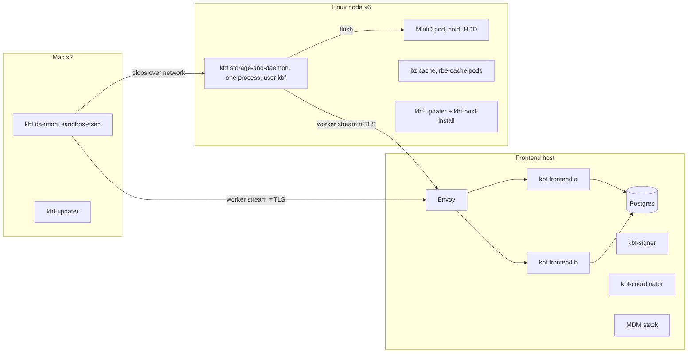

### 4.2 Target, common to A and B
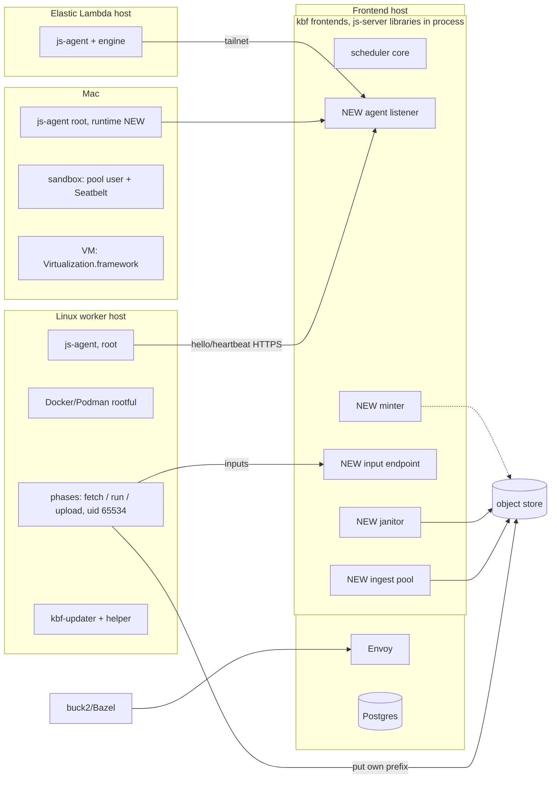

### 4.3 Storage-dependent shape
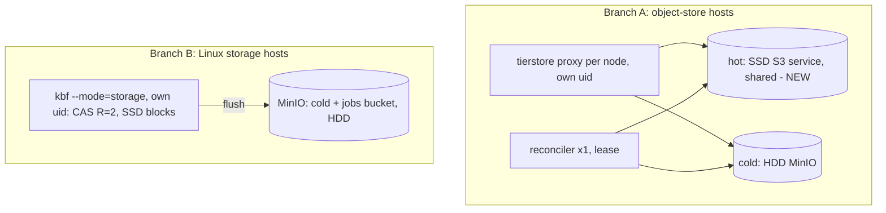

### 4.4 Processes per host type (owner, package)

| Host type | Process | Owner | Package | uid | Today / NEW |
|---|---|---|---|---|---|
| **Frontend** | Envoy | operator | image | envoy image user | today |
| | kbf frontend ×2 with js-server libs | kbf | `kbf` image, `--mode=frontend` (`docs/deploy/kbf-modes.md:22`) | container user (kbf image) | js core in flight |
| | agent listener (hello, heartbeat) | kbf, using `js-agent-wire` | inside frontend | container user (kbf image) | NEW (cannot reuse `js-lease-server`; kbf's layering test forbids `js-agent`/`js-client` in the graph, `layering.rs:608-626`; whether `js-agent-wire` may enter is Q6) |
| | minter, input endpoint | kbf | inside the frontend process | container user | NEW |
| | janitor | kbf | the `kbf` image with a NEW `--mode=janitor`, its own identity (`jobs-gc` only) | own user | NEW |
| | ingest pool (own cgroup) | kbf | the `kbf` image with a NEW `--mode=ingest`. Placement is next to the store, not on the frontend host by default (section 7, S8); the AC commit goes through a frontend over mTLS | own user | NEW |
| | Postgres, signer, coordinator, MDM | operator / kbf | existing | as deployed (not re-checked) | today |
| **Linux worker-only host** | js-agent | jobscheduler | musl tarball today; `.deb` is jobscheduler#300 (open); no unit in tree (only boot-script heredoc, `bootstrap/mod.rs:286-305`) | root or `CAP_SYS_PTRACE` | package/unit NEW |
| | Docker/Podman (rootful) | operator | distro | root | per host |
| | phase containers: `job-io` (fetch, upload) and the action | kbf (`job-io`), the job | digest-pinned images (`--container-pull never`, `lib.rs:36`) | 65534, caps dropped, no-new-privileges, read-only root | NEW tool; image distribution unsolved (Q4) |
| | kbf-updater + `kbf-host-install` | kbf | `packaging/host-agent/linux/*` | agent unprivileged, helper root | exists for kbf; js-agent verb needs kbf#1826 (open) |
| | host firewall for task networks | operator | nftables fragment | root | NEW |
| **Linux storage host [B]** | `kbf --mode=storage`, own uid | kbf | `kbf` deb | `kbf` (split NEW) | split decided, not built |
| | MinIO pod (+ jobs bucket and identities) | operator | k3s | pod | identities NEW |
| | js-agent, updater, engine | as worker | | | NEW |
| **Object-store host [A]** | tierstore proxy + one reconciler | kbf | release tarball + example unit, not managed by the host updater | `tierstore` | NEW delivery |
| | hot S3 service (SSD, shared) | operator | none exists | n/a | NEW deployment |
| | cold MinIO | operator | existing pods | | exists |
| | js-agent, updater, engine | as worker | | | NEW |
| **Mac** | Today: kbf daemon (native) as a LaunchDaemon, updater agent and root local helper; actions run as pool users `kbf-pool-N` (100 per Mac) | kbf | Mac kit, releases under a `current` link (Mac packaging research, live read-only) | daemon user; pool users for actions | exists |
| | Target: js-agent (root LaunchDaemon), sandbox runtime and/or VM runtime, a put-only relay for a no-network guest | jobscheduler | tarball; macOS asset only in open PR #297 | root | NEW |
| | Mac task bundle and VM base, in an OCI registry by digest | kbf (bundle), kbf (base) | NEW artifacts (section 10.3) | read-only, root-owned trees | NEW |
| **Elastic Lambda host** | js-agent + engine, tasks | jobscheduler | binary fetched by boot script with pinned sha256 (`bootstrap/mod.rs:284`) | root | never launched live |
| | scaler / provider | jobscheduler | `js-scaler` and `js-provider-lambdalabs`; the join and provider routes live only in `js-lease-server`; kbf pins neither | | NEW placement (D11) |

### 4.5 Elastic Lambda host: join sequence, route and cost

The bar asks for the whole life of an elastic host, which the first draft left to a word in a diagram.

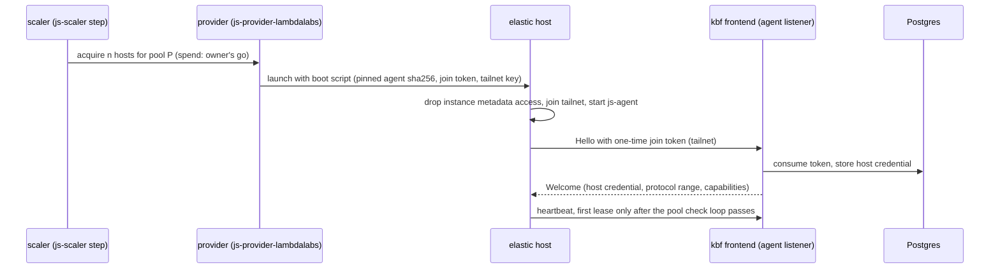

- **Citations.** Boot script and pinned agent hash: `crates/js-lease-server/src/bootstrap/mod.rs:284`. Metadata dropped before the agent starts, tailnet join: `docs/design/pools-providers-network.md:1035-1041` and jobscheduler `6473b9dd3`. Pool check loop: jobscheduler `394482a3b`. One-time join token then host credential: `docs/design/registration.md:28-73`. Pure scaler step: jobscheduler `daf3dba4e`. No live launch is recorded (R8).
- **Route to the farm.** The host reaches the agent listener, the input endpoint and the store over the tailnet (INFERRED from the join design; the store and input endpoints must be reachable on the tailnet, which is a NEW ACL decision). Under both branches the upload goes straight from the cloud host to the farm store.
- **Cost, unmeasured.** Output bytes leave the cloud provider (egress is typically charged by the provider; rate not verified), input bytes enter it; the WAN bandwidth bounds the upload step and the fetch step, so big-output actions are a poor fit for elastic hosts (INFERRED). Stage S9 measures fetch and upload throughput from an elastic host; budget: report, and the owner sets a ceiling before B5 (D7, D11).
- **Where the provisioner runs.** kbf links none of `js-lease-server`, so the scaler, provider and join-token routes have no home in the owner model (D11).

---

## 5. Every interface

| # | Caller → callee | Protocol / listener | Authentication | Status |
|---|---|---|---|---|
| I1 | Client → Envoy → frontend | REAPI gRPC; frontend `--listen` 127.0.0.1:8980 default (`kbf-modes.md:246`) | `--reapi-auth-policy` | today; Execute reply now waits for ingest |
| I2 | js-agent → frontend: `POST /v1/agent/hello` | HTTP/1.1 JSON, `jobscheduler.agent.v1`, agent dials out only; https off loopback (`crates/js-client/src/server_url.rs:19-26`). Listener: a NEW agent listener on each frontend (its own port, TLS off loopback; neither `--listen` 8980 nor the daemon `--worker-listen` 8981, so job and host credentials never share a listener with daemon mTLS). Both frontends serve it behind Envoy or by DNS to both (INFERRED) | pool join token → host credential (`docs/design/registration.md:19-22,57-73`); a join token is one-time, expiring, revocable, bound to one pool (so the pool's trust class binds the host) | wire today; server side in kbf NEW; join-token rows must move from `js-registry`'s single-writer file to Postgres (two frontends) |
| I3 | js-agent ↔ frontend: heartbeat, `Command::{Start,Stop,Cancel}`, `RunResult`, `Taint` | `POST /v1/agent/heartbeat` (`crates/js-agent-wire/src/command.rs:279-302`, `heartbeat.rs:67-94`); same NEW agent listener | host credential over TLS | wire today. `js-server-core` assumes a stream per worker (`crates/js-server-core/src/lib.rs:12-13`); a polled heartbeat needs a NEW adapter, two frontends may hear the same host, and the reply must be answerable at once when a Start is queued (a long-poll or wake, NEW, additive; section 7 S3) |
| I4 | Launch with credential: `Start(JobSpec)` | inside I3 reply | lease id, `valid_for_ms` | NEW generic fields (section 2, R1): ordered `steps` in one lease, each with `{image, args, network profile, secrets, mounts, limits, when}`; log capture; a shared `work` root between steps (storage design §D.2). The credential field is redacted in `Debug`, logs, state root and persisted run records |
| I5 | js-agent → engine | CLI at `--container-bin`, unix socket only | root | today |
| I6 | Fetch step → frontend input endpoint (manifest), then → store (bytes) | HTTPS on the same NEW job-facing listener family as I2, separate from daemon mTLS. The manifest is computed server-side from the `Action` the frontend holds; the client never supplies a list. Bytes: per-digest capability served by the store (**[B]** kbf CAS owners, new verifier; **[A]** the frontend resolves digest to pack key and range from the pack index and signs a ranged GET); fallback: the frontend streams bytes | frontend-signed input token (instance, action, lease, epoch, not-after, single action); ranged and batch reads count against the same closure | NEW; today ByteStream/Locate admit only daemon certs |
| I7 | Upload phase → store (put outputs, logs) | S3 SigV4 header form | **[A]** token = SigV4 credential whose id carries claims + MAC (storage design §B); **[B]** per-job MinIO service account | NEW; store listener plain HTTP today (A) |
| I8 | Ingest → store (list/read the accepted epoch's prefix) | S3 | **[A]** `jobs-read` token; **[B]** read identity on jobs bucket | NEW |
| I9 | Ingest → CAS, AC | **[A]** packs via proxy + Postgres index rows; **[B]** `Cas` trait over mTLS to storage nodes (role `frontend`) | in-process `Role::Ingest` (NEW) | CAS write today for [B]; pack index tables exist |
| I10 | Minter → store | **[A]** local signing, no call; **[B]** MinIO admin API (madmin, encrypted body) with a parent user put-only on `jobs/*` + account management | **[B]** admin credential = cluster write, owner's go | NEW |
| I11 | Janitor → store | S3 delete on `jobs/` only; abort multipart | separate identity (`jobs-gc`) | NEW; tierstore has no `ListMultipartUploads` (add) |
| I12 | Proxy ↔ hot/cold, reconciler ↔ hot/cold **[A]** | S3 over HTTP, static credential files 0600 | own credentials | code exists, deployed nowhere |
| I13 | Storage → MinIO flush **[B]**; storage ↔ peers chain replication | S3 localhost; mTLS role `storage` | node certs | today |
| I14 | Mac daemon → frontend and storage (until Mac runtime) | worker stream `--worker-listen` 8981; blobs over network | mTLS role `daemon` | today |
| I15 | Updater → coordinator; updater → helper; updater → frontend drain | mTLS; unix socket `/run/kbf-host-install/local.sock` 0600; four fixed routes (`updates.md` §5) | updater cert; file mode | today for kbf. A js host drain/idle route is NEW |
| I16 | Release workflows → coordinator | OIDC (`kbf-oidc`) | GitHub identity | kbf today; jobscheduler "off until configured" |
| I17 | Metrics | frontend `GET /metrics`; storage `--metrics-listen` | none; bind internally | js-agent has none (usage rides heartbeat; frontend exports); tierstore has `/healthz`,`/readyz` only. NEW required series for the new components: minter (mints, failures, live credentials, **[B]** account create/delete latency), input endpoint (bytes/s, closure refusals), ingest (queue depth, seconds/GB, refusals by reason, orphaned prefixes), janitor (prefixes reaped, refused keys), and `legacy_read_total` for A7 |
| I18 | Elastic registration | one-time join token → host credential; tailnet (`docs/design/registration.md:28-73`); same agent listener as I2 | token then host credential | routes live only in `js-lease-server`: NEW in kbf; provisioner placement D11 (section 4.5) |
| I19 | Image supply | operator preload (`docker load`); agent pulls nothing | n/a | unsolved for kbf action images and `job-io` |

---

## 6. Storage (short; the storage half is a separate design)

Authority: the **storage design** (per-job token, three sequenced phases, trusted ingest pool, janitor, prefix scheme, retirement gates, probes K1-K14, work items L1-L22). This section only summarises it and reconciles it with branches A and B. It does not duplicate it.

### 6.1 Summary of the storage design
- Token = the SigV4 credential; the access-key id carries version, key id, ops, prefix, not-after, size and part limits and a nonce, with a MAC; the secret is derived from the claims by the front and the minter. Per-key ceilings in the verifier (`jobs-mint` creates under `jobs/`, `jobs-read`, `jobs-gc`, `cas-write`, `cas-gc`). Revocation by short lifetime plus a `_tiering/deny/<sha256(prefix)>` object.
- Prefix `jobs/<32-hex instance>/<lease>/<epoch>/`, server-generated ids only; epoch in the prefix fences zombies.
- Phases: fetch (frontend only, input token) → run (no network, no credential, exit code is the container's) → upload (store only, create token). `job-io` is operator code, never in the action image.
- Ingest: snapshot the listing, check limits before reading, declared outputs only, one pass with `If-Match` ETag, builds Directory/Tree/ActionResult itself, commits via `Role::Ingest`; never caches a nonzero exit or `do_not_cache`. Janitor deletes after commit or age.
- Retirement of storage nodes is the last gated step (`legacy_read_total` 0 for 7 days; that counter does not exist yet).

### 6.2 Branch A and branch B, side by side

| | **[A] tierstore as designed** | **[B] keep kbf storage + MinIO identities** |
|---|---|---|
| Fence | Signed prefix-scoped create-only token; create-only by construction (`crates/tierstore/src/tiered.rs:401-416`) | Per-job MinIO service account (inline policy, expiry, deleted at terminal). Create-only not expressible in policy (no `if-none-match` key; AWS-only): close with revoke-before-ingest plus ETag pin, or versioning/Object Lock (VERIFY) |
| Mint cost | Local signature | One admin call to create and one to delete per job; ~600 IAM writes/s at the 300 executions/s reference (INFERRED, unmeasured) |
| Revoke | Expiry + deny object | Immediate delete (in-flight multipart VERIFY) |
| Where a put lands | Hot tier, ack after hot put + journal object | HDD MinIO today (no hot SSD on this path); SSD MinIO would be a new deployment |
| Digest trust | Optional store rule "key == sha256(body)" possible in the proxy (`crates/tierstore/src/server/mod.rs:57-78` already hashes bodies it reads); limited to single PUT, digest-keyed objects, and does not prove structure | Not available; ingest hashes every byte |
| Ingest | Hash the output; with job-written packs, adopt in place (rows) or copy-in | Read from HDD, hash, write CAS (R=2): about 2× output bytes written plus flush |
| Unbuilt before first routed job | Token role/verifier, TLS or stated posture, streaming PUT, shared SSD S3 service, host-updater management, `ListMultipartUploads`, AC/pack index on the job path | MinIO probe, minter + admin credential, jobs bucket with hard quota, storage/daemon split with own uid |
| Credential gap on a task-hosting node | Proxy and backend credentials beside root agent and tasks unless object-store hosts run no tasks | Cold-store key beside tasks until uid split; a root escape defeats a uid split |
| Reversibility | Retirement is one-way (last step); rest additive | Fully additive |
| Signing key | The token key is held by the minter and every verifier. **Asymmetric signing is required**: the minter holds the private key and proxies hold only the public key, so a root escape on a task-hosting node cannot mint (`cas-gc` would delete the CAS). "Rotate the key id" is recovery, not prevention | No token key. The minter's MinIO credential is the equivalent: a dedicated user with account management only, admin API restricted by source address, minter on its own process identity |
| Per-job ceilings | Bytes, objects, parts and max object size in the verifier (needs the streaming PUT; today a PUT is held in memory up to 256 MiB) | MinIO bucket quota is bucket-wide, not per account, so one task can fill the jobs bucket and starve the rest. Ceilings are a janitor watchdog plus a max object size; this is a gap, not a solution |
| Transport | TLS is a precondition, not a later item: tokens and bodies cross the network, and tasks with egress reach the store | MinIO's own TLS posture is unknown (VERIFY, Q12) |
| Usable hot capacity | Erasure-coded SSD: usable fraction depends on parity and is not computed here (Q13) | Unchanged: R=2 on local SSD |
| Operational planes after migration | Hot S3 service, cold MinIO, proxies, reconciler | Three data planes: kbf CAS, jobs bucket, cold MinIO (plus the legacy pods until F1) |

### 6.3 What the hot store physically is
- **H1** shared erasure-coded SSD S3 service across nodes behind per-node proxies: the design (rev 7 §10), coherent, does not exist on the farm (farm map §6); MinIO upstream is archived (rev 7 App N).
- **H2** tierstore `--hot dir:` on each node's SSD, used for the CAS: exists in code, but all proxies must share one hot backend and the single reconciler tails every proxy's journal from it (`crates/tierstore/src/reconciler.rs:91-130`), so per-node directories are incoherent and single-copy until cold; it recreates what R=2 replication solves. Not recommended for the CAS (INFERRED, high confidence). For `jobs/` alone it can be coherent: see the sharded hybrid, section 6.6.
- Candidates for H1 (rev 7 App N): upstream MinIO (archived, source only), Silo (a young fork with a single community), Ceph RGW (storage classes, heavy to run). None is chosen. Each is a new deployment with its own capacity and operations cost; that cost belongs to A and is not priced here.
- Under [B], with kbf block files staying the CAS (**H0**, not a staging option): **H3** job staging in a jobs bucket on the existing HDD MinIO (no new deployment, ack on HDD); **H4** (option) a small separate SSD S3 service for `jobs/` only, which needs no cold tier because jobs are transient (a new deployment per environment, ack on SSD).

### 6.4 Reconciliation with this doc (conflicts)
1. *Credential holder.* Owner: "the launch carries a credential" and the task writes. Storage design: the action has none; a separate upload phase does. **This doc follows the storage design** (the launch of the upload phase carries it). If js cannot sequence phases over a shared root (VERIFY, storage design §M), the fallback is one container with a root uploader (weaker; storage design §D.4). Decision D2.
2. *Delivery.* A redemption-handle exchange (an earlier part of this work) vs storage design `JobSpec.secrets` as a 0400 tmpfs file in a per-run 0700 directory owned by the agent (storage design §D.2). **Storage design wins**: simpler, no extra endpoint. Residual, stated precisely (INFERRED): the parent directory does stop a same-uid sibling from walking to the file. What grants a read is a sibling that escapes its container into the host process namespace as uid 65534 (all runs share one `--container-user`, `crates/js-agent/src/lib.rs:35`): processes of the same uid can read each other's `/proc/<pid>/root` and so the bind-mounted file. A stolen credential writes only its own prefix, but a sibling that writes into *your* prefix and gets it ingested is cache poisoning of your action, which is the real impact. So a **distinct uid per run is a requirement** (NEW, in js-agent; C2 in section 13), not an option, and "accept it" is withdrawn.
3. *Hot ack under [B].* Owner: put lands on hot. Under B it lands on HDD MinIO; flagged, not hidden.
4. *"Storage nodes run tierstore"* is ambiguous: tierstore is a proxy over S3 backends, not a disk owner (see H2). The literal reading (a proxy on every storage node over local SSD directories) is the sharded hybrid of section 6.6 for jobs, and is incoherent for the CAS; D1 names it as an option so the owner can say which he meant.
5. *10-24 decision wording.* Rev 7's log has 13:28Z (shape approved) and 14:19Z (build service and packing); retirement appears only as the gated final step in a document saying "nothing here is approved to run". Treated as the owner's stated intent, not an executed decision.
6. *Hot-bucket expiry.* Rev 7 §10 sets a 7-day expiration on the hot bucket's `cas/` prefix as a safety net that does not check cold, so an uncopied object older than 7 days is lost. Under A, `jobs/` needs its own age rule (hot-only, shorter) and the copy-lag alert (1 day warn, 3 page, 7 expiry) applies to `cas/`; a lost uncopied job object only reruns the action.

### 6.5 The owner's "refuse a put whose sha256(body) differs from its key": evaluation
- The proxy already hashes bodies as it reads them (`crates/tierstore/src/server/mod.rs:57-78`), so a rule "key == sha256(body)" for digest-keyed CAS objects is cheap to add.
- It covers a single PUT only. Multipart goes cold-only and is not journaled (`tiered.rs:141-149`); streamed, partial and retried puts do not pass through one body check.
- `jobs/` keys are path-named (`out/<path>`), so the rule cannot apply to them at all: the task does not know, and must not choose, the CAS digest.
- A matching body hash does not prove structure. A Directory, Tree or pack whose bytes hash to its key can still be hostile or malformed.
- It sits on the ack path: at 0.4-0.5 GB/s per core without SHA-NI, a 10 MB output adds 20-25 ms before the ack.
- Ingest must still read and hash every byte to build digests, so "adopt in place" saves a copy, not a read.
- **Conclusion.** Digest enforcement is ingest-only in both branches. The proxy rule is defence in depth for digest-keyed CAS writes by daemons (relevant at A5), not a control for task outputs. **Ingest invariant:** the CAS key and every AC key and value come from the ingester's own hashing and from the lease row, never from a task-supplied name, digest, marker, manifest or exit code.

### 6.6 Hybrid: tierstore for job staging only
- **H-shared.** A without retirement: shared SSD S3 hot service, proxies, reconciler, the existing CAS untouched. Pays most of A's unbuilt list and keeps two stores forever (storage design decision 2 alternative).
- **H-sharded (INFERRED, VERIFY the proxy runs with no cold backend).** The minter pins each lease's prefix to one proxy and returns that proxy's endpoint. Each proxy uses `--hot dir:` on its node's SSD with no cold tier and no reconciler. `jobs/` is hot-only (storage design decision 5) and prefixes are disjoint, so no cross-proxy coherence is needed. The ack lands on local SSD; the data is single-copy, so a node loss loses in-flight job outputs and the action reruns, which is acceptable for transient staging. The ingest pool reads each prefix from its proxy's node. It still needs the token role with asymmetric signing, TLS and the streaming PUT, but no shared SSD S3 service and no reconciler. It may be the cheapest of the three (reviewer's point, accepted as an option); it is not evidenced by any measurement.
- Costed in section 14 beside A and B.

### 6.7 Security requirements the storage half must meet (from review; the storage design owns the detail)
- **Both branches.** The ingest invariant (6.5). `Role::Ingest` may write only the AC entry whose key is the action digest in the lease row, in that lease's instance. The exit code is the container's, from `RunResult`, never read from the upload. Stdout and stderr are untrusted blobs, bounded and escaped before any display, and a cache write never depends on a log. A janitor identity is prefix-pinned and the code refuses any key outside `jobs/` (test: the janitor credential tries a CAS key and is refused). Zombie test: epoch N+1 accepted while the N task keeps writing; ingest ignores N.
- **[A].** Asymmetric token signing; TLS before any job token crosses a host; the deny-object check fails closed (a store read failure denies); per-token ceilings; adopting a job-written pack re-verifies the pack structure and every blob hash and never trusts the job's index.
- **[B].** At the terminal event the order is: delete the account and confirm it, including in-flight multipart; then list; then read each object with `If-Match` against the listed ETag. The ETag pin is mandatory, not a VERIFY item. A listing taken before revocation is never trusted. The janitor deletes a dead epoch only after confirmed account deletion, otherwise a zombie recreates objects after cleanup (a quota path, not a poisoning path).
- **Credential renewal.** A renewed lease or a restarted agent re-issues a credential for the same prefix and epoch with a new not-after; it never bumps the epoch. An adopted container keeps the tmpfs file it already has; the value is not in the agent's state root.

---

## 7. Sequence per operation (all 11)

Actors: C client, F kbf frontend (js libraries, minter, input endpoint), D Postgres, G js-agent, X the task steps (fetch, run, upload), O object store, N ingest pool, J janitor. Branch differences are marked [A] and [B].

**New js primitive (NEW, generic, R1).** A `Start` carries an ordered list of steps in one lease, like init containers. Each step has `{image, args, network profile, secrets, mounts, limits, when}` with `when` one of `on_success` or `always`. The agent runs the steps itself, one after another, over a shared `work` root, and reports each step's outcome; kbf concepts stay in kbf. This removes a heartbeat round trip between fetch, run and upload (they are agent-local) and answers whether js can sequence three runs (Q7): it cannot today and the primitive is the change.

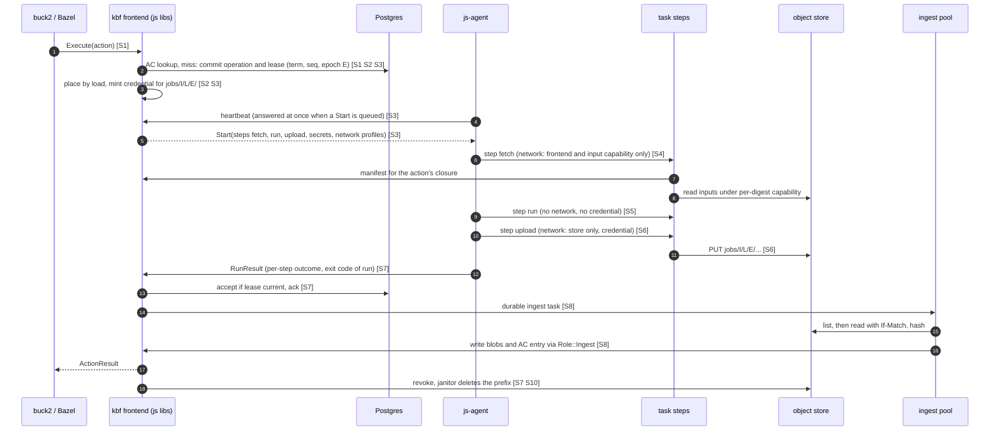

### S1 Submit
C → Envoy → F: Execute(action). F reads Action/Command, validates, pins the image digest (`JobSpec::require_pinned`; tag-only is refused, jobscheduler#311), looks up the AC (closure check on a hit). A miss commits the operation and submits to js-sched (cpu, memory, gpu, platform). No agent is involved. [A] AC and blob rows are in Postgres (rev 7 §J, design only). [B] the AC is in the storage owners' meta log. The AC key must be instance-scoped before untrusted tenants share a farm (R13, D10).

### S2 Place
Actors F, G. In process, js-sched picks the worker with the least booked share among workers whose capabilities match, and admits by measured and predicted load (`docs/design/placement-by-load.md`). Load arrives on the heartbeat, up to 5 s stale (`crates/js-agent-wire/src/lib.rs:124`); stale load invites herding, so the 5 s default is a number to lower, measured in S2. There is no reservation (R7). An agent can misreport usage (trusted base).

### S3 Lease
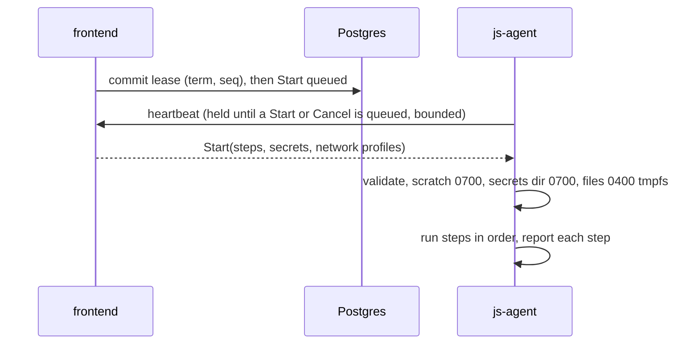
Commit before Start; one accepted result per operation, fenced by lease id. [A] mint is a local signature. [B] mint is an admin call creating the service account. Today's delivery waits up to one heartbeat each way; a held (long-poll) heartbeat reply is NEW and additive, with the plain interval as fallback. Three container starts per action under a rootful engine replace one under crun: lease overhead is stage S2, and S2 must measure a three-step task, not one start.

### S4 Stage inputs
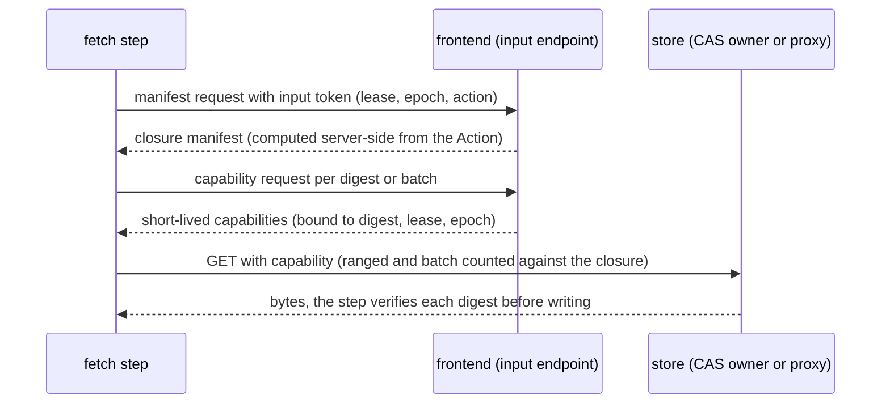
- **Rules.** The closure is computed from the `Action` the frontend already holds and never from a client-supplied list. The token is bound to lease and epoch, short-lived and single-action. A node-wide read key (`--pack-read`; tierstore read-only keys are bucket-wide) is never used.
- **Where bytes flow.** The frontend authorises and the store serves, so input bytes do not funnel through the frontend host (the first draft's endpoint did, and a hashing frontend NIC would be the bottleneck). **[B]** kbf CAS owners accept a capability (a NEW verifier in `kbf-front`). **[A]** the frontend resolves digest to pack key and range through the pack index and signs a ranged GET. Fallback: the frontend streams the bytes, which is simplest and is used if the capability work slips; stage S3 records frontend bytes per second and a direct-fetch comparison so the funnel's cost is visible.
- **Lost.** The node input cache, hard links and shared trees; every job refetches. A host-shared, digest-verified, read-only cache populated only by operator-side code is later work and needs a read-only mount root first (roots are read-write today; storage design §E); it must not be writable by uid 65534.

### S5 Run
Actors G, X. The run step uses the action image, network `none`, no credential. The container runs as a per-run uid (NEW; today 65534 for all runs), caps dropped, no-new-privileges, pinned seccomp, `--read-only` root, a 64 MiB `noexec` `/tmp`, `/scratch` bind (`crates/js-agent/src/cli_runtime/args.rs:151-165`@`6c3dca1ec`). The exit code is the container's as seen by the agent; stdout and stderr are captured by the agent (NEW; today none). Against kbf's crun container the remaining gaps are three: host user namespace, memory capped at booking with no swap, and no delegated cgroup subtree (parity table), plus the `noexec /tmp` difference of section 3. Expect more OOM reruns and CPU throttling until parity is chosen. Mac: section 10.

### S6 Upload
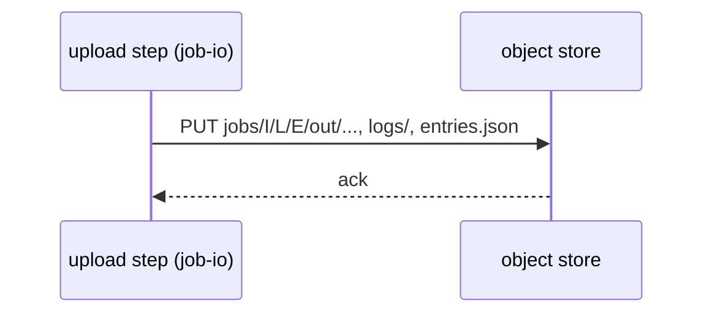
**[A]** the ack follows the hot put plus the journal object; puts are create-only; reserved `_journal/` and `_tiering/` are refused; multipart goes cold-only and is not journaled (`tiered.rs:141-149`). **[B]** the ack follows the MinIO write quorum on HDD. The upload step opens outputs with `openat2(RESOLVE_BENEATH)` and `O_NOFOLLOW`, accepts regular files only, checks link count and device, and runs in a fresh container with the work root mounted `nosuid,nodev`, after the run step has exited. Its network profile is an allow-list of the store endpoint only, enforced by the host firewall.

### S7 Report
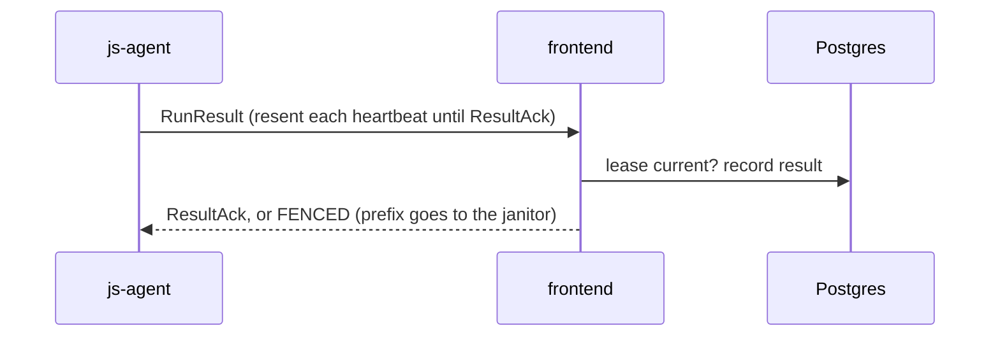
The result carries outcome, per-step status and the run step's exit code only. [B] F deletes the service account now. Taint from a failed removal stops that host's work. Proposed rule (js owner decides, Q8): the host's lease slot frees when the last step ends, not at `ResultAck`; an unacknowledged result is resent without holding a slot. If the agent loses the server mid-step, the running step continues to its own limit and `valid_for_ms` bounds when a next step may start; the credential's not-after is set to the lease's maximum wall time plus a margin so it is the hard bound (Q7).

### S8 Cache write
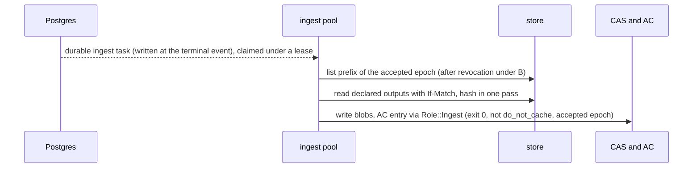
- **Placement.** The ingest pool runs next to the store, not on the frontend host by default. Per output byte under [B] there is a write to the jobs bucket, a read back, SHA-256, an R=2 CAS write with fdatasync and later a flush to cold: more than the daemon's single upload today (2 to 3 times the data movement, not "about 2x"). At 300 executions per second and 1 MB outputs that is about 300 MB/s in, 300 MB/s out and 600 MB/s of replication, which a single frontend host cannot also serve as the data hub. [B] places the pool on storage hosts; [A] on object-store hosts.
- **Latency.** Execute waits for ingest, so hash, read-back and commit are on the critical path of every uncached action. This is a latency cost of the owner model (no kbf process beside the agent does the hashing), reported in S5, not hidden as throughput.
- **Steps.** A bounded pool in its own cgroup; snapshot the listing; limits before bytes; declared outputs only with the `kbf-outputs` name rules; builds the Directory, Tree and ActionResult itself; closure check; commit. [A] adopt in place or copy-in. [B] copy-in through the `Cas` trait. The invariant of 6.5 and 6.7 holds.

### S9 Cold flush
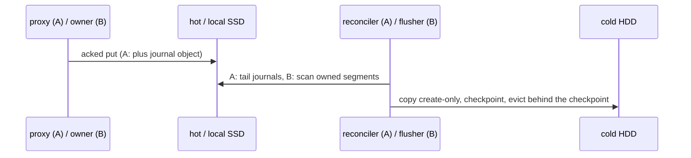
[A] one lease-guarded reconciler tails journals, copies hot to cold create-only, checkpoints, and evicts behind the checkpoint above 80% down to 70% (`crates/tierstore/src/reconciler.rs:98-130`, `crates/tierstore/src/lease.rs:10-23`); `jobs/` is hot-only with its own age eviction (storage design decision 5). [B] the rank-1 owner flushes CAS segments to MinIO after the ack (`crates/kbf-front/src/cache/flush.rs`); the jobs prefix is never flushed, so an output byte reaches cold once as a segment after being staged once.

### S10 Cancel
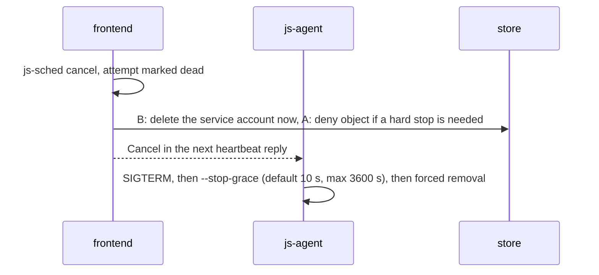
[B] account deletion is effective revocation even if the agent is partitioned. [A] the token lives to expiry; the deny object gives a hard stop. The janitor aborts multipart and deletes the prefix after an age. Nothing under a dead epoch is ever ingested.

### S11 Drain
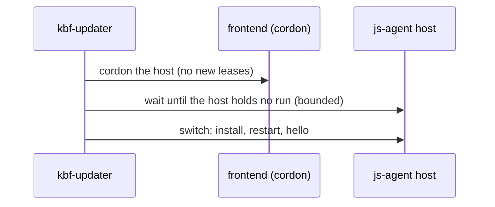
Cordon through the scheduler first, signal the process last. **Worker host:** the updater cordons the host id, waits until the host holds no run, and only then switches. A js-agent SIGTERM alone stops jobs after `--drain-wait` (`crates/js-agent/src/lib.rs:127-132`). The wait has an upper bound (a configured cap, default one lease max wall); past it, the updater does not signal, leaves the host cordoned and reports the exact blocker, and the owner rule "never remove a stuck host from role counts" holds. **Frontend:** `/readyz` 503, lb-wait, refuse new, wait for open executions (15 minutes per rev 7 §6; the coordinator path waits with no default deadline, kbf#1881); uploads go to the store, not through the frontend; an ingest in flight is re-driven from the durable row. **[A] proxy:** readyz 503, lb-wait 10 s, in-flight up to 15 min (`crates/tierstore/src/server/mod.rs:95-106`); an upload longer than that is cut (INFERRED). **[B]** the existing storage drain. **Mac:** wait for leases.

---

## 8. Trust table

**Escape levels (legend).** **L0**: code in an action or task container, no escape. **L1**: escaped from its container to the host as the container's uid (a non-root host user, the same uid for all runs today). **L2**: root on the host, which includes the agent's own compromise because the agent is root. Rows say what each level reaches.

### 8.1 Per component

| Component | Identity | Credentials held | uid | An escaped action reaches |
|---|---|---|---|---|
| Action step | none | **none** | per-run uid (NEW; 65534 today) | L0: its scratch, no network |
| Fetch step (`job-io`) | none | input token, one action's closure; per-digest capabilities | per-run uid | That closure |
| Upload step (`job-io`) | none | create credential for one prefix, short-lived | per-run uid | Its own epoch prefix, write only |
| Task container (Linux) | n/a | as step | host userns | L1: world-readable host files; with a shared uid, a sibling's secret through `/proc/<pid>/root` (6.4 item 2); the per-run uid closes this |
| Input endpoint | frontend | signing key for capabilities and input tokens; reads the Action | frontend user | Not reachable from tasks except as a client |
| js-agent (Linux) | pool token → host credential | host credential; in-memory secret in transit, a tmpfs file per run; no store credential at rest; secrets redacted in `Debug` and `Serialize` and excluded from the state root and run records | root / `CAP_SYS_PTRACE` | L2: trusted base. Agent state, engine, all in-flight credentials on that host (each one prefix), updater cert |
| js-agent (Mac) | as Linux | as Linux | root LaunchDaemon | L2: as Linux, plus the pool-user home trees |
| Engine | root socket | none | root | n/a |
| kbf-updater / helper | updater cert / closed verb grammar | updater cert | agent unprivileged, helper root | n/a |
| Frontend (+js libs) | farm-CA certs | Postgres, CAS write role, AC write | container user | Not reachable; runs no tasks |
| Minter | frontend | **[A]** private signing key and `jobs-mint` ceiling (create on `jobs/`, at most 2 h); **[B]** dedicated MinIO user: account management and put-only on `jobs/*`, nothing else | frontend / own identity | Bounded by the ceiling; cannot read or delete the CAS |
| Ingester | own | `jobs-read`, `cas-write`, `Role::Ingest` | own user and cgroup | n/a |
| Janitor | own | `jobs-gc` (delete on `jobs/`, abort multipart); the code refuses other keys | own user | n/a |
| **[A]** proxy / reconciler | node identity | hot and cold backend keys (0600), **public** verification key only | `tierstore` | L2 on a task-hosting node: all backend keys, the whole store; a minting key is not here (6.2) |
| **[B]** kbf storage | storage cert | cold-store key, block files | `kbf` (shared with actions today) | L1 today: key readable. After the uid split, L2 only |
| **[B]** MinIO | admin and minter users | root in the cluster | pod | The admin API shares the S3 port (INFERRED); restrict the minter by source address |
| Elastic host agent | host credential | host credential; cloud instance identity if the metadata block fails | root | L2: plus the cloud identity unless the block holds (prove live, 8.2) |
| Mac sandbox pool user | per-lease `kbf-pool-N` | upload credential in a 0700 file in the lease directory | pool user | L1: that user and the host's world-readable files; reads are open today (Mac research) |
| Mac VM guest | none | none unless delivered over the control channel; no network | guest user | Hypervisor escape |
| Envoy, Postgres, signer | as deployed | as deployed | as deployed (not re-checked) | Not reachable from tasks |

### 8.2 Escape level by host type

| Host type | L0 / L1 (container) | L2 (root) |
|---|---|---|
| Linux worker-only | Its prefix (write only), input closure; egress limited by NEW network profile and host firewall | Agent state, in-flight credentials, updater cert. No store credential, no kbf node cert |
| Linux storage / object-store host co-located with tasks | Same | **A:** all backend credentials; with asymmetric signing, no token key. **B:** cold-store key, block files. This is the old accepted risk relocated (D6); a root agent defeats the uid split, so the split covers L1 only |
| Dedicated storage host (no tasks) | n/a | n/a (cost: the node loses worker capacity) |
| Elastic Lambda | Same; metadata endpoint dropped before agent start (`docs/design/pools-providers-network.md:1035-1041`) | Plus instance cloud identity unless the block holds (prove with a live check) |
| Mac VM | Guest holds a credential only if delivered; default no network; output through a host put-only relay | Hypervisor escape |
| Mac sandbox | Pool user; `On` network is open with best-effort denies | uid boundary only; a `pf` anchor is required before a credential-bearing task runs there |
| Frontend | Not reachable by design | n/a |

### 8.3 Credential handling requirements (agent as trusted base)
- The `secrets` field is redacted in `Debug`, logging and every echo (heartbeat, `RunResult.detail`, run API reads); a test round-trips a full `JobSpec` through `Debug` and JSON logging and finds no secret byte.
- It is excluded from the state root and from persisted run records; an adopted container keeps its tmpfs file, and the value is never in the state root.
- The heartbeat transport is TLS to the frontend with the host credential. The tmpfs file is mode 0400 owned by the uid of the step that needs it (the upload step), in a 0700 per-run directory.
- Host egress from the fetch and upload steps is an allow-list of the frontend, the store and (fetch) the capability-serving endpoints, in nftables on the host. A step with open egress and a credential could exfiltrate inputs or reach the MinIO admin port or Postgres.

Residual, stated honestly: a hostile action never holds a credential; the upload step is operator code. Under the single-container fallback (D2 b) the command can read the credential, forge its manifest and choose the exit code, bounded to its own action digest; that fallback is off by default and never used for multi-tenant instances.

---

## 9. Failure table

| Event | Common | **[A]** lost / recovers | **[B]** lost / recovers |
|---|---|---|---|
| Worker host dies | Running tasks vanish; heartbeats time out; the scheduler re-leases at epoch+1; the client sees a retry. Lost: running work | Partial objects under the dead epoch are never ingested; the janitor reaps them | Same; the service account expires |
| js-agent restarts | Containers are engine-owned; the agent adopts matching labels, evicts others, resends unacked results; taint persists (`crates/js-agent/src/lib.rs:29,53-62`); no keeper, so scratch of non-adoptable runs is not swept; a drain with the default `--drain-wait` 10 s could cut an upload | Token lives to expiry; the epoch makes stale output unusable | Account lives until the minter deletes it |
| Frontend (and with it the embedded js server) restarts | These are one process under the owner model. Leases and epochs are in Postgres; agents re-register to either frontend; undelivered Starts are resent; Execute streams are cut (the client reruns); in-flight ingest is re-driven from its durable row and is idempotent. **Rule where behaviour is not verified** (the embedded server's run state, Q15): assume it does not survive, treat every lease the new process did not load as lost, and re-lease at epoch+1 | Tokens are stateless; no orphan state | Orphan accounts minted before a crash: the janitor reaps them |
| Postgres down | No new leases or results; Execute for uncached actions fails or waits; running steps finish and their results queue in the agent; AC hits that need no row may still answer | CAS closure checks and pack rows also unavailable: the whole farm | CAS reads continue; commits fail |
| Storage node down | Co-located tasks fail as for a worker death | Hot degrades within erasure tolerance; clients fail over; hot-only objects are lost beyond tolerance (rev 7 App K); a reconciler on the dead host pauses copying and eviction until lease takeover (30 s) | R=2 chain: the other owner serves; the primary acks alone and records repair; both owners dead means unflushed blobs are lost and actions rerun. MinIO pod loss: parity of the 6-pod set is not verified |
| Store wholly down | The job-side client reports an infrastructure failure, never an action failure | Whole farm (the store holds every CAS byte); closure checks answer from Postgres | CAS keeps serving from SSD; the job output path fails if MinIO is down |
| Cold down | | Hot keeps accepting until full, then puts fail; copy-lag alert | Job writes fail at once; CAS hits continue |
| Network partition | Agent to frontend: the scheduler loses the lease and re-leases at epoch+1; the partitioned container keeps running with a live credential until its not-after (the hard cap). Host to store: the upload fails, infrastructure failure, rerun | Expiry is the bound | The account is deleted independently |
| Credential expires mid-upload | The upload fails; infrastructure failure, rerun. The not-after is set to the lease max wall plus margin, so this happens only past the lease limit | Partial object under the epoch is never ingested | Same |
| Token versus agent clock skew | Not-after is checked by the store, not the agent; `valid_for_ms` is measured on the agent's clock alone, so skew moves neither bound. Alert on host clock error (the updater already reports clock) | Verifier tolerance for not-before is a small fixed skew | MinIO checks expiry on its own clock |
| Escaped action | Taint at post-job checks and at grant; the host takes no work | L2 on a co-located node means all backend keys | L2 means the cold-store key; the uid split protects L1 only |
| Credential leak | Bounded to one prefix; never a cache poison (the ingester reads the accepted epoch and hashes) | A leaked *public* verification key is harmless; a leaked minter key is full compromise: rotate the key id | A minter leak cannot touch the CAS; an admin leak means the whole cold store |
| Ingester or janitor down | Results wait; Execute latency grows; prefixes accumulate; lifecycle expiry is the backstop | Needs its own rule on `jobs/` | Plus orphan accounts |
| Reconciler down | | Copies and eviction pause; stale usage counts as "not full" (`crates/tierstore/src/tiered.rs:157-165`): alert needed | n/a |
| Mac host dies | Running leases vanish; the scheduler re-leases at epoch+1. Pool user homes and lease directories are cleaned at next start | Same as a worker host | Same |
| Elastic host fails to launch or dies | The pool check loop does not admit it; the scaler retries within its budget; running work re-leases at epoch+1; the provider terminates an idle or broken host. Spend continues until termination: alert | Partial objects reaped | Accounts expire |

---

## 10. The Mac

### 10.1 What the sources say
- **Owner (10:50Z, 10:55Z):** two options are needed today, a sandbox (`sandbox-exec` plus a per-lease user) AND a VM (Virtualization.framework, two VMs per host). This supersedes the earlier note that said "VM" only.
- **Mac design rev 2:** a pool of users, one bound to one run, one Seatbelt profile per action, no overlay, VMs only when needed; a root agent; a trusted `kbf-executor` beside the agent holding storage credentials (§0, §3.1, §6.2, §10, §13).
- **Live Macs (Mac packaging research, read-only):** the "base" of a Mac action is the host itself: Xcode in `/Applications` picked per action with `DEVELOPER_DIR`; the only kbf file distributed to the Macs is the `kbf` binary (about 41 MB) in a digest-named release directory; 100 `kbf-pool-N` users per Mac on a separate APFS volume; no VM tooling or VM images on either Mac.
- **js:** the Mac agent refuses container jobs (`crates/js-agent/src/lib.rs:45`); there is no `VmRuntime`; `js-vmm` has probes and the base-image builder (`crates/js-vmm/src/lib.rs:1-5`); `VmSpec` has no network device (`crates/js-vmm/src/spec.rs:25-26`); the VM design is a fresh VM per run, one `Exec` per VM, no credential in a guest, network none by default, NAT refused until a LAN-deny design exists (`docs/design/vm-backend.md`; VM guests doc §4). `kbf-vmm` is a stub. Open PR jobscheduler#313 is a probe crate with a workflow on hosted macOS runners (not an empty draft, as the research note first said); read what it proves before planning a new probe.

### 10.2 Reconciliation of rev 2 and the owner model (NEW)
The task contract is runtime-neutral: a launch of steps with a secret, a run and a result. A Mac pool declares its runtime (`exec = sandbox-exec` or `runtime = vm`) and refuses the other (rev 2 §13). The two options are two pools behind one contract.

| Point | Mac design rev 2 | Owner model | Resolution |
|---|---|---|---|
| Isolation | sandbox default, VM when needed | both, today | Both pools; the default for kbf's own builds is D3 |
| Executor | `kbf-executor` beside the agent | none beside the agent | Dropped. Fetch and upload move to `job-io` steps; hash and AC to the ingest; slot clean and fence stay in the agent |
| Credential | executor holds it outside pool uids; "no secret but join token and executor credentials" | upload step holds a scoped credential | Rev 2's claim is contradicted. Deliver in a 0700 file in the lease directory of the run's pool user (stronger than Linux's shared uid), or to a VM through the host relay below |
| Network | `On` is best-effort; `pf` deferred | upload needs the store | `pf` anchor becomes required for the sandbox option. A no-network guest uploads through a host-side put-only relay on vsock (section 10.3), which is the research's proposal and answers the question the first draft left open |
| Guest agent | `kbf-guest` | no kbf process beside the agent | `js-guest` exists; retire `kbf-guest` as a duplicate (INFERRED) |

### 10.3 Packaging: what the research proposes (not yet decided; D4)
There is no usable Mac-native container standard, and none is needed. The proposal is **OCI as the wire and the pin, a directory tree as the Mac root**: use the OCI distribution protocol and OCI 1.1 manifests (with `artifactType`) for everything, pinned by digest, in the same registry as the Linux images. The Mac has no namespaces and no bind or overlay mounts, and a change of root followed by an exec is killed, so the private root a container format exists for cannot be had. The useful half, content-addressed digest-pinned distribution, is kept and the runtime is dropped.

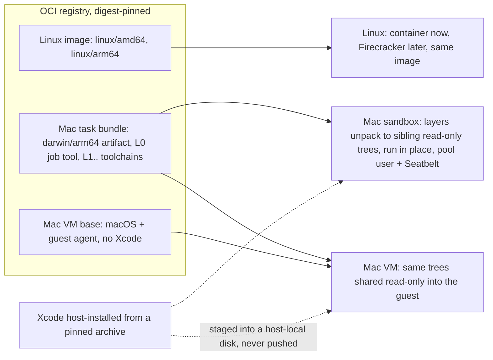

- **Task bundle.** A darwin/arm64 artifact (config: name, version, minimum macOS, whether Xcode is required, environment paths relative to the bundle root, entrypoint). Layers are deterministic tar+zstd and are sibling trees, not a union. L0 is the kbf job-side tool (changes every kbf release, tens of MB); L1.. are toolchains, relocatable (`@rpath`/`@loader_path`) and ad-hoc signed once. A kbf bump re-pulls only L0.
- **VM base.** A separate artifact (100 to 140 GB, chunked), preloaded and not pulled at task time; at most two VMs per host. It holds macOS and the guest agent, never Xcode.
- **One pin rule.** A task carries one bundle digest; a VM task also pins a base digest. One image index digest can name Linux and Mac content together, and the agent picks the child by host OS and architecture. Mac and Linux keep separate pins so a Mac rebuild cannot churn the Linux cache, and the bundle digest is part of the action key because the tools live outside the input root.
- **Sandbox run.** No root switch: the task runs from the read-only trees by absolute path as a pool user under Seatbelt, writes only inside its lease directory, and gets a writable APFS clone of a layer only if a tool needs one. The Seatbelt profile must allow-list reads rather than deny-list them; `DYLD_*` variables are stripped by system binaries, so relocation cannot rely on them.
- **VM run.** The guest has no network. Declared outputs go to the outputs share (existing behaviour) or through a host-side put-only relay on vsock that forwards PUTs under the task's prefix (NEW). The relay is part of the root agent's surface and is a design item (D4c).
- **Xcode.** Never in a registry, bundle layer or pullable base (a licence reading by two researchers, not legal advice). Sandbox: installed on the host from a pinned archive. VM: staged into a host-local derived disk that is never exported.
- **Release.** Bundles and base are built by the release workflow on farm Macs (macOS builds are release-only), and the signed kbf release manifest carries the index digest and the base digest; the agent runs only what a signed release or task names by digest. Build and tests are Rust or Zig, with no shell or Python.
- **Corrections to the research note** (from its own check pass): the OCI index code to extend for js-agent is `crates/js-contain/src/oci/image.rs:59-61` (it refuses indexes today), not kbf's; the shipped slot profile denies `lsopen` and writes outside the lease (`kbf-driver-native/src/network.rs:116-129`), and the `mach-register` and `file-mount` denies are designed in `macos-end-state.md`, not shipped; cross-volume `clonefile` gives `EXDEV` and a non-APFS volume gives `ENOTSUP`, and kbf's fast-sandbox design falls back to per-file copy; the Tart chunk layout is not confirmed (define our own annotations); Apple's `container` 1.0 (released 2026-06-09 per several secondary sources) runs Linux containers only and does not help macOS targets.

### 10.4 Mac decisions (D4, with recommendations)
- **D4a.** May the Xcode-free macOS VM base be hosted in our own registry, pulled only to our Macs? A licence question. Recommend (a) build once and push so identity is real bytes, pending counsel; (b) build per Mac and route on a recipe digest is the fallback and needs no registry change. This is the only legal question that gates the VM design.
- **D4b.** Tighten the sandbox so a task reads only what it is allowed (deny reads of `/opt/homebrew` and `/usr/local`), instead of all of the host as today. Recommend yes after a probe shows Xcode, git and the bundle still work; it changes the documented stance that the profile is only a hermeticity aid.
- **D4c.** How a no-network guest uploads: (a) host put-only relay on vsock (recommended; keeps the no-network default), (b) guest networking, refused until a LAN-deny design exists.
- **D4 (format).** Recommend the OCI-as-wire proposal above (one index digest, a bundle for the sandbox and VM, a separate VM base, Xcode never in the registry), with the first slice sandbox-only: one L0 plus one toolchain layer, pushed by a hand-run release job and run as a pool user on one Mac. The VM half sits behind probe P5 and the legal answer.

### 10.5 VM cost (assumed, unmeasured)
At most two VMs per host, so the farm's two Macs hold four guests. Boot is 20 to 60 s (assumed), 3 to 4 GiB idle memory, clone growth up to about 40 GiB, cold caches, a reduced Metal device (GPU work stays a bare-metal lease), and a licence that excludes service-bureau use (review before a second consumer). A VM per action is 10 to 100 times the action time and is infeasible; **a VM must be per lease or per build**, which conflicts with the VM design's "fresh VM per run" and must be reconciled in that design. V1 adds a boot and restore-from-snapshot probe. The throughput bound is about 2 × 3600 / (boot + run) per Mac per hour for per-run VMs (INFERRED).

### 10.6 Until a Mac runtime exists
The Macs stay on the kbf daemon (trusted-daemon upload, `Role::Daemon`). This is a departure from "two options today" and it is flagged: no runtime exists, so building both pools is the work, not the starting state. The frontends keep the kbf worker stream and a kbf process stays on the Macs; the doc must not claim "only js-agent" for the Macs. Two output paths coexist, trusted-daemon upload (Mac) and untrusted-step upload plus ingest (Linux), as a standing second surface to maintain and test; the retirement gates count both.

### 10.7 Work order
V0 Macs unchanged. V1 probes P0-P9 (VM guests doc §11; P5, a VM from a launch daemon's child with nobody logged in, is the biggest risk; no recorded result shows a guest reaching userspace on the Mac Studios). V2 the runtime(s) in js-agent: OCI client with index and `artifactType`, a store on one APFS volume, credential-by-file delivery, the relay. V3 one Mac in a pool. Hosted macOS runners cannot boot a guest.

---

## 11. Firecracker (Linux, later)
The same digest-pinned OCI image runs inside a Firecracker microVM, behind the same step contract and credential delivery (owner model 10:55Z). Prerequisites, none built: KVM on the host, and nested virtualization on elastic Lambda hosts (unverified that the provider exposes it); a rootfs converted from the OCI image; and credential delivery by vsock or a read-only block device, since a microVM has no host bind mount. Nothing in `secrets` or `network` may assume a container engine.

---

## 12. Updates and rollback

**Who releases what.**

| Component | Released by | Artifact | Note |
|---|---|---|---|
| kbf frontend with embedded js libs | kbf `artifacts.yml` then `release.yml` | attested tarballs/deb/image | js libs are git deps at one revision, raised by a PR of its own (`Cargo.toml:76-90`@kbf, currently `a826aba49`, thirteen commits behind jobscheduler main when this was written); the embedded server version is whatever kbf pins, while the agent ships from main, so skew between them is the normal case (rule S2) |
| js-agent | jobscheduler `release.yml`, every push to main that ships code (`docs/release.md`) | `js-agent-X.Y.Z-x86_64-unknown-linux-musl.tar.gz` + `SHA256SUMS`; no bundle, arm64 or macOS asset; deb is jobscheduler#300 (open) | asset names do not match the helper's `<prefix>-<commit>-<platform>` + `.sigstore.json` |
| `job-io` + action phase images | kbf | digest-pinned | frontend names the digest in each `JobSpec` |
| **[A]** tierstore | kbf `artifacts.yml` (already builds and attests tarballs) | tarball + unit, not started at install | not managed by the host updater |
| **[B]** kbf storage / MinIO | kbf / third party (upstream archived, source only) | kbf package / image | MinIO has no updater path; pod update is a cluster write (owner's go) |
| Mac task bundle and VM base | kbf release workflow on farm Macs | OCI artifacts by digest, named in the signed release manifest (section 10.3) | hosting the base is the legal question D4a |
| Elastic host | not updated, replaced | boot pin (sha256) | rollout = change the pin |

**How each host gets it.** Host-driven and pull-shaped: the unprivileged `kbf-updater` resolves the version, verifies the attestation and asks the root helper `kbf-host-install` (`docs/design/updates.md` §2, 4, 5). The coordinator already has services as data with roles, limits, `after` (kbf#1818-#1825 merged). `js-agent` needs: kbf#1826 (described services; open, Linux local socket only; Mac helper "serves kbf only"), a `[[service]] name="js-agent" after=["kbf"]` entry, `--version --json` (neither js-agent nor tierstore prints it), a unit with `Restart=always` (js-agent exits 0 on SIGTERM and 2 on refusal and leaves containers for adoption, `crates/js-agent/src/lib.rs:109-118`; kbf units use `RestartPreventExitStatus=2`), and `TimeoutStopSec` above `drain-wait + 30 s`.

**Order.** Code wins over rev 7 App A (which says frontends first): the built-in `kbf` service updates storage and daemons first, frontends last (`crates/kbf-coordinator/src/services.rs:99`). The js rule is servers before agents, and the server is the kbf frontend, so `js-agent` is `after = ["kbf"]`. **[A]** tierstore verifier before the minter, set by the release job (the built-in `kbf` service cannot be redefined). **[B]** MinIO pin before the minter. Never two services on one host at once (kbf#1825).

**One js-agent host.** Update ordered only after kbf converged → updater installs on trial → NEW cordon and wait-for-zero-runs on the host (a fifth route, host id equal to updater node id, INFERRED), bounded by a cap (S11) so a long action cannot block an update indefinitely → switch → Hello (protocol range; refusal `unsupported-protocol` ends the agent with exit 2, fails closed) → ready URL → confirm or helper reverts → uncordon.

**Skew rules.**

| # | Pair | Rule |
|---|---|---|
| S1 | frontend N / N-1 | Additive schema on shared Postgres; N-1 runs on N schema (test NEW) |
| S2 | embedded server (pinned revision) / standalone agent | Protocol major in Hello/Welcome; additive fields in a major; skew test in jobscheduler CI: newest agent vs kbf's pinned server and reverse (NEW) |
| S3 | security fields | Gate on `Hello.capabilities`, never version text (old receivers silently ignore unknown fields) |
| S4 | frontend / `job-io` image | Image D(N) on every host before frontend N places work; needs an image capability in Hello (NEW) |
| S5 | **[A]** minter / verifier | Token carries format version and key id; verifier accepts N and N-1; journal formats stay additive (Checkpoint/Usage JSON have no version field) |
| S6 | **[B]** minter / MinIO | One pinned MinIO version; minter tested against exactly it |
| S7 | agent N / N-1 on one host | N-1 adopts containers N started and reads N's state root (test NEW) |
| S8 | `steps` primitive / older agent | A `Start` with `steps` goes only to an agent whose Hello advertises the capability; an older agent is never sent a one-container spec that silently drops `secrets` |

**Rollback.** kbf service: set an older version (helper installs older; revert if `/readyz` fails). Embedded js libs: revert the pin PR; agents keep older range. js-agent: helper trial-and-revert per service; containers adopted; taint sticky. Images: re-issue D(N-1). [A] helper `previous` link; objects immutable. [B] MinIO downgrade across releases generally unsupported (VERIFY; owner's go). Mac: detached launchd apply reverts; images immutable by digest. Elastic: change the pin back.

**Signer trust (K36, D45(4); D5).** The old assumption that js-agent ships inside the kbf package is gone. Options: O1 trust jobscheduler's `release.yml` via the root-owned `trusted_workflows` (`docs/deploy/host-install.md`); jobscheduler has no rulesets and `main` is unprotected at drafting, and js-agent runs as root, so whoever can push main gets root on every host. O2 kbf republishes js-agent under its own signer (paired with the embedded server; agent fixes wait for a kbf bump). **O2 is required before any production install, not a lean**: with O1 and an unprotected `main`, the right to push `main` is root on every host. Even under O2, jobscheduler needs rulesets or branch protection before kbf republishes its agent. Reopen O1 only after rulesets and a protected release environment exist.

**Owner rules.** No update logic in any service (all in updater/coordinator/helper). Frontends never restart on their own (only an ordered, drained switch). Alert with the exact fix: no alert emitter exists in coordinator/updater (failures show as `blocked` on `GET /v1/convergence`, `crates/kbf-coordinator/src/converge.rs:11,189`); NEW text per signal, e.g. `channel_not_allowed` → "add the release workflow to `trusted_workflows` on host X"; `service_not_configured`, `no_current`, `unsupported-protocol` (state both major ranges), host tainted. Never remove a stuck host from role counts to converge.

---

## 13. Migration from section 3 (today)

**Rules every step obeys.**
1. Reversible: each step names its undo; two one-way doors are labelled (A-retire, F1).
2. Benchmark guard classes (NEW). A benchmark lock exists as a single holder line (session, host class, run label, UTC time) kept by the farm operator outside both repositories; no definition, owner or enforcement of it, and no definition of the frozen sets, is in jobscheduler or kbf at the revisions read (a keyword result), so Q9 stays open and D7 asks the owner to name the lock's owner: **G0** nothing a counted run can see; **G1** one named node outside the benchmark set (step fails if the node is in the set); **G2** a node in the set, a frontend, or a shared store: only in a gap with the lock taken, never preempting a counted run, one uncounted warm run after; **G3** a fleet release roll, G2 rules, as few rolls as possible, a roll without the lock discards the run.
3. A node is in daemon mode or agent mode, never both (both would double-book capacity, breaking "no reservation").
4. Benchmark nodes stay in daemon mode until js-agent can quiesce: counted runs reserve a whole node (`docs/design/reserve-node.md`) and the agent has no `Quiesce`, so a whole-node lease refuses every start (`lib.rs:136-148`@jobscheduler `f8f7f84fd`).
5. Cluster writes, uploads, cloud spend: the owner's go per action.
6. Do not touch the flip's files or kbf-updater PRs #1817-#1832; no pin bump during a counted run.
7. Every step ends in a gate that can go red, and a step with no budget set by the owner does not advance (section 14 pass rule).
8. B2 and A4 (the first real actions through the new path) are blocked until the per-instance action-cache namespace gate passes (R13, D10).

**Common steps.**

| Step | Change | Undo | Guard | Go | Gate |
|---|---|---|---|---|---|
| C0 | Owner answers D1-D7. Probe target on a throwaway MinIO of the production version: put-only on one prefix, GET/LIST/DELETE refused, other prefix refused, overwrite, per-job account rate and latency, delete kills in-flight multipart, expiry, hostile name cannot widen, no admin/STS, quota (storage design K12) | delete target | G0 | none | each case red on a planted violation |
| C1 | Land doc changes (section 17); mark jobscheduler design.md 5.4, 9.2-9.4 and steps 21a, 34 superseded | revert | G0 | none | doc lint, citations |
| C2 | Build behind flags: `steps`, `secrets`, `network`, per-run uid, log capture and the held heartbeat in js; agent listener; minter, ingest (`--mode=ingest`), janitor, input endpoint with capabilities, `job-io`; js-agent as a described service; layering decision for `js-agent-wire` (Q6). After the flip merges | flags off | G0 | none | tests; a planted widened scope goes red; the redaction test finds no secret byte; a planted allow in the firewall fragment is caught |
| C3 | Roll 1: one kbf release carrying C2, all flags off | coordinator revert | G3 | none | converged; S0 within baseline spread |
| C4 | Split storage/daemon on a canary node (`kbf --mode=storage` + `--mode=daemon`, modes exist: `kbf-cli/src/lib.rs:4,136`), own uid, 0600 key, test that an action cannot read the key | reinstall single unit | G1 | none | key-unreadable test; stage S1 |
| C5 | Idle js-agent on the canary in pool `canary`; metadata blocked | stop unit | G1 | none | registers, refuses work |
| C6 | Null and echo tasks through the full path (a three-step task and a one-step task) | remove class | G1 | none | stage S2; stale-epoch result rejected; zombie test (epoch N+1 accepted while N keeps writing) |
| C7 | Per-instance AC namespace verified or built (R13) | revert | G0 | none | a planted cross-tenant key collision goes red |

**Branch B steps.** B1 jobs bucket (hard quota, lifecycle, three identities: minter, janitor, ingester) on existing MinIO (G2, owner's go: admin credential). B2 canary class on real actions via a platform property (G1+G3, after C7): minter → service account → upload step → account deleted and confirmed → ingest → janitor. Gate: K12 and the per-job account create/delete rate, measured, within the owner's limit; if the rate gate fails the fall-through is **B-fall**, a presigned POST policy with a `starts-with` key condition and an expiry (local signing, no IAM writes; single PUT or POST only, 5 GiB cap, no create-only guarantee, so the ETag pin and revoke-before-ingest still apply; VERIFY that MinIO enforces the key-prefix condition), or the hybrid. Optional B-ssd: a small SSD S3 service for `jobs/` only (H4). B3 switch non-benchmark nodes one at a time: cordon, drain, stop daemon unit, start js-agent (G1 each). B4 benchmark nodes after `Quiesce` exists (G2). B5 worker-only and elastic hosts (cloud spend: owner's go).

**Branch A steps.** A1 finish tierstore (put-only role, tokens, ceilings, TLS or stated posture, streaming PUT, dir fsync (draft #1920), `ListMultipartUploads`, stale-usage alert, packaging and updater management). A2 shared SSD hot S3 service (G2, owner's go; software unchosen, rev 7 App N candidates). A3 proxies + reconciler, no clients (G1 then G2; rev 7 App K gate: PUT not acked if journal write fails, reconciler resumes from checkpoint, copy-lag alert, 95% back-pressure). A4 canary on tierstore (after C7), ingest into the existing CAS. A5 frontend packs (data path for all actions changes; G3). A6 backfill and Mac packer. A7 retire storage nodes after `legacy_read_total` is 0 for 7 days (counter does not exist yet; **one-way door**, 30-day decommission window recommended in the storage design). A8 former storage nodes become object-store + worker hosts.

**Hybrid steps (sharded, if chosen).** H1 token role with asymmetric signing, TLS and streaming PUT in tierstore (as A1, without the packaging of the reconciler). H2 proxies with `--hot dir:` on canary nodes and a minter that pins prefixes to a proxy (G1). H3 canary on real actions (after C7), ingest reads each prefix from its proxy's node. H4 widen as B3. No shared SSD S3 service, no reconciler, no retirement.

**Mac steps** V0-V3 in section 10. The bundle and base artifacts are built and pushed by a release job (a registry upload: the owner's go). **Final window:** F1 remove `bzlcache`/`rbe-cache` pods (a cluster write and a deletion, one-way; redeploy from manifests; **decision D9**, not a default); F2 remove kbf-daemon from migrated storage hosts.

---

## 14. Cost as benchmark stages

No measured number exists for any of these. Each stage runs 3 times on the frozen sets at the pinned komira commit; a run counts only if the lock was held throughout and no roll happened, else it is discarded, never averaged (NEW). Three runs limit what a single stage can detect (small shifts are inside the noise), which is why S10 runs the two paths side by side. Output stages reuse the `kbf-bench` reference tree: 15,000 files (144 empty), 989 directories, 307 MB, 15,848 blobs, 64 in flight (`crates/kbf-bench/README.md`).

| Stage | Runs | Records |
|---|---|---|
| S0 | frozen build through kbf today, cold and warm | wall time, actions/s, p50/p99 by phase (queue, lease, input, run, upload, report), bytes moved, OOM kills, CPU |
| S1 | S0 with storage/daemon split over loopback (C4) | per-blob latency on the local-owner share (1/6 vs 1/3: settles contradiction X5), node CPU |
| S2 | 1,000 no-op and 1,000 echo tasks, each as a one-step and a three-step task, with the plain and the held heartbeat | lease overhead (submit to start, result to answer), the cost of three container starts under a rootful engine against one under crun, mint and revoke time |
| S3 | input stage-in with no node cache: (a) capability to the store, (b) frontend streaming | bytes fetched per action, time to inputs ready, hit rate lost, **frontend bytes per second and NIC use**, so the funnel is measured against the direct path |
| S4 | reference output tree to the staging store, per file and as one pack | per-request p50/p90/p99, wall time, acks/s. **[A]** hot SSD put plus journal (linger up to 20 ms); **[B]** HDD MinIO (H3) and, if built, SSD (H4); **hybrid** local SSD |
| S5 | ingest of S4: read, hash, CAS write, AC | seconds/GB, Execute tail added (ingest is on the critical path), cache-hit p99 while ingesting, ingest-host NIC. SHA-256 about 0.4-0.5 GB/s per core without SHA-NI, 1.5-2 GB/s with (approximate); at 300 actions/s, 1 MB average is under one core and 10 MB is several cores plus about 3 GB/s of NIC (INFERRED) |
| S6 | copy lag under sustained S4 rate | oldest uncopied age, bytes not in cold, hot fill. **[A]** reconciler; **[B]** flusher |
| S7 | Mac: S2 and S4 on a Mac with each runtime | guest boot, concurrent guests, clone growth; sandbox slot clean time; bundle pull time |
| S8 | mint cost at 10/100/300 per second | **[A]** signature only; **[B]** IAM create and delete rate, the hard gate on the B lean (K12 plus rate), with B-fall measured beside it. The 300 executions/s figure is tied to S0's measured actions/s, not assumed |
| S9 | elastic host: fetch and upload throughput over the tailnet, egress bytes | MB/s each way, cost per GB of egress as billed, time from acquire to first lease |
| S10 | **in-farm A/B**: the same frozen build run at once on daemon-mode nodes and on agent-mode canary nodes (routed by a platform property) | ratio of actions/s, p99 by phase, OOM kills and CPU throttling, agent over daemon. The owner sets a limit on the ratio (D7) |

**What each step moves** (direction and basis, no invented numbers).

| Step | What changes in the measured numbers | Stage | Branch notes |
|---|---|---|---|
| C0 | nothing in production (a probe on a throwaway MinIO) | S8 | |
| C1 | nothing | n/a | docs only |
| C2, C3 | nothing, and the gate checks it | S0 | |
| C4 | local-owner blobs lose the in-process shortcut: latency and CPU up on that share | S1 | |
| C5 | an idle agent on the canary: its own CPU and memory | S0 on the canary | |
| C6 | lease overhead is a new number (js drives docker/podman, kbf drives crun) | S2 | |
| C7 | nothing measured; correctness gate | n/a | |
| B1 | jobs bucket on shared MinIO: IAM and bucket load | S8 | **[B]** only; a cluster write |
| B2, B3, B4 | more bytes fetched (no node cache); an upload ack on HDD; ingest CPU moves from the daemon to the ingest pool; outputs written twice; more OOM reruns and CPU throttling (js caps memory at booking with no swap and a hard CPU quota; kbf allows 1.5x booking plus 512 MiB with swap and CPU weight); `noexec /tmp` failures | S2-S5, S10 | **[B]** |
| B5 | WAN fetch and upload; egress cost | S9 | owner's go for spend |
| A1 | nothing in production | n/a | **[A]**; engineering cost only |
| A2 | a new SSD S3 service: capacity, hot-tier erasure-coding overhead (Q13) | S4 | **[A]**; software unchosen |
| A3 | proxies and reconciler with no clients: node CPU and disk | S6 | **[A]** |
| A4 | upload ack on hot SSD plus journal; ingest as B | S4, S5, S10 | **[A]** |
| A5 | every action changes data path: one PUT per action replaces N; the frontend pack index in Postgres is hot | S4, S10 | **[A]**; rate not claimed (the earlier 6,400 acks/s per proxy rested on an assumed 10 ms put and ignored the journal object, so it is dropped) |
| A6 | backfill I/O; Mac packer | S6 | **[A]** |
| A7 | cold-read tail after eviction | S4 | **[A]**; one-way |
| A8 | former storage nodes gain worker capacity and lose CAS | S0 | **[A]** |
| H1-H4 | as A4/B3 with local-SSD ack; no reconciler | S4, S5, S10 | **hybrid** |
| V1-V3 | VM boot per lease; concurrent guests capped at two per Mac; bundle pull | S7 | Mac |
| F1 | frees pod capacity; nothing in the benchmark path | S0 | one-way |
| F2 | frees daemon capacity on migrated hosts | S0 | |

**Pass rule (NEW).** A step advances only if: (1) its own stage ran and was recorded; (2) the S10 ratio is inside a limit the owner has set, and **if no limit is set the step does not advance** (the gate fails closed, so it can go red); (3) S0 after the step lies inside the min-max of the three baseline S0 runs, as a coarse backstop; (4) for S5, cache-hit p99 stays inside baseline spread. A failed budget undoes the step.

**Branch cost summary.**

| | Unbuilt before the first routed job | Added | Removed | Risk |
|---|---|---|---|---|
| **[A]** | Token role with asymmetric signing, TLS, streaming PUT, shared SSD S3 service (software unchosen; capacity under erasure coding not computed), proxy packaging and updater management, pack path, `legacy_read_total` | A proxy and a reconciler per environment, a hot service | Storage nodes, replication, repair (at the end, one-way) | High at A5 (all actions change data path); store down is the whole farm |
| **[B]** | K12 and the IAM-rate probe, minter and its credential, janitor, jobs bucket with quota, storage/daemon uid split, ETag-pinned ingest | A third data plane (kbf CAS, jobs bucket, cold MinIO) | Nothing | Low until B3 (only canary-class actions change); an archived upstream MinIO; admin credential in the cluster |
| **Hybrid, sharded** | Token role with asymmetric signing, TLS, streaming PUT, a prefix-pinning minter | One proxy per node, no reconciler, no shared SSD service | Nothing | Low; staging is single-copy so a node loss reruns in-flight actions |

The Mac adds a standing second output surface until a Mac runtime exists (section 10.6), under every branch.

---

## 15. Decisions for the owner

Only the real ones. Each has options and a recommendation; none is decided here.

**D1. Does the 2026-10-24 storage decision stand?**
- Options:
  - (A) Execute it: tierstore per node over a shared SSD hot service and HDD cold, signed create-only tokens, storage nodes retired last and gated.
  - (B) Keep storage nodes and fence with per-job MinIO identities (fallback B-fall: a presigned POST policy).
  - (Hybrid-sharded) tierstore on each node for job staging only, over local SSD, with the CAS untouched. This is also the literal reading of "storage nodes run tierstore": it is coherent for transient `jobs/`, not for the CAS.
  - (Hybrid-shared) tierstore for job staging over the shared SSD hot service, without retirement.
- Recommendation: the owner chooses. The evidence leans to B as the cheapest first path, **conditional** on the production-MinIO probe and the measured service-account rate (stage S8) and the action-cache namespace gate (D10); if the rate gate fails, the sharded hybrid is the lowest-cost fall-through and A remains the end state. The credential document (endpoint, key, secret, prefix, expiry) is store-neutral, so staging can move later without touching the task. Retirement stays a separate, gated, one-way decision. The cost comparison is section 14 (branch summary) and 6.2.

**D2. Who holds the write credential?**
- Options: (a) the upload step only, the action has none; (b) one container with a root uploader and the credential in a root-only tmpfs; (c) the action itself, as the owner's wording reads literally.
- Recommendation: (a). (b) is off by default and never for multi-tenant instances; (c) is not chosen, because the command could read the credential and forge its manifest and exit code. (a) needs the generic `steps` primitive (section 7).

**D3. Mac default for kbf's own builds.**
- Options: (a) VM per lease or per build (not per action, 10.5); (b) sandbox plus per-lease user, with a VM for hostile, GUI or pristine work; (c) keep the kbf daemon until a runtime is proven.
- Recommendation: (c) now, a departure from "two options today" because no runtime exists; then build both pools behind the one contract and measure boot, bundle pull and slot clean before fixing the default. A reduced Metal device and a two-guest cap argue against VM by default for Xcode and Metal builds (INFERRED). A credential-bearing sandbox task needs the `pf` anchor first.

**D4. Mac packaging.**
- Recommendation: the OCI-as-wire proposal of 10.3 (one index digest; a darwin task bundle of sibling trees, L0 the job tool; a separate VM base; Xcode never in the registry), first slice sandbox-only. Sub-decisions: **D4a** host the Xcode-free macOS VM base in our own registry (recommend yes, pending counsel; fallback build per Mac); **D4b** deny sandbox reads of host tool directories (recommend yes after a probe); **D4c** no-network guest uploads through a host put-only relay (recommend yes).

**D5. Signer trust for the root helper.**
- Options: O1 trust jobscheduler's release workflow; O2 kbf republishes js-agent under its own signer.
- Recommendation: O2, **required before any production install**, with branch protection on jobscheduler first. O1 only after rulesets and a protected release environment.

**D6. May untrusted tasks run on hosts that hold store credentials?**
- Options: (a) dedicated storage hosts; (b) co-located, with the uid split built and tested and a kbf-only trust class; (c) as today.
- Recommendation: under B, (b) for the six nodes now after the key-unreadable test exists, (a) as the farm grows. Under A prefer (a) (dedicated object-store hosts), or asymmetric signing with backend keys kept off task hosts. A root agent defeats the uid split, so (b) covers only a non-root escape (L1).

**D7. Canary, benchmark lock and the S10 limit.**
- Name the Linux canary outside the benchmark set (otherwise an elastic host, which spends money), the owner of the benchmark lock and that a step or roll must take it, and the limit on the S10 ratio. Until a limit is set no step advances. A canary routing real work to a production node needs the owner's go.

**D8. Is the host updater "beside" the agent?**
- The owner model says no kbf process beside js-agent. The updater and its root helper stay on every host to install and revert versions, and under B a kbf storage process shares some hosts.
- Options: (a) read "beside" as the task path and accept the updater as host management; (b) the agent updates itself, which contradicts the owner rule that no service holds update logic.
- Recommendation: (a). Storage sharing is D6.

**D9. Removing the old `bzlcache` and `rbe-cache` pods (F1).**
- One-way cluster write and deletion. Recommendation: not before the new path has run a full benchmark cycle and a 30-day window; the owner's go for that action.

**D10. Per-instance action-cache namespace as a blocking prerequisite.**
- Whether the AC is already instance-scoped is unverified (every commit passes only the action digest; storage design decision 10). Recommendation: block B2/A4/H3 on it (C7), because otherwise one tenant's result can answer another's identical action.

**D11. Where the elastic provisioner runs, and the Lambda spend go.**
- Options: (a) link the pure scaler step and the provider into one leader frontend, with a Postgres lease (needs the Q6 layering decision); (b) a small provisioner outside the frontends, which is a second server and contradicts the model; (c) no elastic hosts until later.
- Recommendation: (a). Any live launch is spend and needs the owner's go for that action.

Not raised here: the storage design's own ten decisions (TLS posture and the rest); they go to the owner there.

---

## 16. Earlier candidates (one note)
Candidates L, L', B, B', J and W were dropped by the owner (10:42Z). The requirements they surfaced carry on (section 2); J (executor as a job) failed for needing a "trusted job" class in js.

---

## 17. Changes to existing docs

Done in the same pull request as this doc (jobscheduler):
- **`docs/design/rollout.md`** rewritten: libraries inside kbf's frontends plus `js-agent` on every host; no separate server, no `kbf-executor`. D42: the coordinator is already multi-service and `js-agent` is a service. D43: order is `after = ["kbf"]`, and kbf's own service updates storage, daemons, then frontends. D44: compatibility by protocol major, additive fields and capability gating; the version-pair check becomes task spec versus `job-io`. D45: what would change the plan. Removed: "single-service coordinator", the executor package, version-pair rule 5, "nothing in this plan is open".
- **`docs/design/decisions.md`** D42 to D45 and **`docs/design.md`** D42 to D45 summaries and the section 17 text: marked superseded with a pointer to this doc. **`docs/design.md`** 5.4 and 9.2 to 9.4, **`docs/design/extraction-steps.md`** 21a and **`extraction-steps-d.md`** 34, **`docs/design/risks-f.md`** K35 and K36: a superseded note, since the trusted executor and the mounted input/output contract are removed and the agent transiently holds a per-run create-only secret. A full rewrite of those sections waits on the amendment owner (Q11).
- **`docs/design/kbf-today.md`** (this file lives in jobscheduler, not kbf): a "Corrections at kbf 89af8f2ef" section at the top (the body was not re-derived).

Still to do (named, not done here):
- **`docs/release.md`** (jobscheduler): the gamma step sets `js-server` then `js-agent`; with no js-server host it must stay off or change; asset names must match the helper's convention.
- **Mac design rev 2** (companion document): sections 6.2-6.3 and 10 (executor, "no secret except join token and executor credentials") superseded; §13's default flagged by D3.
- **Object-store design rev 7 App A** (companion document): its update order and daemon-skip-at-deadline text disagree with built behaviour (kbf#1881, #1888); code wins.

In the kbf pull request: `docs/design/updates.md:28` (said `kbf` is the only accepted service while `:30` onward describes the services file) and `ARCHITECTURE.md:210` (`kbf-pack` is wired, default off).

---

## 18. Open questions

Q1 Does the 10-24 storage decision stand (D1)? Q2 Primary text of the "config-file services" and "no booking" rulings, and whether js-agent needs a config file (flags only today; `js-lease-server` has one). Q3 How ucdk Jobs (which book, D56) share a host with load-placed kbf tasks. Q4 Is kbf-pack enabled on the farm; how do action images and `job-io` reach hosts (`--container-pull never`, no registry credential). Q6 May `js-agent-wire` enter kbf's graph given the layering test, which keeps `js-agent` and `js-client` out of every package of the graph (and its closure toward `ureq`). Q7 Does an agent that loses the server kill the container (bounds credential life); the proposal in S7 is that steps run to their limit and the not-after is the hard bound. Q8 Does the host slot free at exit or at `ResultAck` (proposal in S7: at exit). Q9 Definition and owner of the benchmark lock and the frozen sets (a holder-line file exists; nothing defines it). Q10 Mac: concurrent-VM limit, boot time, restore-from-snapshot time, slot clean time, registry support for OCI 1.1 artifact types and 100 GB layers. Q11 Owner of the jobscheduler design amendment. Q12 Production MinIO version and whether it supports put-only, no-overwrite, quota and lifecycle; sustained service-account rate; MinIO TLS posture. Q13 Per-node SSD capacity versus kbf's hot directory and usable capacity under erasure coding. Q15 Does the lease/run state of the embedded js server survive a frontend restart (the failure table assumes it does not). Q16 Whether action-cache records are rebuildable from segment footers. Q17 Live Lambda launch go and budget. (Q5 became D11; Q14 became D10.)

---

## 19. Contradictions resolved (winning citation)

- X1 *js core in-process* vs main: code wins (`crates/kbf-server/src/scheduler_core.rs:26`, `crates/kbf-server/src/config.rs:744-773`); in flight.
- X2 *js-agent root*: an earlier reader found no statement; `crates/js-agent/src/lib.rs:33` states it. Code wins.
- X3 *Executor beside agent* (jobscheduler design.md, Mac design rev 2) vs owner model: owner model wins; docs amended (section 17).
- X4 *Update order*: rev 7 App A vs `crates/kbf-coordinator/src/services.rs:99` and `docs/design/updates.md` §3: code wins.
- X5 *Local-owner share* 1/3 (farm map) vs 1/6 (my arithmetic, INFERRED): stage S1 settles it.
- X6 *Drain*: kbf drains until empty; js-agent stops jobs after `--drain-wait`: requirement R10 and the zero-runs wait.
- X7 *Credential delivery and holder*: storage design wins over a redemption handle and over a literal reading of the owner's "task" (section 6.4).
- X8 *Mac*: owner model 10:55Z (both options) wins over rev 2 (sandbox default, executor) and over the earlier "VM" note; default is D3.
- X9 *`ARCHITECTURE.md:210`* stale vs kbf#1747/#1750 (and those are default off).
- X10 *Farm map `kbf-storage-and-daemon.service:51`* vs `docs/deploy/kbf-units.md:383-388`: both carry the sentence; cite both.
- X11 *Mac research "absent"* (first draft) vs the research that exists: the research wins; section 10 carries it.
- X12 *"No pinned seccomp"* (first draft, parity table) vs jobscheduler#319 at `6c3dca1ec`: code wins; three gaps remain, and a `noexec /tmp` is added.
- X13 *Farm map §2* ("kbf-front and kbf-server list tierstore") vs a grep of every `Cargo.toml`: no such entry; the map is stale there.
- X14 *`kbf-today.md` location*: the task text put it in kbf; it lives in jobscheduler (`docs/design/kbf-today.md`), so its corrections are in the jobscheduler pull request.

---

## 20. What changed after review, and what was rejected

Three reviews (architecture and acceptance bar, security, architecture cost) were applied.

**Applied (must-fix).**
- Mac research read and carried (10.3-10.4, D4); the "absent" claim removed.
- Stale seccomp claim fixed; `noexec /tmp` added; revisions stated (section 3 header, section 12).
- H0/H3 defined; L0/L1/L2 legend and a complete uid column; rows for the input endpoint, `job-io`, Mac agent, elastic cloud identity, Mac sandbox and VM (section 8); the L1 residual restated precisely (6.4).
- "No kbf process beside the agent" reconciled (R5, D8).
- One-way steps named; F1 is a decision (D9); the benchmark lock observation recorded (section 13).
- Elastic host: join sequence, route, cost, failure rows, provisioner decision (4.5, 9, D11).
- Per-instance AC namespace made a gate (R13, C7, D10).
- Security: revoke-then-list-then-`If-Match` order and mandatory ETag pin (B); asymmetric token signing (A); digest enforcement ingest-only; zombie test; per-token or watchdog ceilings; ingest invariants; credential redaction and non-persistence; per-run uid as a requirement; host-enforced egress and metadata block; `RESOLVE_BENEATH`; janitor prefix pin; join token properties (sections 6.7, 8.3, 5).
- Cost: input bytes served by the store under capabilities, not through the frontend (S4); ingest placed beside the store, with Execute latency stated (S8); held heartbeat and the generic `steps` primitive, with three-start cost measured (S2, S3); B's IAM rate as a hard gate with a presigned-POST fall-through (B2, S8); an in-farm A/B stage (S10) and a pass rule that fails closed.

**Applied (should-fix).** All steps costed per branch; hot-software candidates; digest-on-put evaluated (6.5); full paths in citations; sequence diagrams for every operation; listeners and metrics in the interface table; failure rows merged and added; Firecracker prerequisites; the 7-day hot expiry; kbf-pack default off; read-only root cited; a drain cap; Mac VM per lease; the 6,400 acks/s figure dropped.

**Considered and rejected or adjusted.**
- *Keep an Envoy-fronted funnel for inputs.* Rejected as the primary path (it stays as the fallback), accepting the cost review's point.
- *Ingest on the frontend.* Rejected as the default placement; allowed where the frontend host proves to have the headroom (S5).
- *Name nodes for the canary (D7).* Not done: node names and addresses are not public text. The owner names them.
- *Drop the hybrid as dismissed too fast.* Accepted: H-sharded is carried as an option, though it is INFERRED and unmeasured.
- *Make B the recommendation.* Not made. The lean is stated with its gates; the choice stays the owner's.
- *Put the `kbf-today.md` changes in a kbf pull request.* The file is in jobscheduler; its changes are in the jobscheduler pull request (X14).
- *`Start.fence` and `Job` exist on the wire and nothing reads them.* Dropped from section 17 because I could not verify it.

**Open.** The storage design is not in a repository yet; Q-list above; no node, benchmark, Mac or farm check was run for this doc.

---

## Appendix: acceptance-bar and carried-requirement map

| Bar item | Section | Branch handling |
|---|---|---|
| Requirements with sources (generic, config-file services, no booking, Lambda, Macs, drains) | 2 (R1, R6, R7, R8, R9, R10, R13) | R4, R11 branch-specific in 6.2 |
| Component diagram, every host type, owner and package | 4.1 today, 4.2 target, 4.3 A/B, 4.4 per host (Linux storage host [B], object-store host [A], Linux worker-only, Mac, elastic, frontend), 4.5 elastic | A and B in 4.3, 4.4 |
| Every interface (caller, protocol, listener, auth) | 5 (I1-I19) | I7-I13 per branch |
| Sequence per operation (11) | 7 (S1-S11, each with actors; diagrams for all) | A/B in S3, S4, S6, S8, S9, S10, S11 |
| Trust table | 8.1, 8.2, 8.3 | A/B rows |
| Failure table (host dies, agent restarts, js server restarts, frontend restarts, storage node down, partition, escaped action) | 9 (plus Postgres, Mac, elastic, credential expiry, clock skew) | A and B columns |
| Updates and rollback | 12 | A/B in release and rollback rows |
| Migration, reversible, no benchmark node taken | 13 | B steps, A steps, hybrid steps, guard classes |
| Cost as benchmark stage | 14 | A/B/hybrid columns |
| Decisions for the owner | 15 (D1-D11) | D1 is A/B/hybrid |
| Earlier candidates | 16 | n/a |
| Open questions | 18 | n/a |
| Changes to existing docs | 17 | n/a |

| Carried requirement | Section | Per branch |
|---|---|---|
| No-follow reads (C1) | 2, 7 S6/S8, 8 | both: ingest lists and re-applies names; upload step uses `RESOLVE_BENEATH` and `O_NOFOLLOW` |
| Lease verified independently (C2) | 2, 7 S7/S8 | both: `Role::Ingest` reads the accepted epoch; [B] adds revoke-before-read |
| Agent taint stops kbf work (C3) | 2, 7 S7 | both |
| Trust classes (C4) | 2, D6 | A prefers dedicated hosts |
| Metadata blocked on cloud hosts (C5) | 2, 8.2, 4.5 | both: host firewall |
| Version/capability handshake, restart order (C6) | 12 (S1-S8) | S5 [A], S6 [B] |
| Drains never cut an upload | R10, 7 S11, 12 | [A] proxy drain 15 min; [B] existing drain |
| Storage under its own uid (C7) | R11, 6.2, 13 C4 | [B] built; [A] proxy own uid |
| The Mac (C8) | 10, D3, D4 | both: Macs unchanged until a runtime exists |
| Storage branches A and B | 6 (short), 4.3, 4.4, 5, 7, 8, 9, 12, 13, 14 | marked [A]/[B] |
