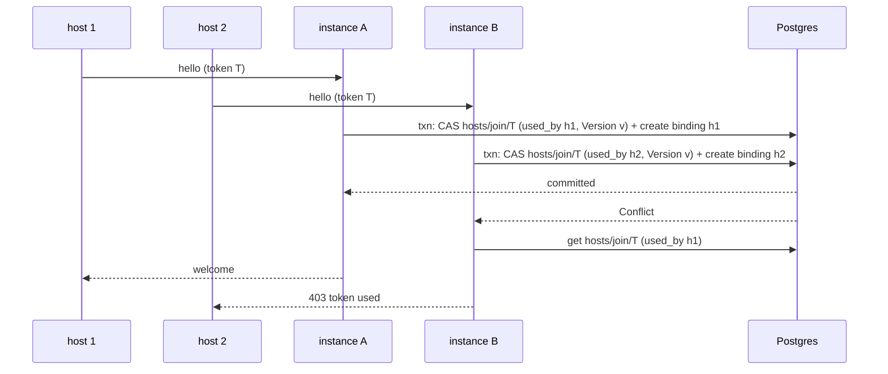
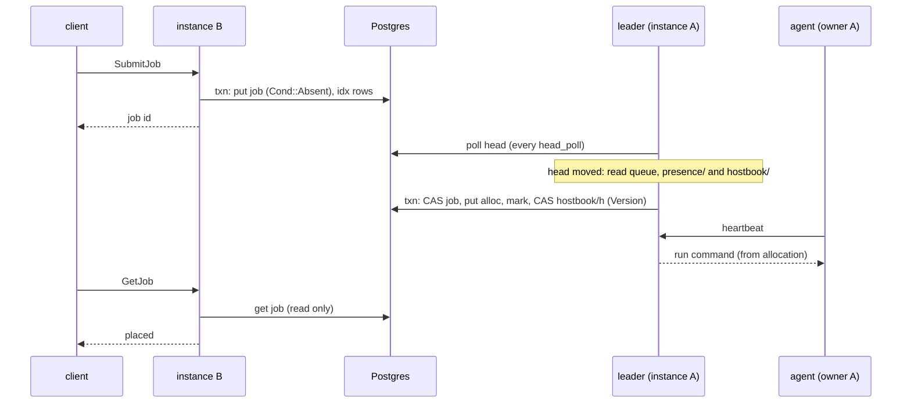
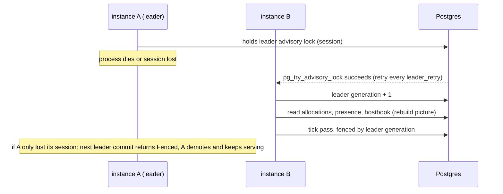

# Running the server as N instances on shared Postgres

Status: design, nothing built. Companion to [jobscheduler-design.md](jobscheduler-design.md) (sections 10.2 and 13, question 1),
[deployment.md](deployment.md), [absence.md](absence.md) and [../lease-server-update.md](../lease-server-update.md). A living document: it is
updated in the pull request that changes what it describes.

Direction from the project owner: the server (`js-server`, the `js-lease-server` crate) should run as several instances over one Postgres
store, as the kbf frontend does. A deploy must never leave zero serving instances, and no state may live only in one instance's local disk or
memory unless it is a cache that can be rebuilt from the shared store. This is option C of section 13, question 1 (several active services),
which the design doc had not chosen until now.

## Problem

Today one process serves everything and several things in it are right only because it is alone.

- **One writer.** The process takes a Postgres advisory lock for its life and bumps a `writer_generation` row; every commit it makes reads that
  row `FOR SHARE`, so a second process that starts would permanently fence the first (`StoreError::Fenced`, then exit). A deploy is therefore
  stop-first: the old process must release the lock before the new one serves. There is a gap with zero servers on every update, and a crash
  is a gap until the supervisor restarts the process.
- **Job store in a local file.** Jobs, allocations, marks, taints, secondary indexes and the change feed are a SQLite file beside the state
  file, held by one process on a local mount.
- **Identity read once.** Host bindings, join tokens and host credentials are in Postgres, but each process loads a full copy at start,
  authenticates from that copy, and writes it back from memory with no preconditions (`Cond::Any`) and a `save()` that deletes every key it
  does not hold.
- **Live state in memory.** The host table (sessions, epochs, last-heard, phase, load), the placement engine's picture, and the usage
  buffer are in process memory, rebuilt from the agents' next hello after a restart.

What breaks if a second instance simply starts (each of these is a bug today's single process cannot have):

| Event | What goes wrong |
|---|---|
| A host's first hello is answered by A, its next heartbeat reaches B | B has no such credential in memory, answers 401, and the agent treats 401 as fatal and exits. |
| One join token, two hellos, one at each instance | Each instance sees the token unused in its own memory; two hosts register with it. |
| A registers a host, then B saves | B's snapshot `save()` deletes bindings B does not hold, and overwrites A's taint and cordon. |
| Two instances place the queue | The placement transaction has preconditions on the job, allocation, mark and taint rows but not on the host's booked capacity, so two engines each with room in their own picture overbook a host. |
| A submit lands on B | The leader's placer reads its tables again only when its own process wrote (`JobStore::written()`), so it does not see B's job until some other write. |
| A lists hosts, cordons a host owned by B | The registry is local: the host is unknown there (`unknown-host`). |
| A settles "absent" hosts | A judges absence from its own registry, where B's hosts were never present, and frees live hosts' work. |

The goal of this document is a protocol under which N instances (N at least 2) serve every API at once, exactly one of them runs the global
duties at any time, and a deploy, a crash or a Postgres failover never leaves the service unable to answer.

## What does not change

- The wire to agents and clients: no route, field or status code changes. Agents need no release for this (section Compatibility).
- Row formats in the state store: only new optional rows under new key prefixes. The existing keys (`job/`, `alloc/`, `mark/`, `taint/`,
  `idx/`, `hosts/binding/`, `hosts/join/`) keep their values.
- The rule that silence ends nothing (`absence.md`): a host that stops being heard is lost only after grace plus retention, as today.
- One placement engine, one global queue order, whole-host marks (one mark row per job). Placement is not split by host owner (rejected below).
- Log bytes: pass-through to the object store, read with the server's read key.

## Decisions

1. **Postgres rows are the source of truth for everything durable; memory is a cache with a rule for refresh.** Reads fall through to the row on
   a miss and are refreshed by the change feed; writes carry a precondition and retry on conflict.
2. **Session is local, presence is shared.** The agent's session (secret digest, epoch counter, in-flight listing) lives in the instance that
   holds its connection. A small `presence/<host>` row published by that instance is what every other instance and the leader read.
3. **Exactly one leader runs the global duties** (the tick: job pass, placement, taint keeping, feed trim, retention sweep, settle, scaler).
   It is elected by a second Postgres advisory lock and fenced by its own generation. Serving needs no lock.
4. **Defence in depth on capacity**: a `hostbook/<host>` row with a version, checked in the placement transaction, so a deposed or duplicated
   placer cannot overbook even if the leader lock is wrong.
5. **Rows, not NOTIFY.** Correctness uses the advisory lock session, versioned-row compare-and-set, and the head-ordered change feed polled by
   cursor. `LISTEN/NOTIFY` is not used for correctness (not replayed, session-scoped, none is sent today: `postgres/mod.rs` C5) and is at most a
   later latency optimisation.

## State map

Where each piece is now, what breaks with a second instance, and what it becomes. Evidence is the file as of this commit.

| State | Now | Becomes |
|---|---|---|
| Jobs, allocations, marks, taints, `idx/`, change feed | SQLite file `<state-file>.jobs` (`job_store.rs`, `SqliteStore::open`), one process | The existing `PostgresStore` (same schema, same key prefixes). `JobStore` is already generic over `Arc<dyn Store>` and every mutation is a `Txn` with `Cond::Version` or `Cond::Absent` (`js-jobs/src/store/whole.rs`, `store/taints.rs`), so it is multi-writer at row level on Postgres. |
| Host bindings, join-token and host-credential digests | Postgres `hosts/binding/<host>`, `hosts/join/<digest>`, but read once at start into `BindingStore` and `JoinTokens` memory, written back from memory with `Cond::Any`, `save()` deletes keys it does not hold (`agent_state.rs`, `host_keys.rs`, `join_tokens.rs`) | Rows are the truth: read-through on a miss, refreshed by the change feed; writes `Cond::Version` / `Cond::Absent` with retry; no delete sweep in `save()`. See "Identity". |
| Host table: session, epoch, last-heard, phase, claim, labels, load, held runs, drain marks, cordon | In-memory `js_registry::Registry` per process (`registry.rs`, `record.rs`); `jobscheduler-design.md` section 10.2 and line 972: "a heartbeat is not a write" | Session stays local; presence row shared. See "Presence". |
| Placement engine picture, `SchedPlacer` caches | One in-memory engine per process, resynced from the allocation table each pass (`sched/jobs_pass.rs`, `js-sched-placer`) | Runs on the leader only, over presence rows; plus `hostbook` CAS. |
| Change detection (skip pass, reuse cached tables) | Per-process write counter `JobStore::written()` (`js-jobs/src/store.rs`, `js-sched-placer/src/jobs_seen.rs`) | The store's committed head revision. |
| Usage: node-minute rows, profiles, ended history | `usage.db` SQLite beside the state file; in-memory minute buffer flushed every 5 minutes (`usage_js.rs`, `usage_hub.rs`, `js-usage/src/store.rs`) | Same Postgres store and keys; flush retries on conflict; minute rows are written by the instance that owns the host's session. |
| Job logs: bytes, host upload credentials, follow waiters | Bytes in the object store; credentials in `LogGrants` memory; follow waiters a per-process semaphore | Already shareable. Each instance mints for the hosts whose session it holds. |
| Elastic scaler records | Postgres `acquires/scaler/*`, whole-value put with `Cond::Any`, task in the process | Leader only; the write is a CAS on the row version. |
| Hello limiter, provider catalog cache, metrics, alert dedupe, client-token reload, `/status` | Per process | Stays per process; documented (see "What stays per instance"). |

## Identity: bindings, tokens, credentials

These break first, so they land before a second instance runs, even with the job store still local.

- **Read-through.** Authentication reads the memory copy; on a miss (unknown credential digest, unknown host) it does one `store.get(key)` and
  caches a hit. A copy is refreshed by polling `Store::changes(after)` about once a second, so a revoked credential stops working everywhere
  within the poll interval (tunable `identity_poll`, default 1 s). A 401 is never answered from a cache miss alone: the row is read first.
- **Writes carry preconditions.** A new binding is `Cond::Absent`; a change is `Cond::Version(v)` of the version read; a `Conflict` re-reads
  and retries the merge. Credential renewal times merge as `max()`, so concurrent renewals cannot move a time backwards. Taint and cordon are
  fields of the binding and are changed the same way, so A's cordon is not overwritten by B's save.
- **No sweep.** `save()` no longer makes the store equal this process's snapshot. A row is deleted only by an explicit forget or revoke, as a
  `Cond::Version` delete.
- **One-use tokens.** Using a join token is a compare-and-set of its row (an additive `used_by` field) in the same transaction that creates
  the host's binding. Of two concurrent hellos with one token exactly one commits; the other reads the conflict, re-reads, and is refused as
  today's second use is. The compensating "give back" after a refused admission is also a CAS on the version it wrote.
- **Format.** The value keeps the existing encoding and the rule that unknown fields are kept and written back (`host_keys.rs` `encode` and
  `extra`). No new required field; an old release reads the new rows and ignores `used_by`. The one behaviour an old release would have wrong is
  the one-use rule across instances, which an old release does not run.

The in-process `host_writes` mutex (one hello at a time) stays as a local optimisation. The guarantee it gave across requests now comes from
the CAS above.

## Presence: sharing the host table

Today the leader-side questions (can this job ever be placed, which hosts are up, is this host absent, cordon this host) read the local
registry. With N instances the local registry knows only its own hosts.

**Rejected: route all placement to the instance that owns each host.** The queue order, whole-host marks (one mark row per job) and fairness
are global. Two engines each seeing only their own hosts would mark different hosts for one whole-host job.

**Chosen: a presence row per host.** `presence/<host>` is a new optional row:

```
presence/<host> = {
  owner:        instance id (random per process start),
  epoch:        host's session epoch,
  claim, labels, shape, phase,
  last_heard_ms: coarse (written at most every presence_refresh),
  cordon_until, drain mark, unclean flag, load summary
}
```

- Written by the owner on hello, on a change of any field above, and otherwise every `presence_refresh` (tunable, default 5 s, which is the
  heartbeat interval; it must stay below grace / 2 so the leader's "last heard" is never older than grace by the refresh alone). Cost: about one
  small write per host per 5 s. At the live farm's few hosts that is under 2 writes per second, and at 100 hosts 20 per second, which the
  global commit point (below) carries but which is the number to watch (open question 2).
- Read by everything that needs the whole fleet: admission (`no-capable-host`), `ListHosts`/`ListPools`, `GET /v1/hosts`, cordon, the leader's
  placement pass and absent-host settlement. They read the `presence/` prefix, not the local registry.
- A new prefix, not `hosts/`: an old release's whole-snapshot `save()` deletes keys under `hosts/` it does not hold, so new rows must not
  share that prefix (this is also why the delete sweep goes).
- **This amends** `jobscheduler-design.md` section 10.2 ("Reads on the hot path (heartbeat, host book) come from memory") and the line "a
  heartbeat is not a write" (section 10, the not-in-the-database list). The amendment: a heartbeat is not a write, but a coarse presence refresh
  is. Live sessions, session secrets and exact heartbeat times remain memory only. The instruction on that line stays for everything but the
  presence row. Recorded here and made in the design doc by the PR that lands presence.
- **Session is local.** The secret digest, the epoch counter and the in-flight listing stay in the owner. An agent whose next request reaches a
  different instance gets `409 unknown-host` or `403 session-mismatch` and says hello again at once (`js-agent/src/session.rs`). That path
  works today and is the agent's whole stickiness contract.
- **Epoch is monotonic across instances.** At hello the owner does a CAS increment of `epoch` in `presence/<host>`; the epoch is the stored epoch
  plus one, so epochs never repeat when a host moves from A to B to A.
- **Host-live (duplicate host id)** becomes a CAS on `presence/<host>`: a hello for a host whose row shows another owner with `last_heard`
  inside grace is refused `409 host-live`; a hello after grace takes over.
- **Session-scoped bookkeeping** (unclean hosts, last committed listing session, the first-listing test that loses unlisted work) belongs to the
  session, so it stays with the owner. The one bit the leader needs, "the last listing was clean", is a field of the presence row. A hello on a
  new instance starts a new session and a new first-listing test there, which is the correct meaning.

## Leader: the global duties

### What the leader runs

The tick (every 5 s, `Shared::tick` order) splits.

| Per instance, for its own sessions | Leader only |
|---|---|
| `registry.advance` (sessions, grace) | Job pass: expiry, retention sweep, settle absent hosts |
| Log credential renewal | `place_jobs` (the tick pass and the beat-triggered pass) |
| Usage flush for its own hosts, presence refresh | `keep_taints`, change-feed trim |
| Client-token reload | Scaler loop, usage prune and tail-counter flush |

### Election and fencing

- Every instance tries, in the background, a second Postgres session advisory lock (a new key; the same `WriterLock` code). The winner
  increments a **leader generation** (a new additive row, not the existing `writer_generation`) and runs leader work through a store handle
  fenced by that generation. Serving commits are not fenced at all: they are protected by row CAS only.
- Do not reuse `writer_generation` for serving instances: today a second start would fence the first, which is exactly the property to remove.
  The existing row stays for a release running the old protocol (Compatibility).
- **A lost lock demotes the role.** The instance stops tick, placer and scaler and keeps serving; today a lost lock stops every listener and
  exits 1. A fenced leader commit (`Fenced`) is the same demotion, not an exit.
- All leader writes are CAS or fenced, so a double leader during a Postgres blip is harmless and only wasteful.
- Absent-host settlement is judged from presence rows (owner row missing, or `last_heard` older than grace plus retention), never from one
  instance's local view, and only by the leader. The "silence ends nothing" rule is unchanged.

### Placement

One leader runs the engine, so queue order, marks and fairness stay global. Beat-triggered passes on a follower become a nudge: the leader's
own head poll (about 500 ms, `head_poll`, below) starts a pass when the head moved. The placement transaction (`whole.rs`) keeps its
preconditions on job, allocation, mark and taint and gains one: `Cond::Version` on `hostbook/<host>` (new optional row: booked cpu, memory,
ports, version). A second placer with the same room in its picture then fails the CAS on the host it shares, re-reads and chooses again. This
makes overbooking impossible by construction, not by the lock being right.

### Change detection

The per-process write counter is replaced by the store's committed head revision (`Store::changes` / `Commit::revision`, already used by
`job_store/feed_trim.rs`). A submit at A moves the head; the leader sees it at its next poll and re-reads. Cost: one `SELECT rev FROM head`
every `head_poll` (tunable, default 500 ms).

### Whole-host jobs on takeover

Whole-host prepare, `Ready`, `Committed` and `Restoring` state is rebuilt from hellos and resets on every leader takeover (design section 13,
question 1, option B caveat). Takeover therefore means: the new leader rebuilds its picture from allocation rows and presence rows, and a
whole-node job in the middle of its prepare is re-prepared by the host's next listing, not lost. A whole-node pool can show up to one tick of
no new placements plus the time for the first listing, bounded by `leader_lease` (below). This is stated so the farm's whole-node pool is not
surprised by a leader flip.

## Usage and telemetry

- Node-minute rows are already merged by CAS (`js-usage/src/store.rs`, `UsageError::Conflict`) but "a row for a minute already stored replaces
  it", so two writers of one minute race replace-versus-replace. Only the instance that owns the host's session (`presence.owner`) writes that
  host's minute rows, and the flush retries on `Conflict`.
- A flip between instances mid-minute can drop a partial minute (the new owner starts a new buffer). Loss of one unflushed 5-minute buffer when
  an instance dies is accepted telemetry loss, stated here and in `usage-store.md`.
- The ended-allocation record (`usage/ended`) is written in the job store's free transaction, so it moves with the job store.

## Logs

Already shareable. GetLogs follow reads the object store with the server's read key. Each instance mints upload credentials for the hosts whose
session it holds; an agent that flips pays one STS AssumeRole (the mint is queued, never inline). `max_follow` is per instance, so total follow
capacity is N times it; documented.

## What stays per instance

- Hello limiter: burst and interval become N times the configured rate across instances.
- Provider catalog cache, alert dedupe, metrics recorder and the `/status` page describe one instance. Scrape every instance.
- Configuration and secrets are identical across instances because the deployment gives each the same files; a change is a new file version and
  a rolling update. No config is edited in one instance.

## Routing

The agent API (port 7301) is plain HTTP/1.1 request and response: `POST /v1/agent/hello`, then `POST /v1/agent/heartbeat` every 5 s with a 15 s
grace (`js-agent-wire`). It is not a long-lived stream. An agent keeps one keep-alive TCP connection, so it is naturally pinned to one instance
until the connection breaks. The job service (7302) also speaks HTTP/2 (gRPC) as well as HTTP/1.1; a client's HTTP/2 connection is pinned to one
instance for its life.

- **Stickiness is not required for correctness** once identity rows are shared. A request that reaches an instance without the session gets 409
  or 403 and the agent re-hellos. It is only worth having for cost: each flip costs one hello, one log-credential mint, one first-listing check and
  one presence write. 401 is fatal to an agent, which is why credentials are readable from the store by every instance.
- **The edge proxy balances per TCP connection** (raw TCP proxy, the server's TLS passes through): it cannot route per request or by header.
  Recommended: keep it resolving the service's per-task DNS name (every task address) with least-request balancing, and do not use the service
  VIP, which hides dead tasks and balances long connections poorly. Host-mode port publishing is not needed.
- **Add an active health check** for both pools. Today the proxy has none for these pools; a task that is starting or draining must leave the
  pool. A TCP connect to 7301 and 7302 suffices because an instance binds them only when it serves; or serve readiness on the overlay address
  instead of loopback.
- **Explicit drain**, inside the stop grace: readiness goes 503, then HTTP/2 GOAWAY and listener close, then exit.
- **Connection max age** (tunable `connection_max_age`, default 10 min, server side) so connections rebalance after scale-out or a restart. The
  server sends `Connection: close` or GOAWAY at the age; today there is none, so old connections never rebalance.
- **To verify with one test deploy**, not assumed: whether the orchestrator withholds a not-yet-healthy task from per-task DNS while its health
  check is starting.
- **What N buys**: with every task on one node, N tasks give zero-downtime deploys and crash tolerance, not node-failure tolerance.

## Readiness and deployment shape

Today readiness means "I hold the writer lock", and the start order is built around one holder: the readiness listener first, then the lock, then
the other listeners; a second process waits and answers 503. The host updater hook probes "the store's writer lock held by a different
holder" for prepare, cutover, verify and rollback (`docs/lease-server-update.md`, `packaging/js-lease-server/updater.d`).

- **Ready** = store reachable, schema acceptable, listeners bound. Independent of leadership, which is reported separately (`/readyz?role`).
- The deployment moves from `replicas: 1`, stop-first to `replicas: N` (N at least 2), start-first, parallelism 1, so the new task is ready
  before an old one stops and never fewer than N-1 serve.
- The updater hook's checks become "new instance ready and old instance drained"; `lease-server-update.md` and `release.md` ("One writer per
  store") are rewritten. This is its own PR: it touches packaging and the hook.
- While the old release still runs the old protocol (one writer, fencing on `writer_generation`), a new-release instance must not start beside
  it. The rollout order below keeps replicas at 1 until every instance runs the new release.

## Sequence diagrams

### Hello at a different instance than the heartbeat

```mermaid
sequenceDiagram
    participant Ag as agent
    participant A as instance A
    participant B as instance B
    participant PG as Postgres
    Ag->>A: POST hello (credential)
    A->>PG: get hosts/binding/h (miss in cache)
    A->>PG: txn: CAS presence/h (epoch+1, owner A)
    A-->>Ag: welcome (session secret, epoch)
    Note over Ag,B: connection breaks; next request reaches B
    Ag->>B: POST heartbeat (credential, epoch, secret)
    B->>PG: get hosts/binding/h (miss), get presence/h
    B-->>Ag: 409 unknown-host (no session here)
    Ag->>B: POST hello (credential)
    B->>PG: txn: CAS presence/h (epoch+1, owner B)
    B-->>Ag: welcome
    Note over A: A's next presence refresh gets Conflict, drops its session
```

### One join token, two concurrent hellos



### Submit on one instance, placement on the leader



### Leader failure and takeover



## Latency budget

Every commit is one transaction: `LOCK TABLE head`, `SELECT head FOR UPDATE`, `now()`, the writes, the fence read (leader handle only), the head
update, `COMMIT` (`postgres/tx.rs`). That is a **global commit serialisation point**: a writer queues on the table lock, so the rate of all
writes in the system, not each instance's, is what the budget bounds. Reads are plain selects and do not take it.

| Operation | Postgres round trips | Locks held | Notes |
|---|---|---|---|
| Heartbeat (presence unchanged) | 0 | none | Memory only, as today. |
| Heartbeat that refreshes presence (every `presence_refresh`) | 1 write txn | head lock for the commit | About one per host per 5 s. |
| Hello, known credential | 1 read (on a cache miss) + 1 write txn (presence CAS, epoch) | head lock for the commit | Plus one STS mint, queued, not inline. |
| Hello with a join token | 1 read + 1 write txn (token CAS + binding create) | head lock for the commit | Exactly one concurrent winner. |
| Authenticate, cache hit | 0 | none | Refreshed by change poll. |
| Authenticate, cache miss | 1 read | none | Required before any 401. |
| SubmitJob | 1 write txn (job, indexes) + 1 read | head lock for the commit | Same shape as today on SQLite, over the network. |
| GetJob, GetResult, ListJobs, GetLogs (no follow) | 1 read, or 1 list | none | Read only, any instance. |
| GetLogs follow | 1 read per wake | none | Plus object-store read; bounded by `max_follow` per instance. |
| CordonHost / UncordonHost | 1 read + 1 write txn | head lock | Applies at the owner's next heartbeat or the leader's next pass. |
| Leader tick pass | 1 head read + 1 list of `presence/` + 1 list of `hostbook/` + queue read; 1 write txn per placement; 1 per settle | head lock per commit | Passes run only when the head moved or the 5 s tick fires. |
| Change poll (each instance) | 1 `SELECT rev FROM head` per `identity_poll` / `head_poll` | none | 2 reads per second per instance at the defaults. |
| Usage flush | 1 write txn per host-batch per 5 min | head lock | Retries on conflict. |

Aggregate write budget at the live scale (about 6 hosts; 2.5 GetJob, 0.06 SubmitJob and 0.02 ListJobs per second measured over 10 minutes from the
server's request log): presence refresh 1.2 writes/s, placement and feed trim well under 1 write/s, so under 3 writes/s in all, each a short
transaction. This is measured load times the design's rate, not a Postgres benchmark; PR 8 below measures commit latency under N=2 and N=4 with
the fake hosts of the conformance suite before the replica count is raised past 2.

## Model check, before code

The protocol has properties that only hold across interleavings, so it is modelled before any behaviour change lands. Two artifacts, both in
PR 0b of the list below:

1. **A PlusCal/TLA+ specification** (`docs/design/model/multi_instance.tla`, with its `.cfg`) checked with TLC for 2 instances, 2 hosts, 2 jobs,
   1 token. TLC is not part of CI (it needs a JVM and the repository's CI runs build and unit tests only); the spec, its configuration and the
   state counts TLC reported are checked in, and the Rust test below is the one CI runs. Not yet written or run at this commit.
2. **An exhaustive interleaving test in Rust** over `js-state`'s fake store (`Store` is already faked), driving the real identity,
   presence, leader and placement code as an instance model, enumerating every order of the steps of two instances up to a bound. This is the check
   that runs in CI and the one that keeps passing as the code changes.

Properties (each is a spec invariant and a named Rust test):

| Property | Meaning |
|---|---|
| `OneUse` | A join token is admitted at most once, across instances and across a compensating give-back. |
| `NoLostBinding` | A binding or taint written by one instance is never removed by another instance's save. |
| `EpochMonotonic` | A host's epoch never repeats or decreases, through A to B to A. |
| `NoOverbook` | The booked capacity on a host never exceeds its shape, for any interleaving of two placers, including a deposed leader mid-commit. |
| `SingleLiveLeader` | After a leader generation bump, no commit with the old generation succeeds. |
| `NoFreeOfLiveHost` | The leader never settles a host as absent while its presence row is inside grace. |
| `AgentConverges` | An agent that flips between instances reaches a session in one hello after any 409 or 403 and never sees a 401 for a credential the store holds. |

Scenarios to enumerate: leader lease expiry; a deposed leader mid-commit; Postgres failover (session loss on both locks); two hellos for one
token; deposed placer against new placer overbooking; an agent flipping A to B to A; a cordon at A against a heartbeat at B; a rollback to the
previous release between steps. The exact PlusCal is written in PR 0b and reviewed before any later PR lands.

## Compatibility and failure modes (B8)

All format changes are additive: new optional rows under new prefixes (`presence/`, `hostbook/`, the leader generation row), one new optional
field (`used_by`) in an existing value that keeps unknown fields. Nothing is renumbered, renamed, removed or newly required, and no version floor is
raised.

- **Previous release on new data**: a test starts the previous release's server over a store holding presence, hostbook and `used_by` data and
  checks that it serves, reads the bindings, and does not delete the new rows. A new-prefix row is outside the old `save()`'s sweep. The test is
  named in PR 1 and PR 2 (below) and runs the previous release from the release fixtures as the existing skew tests do
  (`crates/js-agent/tests/agent/skew`).
- **New release on old data**: a test starts the new release over a store written only by the previous release (no presence, no hostbook, no
  leader row) and checks that it serves, creates the rows on first use and places work.
- **Both on one store** is not supported: an old-release instance beside a new one would fence it on `writer_generation` and run the
  sweeping `save()`. The rollout keeps one instance until the old release is gone, and the rollback path below returns to one instance first.
- **Job store on Postgres**: row formats are the SQLite store's, written through the same `Store` trait. The previous release reads only its own
  SQLite file, so rollback means the previous release runs on the old file, which is kept untouched.

Failure modes:

| Failure | Behaviour |
|---|---|
| Postgres unreachable | Instances answer errors for writes and reads that miss their caches; cached authentication still answers, so agents are not told 401 by a database blip. Not ready until reachable. |
| Postgres failover | Both advisory locks are session locks and are lost; the leader demotes, every instance re-competes. Writes in flight return an error; CAS makes the retry safe. |
| Leader dies | Another instance takes the lock within `leader_lease` plus one tick; serving is unaffected; whole-host prepare state resets as described. |
| Two leaders (lock wrong or blip) | Leader commits carry the leader generation, so the older one is rejected `Fenced`; `hostbook` CAS prevents overbooking even if the fence is bypassed. |
| An instance dies | Its agents see a connection error, reach another instance, get 409, and re-hello. Their presence rows go stale and are replaced by the new owner. |
| Clock skew between instances | Time in leader judgements comes from the database clock (`clock_timestamp()`, already used for expiry), not from each instance. |
| Presence write fails | The session continues; the row is retried at the next refresh; the leader treats a row older than grace as stale. |

## Cutover from the single-writer deploy (reversible)

The large one-way risk is moving the job store from the local SQLite file to Postgres (job specs, retention, id minting). Each step is its own
release and is reversible.

1. **Identity and presence rows, still one instance.** Behaviour unchanged at replicas 1. Rollback: previous release; the new rows are ignored.
2. **Job store on Postgres, still one instance.** One-time copy of the SQLite rows during a short window with the service scaled to zero (serving
   is down for the copy; kbf retries, agents re-hello). The SQLite file is left untouched and read-only for rollback. Verify by count and by a
   checksum of the rows per prefix, which `js` prints, before the new release starts. Rollback: scale to zero, previous release on the old file;
   jobs submitted after the cutover are not in the old file (stated to the owner before the window; question 5).
3. **Leader election and hostbook, one instance** (the instance is always the leader). Rollback: previous release.
4. **Replicas 2, start-first**, after readiness and the updater hook are changed. From here a deploy never has zero serving instances.
5. **Edge proxy health check, drain and connection max age.** Verified on one test deploy before relying on it.
6. **Scaler leader gate** last: the scaler is not active on the live deployment (one static pool, no machine provider), so it blocks nothing.

Never apply the new stack while the host's native unit of the previous release is running: the writer lock arrangement of the previous
release and the new protocol must not overlap (the existing rule in the stack header, restated for the new shape).

## Implementation PRs, in landing order

Each is one subject, with its tests and the docs it changes in the same PR.

| # | Repo | PR | Notes |
|---|---|---|---|
| 0 | jobscheduler | This document | Docs only. |
| 0b | jobscheduler | The PlusCal spec, its TLC state counts, and the Rust interleaving-test scaffold over the fake store | No behaviour change. Review before PR 1. |
| 1 | jobscheduler | Host bindings and credentials: read-through, CAS writes, no delete sweep | Needs the model's `NoLostBinding`; names the old-on-new and new-on-old tests. |
| 2 | jobscheduler | Join tokens: one-use as CAS (`used_by`), compensating undo as CAS | Cross-instance test: two instances, one token, two concurrent hellos, one admitted. |
| 3 | jobscheduler | Job store on the Postgres store; copy tool; head revision replaces `written()` | The cutover step 2 binary; SQLite rows copied. |
| 4 | jobscheduler | `presence/<host>` rows; epoch CAS; host listing, admission and cordon read presence | Amends design section 10.2; presence-write budget tests. |
| 5 | jobscheduler | Leader lock and leader generation; leader-only tick; demotion instead of exit; `hostbook` CAS in the placement txn | The core of the protocol; the exhaustive Rust interleaving test lands here. |
| 6 | jobscheduler | Usage on Postgres, minute rows by owner, flush retries | Moves `usage.db`. |
| 7 | jobscheduler | Readiness independent of the lock; drain; connection max age; updater hook and docs rewritten | Packaging and `lease-server-update.md`. |
| 8 | deployment repository | Stack: replicas N, start-first; edge proxy health check; the host-mode and VIP decisions recorded | After PR 7 is released; measures commit latency at N=2 and N=4. |
| 9 | jobscheduler | Scaler gated on the leader, records written by CAS | Last; off on the live deployment. |
| 10 | jobscheduler | Rewrite design section 13 question 1 and 10.2 "One writer" to the chosen design; remove the question | Docs only. |

## Open questions for the project owner

Each has a recommended answer; the design above assumes them.

1. **Leader-only placement, or placement by the instance that owns each host?** Recommended: leader plus `hostbook` CAS. Per-owner placement breaks
   the global queue, whole-host marks and fairness.
2. **Accept presence writes about every 5 s per host?** Recommended: yes. About 1 to 2 writes per second at the live scale; revisit with the
   measured commit latency (PR 8) if the fleet grows past about 100 hosts, where `presence_refresh` can rise toward grace / 2.
3. **N = 2 on the one machine now, or a second machine?** Recommended: two instances now, which buys zero-downtime deploys and crash tolerance; a
   second machine is a later decision (node-failure tolerance also needs a second Postgres path and a second edge).
4. **Agent stickiness?** Recommended: none beyond TCP keep-alive, plus the server-side connection max age. A flip costs one hello and one STS call.
5. **Job-store cutover: a short pause, or dual-write?** Recommended: a short pause with the service scaled to zero, SQLite file kept untouched for
   rollback. Dual-write needs a second consistency protocol for a one-time move.
6. **Rewrite `jobscheduler-design.md` section 13 question 1 and section 10.2 "One writer" to option C?** Recommended: yes, in PR 10, once the
   protocol has passed the model check; until then those sections carry a pointer to this document.
7. **Is a lost unflushed usage buffer (at most 5 minutes of node rows when an instance dies) acceptable?** Recommended: yes; it is telemetry.
