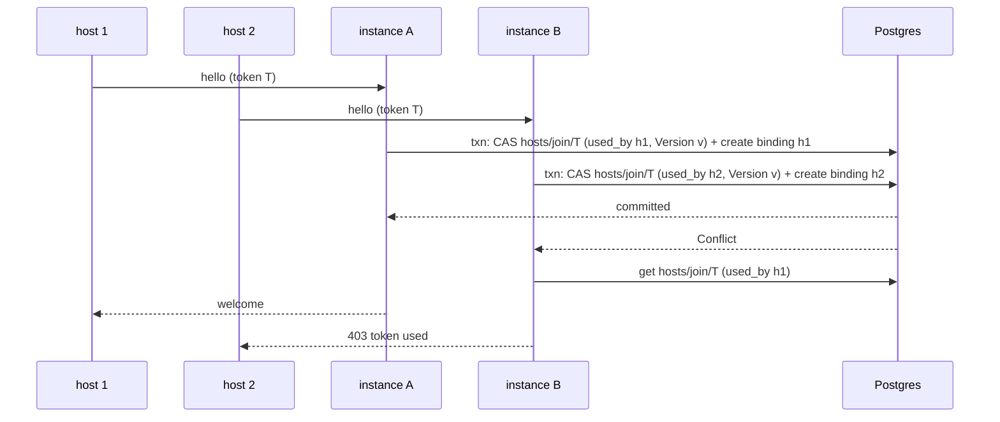
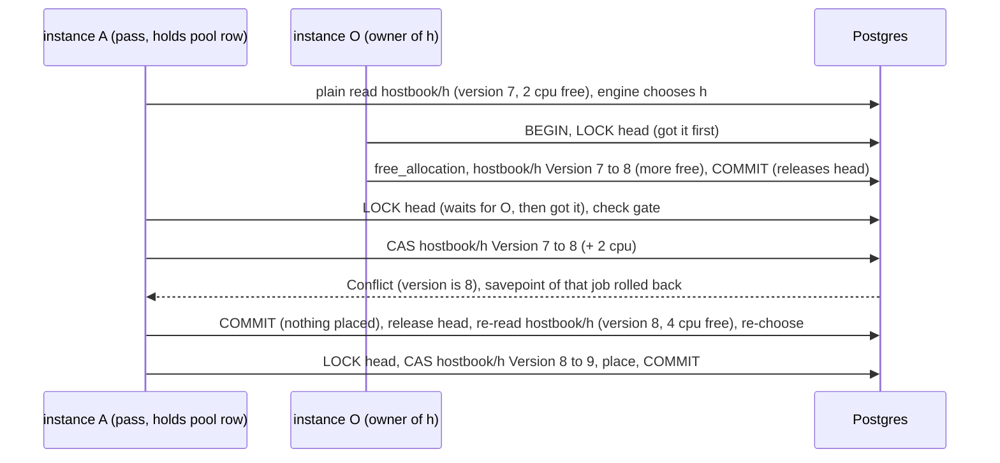
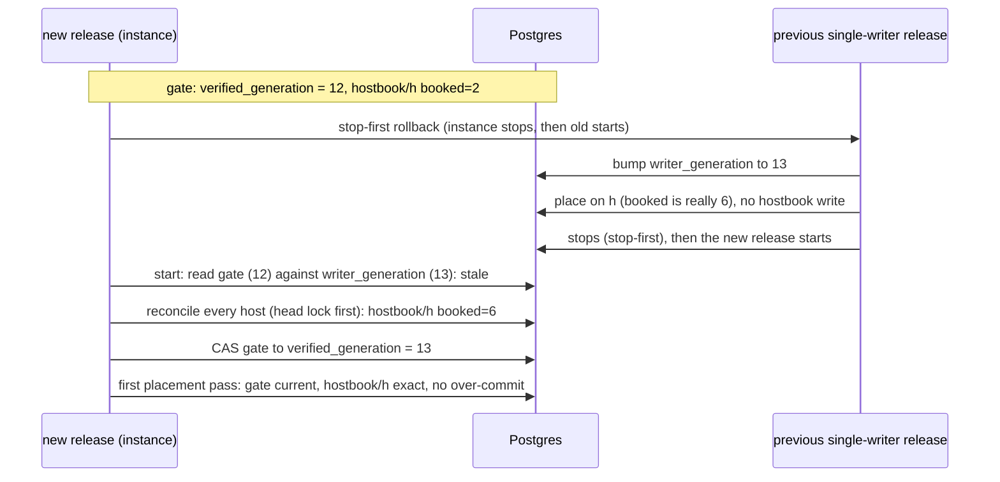
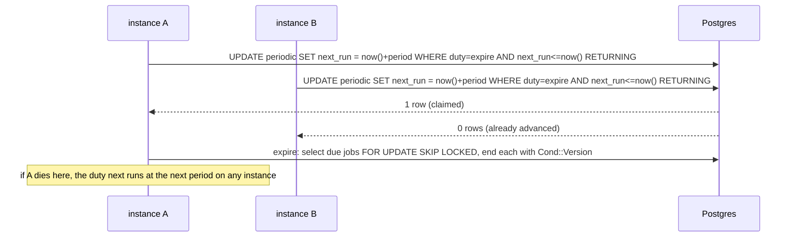
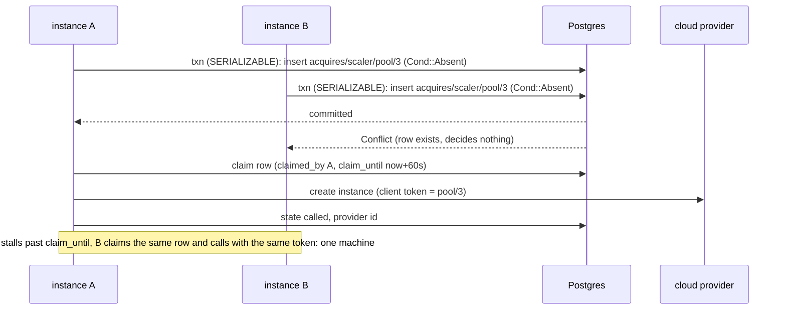

# Running the server as N instances on shared Postgres

Status: design, nothing built. Companion to [jobscheduler-design.md](jobscheduler-design.md) (sections 10.2 and 13, question 1),
[deployment.md](deployment.md), [absence.md](absence.md) and [../lease-server-update.md](../lease-server-update.md). A living document: it is
updated in the pull request that changes what it describes.

Direction from the project owner: the server (`js-server`, the `js-lease-server` crate) runs as any number of instances over one Postgres
store, as the kbf frontend does, and Postgres is the single source of truth. Instances "just work": there is no leader, no lease and no
election. Every decision (placement, admission, taints, settlement, periodic work) is made inside a Postgres transaction whose correctness does
not depend on which instance runs it or how many run it at once. This is option C of section 13, question 1, in its leaderless form.

**Why no leader.** An earlier draft of this document elected one instance by a lease row to run the global duties. The owner decided
(2026-11-15) that Postgres is the one source of truth and that a second source of order (a lease, a generation, a role) is not needed: the
row locks, conditional updates and unique constraints that make a leader safe also make every instance safe without one. All of that
machinery is gone from this document, not kept as an alternative.

## Problem

Today one process serves everything and several things in it are right only because it is alone.

- **One writer.** The process takes a Postgres advisory lock for its life and bumps a `writer_generation` row; every commit it makes reads that
  row `FOR SHARE`, so a second process that starts would permanently fence the first (`StoreError::Fenced`, then exit). A deploy is therefore
  stop-first: the old process must release the lock before the new one serves. There is a gap with zero servers on every update, and a crash
  is a gap until the supervisor restarts the process.
- **Job store in a local file.** Jobs, allocations, marks, taints, secondary indexes and the change feed are a SQLite file beside the state
  file, held by one process on a local mount.
- **Identity read once.** Host bindings, join tokens and host credentials are in Postgres, but each process loads a full copy at start,
  authenticates from that copy, and writes it back from memory with no preconditions (`Cond::Any`) and a `save()` that deletes every key it
  does not hold.
- **Live state in memory.** The host table (sessions, epochs, last-heard, phase, load), the placement engine's picture, and the usage
  buffer are in process memory, rebuilt from the agents' next hello after a restart.
- **Global duties in the tick.** Expiry, retention, settlement, taint keeping, feed trim and the scaler run in one process's tick, and nothing
  stops two processes from running them at once.

What breaks if a second instance simply starts (each of these is a bug today's single process cannot have):

| Event | What goes wrong |
|---|---|
| A host's first hello is answered by A, its next heartbeat reaches B | B has no such credential in memory, answers 401, and the agent treats 401 as fatal and exits. |
| One join token, two hellos, one at each instance | Each instance sees the token unused in its own memory; two hosts register with it. |
| A registers a host, then B saves | B's snapshot `save()` deletes bindings B does not hold, and overwrites A's taint and cordon. |
| Two instances place the queue | The placement transaction has preconditions on the job, allocation, mark and taint rows but not on the host's booked capacity, so two engines each with room in their own picture overbook a host, and both may place the same queued job on different hosts if neither holds a row lock on it. |
| A submit lands on B | A placer reads its tables again only when its own process wrote (`JobStore::written()`), so it does not see B's job until some other write. |
| A lists hosts, cordons a host owned by B | The registry is local: the host is unknown there (`unknown-host`). |
| A settles "absent" hosts | A judges absence from its own registry, where B's hosts were never present, and frees live hosts' work. |
| Both run the periodic duties | Expiry, trim, settle and the scaler each run twice, racing on the same rows. |

The goal of this document is a protocol under which any number of instances serve every API and make every decision at once, with no
instance more special than another, and a deploy, a crash or a Postgres failover is safe. When Postgres is unreachable nothing is decided
(fail closed, below).

## What does not change

- The wire to agents and clients: no route, field or status code changes. Agents need no release for this (section Compatibility). The one
  behaviour agents see is a `503` while the database is unreachable; section "Fail closed" says why an agent treats it as a retry.
- Row formats in the state store: only new optional rows under new key prefixes. The existing keys (`job/`, `alloc/`, `mark/`, `taint/`,
  `idx/`, `hosts/binding/`, `hosts/join/`) keep their values.
- The rule that silence ends nothing (`absence.md`): a host that stops being heard is lost only after grace plus retention, as today.
- One placement algorithm, one global queue order per pool, whole-host marks (one mark row per job). Placement is not split by host owner
  (rejected below).
- Log bytes: pass-through to the object store, read with the server's read key.

## Decisions

1. **Postgres rows are the source of truth for everything durable; memory is a cache rebuildable from the database.** A cache is refreshed by
   `LISTEN/NOTIFY` as a wake-up and by a version poll as the guarantee; writes carry a precondition and retry on conflict.
2. **Every decision is a transaction that is correct for any number of concurrent runners.** The tools, in order of preference: a unique key
   (`Cond::Absent`); a conditional update on a version column (`Cond::Version`); the store's head lock, which every writing transaction takes
   first and which makes the writes of one transaction a unit no other writer interleaves with; `FOR UPDATE SKIP LOCKED` on the few rows taken
   before the head lock so runners do not wait on each other (the placement pool row); and a retry of the whole transaction on a deadlock or
   serialization failure. One lock order for all of them (pool row, head lock, other rows in key order) is in "The placement transaction". No
   decision relies on a role, a lease or a count of instances.
3. **Postgres is the central dependency, and the design says so.** When it is unreachable, instances make no decisions and answer `503`
   (section "Fail closed"). There is no memory-first fallback that keeps deciding on a stale picture.
4. **Session is local, presence is shared.** The agent's session (secret digest, epoch counter, in-flight listing) lives in the instance that
   holds its connection, and that instance is the only one that talks to the agent. A small `presence/<host>` row published by it is what every
   other instance reads. Every decision about the host (placement, taint, cordon, settle) is in the database.
5. **Defence in depth on capacity**: a `hostbook/<host>` row with a version, reserved by conditional update in the placement transaction and
   bumped by every transaction that changes the host's allocations, so overbooking is impossible even if a lock is missed. It is a derived cache of
   the allocation rows, never a second source of truth (see "Placement").
6. **Periodic work is claimed per row, not owned by an instance.** Each duty is a row with a `next_run`; whichever instance advances it runs
   the duty once for that period (section "Periodic work").
7. **Rows, not NOTIFY, for correctness.** `LISTEN/NOTIFY` is not replayed and is session-scoped; it is used only to wake a runner earlier than
   its poll would. Every property and every latency bound below holds with NOTIFY switched off, and the latency table gives both numbers.

## State map

Where each piece is now, what breaks with a second instance, and what it becomes. Evidence is the file as of this commit.

| State | Now | Becomes |
|---|---|---|
| Jobs, allocations, marks, taints, `idx/`, change feed | SQLite file `<state-file>.jobs` (`job_store.rs`, `SqliteStore::open`), one process | The existing `PostgresStore` (same schema, same key prefixes). `JobStore` is already generic over `Arc<dyn Store>` and every mutation is a `Txn` with `Cond::Version` or `Cond::Absent` (`js-jobs/src/store/whole.rs`, `store/taints.rs`), so it is multi-writer at row level on Postgres. |
| Host bindings, join-token and host-credential digests | Postgres `hosts/binding/<host>`, `hosts/join/<digest>`, but read once at start into `BindingStore` and `JoinTokens` memory, written back from memory with `Cond::Any`, `save()` deletes keys it does not hold (`agent_state.rs`, `host_keys.rs`, `join_tokens.rs`) | Rows are the truth: authentication reads the row; writes `Cond::Version` / `Cond::Absent` with retry; no delete sweep in `save()`. See "Identity". |
| Host table: session, epoch, last-heard, phase, claim, labels, load, held runs, drain marks, cordon | In-memory `js_registry::Registry` per process (`registry.rs`, `record.rs`); `jobscheduler-design.md` section 10.2 and line 972: "a heartbeat is not a write" | Session stays local; presence row shared. See "Presence". |
| Placement engine picture, `SchedPlacer` caches | One in-memory engine per process, resynced from the allocation table each pass (`sched/jobs_pass.rs`, `js-sched-placer`) | A pass is stateless: it reads rows inside the placement transaction and runs on any instance, under the pool row lock and the `hostbook` reservation. See "Placement". |
| Host-isolation taint (`Tainted`, `keep_taints`, `drop_taints`) | A `taint/` row written in the placement txn, then copied into the placing process's own in-memory registry and binding snapshot, then the row deleted at `Cond::Any` (`agents_taints.rs`, `jobs_pass.rs`, `js-jobs/store/taints.rs`) | Written into the host's binding row in the placement txn itself; the owner reads it from the binding. See "Taint hand-off". |
| Index backfill at open | `JobStore::new` runs `backfill_indexes` on every open (`store/index.rs`) | A one-time migration step and a periodic row any instance may claim. See "Startup index backfill". |
| Change detection (skip pass, reuse cached tables) | Per-process write counter `JobStore::written()` (`js-jobs/src/store.rs`, `js-sched-placer/src/jobs_seen.rs`) | The store's committed head revision, polled, plus NOTIFY as a wake. |
| The tick: expiry, retention, settle, taint keeping, feed trim, usage prune, scaler | One process's `Shared::tick` | Periodic rows claimed per row; per-row work claimed with `SKIP LOCKED`. See "Periodic work". |
| Usage: node-minute rows, profiles, ended history | `usage.db` SQLite beside the state file; in-memory minute buffer flushed every 5 minutes (`usage_js.rs`, `usage_hub.rs`, `js-usage/src/store.rs`) | Same Postgres store and keys; minute rows are written by the instance that owns the host's session, in the presence transaction. |
| Job logs: bytes, host upload credentials, follow waiters | Bytes in the object store; credentials in `LogGrants` memory; follow waiters a per-process semaphore | Already shareable. Each instance mints for the hosts whose session it holds. |
| Elastic scaler records | Postgres `acquires/scaler/*`, whole-value put with `Cond::Any`, task in the process | Intent rows claimed per row, with the row id as the provider's idempotency token. See "Scaler and cloud calls". |
| Hello limiter, provider catalog cache, metrics, alert dedupe, client-token reload, `/status` | Per process | Stays per process; documented (see "What stays per instance"). |

## Fail closed

Postgres is the one source of truth and therefore the one dependency every decision has. The rule is plain:

- **An instance that cannot reach Postgres makes no decision.** No placement, no admission, no hello is welcomed, no listing is committed, no
  cordon, no settlement, no periodic duty, no scaler call. There is no memory-first fallback and no "keep serving from the cache".
- **Zero staleness for grants that can be revoked.** Deny rows and revoked tokens and credentials take effect at once, so authentication of a
  request reads the credential's row (one primary-key read, never a cache hit alone) before it answers anything but a refusal. The cache holds
  the parsed binding only to avoid decoding; the row's version decides. This is why a database outage cannot be papered over by cached
  authentication: a cache that could outlive a revocation is not allowed.
- **The reply is `503` with `Retry-After`, never `401`.** An agent treats 401 as fatal and exits, and a database outage must not kill agents.
  A test in `js-agent` (PR 1) asserts an agent treats `503` from hello and heartbeat as a retry with its normal backoff and keeps its jobs
  running. The agent already keeps running jobs without a server (`absence.md`); nothing is lost by a silent server.
- **Recovery does not settle on the outage's silence.** While Postgres was away no heartbeat was recorded, so every host's `last_heard` is as
  old as the outage. An instance that has seen a failed query holds all absent-host settlement for `settle_quiet` (tunable, default grace plus
  one heartbeat interval, 20 s, measured on a local monotonic clock) after its first success, so agents re-heartbeat first. This is a guard
  on the settling instance only; the settle transaction itself still carries a `Cond::Version` on the host's presence row (see "Periodic work"),
  so a host that is heard in the meantime cannot be freed whatever any instance believes.
- **Probes.** Liveness is the process answering; readiness for the proxy is listeners bound and schema accepted (see "Readiness"), so an
  outage shows as `503` from live instances, not as an empty pool; `/readyz?db` reports database reachability for operators.

## Identity: bindings, tokens, credentials

These break first, so they land before a second instance runs, even with the job store still local.

- **Read the row.** Authentication reads `hosts/binding/<host>` (and the credential row) from the store on each request, by primary key, as
  above. The memory copy is a decoded cache validated by row version. An unknown credential digest is answered `401` only after the read finds no
  row; a failed read is `503`. A cache refresh poll (`identity_poll`, default 1 s on the change feed) keeps the decoded copies warm and is
  not what decides.
- **Writes carry preconditions.** A new binding is `Cond::Absent`; a change is `Cond::Version(v)` of the version read; a `Conflict` re-reads
  and retries the merge. Credential renewal times merge as `max()`, so concurrent renewals cannot move a time backwards. Taint and cordon are
  fields of the binding and are changed the same way, so A's cordon is not overwritten by B's save.
- **No sweep.** `save()` no longer makes the store equal this process's snapshot. A row is deleted only by an explicit forget or revoke, as a
  `Cond::Version` delete.
- **One-use tokens.** Using a join token is a compare-and-set of its row (an additive `used_by` field) in the same transaction that creates
  the host's binding. Of two concurrent hellos with one token exactly one commits; the other reads the conflict, re-reads, and is refused as
  today's second use is. The compensating "give back" after a refused admission is also a CAS on the version it wrote.
- **Format.** The value keeps the existing encoding and the rule that unknown fields are kept and written back (`host_keys.rs` `encode` and
  `extra`). No new required field; an old release reads the new rows and ignores `used_by`. The one behaviour an old release would have wrong is
  the one-use rule across instances, which an old release does not run.

The in-process `host_writes` mutex (one hello at a time) stays as a local optimisation. The guarantee it gave across requests now comes from
the CAS above.

## Presence: sharing the host table

Today the questions "can this job ever be placed", "which hosts are up", "is this host absent" and "cordon this host" read the local registry.
With N instances the local registry knows only its own hosts.

**Rejected: route all placement to the instance that owns each host.** The queue order, whole-host marks (one mark row per job) and fairness
are global per pool. Two engines each seeing only their own hosts would mark different hosts for one whole-host job.

**Chosen: a presence row per host.** `presence/<host>` is a new optional row:

```
presence/<host> = {
  owner:          instance id (random per process start),
  agent_instance: the agent process's instance, from its hello,
  epoch:          host's session epoch,
  claim, labels, shape, phase,
  last_heard_ms:  coarse (written at most every presence_refresh),
  cordon_until, drain mark, released, unclean flag, load summary
}
```

- Written by the owner on hello, on a change of any field above, and otherwise every `presence_refresh` (tunable, default 5 s, which is the
  heartbeat interval; it must stay below grace / 2 so "last heard" is never older than grace by the refresh alone). Cost: about one small
  write per host per 5 s. At the live farm's few hosts that is under 2 writes per second, and at 100 hosts 20 per second, which the global
  commit point (below) carries but which is the number to watch. Recommended and accepted: about every 5 s per host is fine.
- Read by everything that needs the whole fleet: admission (`no-capable-host`), `ListHosts`/`ListPools`, `GET /v1/hosts`, cordon, every
  placement pass and absent-host settlement. They read the `presence/` prefix, not the local registry.
- A new prefix, not `hosts/`: an old release's whole-snapshot `save()` deletes keys under `hosts/` it does not hold, so new rows must not
  share that prefix (this is also why the delete sweep goes).
- **This amends** `jobscheduler-design.md` section 10.2 ("Reads on the hot path (heartbeat, host book) come from memory") and the line "a
  heartbeat is not a write" (section 10, the not-in-the-database list). The amendment: a heartbeat is not a write, but a coarse presence refresh
  is. Live sessions, session secrets and exact heartbeat times remain memory only. Recorded here and made in the design doc by the PR that lands
  presence.
- **Session is local.** The secret digest, the epoch counter and the in-flight listing stay in the owner. An agent whose next request reaches a
  different instance gets `409 unknown-host` or `403 session-mismatch` and says hello again at once (`js-agent/src/session.rs`). That path
  works today and is the agent's whole stickiness contract.
- **Epoch is monotonic across instances.** At hello the owner does a CAS increment of `epoch` in `presence/<host>`; the epoch is the stored epoch
  plus one, so epochs never repeat when a host moves from A to B to A.
- **Host-live (duplicate host id) differs from today's rule, on purpose.** Today `registry.rs` (the `HostLive` refusal, about line 351) refuses
  any hello while the host is Live, and `js-agent/src/session.rs` treats `host-live` as back off and retry. Copied as is, every flip would leave
  the host unserved for grace plus a jittered backoff: the old owner wrote `last_heard` at most 5 s earlier, so the new instance would see
  an owner with a fresh row. The registry already knows who is calling: a hello carries the agent's `instance` and its credential, and
  `bound.admits(credential, instance)` is how `HostBound` is decided. The new rule is a CAS on `presence/<host>`:
  - the hello's credential and agent `instance` equal those the row records: the same agent flipping. It **takes over at once**, whatever
    `last_heard` says, with an epoch CAS (owner becomes the new instance, epoch plus one). The old owner's next presence refresh or listing
    commit loses the CAS and it drops the session (see "Stale session").
  - a different credential or a different agent `instance` while the row is inside grace: `409 host-live`, as today. After grace it takes over.
  - a draining owner writes `released: true` (with the epoch) into `presence/<host>` for each of its sessions before it closes listeners, so a
    flip off a drained instance is never judged by `last_heard` at all, and a different agent may take a released host at once.
  A flip therefore costs one 409, one hello and one CAS, not grace plus backoff. Two agent processes with one credential and different `instance`
  values are still refused. This rule replaces the single-process one in `registry.rs`; PR 4 changes both and the test for each outcome.
- **Stale session.** An owner that has lost a presence CAS (another instance took the host) marks its session superseded. Its listing commits
  (`commit_listing`, `lose_unlisted`, `free_allocation` on a host's confirmation) are conditional on `Cond::Version` of `presence/<host>` at the
  epoch it holds, so a superseded session cannot commit a listing or a free after the new owner took over. The reply to the old connection is
  `403 session-mismatch`.
- **Last_heard is stamped by the store.** The owner writes `last_heard_ms` as the commit time the store gives the presence transaction
  (the same database clock as expiry and every claim below), never `Clock::now()` of the process. Heartbeat paths that stamp with the process
  clock today (`agent_api.rs`, `store_time(placing.clock.now())`) keep doing so for per-session values that only the owner reads, but no value
  that one instance compares against another instance's value may come from a process clock. The refresh is coarse, so "last heard" can be
  older than the truth by up to `presence_refresh` plus a commit; grace is sized for that.
- **Heartbeat ordering is by session, not by a send time.** A delayed heartbeat overtaken by a newer one across a flip needs no timestamp guard.
  Within one session, one agent sends its beats one at a time over one connection, so they arrive in order. Across sessions, a beat carries the
  session secret and epoch of the session it belongs to: the old owner applies it only while it still holds that session, and its presence write
  is conditional on the row's version at that epoch (see "Stale session"), so a beat from a superseded session is answered `403 session-mismatch`
  and writes nothing. No heartbeat field is added and the agent is unchanged. (An earlier draft ordered beats by a `sent_unix` and a
  `last_sent_unix` guard. The `Heartbeat` wire struct has no send-time field, so that would be a wire change that old agents do not send, and a
  guard on an agent clock that steps back would ignore every beat until the clock passed the old value. It is dropped; see "Review findings and responses" in [multi-instance-review.md](multi-instance-review.md).)
- **Session-scoped bookkeeping** (unclean hosts, last committed listing session, the first-listing test) belongs to the session, so it stays with
  the owner. The one bit the other instances need, "the last listing was clean", is a field of the presence row. A hello on a new instance starts
  a new session and a new first-listing test there. What that test may end is narrowed; see "First listing after a flip".

## First listing after a flip

`first_listing` is per instance and per session; on a first listing `lose_unlisted` ends any job in `Starting` or `Running` that the listing
neither lists nor retires, and `Lost` is terminal. With one process that needed a server restart in the middle of a start. With N instances a
flip is routine (every `connection_max_age`, every deploy, every crash), so the same rule would kill work that never started: owner A commits
`Placed` to `Starting` and sends `JobStart` in a heartbeat reply, the connection drops before the agent acts, the agent hellos at B, and B's first
listing does not show the job.

- **A `Starting` job that the first listing does not show is not lost.** It stays `Starting`, and the new owner sends `JobStart` again with the
  next heartbeat reply. This needs the agent's start to be idempotent on the allocation id (a repeated `JobStart` for an allocation that is
  running or has run is a no-op, answered from the listing). PR 5a checks that in `js-agent` and adds the idempotence if it is missing; it is a
  change on the agent side and therefore ships first in its own PR, because agents are updated by the hostkeeper after the server.
- **A `Starting` job is lost only after a start deadline**: `start_confirm` (tunable, default 2 minutes by the database clock), counted from the
  commit of `Starting`, across flips. Not from the session.
- **A `Running` job that a first listing neither lists nor retires** is still lost, as today: the listing is the agent's complete account, and a
  running job absent from it is gone.
- Until 5a is in agents, the server holds the first-listing loss of `Starting` jobs back for a host whose hello does not announce the capability
  (an additive hello capability flag `start-idempotent`), so an older agent is never sent a duplicate start.

## Placement without a leader

Any instance may run a placement pass at any time, and any number may run at once. A pass is stateless: it holds no picture between passes,
reads what it needs inside the placement transaction, and its correctness is the transaction's. Two passes at once must never place one job
twice, never over-commit a host, and never place a second job beside an `isolation=host` job.

### The placement transaction

One transaction places up to `place_batch` jobs (tunable, default 8) for one pool. It is built on a **lock order that every transaction in the
store follows, stated once here because the rest of the section depends on it**:

> **Order: (1) pool row, only for a placement pass, taken `SKIP LOCKED` and never waited for; (2) the head lock (`LOCK TABLE head`, then
> `SELECT head FOR UPDATE`), which is how the store opens every writing transaction today (`postgres/tx.rs`: "a writer locks it first and holds
> the lock to its commit"); (3) every other row, in key order.** No transaction takes a lock of an earlier class after one of a later class.

Consequences, each checked by the model (`LockOrder`, below):

- Only a placement pass takes the pool row, and it takes it before the head lock. Every other writer (a free, a cancel, a presence write, a
  settle) starts at the head lock. So no cycle exists: a pass waits on nothing it holds, and a writer never waits for a pass's pool row.
- Once a transaction holds the head lock, no other writer is running. Row locks of class (3) are therefore never contended between writers,
  and `FOR UPDATE SKIP LOCKED` on them would never skip. They are taken (`SELECT ... FOR UPDATE`) only to make the rows read the rows written, as
  the store's `locked_txn` does; no step of this design relies on a skip of a class (3) row. `SKIP LOCKED` is used where it can skip: the pool
  row, and the due-duty claims of "Periodic work".
- A deadlock or serialization failure (`40P01`, `40001`) is not expected. If the server reports one anyway, the store's transaction helper
  retries the whole transaction after a jittered backoff, up to `txn_retry_max` (default 5), then answers the caller a retryable error. Every
  statement of the design carries a precondition, so a retry is safe.
- **What runs outside the head lock.** The head lock is a global commit point, so the pass holds it only for the writes. Reading the fleet and
  running the placement engine (CPU) happen *before* it, while the pass holds the pool row but not the head lock, as plain reads. A plain read
  may be a little stale or mutually inconsistent; that is safe because the writes after the head lock are all conditional on the versions that
  were read (steps 5 and 6), so a stale picture fails a condition and places nothing wrong.

Steps. Each is a statement or group of statements; on a failed condition of one job the pass rolls back to that job's savepoint and leaves the
job queued, and any other failure rolls the whole transaction back and places nothing.

1. **Claim the pool** (class 1). `SELECT ... FROM placement_pool WHERE pool = $p FOR UPDATE SKIP LOCKED`. If another pass holds the row, this
   pass gets no row and stops: that pass is deciding for the same pool and re-reads the queue before it ends (step 8), so skipping loses nothing
   it will not see. The pool row is a mutex any instance can take, held for the pass (read, choose, write: about 7r plus engine time, see
   "Latency budget"); it is not a role and nothing is elected. It exists to keep the queue order and whole-host marks one sequence per pool and to
   keep two passes from computing the same answer; the safety of the later steps does not rest on it.
2. **Read the queue** (plain read, no row lock). The next `place_window` (default 32) queued jobs of the pool in queue order, each with its row
   version.
3. **Read the fleet** (plain reads). `presence/` for the pool, `hostbook/` for its hosts, the marks, taints and the bindings the engine needs, each
   with its version, and the `hostbook` gate row (below). This is the picture; it is discarded at the end of the pass.
4. **Choose** with the existing placement engine (pure, over those rows, CPU only, no lock but the pool row). It returns, for each job it can
   place, the host and the resources.
5. **Take the head lock** (class 2) and check the gate: one read of the `hostbook` gate row (see "`hostbook` is a derived cache"); if it does not
   say the rows are exact for the store's current `writer_generation`, the pass places nothing and runs the reconcile first.
6. **Reserve and write, per job, in (host, job) key order** (class 3; locks taken `FOR UPDATE` to pin what is checked):
   - `hostbook/<host>`: `Cond::Version` as read in step 3 plus the fit check on every field of `Resources`
     (`UPDATE hostbook SET booked = booked + $req, version = version + 1 WHERE host = $h AND version = $v AND booked + $req <= shape`);
   - `presence/<host>`: `Cond::Version` as read, so a host that was cordoned, drained, released or taken over since step 3 is not placed on;
   - the job row: `Cond::Version` (queued to placed); the allocation row and the job's mark row: `Cond::Absent`;
   - for an `isolation=host` job, the taint field of the host's binding row (`Cond::Version`; see "Taint hand-off").
   A failed condition means the picture changed (a free by the owner, another pass, a cancel): that job's savepoint rolls back and it stays
   queued; the pass loops (step 8) and re-reads. Because the head lock excludes every other writer, "changed" can only mean changed before
   step 5, and one re-read is enough.
7. **Commit.** `COMMIT` releases the head lock and the pool row. `NOTIFY js_wake, 'alloc:<host>'` for each host placed on is sent at commit, so
   it is delivered only if the placement committed.
8. **Loop.** If the pass placed anything or lost a condition, it runs again at once for the same pool and stops when a pass places nothing, so it
   drains the queue and re-reads after its last placement. If step 1 found the pool locked, the pass re-arms itself once after `place_retry`
   (default 100 ms), so a submit that committed just after the holder's last read is not missed until the sweep.

**Why each lock.** The guarantees stack so that no single lock is load-bearing.

| Guarantee | Held by | What if that one were missing |
|---|---|---|
| No deadlock | The lock order above: pool row, then head, then rows in key order; the pool row is never waited for | A pass holding a host row while waiting for the head lock, against a free already inside its head-first transaction that updates the same host row, would deadlock. The order forbids it: the pass takes no row lock before the head lock. |
| A job is placed once | The `Cond::Version` queued to placed on the job row, the allocation and mark rows being `Cond::Absent`, all after the head lock | Two passes that both read the job queued: the second's version condition fails, it rolls back that job. |
| A host is never over-committed | The conditional update on `hostbook/<host>` (version and fit), and the `presence/<host>` version | Two passes with room in their own picture: the second's update matches no row, it re-reads. |
| Queue order and whole-host marks are one sequence per pool | The pool row | Two passes could each mark a different host for one whole-host job. The marks are `Cond::Absent` per job, so both cannot mark one job; at worst the picture is stale and the job places a pass later. Order, not safety. |
| No second job beside an `isolation=host` job | The taint written on the binding in the same transaction, read by the engine from the binding in step 3, and the binding's `Cond::Version` in step 6 | Two passes both placing `isolation=host` jobs on one host: the second's binding condition fails. |
| A job being changed is not placed from a stale read | The job row's `Cond::Version` | A cancel or expiry that committed after step 2 fails the condition; the job is not placed. |

**Parallelism.** Different pools place at once up to the head lock, which serialises their short write phases. Within a pool, passes serialise on
the pool row. A pass that skips because the pool is locked costs one round trip. The heartbeat's presence write waits only for the head lock, which
is held for the write phase (about 3r, see the budget), not for the read phase or the engine's compute.

**Rejected: take the head lock first and run the whole pass inside it** (the other consistent lock order). It is also deadlock-free, but the
head lock would then span the reads of `presence/` and `hostbook/`, the engine's CPU and the writes, and every heartbeat's presence write and every
free would queue behind a pass whose time grows with the fleet and the queue. It also makes the pool row dead code: every transaction is
serialised, so `SKIP LOCKED` never skips. The chosen order keeps the long part outside the commit point.

**Rejected: take row locks (pool, jobs, `hostbook`, binding) first and the head lock last, as the commit of the store does.** It deadlocks with
any head-first transaction that touches a host row the pass already locked (a free by the owner against a pass that placed on the same host), and
the loser is chosen by the server at random.

**Rejected: claim only jobs by `SKIP LOCKED`, with no pool row.** It lets two passes place different jobs of one pool at once, which is safe for
capacity and double placement but breaks the single queue order: pass B could place job 5 while pass A, holding job 1, was about to need the host
B uses for a whole-host mark. Fairness is a stated property of the queue, so the pool row stays.

### `hostbook` is a derived cache of the allocation rows

The allocation rows decide what is booked. `hostbook/<host>` holds `{version, booked}`, where `booked` is every field of `Resources` that
placement checks (cpu, memory, ports, gpus, gpu_class, disk_bytes; the doc and the code name the same set, and a test fails when `Resources`
gains a field that `booked` lacks). Its job is to be a single row whose version moves on every change of the host's allocations.

- **Every transaction that creates or ends an allocation bumps it, in that transaction**, through one helper that is the only way to write an
  allocation row (`JobStore` allocation write, below the callers), so a path cannot skip it. The callers to cover are: placement; `free_allocation`
  after a host confirms; `end_job` and `lose_unlisted`; expiry (`job_expiry::expire`, `expire_prepares`); cancel (`cancel_and_free`); absent
  settlement; and the scaler's settle. A test lists the callers of the helper and fails on a new allocation write that bypasses it.
- **Frees on an owner conflict with placements on the same host.** That is cheap and correct: the loser re-reads (one read of one row) and
  retries. The cost is a CAS retry on hosts that are both being freed and placed, not a new lock.
- **Absent is not zero.** A placement never creates `hostbook/<host>` from an empty picture: a host with live allocations and no row would
  otherwise read as zero booked and be overbooked by the first placement. A host with no `hostbook` row is not placeable until reconciled.
- **Present is not exact either: the gate.** A row can exist and be wrong. The case: the new release is rolled back to a release that places and
  frees without maintaining `hostbook`, which places on host `h` and leaves `hostbook/h` saying `booked = 2` while the allocations say 6; the new
  release is rolled forward and the first pass would win the CAS on the stale version, because the old release never moved it. A periodic
  repair every `reconcile_every` is too late for that, so the row is tagged and a gate stands before the first pass:
  - **A gate row** `hostbook/_gate = {verified_generation}` records the store's `writer_generation` (the existing row, which the previous release
    bumps at every start and the new release only reads, never bumps) at which every `hostbook` row was last made exact. Any start of the
    previous release changes `writer_generation`, so the gate is stale after it, and cannot be fooled by a rollback that ran for one second.
  - **Every placement transaction reads the gate after the head lock (step 5) and places nothing unless `verified_generation` equals the current
    `writer_generation`.** The previous release running beside the new one (a rollback overlapping, below) therefore also stops the new
    release's placement at once.
  - **Start-up gate.** An instance at start, before its placement passes are enabled, reads the gate. If it is stale or absent, it runs the full
    reconcile (every host, one transaction per host, below) and then writes the gate by `Cond::Version` to the current `writer_generation`. An
    instance that finds the gate current starts its passes at once. Two instances reconciling at once both reach the same values, and the gate
    write is a CAS, so one wins and the other finds it current.
  - **Row tag.** Each `hostbook` row also carries `writer = <protocol revision>` of the transaction that last wrote it; a row whose `writer` is
    below the reader's is reconciled on first touch, so a later change of the booking rule has the same gate.
  - Test: `rollback_then_roll_forward_does_not_overcommit` (previous release fixture places on `h`, new release starts, asserts no pass places
    before the gate is current, then that `booked` equals the allocations and a placement beyond the shape is refused).
- **Reconcile is per row, by anyone.** It is a `locked_txn` (head lock first, so no writer runs while it reads; no `SERIALIZABLE` needed) that
  reads the host's allocation rows and writes `{booked = sum}` by `Cond::Absent` (a missing row, version 1) or `Cond::Version` (a row that
  differs, logged, metric `hostbook_repaired`). It is run (a) by the start-up gate, over every host; (b) by a pass that finds a host with no row, for
  that host, at once; (c) by the periodic row `reconcile` (below), over every host, as a backstop for a bug, not for rollback; and (d) after a
  placement `Conflict` that a re-read does not explain.

### Taint hand-off

Today the placement transaction writes a `taint/` row (`Cond::Absent`) for an `isolation=host` job. Then `Tainted::tainted()` calls
`taint_host` on the placing process's own registry, `keep_taints` writes the taint into the binding from `registry.bindings()` and filters hosts by
`bound.contains_key(host)`, and `drop_taints` deletes the row at `Cond::Any`. That works only when the placing process owns the host: if instance
A places a job on a host owned by B, A's registry does not know the host (`taint_host` returns false), `keep_taints` finds nothing, B's registry
never learns of the taint, and a `drop_taints` that did run would delete the row before any owner held the taint, so a second job could land on a
tainted host.

- **The taint is a field of the host's binding row, written in the placement transaction.** The txn that places an `isolation=host` job also
  sets `taint` on `hosts/binding/<host>` by `Cond::Version`. The row and the binding field commit together or not at all, so there is never a
  committed placement without the taint on the binding. The `taint/` row remains for an old release and for the engine's own picture.
- **The owner reads the taint from the binding.** The `tainted` flag that `job_whole::serve` and prepare take is read from the binding row on the
  beat (the same read that authenticates, see "Identity"), so it is never older than the beat. No registry call crosses instances.
- **Clearing is by the owner, after the host is fresh.** The "host is fresh" judgement uses the owner's session (a clean first listing after
  the job's end, as the registry does today). The owner removes the binding's `taint` by `Cond::Version` and then the `taint/` row by
  `Cond::Version`, in one transaction. The periodic row `taint-repair` only repairs: a `taint/` row without the binding field gets the field by
  CAS, and `drop_taints` deletes a row only at the version it read, and only when the binding no longer carries the taint or the host's binding is
  gone. The `Cond::Any` delete goes.
- The model has a property for it (`TaintHandOff`, below).

### Agent sessions: how the owner learns of a placement made elsewhere

The placing instance and the instance that holds the agent's connection are often different. The agent is only ever spoken to by its owner, in
the reply to a heartbeat; the placement is in rows. So the owner needs to see the new allocation by the time the agent's next heartbeat
arrives, and nothing else.

- **The beat reads it.** Each heartbeat already reads `hosts/binding/<host>` for zero-staleness authentication. The same single statement
  (`WHERE key IN (binding, presence, hostbook)`) also returns `hostbook/<host>`; when its version is newer than the owner's cached one, the
  owner reads the host's allocation rows (one more read, only on a change), sends the `JobStart` in the reply and caches the new version. The
  delay from placement to the owner knowing is therefore at most the time to the agent's next beat, with **no dependence on NOTIFY or a poll**.
  Cost: one extra read per beat of a statement that exists already, plus the allocation read when something changed.
- **NOTIFY and the poll are for other duties.** The owner also LISTENs on `js_wake`; a `alloc:<host>` notice for a host it owns refreshes its cached
  allocations early (milliseconds), so a cache that serves reads (`GetJob` on this instance, listings) is fresh before the beat. If a notice is
  lost the poll of the head revision (`head_poll`, default 500 ms) refreshes the same cache. Neither carries a decision.
- **A placement by the owner itself** (the placing instance owns the host) is queued for that host's next reply directly, as today's inline pass.
- **When the owner is gone.** If the host's owner dies, the placement stays in rows; the host's next hello at another instance reads it. The job
  is `Starting` and is re-sent after the flip (see "First listing after a flip").

### Change detection

The per-process write counter is replaced by the store's committed head revision (`Store::changes` / `Commit::revision`, already used by
`job_store/feed_trim.rs`). A submit at A moves the head; any instance's poll sees it. A pass is triggered by (1) a NOTIFY `js_wake` with
`submit:<pool>` (sent by `SubmitJob` and by cancel), (2) a NOTIFY on capacity change (`cap:<pool>`, sent by the transaction that frees an allocation or
changes a host's presence, cordon or shape), (3) the head poll noticing the head moved, and (4) the periodic placement sweep (below). Every instance
LISTENs and wakes; all of them try, and the pool row (`SKIP LOCKED`) lets one go first and the others stop in one round trip. Cost of the poll: one `SELECT rev
FROM head` every `head_poll` (default 500 ms) per instance.

### Scaler and cloud calls

The scaler makes cloud calls (instance creation, spend) that are not store commits, so a second runner must not make a second machine.

- **Intent rows, written by unique key.** The decision "pool P wants one more machine" is a transaction that inserts `acquires/scaler/<pool>/<n>`
  with `Cond::Absent`, where `<n>` is the next ordinal after the highest existing row for the pool, inside a `locked_txn` (head lock first, so no
  writer runs while it reads) that reads the queue's unmet demand and the existing intent rows. Two instances deciding at once pick the same `<n>`; one insert wins and the other
  sees the row and decides nothing.
- **Claimed per row.** An intent row has `state` (planned, called, ready, failed, retired), `claimed_by` and `claim_until`. An instance claims a
  planned row, or one whose `claim_until` has passed by the database clock, with `UPDATE ... SET claimed_by = $me, claim_until = now() + $ttl
  WHERE key = $k AND version = $v AND (state = 'planned' OR claim_until < now()) RETURNING ...` (a `Cond::Version` update inside a head-first
  transaction, so exactly one claimant's update matches), then
  makes the call and writes `called` with the provider's id. `ttl` defaults to 60 s.
- **The provider call carries the row key as its idempotency token** (client token). Two claimants (a claim that expired while the first was slow)
  produce one machine, because the provider returns the first call's result for the same token. A provider call that cannot take an
  idempotency token is not made by the scaler (the live deployment has no provider, so this blocks nothing).
- **Ending** a machine is the same shape: a `retired` intent row claimed per row, the provider's terminate call being idempotent by its id.
- No leader, no generation, no fenced handle. A duplicate or late claimant is harmless because the row and the token are the dedup.

## Periodic work

Every duty that the tick ran is a row `periodic/<duty>` = `{next_run_ms, period_ms, claimed_by, version, min_protocol}`. Duties: `expire` (job
expiry and expire-prepares), `retention` (retention sweep), `settle` (absent hosts), `taint-repair`, `feed-trim`, `reconcile` (`hostbook`),
`idx-backfill`, `usage-prune` and tail-counter flush, `placement-sweep/<pool>`, `scaler`.

- **Claim.** Every instance, every `sweep_poll` (default 5 s), runs one statement for the due duties:
  `UPDATE periodic SET next_run = now() + period, claimed_by = $me, version = version + 1 WHERE next_run <= now() AND min_protocol <= $mine
  RETURNING duty` (in the store, `Store::claim_due`: one statement on the `periodic` table, a leaf lock that takes no other lock after it, and
  the table is outside the change feed, so it does not take the head lock; two instances' statements serialise on the row and the second matches
  nothing). Only the instance whose update matched the row runs the
  duty for that period; the others get no row. A duty therefore runs at most once per period no matter how many instances exist.
- **A dead claimant loses one period, not the duty.** The row was advanced at claim time, so if the claimant dies mid-run the duty next runs
  at the next period, on whichever instance claims it. Every duty is written so that a run is idempotent and may be cut off at any point
  (the existing sweeps are batches with `Cond::Version`). The periods are short (5 s to 5 min) against what the duties guard (retention in hours),
  so one lost period is invisible; `expire` and `settle` use 5 s.
- **Per-row work inside a duty is a head-first transaction per row.** `expire` reads a batch of due jobs and `settle` a batch of candidate
  `presence/` rows as plain reads (`LIMIT $batch`), then ends each row in its own `locked_txn` with the row's `Cond::Version`. Two instances that
  both entered the same duty (a claim raced a period boundary) may both read a row; the second's version condition fails and it moves on, so a
  row is processed once. `SKIP LOCKED` is not used here: after the head lock it would never skip, and before it a plain read needs none.
- **Absent-host settlement** is judged from the presence row (a missing row, or `last_heard_ms` older than grace plus retention by the database
  clock), never from one instance's local view. The "silence ends nothing" rule is unchanged. **The settle transaction carries `Cond::Version` on
  `presence/<host>` at the version it judged** and on the `hostbook/<host>` it releases. A host that re-hellos between the read and the commit
  moved the presence version, so the settle conflicts, re-reads, and sees a live host. Without that condition an instance would free allocations
  of a host that is back at another instance, and its first listing would find live jobs without allocations and be told to stop them. After any
  database failure an instance additionally holds settlement for `settle_quiet` (see "Fail closed").
- **Placement sweep.** `placement-sweep/<pool>` has a 5 s period; its run is one placement pass for the pool. It is the backstop when a NOTIFY
  and the head poll both missed (a bound is given in the latency table), and the only trigger for time-driven placement (a reservation that
  becomes due).
- **Cost.** One statement per instance per `sweep_poll` that matches no row when nothing is due: 0.2 reads per second per instance.
- **Mixed versions.** A duty row has `min_protocol`; an instance whose protocol is lower does not claim it (see "Mixed-version instances").

### Startup index backfill

`JobStore::new` runs `backfill_indexes` on every open: it scans the whole job and allocation tables, then writes in `SWEEP_BATCH` transactions
with `Cond::Version` on each row it judged, and a lost precondition returns `JobStoreError::Stale` (`store/index.rs`). Beside a live instance
that fails: a heartbeat or submit that changes a row between the scan and the batch makes the open fail, and the new task never becomes ready while
the old one serves; when it succeeds, each start scans all retained history over the network and holds the global head lock for every batch.

- **Backfill is not part of open.** `JobStore::open` gets a `backfill: bool` (default true for the single-writer release, false in the new
  server). The copy tool of PR 3 runs it once after the copy, while the service is scaled to zero, so a freshly migrated store is complete.
- **It is the periodic duty `idx-backfill`**, driven by a marker row `idx/backfilled = <index schema version>` (new, additive): absent or older
  than the code's index version means the claimant runs it, in batches of `SWEEP_BATCH`, a `Stale` batch is re-read and retried (bounded, with
  backoff), and it writes the marker when a full scan finds nothing to change. Any instance is ready without it; reads that need a missing index
  entry fall back to the row (as today for an unindexed row).
- Latency line: one full scan of retained rows and one write txn per `SWEEP_BATCH`, each holding the head lock for its commit, once per index
  version. At the live scale (retention in the thousands of rows) that is a few seconds; PR 3 measures it on a copy of the live data.

### Whole-host jobs across instances

Whole-host prepare, `Ready`, `Committed` and `Restoring` state is held today in the placer's memory and rebuilt from hellos (design section 13,
question 1, option B caveat). A pass now holds nothing between passes, so this state cannot stay there: PR 5 stores it as additive fields of the
allocation row (written by the owner on each transition, `Cond::Version`), so any instance's pass and any owner after a flip read the same
state. Until that PR lands, a whole-node job in the middle of its prepare is re-prepared by the host's next listing after a flip, not lost.

## Store primitives

The `Store` trait today gives optimistic commits: reads outside, `Cond` checks at commit under the table lock on `head`. The decisions above need
three additions, each additive and implemented by the Postgres store and the fake (the SQLite store, which has one process, implements them
trivially):

- **`locked_txn`**: a closure run inside one Postgres transaction that takes the head lock first, like every writing transaction of the store
  today, and then may `get_for_update(key)` and `list_for_update(prefix, limit)` in key order before it writes, so the rows read are the rows
  locked and no other writer runs between. It also offers `pre_claim(pool)`, the one lock allowed before the head lock: a `SKIP LOCKED` take of a
  `placement_pool` row, held to the end of the transaction. Taking any other row lock before the head lock is not expressible through it. A
  deadlock or serialization failure retries the closure (`txn_retry_max`). The order is stated in "The placement transaction".
- **`claim_due(prefix, owner, now)`**: the periodic claim statement above, returning the duties this call advanced.
- **`notify(channel, payload)` and `listen(channel)`**: `NOTIFY` is issued at commit of the transaction that asked for it, and `listen` delivers on
  a dedicated connection; a dropped connection reconnects and then forces one head poll.

NOTIFY takes a global lock at commit in Postgres, which serialises committing transactions that notified; the store already serialises every
commit on `head`, so this adds nothing measurable. The same store handle is used for every instance; there is no fenced variant.

## Usage and telemetry

- Node-minute rows are already merged by CAS (`js-usage/src/store.rs`, `UsageError::Conflict`) but "a row for a minute already stored replaces
  it", so two writers of one minute race replace-versus-replace. Only the instance that owns the host's session (`presence.owner`) writes that
  host's minute rows, and it retries on `Conflict`.
- **Written with the presence refresh, not every 5 minutes.** The owner puts the host's completed minute rows into the same transaction as its
  presence refresh (about every 5 s). That is no extra transaction, and the loss when an instance dies is at most the current partial minute. The
  accepted alternative if this proves costly in measurement (a few more rows per presence write) is the old 5-minute buffer, whose loss on instance
  death is acceptable telemetry loss; the choice is a tunable `usage_flush` (default: with presence).
- A flip between instances mid-minute can drop a partial minute (the new owner starts a new buffer); stated here and in `usage-store.md`.
- The ended-allocation record (`usage/ended`) is written in the job store's free transaction, so it moves with the job store.

## Logs

Already shareable. GetLogs follow reads the object store with the server's read key. Each instance mints upload credentials for the hosts whose
session it holds; an agent that flips pays one STS AssumeRole (the mint is queued, never inline). `max_follow` is per instance, so total follow
capacity is N times it; documented.

## What stays per instance

- Hello limiter: burst and interval become N times the configured rate across instances.
- Provider catalog cache, alert dedupe, metrics recorder and the `/status` page describe one instance. Scrape every instance.
- Configuration and secrets are identical across instances because the deployment gives each the same files; a change is a new file version and
  a rolling update. No config is edited in one instance.

## Coordinator

The coordinator follows the same rules, in its own repository's design: Postgres is the single source of truth, any number of coordinator
instances just work, every order is issued from a transaction claimed per row (an order row is claimed with `FOR UPDATE SKIP LOCKED` and carries
an idempotency key), and **no orders are issued while the database is unreachable**. What this document fixes is the constraint it puts on this
service: the coordinator reaches it as an ordinary client, with no shared in-memory state. The one open item is the coordinator's Mac LAN
listener, which is host-mode and cannot bind on two tasks at once (question 1).

## Routing

The agent API (port 7301) is plain HTTP/1.1 request and response: `POST /v1/agent/hello`, then `POST /v1/agent/heartbeat` every 5 s with a 15 s
grace (`js-agent-wire`). It is not a long-lived stream. An agent keeps one keep-alive TCP connection, so it is naturally pinned to one instance
until the connection breaks. The job service (7302) also speaks HTTP/2 (gRPC) as well as HTTP/1.1; a client's HTTP/2 connection is pinned to one
instance for its life.

- **Stickiness is not required for correctness** once identity rows are shared. A request that reaches an instance without the session gets 409
  or 403 and the agent re-hellos. No stickiness is built beyond TCP keep-alive plus the server-side connection max age (accepted): each flip
  costs one hello, one log-credential mint, one first-listing check and one presence write. 401 is fatal to an agent, which is why credentials
  are readable from the store by every instance.
- **The edge proxy balances per TCP connection** (raw TCP proxy, the server's TLS passes through): it cannot route per request or by header.
  Recommended: keep it resolving the service's per-task DNS name (every task address) with least-request balancing, and do not use the service
  VIP, which hides dead tasks and balances long connections poorly. Host-mode port publishing is not needed for 7301 and 7302.
- **Add an active health check** for both pools. Today the proxy has none for these pools; a task that is starting or draining must leave the
  pool. A TCP connect to 7301 and 7302 suffices because an instance binds them only when it serves; or serve readiness on the overlay address
  instead of loopback.
- **Explicit drain**, inside the stop grace: readiness goes 503, then HTTP/2 GOAWAY and listener close (after the release marks of "Presence"),
  then exit.
- **Connection max age** (tunable `connection_max_age`, default 10 min, server side) so connections rebalance after an update overlap or a
  restart. The server sends `Connection: close` or GOAWAY at the age; today there is none, so old connections never rebalance.
- **To verify with one test deploy**, not assumed: whether the orchestrator withholds a not-yet-healthy task from per-task DNS while its health
  check is starting.

## Readiness and deployment shape

Today readiness means "I hold the writer lock", and the start order is built around one holder: the readiness listener first, then the lock, then
the other listeners; a second process waits and answers 503. The host updater hook probes "the store's writer lock held by a different
holder" for prepare, cutover, verify and rollback (`docs/lease-server-update.md`, `packaging/js-lease-server/updater.d`).

- **Ready** = schema acceptable and listeners bound. Database reachability is reported separately (`/readyz?db`) and a request answers 503
  while it is down (see "Fail closed"), so an outage does not empty the proxy's pool.
- **Steady state is one instance.** The deployment keeps `replicas: 1`. **An update runs two**: start-first, parallelism 1, so the new task is
  ready before the old one stops, and the old one drains for up to the stop grace (release marks, readiness 503, GOAWAY, exit). There is never a
  moment with zero serving instances during an update; a crash of the one instance is a gap until the supervisor restarts it (accepted:
  node-failure and crash tolerance would need a standing second instance, which the owner has not asked for).
- **Correctness holds for any N.** The overlap of two is the case that runs in production, but every protocol rule above is written for N, and the
  model check runs three instances. Raising `replicas` later is a deployment change with no protocol change.
- The updater hook's checks become "new instance ready and old instance drained"; `lease-server-update.md` and `release.md` ("One writer per
  store") are rewritten. This is its own PR: it touches packaging and the hook.
- While the old release still runs the old protocol (one writer, fencing on `writer_generation`), a new-release instance must not start beside
  it, and the same holds for the rollback to it. The first rollout to the leaderless release, and any rollback past it, are stop-first with one
  instance (a deploy gap); only updates between leaderless releases overlap two (see "Compatibility", release rollback).

## Sequence diagrams

### Hello at a different instance than the heartbeat

```mermaid
sequenceDiagram
    participant Ag as agent
    participant A as instance A
    participant B as instance B
    participant PG as Postgres
    Ag->>A: POST hello (credential)
    A->>PG: get hosts/binding/h (always read)
    A->>PG: txn: CAS presence/h (epoch+1, owner A)
    A-->>Ag: welcome (session secret, epoch)
    Note over Ag,B: connection breaks; next request reaches B
    Ag->>B: POST heartbeat (credential, epoch, secret)
    B->>PG: get hosts/binding/h, presence/h
    B-->>Ag: 409 unknown-host (no session here)
    Ag->>B: POST hello (credential, agent instance)
    Note over B: presence/h owner A, last_heard fresh, same credential and agent instance: takes over, no host-live
    B->>PG: txn: CAS presence/h (Version v, epoch+1, owner B)
    B-->>Ag: welcome
    Note over A: A's next presence refresh or listing commit gets Conflict, drops its session
```

### One join token, two concurrent hellos



### Submit on one instance, two instances place at once, the owner starts the job

```mermaid
sequenceDiagram
    participant C as client
    participant B as instance B
    participant PG as Postgres
    participant P1 as instance A (pass)
    participant P2 as instance B (pass)
    participant O as instance O (owns host h)
    participant Ag as agent on h
    C->>B: SubmitJob
    B->>PG: txn: put job (Cond::Absent), idx rows, NOTIFY js_wake submit:pool
    B-->>C: job id
    PG-->>P1: NOTIFY submit:pool
    PG-->>P2: NOTIFY submit:pool
    P1->>PG: BEGIN, pool row FOR UPDATE SKIP LOCKED (got it; no head lock yet)
    P2->>PG: BEGIN, pool row FOR UPDATE SKIP LOCKED (no row, stop; re-arm place_retry)
    P1->>PG: plain reads: queue, presence, hostbook, gate (versions noted); engine chooses (CPU, no head lock)
    P1->>PG: LOCK head, check gate, then CAS hostbook/h (Version, fit), CAS presence/h, CAS job, put alloc, mark, taint on binding if isolation=host
    P1->>PG: COMMIT (releases head and pool row), NOTIFY alloc:h
    PG-->>O: NOTIFY alloc:h (refreshes O's cache early)
    P2->>PG: after place_retry: pool row, queue empty, stop
    Ag->>O: heartbeat
    O->>PG: one read: binding, presence, hostbook/h (version moved)
    O->>PG: read allocations of h
    O-->>Ag: JobStart (from allocation)
    C->>B: GetJob
    B->>PG: get job (read only)
    B-->>C: placed
```

### A placement races a free on the same host



The free and the pass never hold a lock the other waits on: the free holds the head lock and the host row, the pass holds only the pool row until
it asks for the head lock, and nobody asks for a row lock before the head lock. There is no deadlock to retry.

### Rollback then roll-forward, `hostbook` gate



### Periodic duty claimed per row



### Scaler intent claimed per row



### Postgres unreachable

```mermaid
sequenceDiagram
    participant Ag as agent
    participant I as instance
    participant PG as Postgres
    Ag->>I: heartbeat
    I->>PG: read binding (fails)
    I-->>Ag: 503 Retry-After (no decision, no cached answer)
    Note over Ag: retries with backoff, jobs keep running
    Note over I: no placement, no settle, no periodic claim; settle_quiet armed
    PG-->>I: reachable again
    Ag->>I: heartbeat
    I->>PG: read binding, presence write
    I-->>Ag: reply
    Note over I: settlement resumes settle_quiet after the first success
```

## Latency budget

Every commit is one transaction: `LOCK TABLE head`, `SELECT head FOR UPDATE`, `now()`, the writes, the head update, `COMMIT`
(`postgres/tx.rs`). That is a **global commit serialisation point**: a writer queues on the table lock, so the rate of all writes in the system,
not each instance's, is what the budget bounds. Reads are plain selects and do not take it. Every row lock of this design but one is taken after the head lock, inside that transaction, so
their hold time is bounded by it; the one exception is the placement pool row, taken before it (lock order in "The placement transaction"). The
head lock is therefore the scarce resource, and a pass is built to hold it only for its writes. The counts below are round trips (r), rows locked
and, for the placement rows, the head-lock hold and the pool-row hold separately. The time of one round
trip is not measured here: this document uses r = 1 ms to 2 ms (Postgres on the same machine or overlay, inferred) and PR 8 measures it.

| Operation | Postgres round trips | Rows locked, hold time | Notes |
|---|---|---|---|
| Heartbeat of a host (auth, taint, new placement check) | 1 read (binding, presence, hostbook in one statement) + 1 presence write txn | presence row and head lock for the commit, about 2r | The read is the zero-staleness authentication; the write is the 5 s presence refresh. |
| Heartbeat, `hostbook` version moved | + 1 read of the host's allocations | none | Only when a placement or free changed the host. |
| Heartbeat that lists jobs | as above; 1 read per listed job row not in the cache; 1 write txn when something changes (result, free, transition, `Starting` to `Running`) | job and allocation rows and `hostbook` for the commit | `commit_listing` reads each listed job and allocation (`placement_of`), `answer_retired`, `live_on(host)` twice, `job_whole::serve` and `per_job::serve` run on every beat. Uncached over Postgres a host with 10 jobs costs about 25 reads per beat (the reviewer's count; not measured here). The owner serves these from a job and allocation row cache that the change feed and `js_wake` keep fresh, validated by the `hostbook` version of the beat's read, so a steady beat costs the two round trips above. PR 3 builds the cache and measures reads per beat with 10 jobs before PR 4. |
| Hello, known credential | 1 read + 1 write txn (presence CAS, epoch) | presence row, head lock | Plus one STS mint, queued, not inline. |
| Hello with a join token | 1 read + 1 write txn (token CAS + binding create) | token and binding rows | Exactly one concurrent winner. |
| Authenticate | 1 read | none | Always the row (zero staleness). |
| SubmitJob | 1 write txn (job, indexes, NOTIFY) + 1 read | head lock for the commit | Same shape as today on SQLite, over the network. |
| GetJob, GetResult, ListJobs, GetLogs (no follow) | 1 read, or 1 list | none | Read only, any instance. |
| GetLogs follow | 1 read per wake | none | Plus object-store read; bounded by `max_follow` per instance. |
| CordonHost / UncordonHost | 1 read + 1 write txn (binding, presence, NOTIFY `cap:pool`) | binding and presence rows | Applies at the owner's next heartbeat; wakes placement. |
| Placement pass, nothing to place | 1 (pool row, lost) to 3 (pool row, queue, nothing placeable) | pool row for the pass, about 3r; no head lock | Skipped instance: 1r. A pass that places nothing never takes the head lock. |
| Placement transaction, one job | about 8: `BEGIN` + pool row (1), queue read (1), `presence/` + `hostbook/` + gate reads (1), engine (CPU, no round trip), head lock + gate check (1), writes for the job (job, alloc, mark, hostbook, presence check, binding if taint; 1 to 2 statements), commit (1) | pool row for the whole pass, about 7r plus engine time (8 ms to 16 ms plus engine, inferred). **Head lock for the write phase only: lock, gate check, writes, commit, about 3r (3 ms to 6 ms).** Rows locked after the head lock: 1 hostbook, 1 presence, 1 job, 1 binding if `isolation=host`. | Reads and the engine's compute are outside the head lock, so a heartbeat's presence write queues behind at most about 3r, not the pass's compute. PR 5 measures both holds with 10, 50 and 100 hosts. |
| Placement transaction, 8 jobs on 3 hosts | about 9 | pool row about 9r plus engine time; head lock about 4r (one more statement group per extra host row, one commit) | One transaction places the batch, amortising the fixed statements. |
| Placement transaction that loses a condition | as above, plus 1 re-read and a second write phase | head lock about 3r again | The losing job's savepoint rolls back; no deadlock retry is expected. |
| Drain a queue of 100 jobs | 13 batches, about 9r each | pool row per batch; head lock about 4r per batch | About 120 r, 0.12 s to 0.24 s inferred, of which about 50 r hold the head lock. |
| Periodic claim | 1 statement per instance per 5 s | duty row for the statement, 1r; no head lock | Matches no row when nothing is due. |
| Duty run (`expire`, `settle`, ...) | 1 plain read per batch + 1 head-first write txn per row (or per small group) | head lock and the row's rows for the commit, about 2r per row | Idempotent; cut-off safe. |
| Wake listener | 0 per notice; 1 reconnect and 1 head read after a dropped connection | none | One dedicated connection per instance. |
| Change poll (each instance) | 1 `SELECT rev FROM head` per `head_poll` | none | 2 reads per second per instance. |
| Usage minute rows | 0 extra (in the presence transaction) | rows of the minutes completed | A few rows per write. |

**End to end times** (defaults; inferred from the tunables and r above, not measured):

| Path | Time | Made of |
|---|---|---|
| Submit to a placement committed | about 15 ms to 35 ms with NOTIFY (engine compute not included); up to about 530 ms by the head poll if NOTIFY is lost; up to about 5 s if both are lost (placement sweep) | commit of the submit (about 2r), NOTIFY delivery (about 1r), the pass (about 8r). |
| Submit to start command at the agent | mean about 2.5 s, up to about 5.05 s with NOTIFY; up to about 5.55 s with only the poll; up to about 10 s with only the sweep | the placement above, then the wait for the owner's next heartbeat (uniform on 0 to 5 s; the owner sees the placement in that beat's own read, so a missed notice adds nothing). An owner that placed the job itself answers the next beat the same way. |
| Placement made by instance A, owner O learns | at the next heartbeat; the cache is warm within about 5 ms of the commit with NOTIFY, within 500 ms by the poll | the beat's read of `hostbook/<host>` is what the start depends on. |
| Capacity freed to the next queued job placed | about 15 ms to 30 ms with NOTIFY `cap:pool`; up to about 530 ms by the poll | the freeing transaction notifies; a pass runs. |
| Agent flip to served again | about one heartbeat interval plus one round trip | one 409, one hello, one epoch CAS; no wait on grace (see "Presence"). |
| Instance dies, its hosts served again | the agents' next request plus one hello each | no election, no wait: placement and every duty continue on any instance, because none is special. Pending duty runs resume at their next period (5 s for `expire`, `settle`). |
| Rolling update, per host | one flip, as above | the old instance drains with release marks, so no host waits on grace. |
| Postgres recovery to first settle | `settle_quiet`, 20 s | see "Fail closed". |

Aggregate write budget at the live scale (about 6 hosts; 2.5 GetJob, 0.06 SubmitJob and 0.02 ListJobs per second measured over 10 minutes from the
server's request log): presence refresh (with usage rows) about 1.2 writes/s. Placement, feed trim, and per-job writes (a result, a free, a
`Starting` to `Running` transition: a few per job, so on the order of 0.2 per second at the submit rate above, inferred) add well under 1 write/s;
periodic claims add 0.2 statements/s per instance that match nothing. So about 2 to 3 writes/s in all, each a short transaction. Reads: two per beat
per host (about 2.4/s at 6 hosts), two head polls per second per instance, and the request mix above. This is measured load times the design's
rate, not a Postgres benchmark; PR 8 below measures commit latency with one and two instances and 10, 50 and 100 fake hosts (the conformance
suite's, with 10 jobs per host) before the fleet grows past 100 hosts.

## Model check, before code

The protocol has properties that only hold across interleavings, so it is modelled before any behaviour change lands. Two artifacts, both in
PR 0b of the list below:

1. **A PlusCal/TLA+ specification** (`docs/design/model/multi_instance.tla`, with its `.cfg`) checked with TLC for 2 instances, 2 hosts, 2 jobs,
   1 token, and a second configuration with 3 instances, 1 host and 2 jobs for the claim actions only (placement, periodic claim and scaler
   intent: two instances cannot show a third claiming around a stale second). TLC is not part of CI (it needs a JVM and the repository's CI runs
   build and unit tests only), and this is a gate that has not run: the spec is not written or run at this commit. PR 0b checks in the spec, the
   configurations, and the TLC output (state count and result) with the commit hash of the spec it ran on; those counts are a record, not an
   assertion, and CI does not compare them to the Rust model. **Only the Rust enumeration runs in CI**, so the table below says which properties it
   covers; a property marked TLA only is checked when the spec changes, by the author, and the PR says so.
2. **An exhaustive interleaving test in Rust** over `js-state`'s fake store (`Store` is already faked, and gets the three primitives above),
   driving the real identity, presence, placement, periodic and scaler-intent code as an instance model, enumerating every order of the steps of
   two instances up to a bound, with each statement of a transaction as a step so that locks and conflicts interleave. This is the check that runs
   in CI and the one that keeps passing as the code changes.

Properties (each is a spec invariant and a named Rust test):

| Property | Meaning |
|---|---|
| `OneUse` | A join token is admitted at most once, across instances and across a compensating give-back. |
| `NoLostBinding` | A binding or taint written by one instance is never removed by another instance's save. |
| `EpochMonotonic` | A host's epoch never repeats or decreases, through A to B to A. |
| `PlaceOnce` | Whatever number of passes run at once, a queued job gets at most one allocation and one mark. |
| `NoOverbook` | The booked capacity on a host never exceeds its shape, for any interleaving of passes, frees and reconciles, with the pool row lock modelled as absent as well as present. |
| `QueueOrder` | With the pool row lock, the job placed first in a pool is never behind a placeable job queued earlier (the order of safety is separate from `NoOverbook`). |
| `PeriodicOnce` | A periodic duty runs at most once per period across any number of instances, and a duty whose claimant dies runs again within two periods. |
| `IntentOnce` | A scaler intent yields at most one provider call token, and two claimants (a claim that expired) produce one machine. |
| `NoFreeOfLiveHost` | No instance settles a host as absent while its presence row is inside grace, including right after a database outage (`settle_quiet`). |
| `FailClosed` | An instance whose store calls fail commits nothing, answers `503`, and does not settle on the outage's silence; no cached answer authenticates a revoked credential. |
| `AgentConverges` | An agent that flips between instances reaches a session in one hello after any 409 or 403 and never sees a 401 for a credential the store holds. The model includes the `host-live` rule (same credential and `instance` takes over; different is refused inside grace), so the property fails if a flip can be refused. |
| `FlipServedBounded` | Liveness: a host whose agent flips, or whose owner drains or dies, is served again within one hello after its next request, with no wait on `last_heard`. |
| `NoStaleCommit` | A session superseded by another owner's presence CAS commits no listing and no free. |
| `LockOrder` | Every transaction of the model takes locks in the one order (pool row, head lock, other rows in key order), each statement a step; no interleaving reaches a deadlock, and a pass never holds a row lock while waiting for the head lock. The check also fails if a transaction is written in the other order, so it is a gate with a negative case. |
| `HostbookGate` | After a step of the previous release that places or frees without writing `hostbook` (a rollback), no new-release pass places until the gate is current and every row is exact; a roll-forward then a placement beyond the shape is refused. |
| `RollbackOrder` | A rollback to the single-writer release never has an old and a new instance running together (stop-first); an update between leaderless releases may. |
| `HostbookExact` | After every free path (confirm, end, lose, expiry, cancel, settle) and after reconcile, `hostbook.booked` equals the sum of the host's live allocations, for every field of `Resources`; a host with no row is not placed on. |
| `TaintHandOff` | A host with a live `isolation=host` allocation never takes another allocation, whichever instance places and whichever owns the host; the binding carries the taint before the `taint/` row can be deleted. |
| `OwnerSeesPlacement` | A placement committed at any instance is in the owner's reply to the heartbeat that follows the commit, with NOTIFY switched off. |
| `DrainReleases` | A drained owner's sessions are marked released in `presence/` before its listeners close. |
| `SettleSafe` | A settle transaction that read a presence version older than a re-hello's commit conflicts and frees nothing. |
| `StartingNotLost` | A `Starting` job is never made `Lost` by a first listing alone; only by `start_confirm` elapsing. |
| `MixedVersion` | With one instance at N and one at N+1, every other property holds, N keeps fields it does not know, and N never claims a duty whose `min_protocol` exceeds its own. |

Where each runs: Rust enumeration in CI (PR 5) for `OneUse`, `NoLostBinding`, `EpochMonotonic`, `PlaceOnce`, `NoOverbook`, `LockOrder`, `HostbookGate`, `RollbackOrder`, `QueueOrder`,
`PeriodicOnce`, `IntentOnce`, `NoFreeOfLiveHost`, `FailClosed`, `AgentConverges`, `FlipServedBounded`, `NoStaleCommit`, `HostbookExact`,
`TaintHandOff`, `OwnerSeesPlacement`, `SettleSafe`, `StartingNotLost` and `MixedVersion`; TLA only (author-run, results in the PR): the
3-instance claim interleavings with unbounded retries, and `DrainReleases` over partial drains. The Rust model uses the real identity,
presence, placement, periodic and settle code, so a change to one of them is checked by the test that fails in CI.

Actions the spec and the enumeration both include: hello (same agent, different agent, token), heartbeat, presence refresh, owner drain with
release, owner crash, listing commit with first-listing test, free paths, placement passes (each statement a step, including `isolation=host`
and a pass skipped by `SKIP LOCKED`), reconcile, settle, periodic claim and claimant death, scaler intent insert and claim with an expiring
claim, NOTIFY delivered, lost and duplicated, Postgres unreachable and back, change-feed trim with `StaleCursor`, a rollback then
roll-forward between steps (the previous release placing and freeing without writing `hostbook`, `writer_generation` bumped), and a server-reported
deadlock or serialization failure with its retry.

Scenarios to enumerate: two passes at once on one pool, and on two pools sharing a host; a placement racing a free on one host; a placement
racing a cancel of the same job; an `isolation=host` placement racing another placement on the same host from the other instance; a periodic duty
claimed at a period boundary by both instances; a claimant dying mid-duty; a scaler claim expiring mid-call; two hellos for one token; an agent
flipping A to B to A; a flip that follows a `JobStart` the agent never saw; a cordon at A against a heartbeat at B; a settle racing a re-hello;
Postgres unreachable across the grace and recovery; N and N+1 together; a rollback to the previous release between steps, with and without overlap. The exact PlusCal is
written in PR 0b and reviewed before any later PR lands.

## Compatibility and failure modes (B8)

All format changes are additive: new optional rows under new prefixes (`presence/`, `hostbook/`, `periodic/`, `placement_pool/`, `idx/backfilled`,
intent rows under the existing `acquires/scaler/`), new optional fields (`used_by` on a join token, `taint` on a binding, `agent_instance` on presence, `writer` on a hostbook row, whole-host state on an allocation) in existing values that keep unknown fields, the row
`hostbook/_gate`, and one additive hello capability (`start-idempotent`). Nothing is renumbered, renamed, removed or newly required, and no version floor is raised.

- **Previous release on new data**: a test starts the previous release's server over a store holding presence, hostbook, periodic and `used_by`
  data and checks that it serves, reads the bindings, and does not delete the new rows. A new-prefix row is outside the old `save()`'s sweep. The test is
  named in PR 1 and PR 2 (below) and runs the previous release from the release fixtures as the existing skew tests do
  (`crates/js-agent/tests/agent/skew`).
- **New release on old data**: a test starts the new release over a store written only by the previous release (no presence, no hostbook, no
  periodic rows) and checks that it serves, creates the periodic rows, places no work until the start-up gate has reconciled `hostbook` from the
  allocation rows (and any `hostbook` row that exists is reconciled too, since the previous release never wrote it), and then places work.
- **Both on one store** (the previous single-writer release beside a new one) is not supported, in either direction, and the doc says which
  updates may overlap (next bullet). An old-release process beside a new one would bump `writer_generation`, fence the other and run the
  sweeping `save()`, which deletes every `hosts/` key it does not hold: that wipes the bindings and taints the new instance wrote. The new
  release never bumps `writer_generation`; it only reads it as the `hostbook` gate (see "`hostbook` is a derived cache"), so an old process
  that starts beside it stops its placement at once, but cannot be stopped from deleting `hosts/` keys. It must not be started.
- **Job store on Postgres**: row formats are the SQLite store's, written through the same `Store` trait. The previous release reads only a
  SQLite file; rollback therefore runs on an exported file (see "Cutover"), not on the old file as it was left.
- **Release rollback is a service update, and the update's order depends on its target.** Migrations the new release applies are ones the
  previous release tolerates (additive rows and fields only, above), so a rollback never needs a database restore. The order:
  - **Rollback to a leaderless release** (any release that has this document's protocol, whatever its revision): the same start-first update,
    two instances overlapping up to the stop grace. The two are the pair `(N, N+1)` of "Mixed-version instances" in reverse, which the model
    covers.
  - **Rollback to a release before the first leaderless one** (the single-writer release): **stop-first, with a deploy gap**. The service
    update sets stop order stop-first and the one instance stops before the old release starts, so the old process never runs beside a new
    one. This is the only update that has a gap, and it is the cost of the single-writer release's design (above). The updater hook chooses the
    order from the target release's `protocol` revision in its manifest and defaults to stop-first when the manifest does not say, so a missing
    value cannot start the unsafe overlap. Past cutover step 2 the same rollback also runs the export first (see "Cutover").
  - **Roll-forward after a rollback to the single-writer release** is the stop-first update in the other direction (the old process must be gone
    before a new instance starts); the new instance finds the `hostbook` gate stale (`writer_generation` moved) and reconciles before it places.

### Mixed-version instances (release N and N+1 together)

During every update, N and N+1 run on one store at once (replicas 2, start-first). "Both on one store is not supported" above is about the
pre-change release only; it says nothing about two versions of this protocol, which B8 also requires.

- **Rule.** Every later change to a presence, hostbook, periodic, intent or binding value is additive and an instance keeps and writes back fields
  it does not know. A periodic row's `min_protocol` (and an intent row's) says the lowest protocol revision that may claim it, so a new duty or a
  changed duty is claimed only by an instance that understands it; the older instance serves and claims the duties it knows. A change that cannot be
  additive raises `min_protocol` on the rows it changes and is landed in two releases (the first reads both shapes, the second writes the new
  one), as B8 requires.
- **Test.** `n_and_n_plus_1_together`, in PR 5 and re-run for every later PR that changes a row: the Rust interleaving test runs a pair
  `(N, N+1)` where N is the previous protocol revision, taken from a fixture of the previous release's row writers kept in the repository, over
  every scenario of the list, and checks every property. The same pair is in the TLA+ model as a version flag per instance, where N+1 writes an
  extra field and N must keep it.
- **Identity cache and a trimmed feed.** The change feed is trimmed by the `feed-trim` duty, by count. An instance that was paused or slow can ask
  for a cursor behind the trim (`StaleCursor`). It then drops its decoded caches and reloads from the table before it answers another request
  that depends on them. Authentication already reads the row, so a revoked credential cannot stay cached; the reload is for the job and allocation
  cache. Test: `stale_cursor_reloads_identity`, which revokes a credential during a trim and asserts the instance refuses it after its next poll.

Failure modes:

| Failure | Behaviour |
|---|---|
| Postgres unreachable | Fail closed. Instances answer `503 Retry-After` and make no decision: no placement, no admission, no settle, no periodic claim, no scaler call, and no cached authentication. Agents retry and keep their jobs running; nothing ends on silence. Recovery holds settlement for `settle_quiet`. The database is the central dependency and its outage is the service's outage. |
| Postgres failover | A connection error is an unreachable database until the instance reconnects; in-flight transactions roll back, and a placement or claim that committed is visible after failover as any commit is (it follows the Postgres setup's durability, which the design assumes). Every statement is safe to retry because it carries a precondition. |
| An instance dies | Its agents see a connection error, reach another instance (or the restarted one), get 409, and re-hello. Its presence rows go stale and are replaced by the new owner. Periodic duties it had claimed run again at the next period. Placement continues on any other instance with no pause; with one instance it resumes when the supervisor restarts it. |
| Two instances run the same duty or pass at once | Safe by construction: the periodic claim, the pool row, the job row claim, the `hostbook` CAS and the unique keys admit one effect; the loser rolls back or finds no row. |
| A NOTIFY is lost | Late by at most `head_poll`, then by the placement sweep; no property depends on it. |
| Host flips between instances | One 409, one hello, an epoch CAS that takes the host over (same credential and agent `instance`); a `Starting` job is re-sent, not lost. About one heartbeat interval plus a round trip unserved. |
| Clock skew between instances | Every time compared across instances (`last_heard_ms`, `next_run`, `claim_until`, start deadlines, expiry) is the store's commit time, stamped in the writing transaction. `settle_quiet` uses a local monotonic interval, not a clock comparison. |
| Presence write fails | A store failure is the unreachable case above: the beat is answered `503`. The row is written at the next beat. |
| A scaler claimant stalls | Its claim expires by the database clock; another claimant calls with the same token; one machine. |

## Cutover from the single-writer deploy (reversible)

The large one-way risk is moving the job store from the local SQLite file to Postgres (job specs, retention, id minting). Each step is its own
release and is reversible.

1. **Identity and presence rows, still one instance.** Behaviour unchanged at replicas 1, except the always-read authentication and the `503`
   path. Rollback: previous release; the new rows are ignored.
2. **Job store on Postgres, still one instance.** This step is **reversible only through an export**, because from the first job the new release
   writes, only Postgres has it, and the previous release on the old file would see that job's host list it as unknown and stop it (and lose its
   result, the queue, the allocations and the ended and usage rows; id and revision sequences would diverge).
   - **Dry run first.** The copy tool runs against a copy of the live SQLite file into a scratch Postgres schema while the service keeps running;
     it prints counts and a checksum of the rows per prefix, and the real window opens only when the dry run's counts and timing are accepted.
   - **Copy** during a short window with the service scaled to zero (a short pause: serving is down for the copy; kbf retries, agents re-hello).
     The SQLite file is left untouched. Verify by count and checksum before the new release starts. The copy tool then runs the index backfill once.
   - **Export tool** (PR 3b, `js export-sqlite`, with the same checksum): writes every row of the job store, usage included, from Postgres to
     a new SQLite file, preserving the id and revision sequences. It is tested by the round trip `copy then export equals the original file's rows`.
   - **Rollback** from step 2 at any later time: scale to zero, export, start the previous release on the exported file. Jobs submitted after the
     cutover, running jobs, queued jobs, allocations and history are all in the exported file, so nothing is stopped or lost beyond the pause. Hosts
     re-hello and list their jobs, which the previous release knows. The file left untouched by the copy is kept as a backup, not used for rollback
     once any job has run.
3. **Leaderless placement, periodic rows, `hostbook` and the taint-on-binding change, still one instance.** The one instance runs every pass and
   duty by the same claims; it reconciles `hostbook` from the allocation rows. Rollback: previous release, after the export of step 2 if it is a
   rollback past step 2; a later roll-forward finds the `hostbook` gate stale and reconciles every host before its first pass ("`hostbook` is a derived cache"), so the
   old release's placements cannot be over-committed against. This rollback is stop-first.
4. **Start-first updates (two instances during an update only)**, after readiness and the updater hook are changed. From here an update
   between leaderless releases never has zero serving instances. Rollback past step 3 stays stop-first (above).
5. **Edge proxy health check, drain and connection max age.** Verified on one test deploy before relying on it.
6. **Scaler intents** last: the scaler is not active on the live deployment (one static pool, no machine provider), so it blocks nothing.

Never apply the new stack while the host's native unit of the previous release is running: the writer lock arrangement of the previous
release and the new protocol must not overlap (the existing rule in the stack header, restated for the new shape).

## Implementation PRs, in landing order

Each is one subject, with its tests and the docs it changes in the same PR.

| # | Repo | PR | Notes |
|---|---|---|---|
| 0 | jobscheduler | This document | Docs only. |
| 0b | jobscheduler | The PlusCal spec, its TLC state counts, and the Rust interleaving-test scaffold over the fake store | No behaviour change. Review before PR 1. |
| 1 | jobscheduler | Host bindings and credentials: always-read authentication, `503` when the store is unreachable, CAS writes, no delete sweep, `StaleCursor` reload | Needs the model's `NoLostBinding` and `FailClosed`; names the old-on-new and new-on-old tests, `stale_cursor_reloads_identity` and the agent test that `503` is a retry. |
| 2 | jobscheduler | Join tokens: one-use as CAS (`used_by`), compensating undo as CAS | Cross-instance test: two instances, one token, two concurrent hellos, one admitted. |
| 3a | jobscheduler | Store primitives: `locked_txn`, `claim_due`, `notify`/`listen`, on the Postgres store, the fake and SQLite | An interface lands before its users (P7). No behaviour change. |
| 3 | jobscheduler | Job store on the Postgres store; copy tool with dry run; head revision replaces `written()`; job and allocation row cache fed by the change feed and `js_wake`; backfill out of open | The cutover step 2 binary; SQLite rows copied; measures reads per beat and the backfill time on a copy of the live data. |
| 3b | jobscheduler | `js export-sqlite` and the copy-then-export round-trip test | Makes cutover step 2 reversible; lands before the cutover window. |
| 5a | jobscheduler (js-agent) | Agent `JobStart` idempotent on the allocation id; hello capability `start-idempotent` | Lands and is rolled to hosts before PR 5 turns on the `Starting` rule. |
| 4 | jobscheduler | `presence/<host>` rows; epoch CAS; the same-agent takeover rule in `registry.rs` and the release mark on drain; stale-session CAS on listing commits; stale-session CAS on beats (no heartbeat field added); usage minute rows in the presence transaction; host listing, admission and cordon read presence | Amends design section 10.2 and the `HostLive` rule; presence-write budget tests. |
| 5 | jobscheduler | Placement without a leader: the placement transaction in the one lock order (pool row, then head lock, reads and engine before it), the `hostbook` reservation, the `hostbook` gate with its start-up reconcile, the taint on the binding, the one allocation write helper, reconcile, NOTIFY wake and the beat's `hostbook` read, whole-host state on the allocation row, the `Starting` rule and `start_confirm` | The core of the protocol; the exhaustive Rust interleaving test, including `n_and_n_plus_1_together`, lands here. May be split along those lines if it is too large (P7). |
| 5b | jobscheduler | Periodic rows and per-row claims: `expire`, `retention`, `settle` with presence preconditions and `settle_quiet`, `taint-repair`, `feed-trim`, `reconcile`, `idx-backfill`, `placement-sweep`; `min_protocol` | The tick is replaced; no instance runs a duty by role. |
| 6 | jobscheduler | Usage on Postgres: minute rows by owner | Moves `usage.db`. |
| 7 | jobscheduler | Readiness without the lock; drain; connection max age; updater hook (start-first between leaderless releases, stop-first to the single-writer release or when the manifest has no `protocol`) and docs rewritten | Packaging and `lease-server-update.md`. |
| 8 | deployment repository | Stack: start-first update overlapping two instances; edge proxy health check; the host-mode and VIP decisions recorded | After PR 7 is released; measures commit latency with one and two instances. |
| 9 | jobscheduler | Scaler: intent rows by unique key, claimed per row, provider token from the row key | Last; off on the live deployment. |
| 10 | jobscheduler | Rewrite design section 13 question 1 and 10.2 "One writer" to the chosen design; remove the question | Docs only. |

The review findings and their responses, and the open questions for the project owner, are in [multi-instance-review.md](multi-instance-review.md)
(split out so this file stays under 1000 lines, R12).
