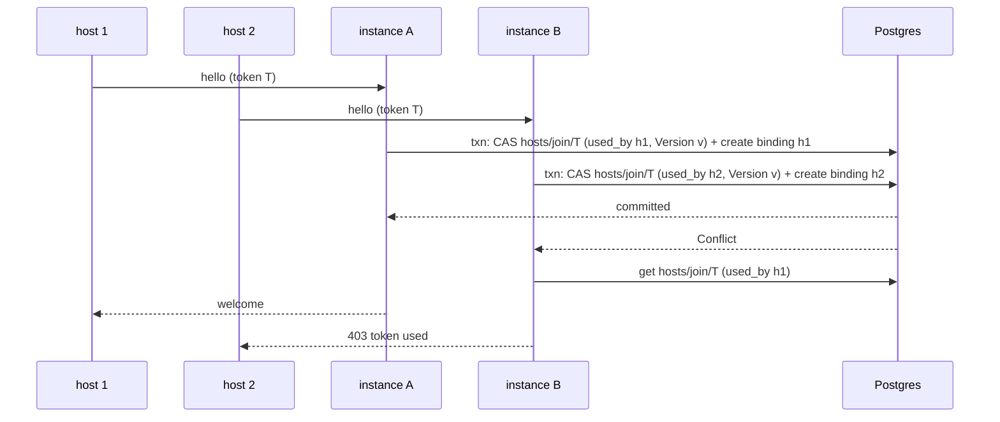
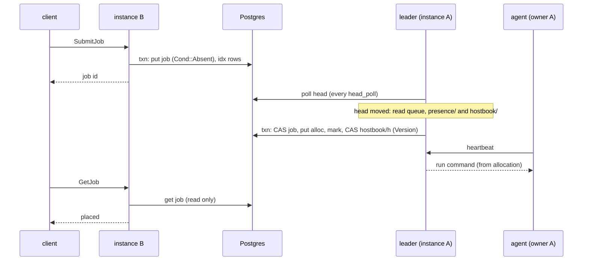
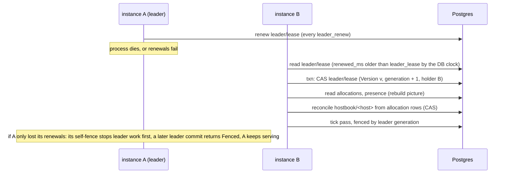

# Running the server as N instances on shared Postgres

Status: design, nothing built. Companion to [jobscheduler-design.md](jobscheduler-design.md) (sections 10.2 and 13, question 1),
[deployment.md](deployment.md), [absence.md](absence.md) and [../lease-server-update.md](../lease-server-update.md). A living document: it is
updated in the pull request that changes what it describes.

Direction from the project owner: the server (`js-server`, the `js-lease-server` crate) should run as several instances over one Postgres
store, as the kbf frontend does. A deploy must never leave zero serving instances, and no state may live only in one instance's local disk or
memory unless it is a cache that can be rebuilt from the shared store. This is option C of section 13, question 1 (several active services),
which the design doc had not chosen until now.

## Problem

Today one process serves everything and several things in it are right only because it is alone.

- **One writer.** The process takes a Postgres advisory lock for its life and bumps a `writer_generation` row; every commit it makes reads that
  row `FOR SHARE`, so a second process that starts would permanently fence the first (`StoreError::Fenced`, then exit). A deploy is therefore
  stop-first: the old process must release the lock before the new one serves. There is a gap with zero servers on every update, and a crash
  is a gap until the supervisor restarts the process.
- **Job store in a local file.** Jobs, allocations, marks, taints, secondary indexes and the change feed are a SQLite file beside the state
  file, held by one process on a local mount.
- **Identity read once.** Host bindings, join tokens and host credentials are in Postgres, but each process loads a full copy at start,
  authenticates from that copy, and writes it back from memory with no preconditions (`Cond::Any`) and a `save()` that deletes every key it
  does not hold.
- **Live state in memory.** The host table (sessions, epochs, last-heard, phase, load), the placement engine's picture, and the usage
  buffer are in process memory, rebuilt from the agents' next hello after a restart.

What breaks if a second instance simply starts (each of these is a bug today's single process cannot have):

| Event | What goes wrong |
|---|---|
| A host's first hello is answered by A, its next heartbeat reaches B | B has no such credential in memory, answers 401, and the agent treats 401 as fatal and exits. |
| One join token, two hellos, one at each instance | Each instance sees the token unused in its own memory; two hosts register with it. |
| A registers a host, then B saves | B's snapshot `save()` deletes bindings B does not hold, and overwrites A's taint and cordon. |
| Two instances place the queue | The placement transaction has preconditions on the job, allocation, mark and taint rows but not on the host's booked capacity, so two engines each with room in their own picture overbook a host. |
| A submit lands on B | The leader's placer reads its tables again only when its own process wrote (`JobStore::written()`), so it does not see B's job until some other write. |
| A lists hosts, cordons a host owned by B | The registry is local: the host is unknown there (`unknown-host`). |
| A settles "absent" hosts | A judges absence from its own registry, where B's hosts were never present, and frees live hosts' work. |

The goal of this document is a protocol under which N instances (N at least 2) serve every API at once, exactly one of them runs the global
duties at any time, and a deploy, a crash or a Postgres failover never leaves the service unable to answer.

## What does not change

- The wire to agents and clients: no route, field or status code changes. Agents need no release for this (section Compatibility).
- Row formats in the state store: only new optional rows under new key prefixes. The existing keys (`job/`, `alloc/`, `mark/`, `taint/`,
  `idx/`, `hosts/binding/`, `hosts/join/`) keep their values.
- The rule that silence ends nothing (`absence.md`): a host that stops being heard is lost only after grace plus retention, as today.
- One placement engine, one global queue order, whole-host marks (one mark row per job). Placement is not split by host owner (rejected below).
- Log bytes: pass-through to the object store, read with the server's read key.

## Decisions

1. **Postgres rows are the source of truth for everything durable; memory is a cache with a rule for refresh.** Reads fall through to the row on
   a miss and are refreshed by the change feed; writes carry a precondition and retry on conflict.
2. **Session is local, presence is shared.** The agent's session (secret digest, epoch counter, in-flight listing) lives in the instance that
   holds its connection. A small `presence/<host>` row published by that instance is what every other instance and the leader read.
3. **Exactly one leader runs the global duties** (the tick: job pass, placement, taint keeping, feed trim, retention sweep, settle, scaler).
   It is elected by a **lease row** (renewed by the leader, taken over by CAS when the lease has run out by the database clock) and fenced by
   its own generation. Serving needs no lock. An advisory lock is not used: it has no lease, so a leader whose host dies silently would hold it
   until Postgres notices the dead socket.
4. **Defence in depth on capacity**: a `hostbook/<host>` row with a version, checked in the placement transaction and bumped by every
   transaction that changes the host's allocations, so a deposed or duplicated placer cannot overbook even if the leader election is wrong.
   It is a derived cache of the allocation rows, never a second source of truth (see "Placement").
5. **Rows, not NOTIFY.** Correctness uses the leader lease row, versioned-row compare-and-set, and the head-ordered change feed polled by
   cursor. `LISTEN/NOTIFY` is not used for correctness (not replayed, session-scoped, none is sent today: `postgres/mod.rs` C5) and is at most a
   later latency optimisation.

## State map

Where each piece is now, what breaks with a second instance, and what it becomes. Evidence is the file as of this commit.

| State | Now | Becomes |
|---|---|---|
| Jobs, allocations, marks, taints, `idx/`, change feed | SQLite file `<state-file>.jobs` (`job_store.rs`, `SqliteStore::open`), one process | The existing `PostgresStore` (same schema, same key prefixes). `JobStore` is already generic over `Arc<dyn Store>` and every mutation is a `Txn` with `Cond::Version` or `Cond::Absent` (`js-jobs/src/store/whole.rs`, `store/taints.rs`), so it is multi-writer at row level on Postgres. |
| Host bindings, join-token and host-credential digests | Postgres `hosts/binding/<host>`, `hosts/join/<digest>`, but read once at start into `BindingStore` and `JoinTokens` memory, written back from memory with `Cond::Any`, `save()` deletes keys it does not hold (`agent_state.rs`, `host_keys.rs`, `join_tokens.rs`) | Rows are the truth: read-through on a miss, refreshed by the change feed; writes `Cond::Version` / `Cond::Absent` with retry; no delete sweep in `save()`. See "Identity". |
| Host table: session, epoch, last-heard, phase, claim, labels, load, held runs, drain marks, cordon | In-memory `js_registry::Registry` per process (`registry.rs`, `record.rs`); `jobscheduler-design.md` section 10.2 and line 972: "a heartbeat is not a write" | Session stays local; presence row shared. See "Presence". |
| Placement engine picture, `SchedPlacer` caches | One in-memory engine per process, resynced from the allocation table each pass (`sched/jobs_pass.rs`, `js-sched-placer`) | Runs on the leader only, over presence rows; plus `hostbook` CAS. |
| Host-isolation taint (`Tainted`, `keep_taints`, `drop_taints`) | A `taint/` row written in the placement txn, then copied into the leader's own in-memory registry and binding snapshot, then the row deleted at `Cond::Any` (`agents_taints.rs`, `jobs_pass.rs`, `js-jobs/store/taints.rs`) | Written into the host's binding row in the placement txn itself; the owner reads it from the binding. See "Taint hand-off". |
| Index backfill at open | `JobStore::new` runs `backfill_indexes` on every open (`store/index.rs`) | A one-time migration step and a leader-only retrying task; followers open without it. See "Startup index backfill". |
| Change detection (skip pass, reuse cached tables) | Per-process write counter `JobStore::written()` (`js-jobs/src/store.rs`, `js-sched-placer/src/jobs_seen.rs`) | The store's committed head revision. |
| Usage: node-minute rows, profiles, ended history | `usage.db` SQLite beside the state file; in-memory minute buffer flushed every 5 minutes (`usage_js.rs`, `usage_hub.rs`, `js-usage/src/store.rs`) | Same Postgres store and keys; flush retries on conflict; minute rows are written by the instance that owns the host's session. |
| Job logs: bytes, host upload credentials, follow waiters | Bytes in the object store; credentials in `LogGrants` memory; follow waiters a per-process semaphore | Already shareable. Each instance mints for the hosts whose session it holds. |
| Elastic scaler records | Postgres `acquires/scaler/*`, whole-value put with `Cond::Any`, task in the process | Leader only; the write is a CAS on the row version. |
| Hello limiter, provider catalog cache, metrics, alert dedupe, client-token reload, `/status` | Per process | Stays per process; documented (see "What stays per instance"). |

## Identity: bindings, tokens, credentials

These break first, so they land before a second instance runs, even with the job store still local.

- **Read-through.** Authentication reads the memory copy; on a miss (unknown credential digest, unknown host) it does one `store.get(key)` and
  caches a hit. A copy is refreshed by polling `Store::changes(after)` about once a second, so a revoked credential stops working everywhere
  within the poll interval (tunable `identity_poll`, default 1 s). A 401 is never answered from a cache miss alone: the row is read first.
- **Writes carry preconditions.** A new binding is `Cond::Absent`; a change is `Cond::Version(v)` of the version read; a `Conflict` re-reads
  and retries the merge. Credential renewal times merge as `max()`, so concurrent renewals cannot move a time backwards. Taint and cordon are
  fields of the binding and are changed the same way, so A's cordon is not overwritten by B's save.
- **No sweep.** `save()` no longer makes the store equal this process's snapshot. A row is deleted only by an explicit forget or revoke, as a
  `Cond::Version` delete.
- **One-use tokens.** Using a join token is a compare-and-set of its row (an additive `used_by` field) in the same transaction that creates
  the host's binding. Of two concurrent hellos with one token exactly one commits; the other reads the conflict, re-reads, and is refused as
  today's second use is. The compensating "give back" after a refused admission is also a CAS on the version it wrote.
- **Format.** The value keeps the existing encoding and the rule that unknown fields are kept and written back (`host_keys.rs` `encode` and
  `extra`). No new required field; an old release reads the new rows and ignores `used_by`. The one behaviour an old release would have wrong is
  the one-use rule across instances, which an old release does not run.

The in-process `host_writes` mutex (one hello at a time) stays as a local optimisation. The guarantee it gave across requests now comes from
the CAS above.

## Presence: sharing the host table

Today the leader-side questions (can this job ever be placed, which hosts are up, is this host absent, cordon this host) read the local
registry. With N instances the local registry knows only its own hosts.

**Rejected: route all placement to the instance that owns each host.** The queue order, whole-host marks (one mark row per job) and fairness
are global. Two engines each seeing only their own hosts would mark different hosts for one whole-host job.

**Chosen: a presence row per host.** `presence/<host>` is a new optional row:

```
presence/<host> = {
  owner:        instance id (random per process start),
  epoch:        host's session epoch,
  claim, labels, shape, phase,
  last_heard_ms: coarse (written at most every presence_refresh),
  cordon_until, drain mark, unclean flag, load summary
}
```

- Written by the owner on hello, on a change of any field above, and otherwise every `presence_refresh` (tunable, default 5 s, which is the
  heartbeat interval; it must stay below grace / 2 so the leader's "last heard" is never older than grace by the refresh alone). Cost: about one
  small write per host per 5 s. At the live farm's few hosts that is under 2 writes per second, and at 100 hosts 20 per second, which the
  global commit point (below) carries but which is the number to watch (open question 2).
- Read by everything that needs the whole fleet: admission (`no-capable-host`), `ListHosts`/`ListPools`, `GET /v1/hosts`, cordon, the leader's
  placement pass and absent-host settlement. They read the `presence/` prefix, not the local registry.
- A new prefix, not `hosts/`: an old release's whole-snapshot `save()` deletes keys under `hosts/` it does not hold, so new rows must not
  share that prefix (this is also why the delete sweep goes).
- **This amends** `jobscheduler-design.md` section 10.2 ("Reads on the hot path (heartbeat, host book) come from memory") and the line "a
  heartbeat is not a write" (section 10, the not-in-the-database list). The amendment: a heartbeat is not a write, but a coarse presence refresh
  is. Live sessions, session secrets and exact heartbeat times remain memory only. The instruction on that line stays for everything but the
  presence row. Recorded here and made in the design doc by the PR that lands presence.
- **Session is local.** The secret digest, the epoch counter and the in-flight listing stay in the owner. An agent whose next request reaches a
  different instance gets `409 unknown-host` or `403 session-mismatch` and says hello again at once (`js-agent/src/session.rs`). That path
  works today and is the agent's whole stickiness contract.
- **Epoch is monotonic across instances.** At hello the owner does a CAS increment of `epoch` in `presence/<host>`; the epoch is the stored epoch
  plus one, so epochs never repeat when a host moves from A to B to A.
- **Host-live (duplicate host id) differs from today's rule, on purpose.** Today `registry.rs` (the `HostLive` refusal, about line 351) refuses
  any hello while the host is Live, and `js-agent/src/session.rs` treats `host-live` as back off and retry. Copied as is, every flip would leave
  the host unserved for grace plus a jittered backoff: the old owner wrote `last_heard` at most 5 s earlier, so the new instance would see
  an owner with a fresh row. The registry already knows who is calling: a hello carries the agent's `instance` and its credential, and
  `bound.admits(credential, instance)` is how `HostBound` is decided. The new rule is a CAS on `presence/<host>`:
  - the hello's credential and agent `instance` equal those the row records (`presence.agent_instance`, an additive field): the same agent
    flipping. It **takes over at once**, whatever `last_heard` says, with an epoch CAS (owner becomes the new instance, epoch plus one). The old
    owner's next presence refresh or listing commit loses the CAS and it drops the session (see "Stale session").
  - a different credential or a different agent `instance` while the row is inside grace: `409 host-live`, as today. After grace it takes over.
  - a draining owner writes `released: true` (with the epoch) into `presence/<host>` for each of its sessions before it closes listeners, so a
    flip off a drained instance is never judged by `last_heard` at all, and a different agent may take a released host at once.
  A flip therefore costs one 409, one hello and one CAS, not grace plus backoff. Two agent processes with one credential and different `instance`
  values are still refused. This rule replaces the single-process one in `registry.rs`; PR 4 changes both and the test for each outcome.
- **Stale session.** An owner that has lost a presence CAS (another instance took the host) marks its session superseded. Its listing commits
  (`commit_listing`, `lose_unlisted`, `free_allocation` on a host's confirmation) are conditional on `Cond::Version` of `presence/<host>` at the
  epoch it holds, so a superseded session cannot commit a listing or a free after the new owner took over. The reply to the old connection is
  `403 session-mismatch`.
- **Last_heard is stamped by the store.** The owner writes `last_heard_ms` as the commit time the store gives the presence transaction
  (the same database clock as expiry), never `Clock::now()` of the process. Heartbeat paths that stamp with the process clock today
  (`agent_api.rs`, `store_time(placing.clock.now())`) keep doing so for per-session values that only the owner reads, but no value that the
  leader compares against another instance's value may come from a process clock. The refresh is coarse, so "last heard" can be older than the
  truth by up to `presence_refresh` plus a commit; grace is sized for that.
- **Session-scoped bookkeeping** (unclean hosts, last committed listing session, the first-listing test) belongs to the session, so it stays with
  the owner. The one bit the leader needs, "the last listing was clean", is a field of the presence row. A hello on a new instance starts a new
  session and a new first-listing test there. What that test may end is narrowed; see "First listing after a flip".

## First listing after a flip

`first_listing` is per instance and per session; on a first listing `lose_unlisted` ends any job in `Starting` or `Running` that the listing
neither lists nor retires, and `Lost` is terminal. With one process that needed a server restart in the middle of a start. With N instances a
flip is routine (every `connection_max_age`, every deploy, every crash), so the same rule would kill work that never started: owner A commits
`Placed` to `Starting` and sends `JobStart` in a heartbeat reply, the connection drops before the agent acts, the agent hellos at B, and B's first
listing does not show the job.

- **A `Starting` job that the first listing does not show is not lost.** It stays `Starting`, and the new owner sends `JobStart` again with the
  next heartbeat reply. This needs the agent's start to be idempotent on the allocation id (a repeated `JobStart` for an allocation that is
  running or has run is a no-op, answered from the listing). PR 5 checks that in `js-agent` and adds the idempotence if it is missing; it is a
  change on the agent side and therefore ships first in its own PR (5a), because agents are updated by the hostkeeper after the server.
- **A `Starting` job is lost only after a start deadline**: `start_confirm` (tunable, default 2 minutes by the database clock), counted from the
  commit of `Starting`, across flips. Not from the session.
- **A `Running` job that a first listing neither lists nor retires** is still lost, as today: the listing is the agent's complete account, and a
  running job absent from it is gone.
- Until 5a is in agents, the server holds the first-listing loss of `Starting` jobs back for a host whose hello does not announce the capability
  (an additive hello capability flag `start-idempotent`), so an older agent is never sent a duplicate start.

## Leader: the global duties

### What the leader runs

The tick (every 5 s, `Shared::tick` order) splits.

| Per instance, for its own sessions | Leader only |
|---|---|
| `registry.advance` (sessions, grace) | Job pass: expiry, retention sweep, settle absent hosts |
| Log credential renewal | `place_jobs` (the tick pass and the beat-triggered pass) |
| Usage flush for its own hosts, presence refresh | `keep_taints`, change-feed trim |
| Client-token reload | Scaler loop, usage prune and tail-counter flush |

### Election and fencing

- **Election is a lease row**, `leader/lease = {holder, generation, protocol, renewed_ms}` (new, additive). The leader renews it by CAS every
  `leader_renew` (tunable, default 2 s). It writes `renewed_ms` from the store's commit time. A candidate that reads a lease whose
  `renewed_ms` is older than `leader_lease` (tunable, default 10 s) by the database clock takes it over by `Cond::Version`, with the generation
  plus one. A candidate retries every `leader_retry` (default 1 s). The winner runs leader work through a store handle fenced by the generation.
  Serving commits are not fenced at all: they are protected by row CAS only.
- **Detection and bound.** Takeover after a silent death is `leader_lease` plus `leader_retry` plus one tick by default: at most about 16 s,
  independent of Postgres noticing a dead socket (an advisory lock held by a dead peer is only released then, which can be minutes unless the
  server sets `tcp_keepalives_*`; the client settings in `js-state` `timeouts.rs` do not help the server side). That is why the lock is not the
  election.
- **Self-fence.** A leader measures, with a monotonic clock, the time since its last successful renewal; when that passes `leader_lease` minus
  `leader_margin` (default 3 s) it stops acting as leader at once, before another instance may take over. No wall-clock comparison between
  instances is used.
- **Leader-only effects that are not store commits.** The generation fences store commits only. The scaler's cloud calls (instance creation,
  spend) are not store commits and a deposed leader could issue one before its next CAS fails. Therefore: (1) the scaler writes its intent row
  (`acquires/scaler/<id>`, fenced by the generation) before the call, (2) the call carries that row's id as the provider's idempotency token (client
  token), so two leaders that both try produce one machine, (3) the self-fence above bounds how long a deposed leader keeps acting. A provider
  call that cannot take an idempotency token is not made by the scaler (the live deployment has no provider, so this blocks nothing). The
  taints are no longer registry state (see "Taint hand-off"), so no other leader effect is outside the store.
- **Protocol field.** `leader/lease.protocol` is the protocol revision of the instance that holds it. An instance whose protocol is lower
  than the one in the row does not campaign, so an older release never takes the lease back from a newer one (see "Mixed-version instances").
- Do not reuse `writer_generation` for serving instances: today a second start would fence the first, which is exactly the property to remove.
  The existing row stays for a release running the old protocol (Compatibility).
- **A lost lease demotes the role.** A failed renewal CAS, the self-fence, and a fenced commit (`Fenced`) all stop tick, placer and scaler and
  keep serving; today a lost lock stops every listener and exits 1.
- All leader store writes are CAS or fenced, so a double leader during a Postgres blip is harmless and only wasteful.
- Absent-host settlement is judged from presence rows (owner row missing, or `last_heard` older than grace plus retention), never from one
  instance's local view, and only by the leader. The "silence ends nothing" rule is unchanged. **The settle transaction carries
  `Cond::Version` on `presence/<host>` at the version it judged** and on the `hostbook/<host>` it releases. A host that re-hellos between the
  leader's read and its commit moved the presence version, so the settle conflicts, re-reads, and sees a live host. Without that condition
  the leader would free allocations of a host that is back at another instance, and its first listing would find live jobs without
  allocations and be told to stop them.

### Placement

One leader runs the engine, so queue order, marks and fairness stay global. Beat-triggered passes on a follower become a nudge: the leader's
own head poll (about 500 ms, `head_poll`, below) starts a pass when the head moved. The placement transaction (`whole.rs`) keeps its
preconditions on job, allocation, mark and taint and gains one: `Cond::Version` on `hostbook/<host>`. A second placer with the same room in
its picture then fails the CAS on the host it shares, re-reads and chooses again. This makes overbooking impossible by construction, not by the
election being right. What `hostbook` is, and what keeps it right, needs to be stated exactly.

**`hostbook` is a derived cache of the allocation rows, never a second source of truth.** The allocation rows decide what is booked.
`hostbook/<host>` holds `{version, booked}`, where `booked` is every field of `Resources` that placement checks (cpu, memory, ports, gpus,
gpu_class, disk_bytes; the doc and the code name the same set, and a test fails when `Resources` gains a field that `booked` lacks). Its job is to
be a single row whose version moves on every change of the host's allocations.

- **Every transaction that creates or ends an allocation bumps it, in that transaction**, through one helper that is the only way to write an
  allocation row (`JobStore` allocation write, below the callers), so a path cannot skip it. The callers to cover are: placement; `free_allocation`
  after a host confirms; `end_job` and `lose_unlisted`; expiry (`job_expiry::expire`, `expire_prepares`); cancel (`cancel_and_free`); absent
  settlement; and the scaler's settle. A test lists the callers of the helper and fails on a new allocation write that bypasses it.
- **Frees on an owner conflict with the leader's placements on the same host.** That is cheap and correct: the loser re-reads (one read of
  one row) and retries. The cost is a CAS retry on hosts that are both being freed and placed, not a new lock.
- **Absent is not zero.** The placement transaction never creates `hostbook/<host>` by `Cond::Absent` from an empty picture: a host with live
  allocations and no row would otherwise read as zero booked and be overbooked by the first placement. The row is created only by the
  **reconcile step**, which reads the host's allocation rows and writes `{version 1, booked = sum}` with `Cond::Absent`. A host with no
  `hostbook` row is not placeable until reconciled.
- **Reconcile on every leader takeover**, before the first pass, for every host: recompute `booked` from the allocation rows, and write it by
  `Cond::Version` when it differs (logging the difference, metric `hostbook_repaired`). This covers old data (no rows), and a rollback followed
  by a roll-forward, where the previous release placed and freed without maintaining the row. A leader also reconciles a single host after a
  placement `Conflict` it cannot explain from its own picture.

### Change detection

The per-process write counter is replaced by the store's committed head revision (`Store::changes` / `Commit::revision`, already used by
`job_store/feed_trim.rs`). A submit at A moves the head; the leader sees it at its next poll and re-reads. Cost: one `SELECT rev FROM head`
every `head_poll` (tunable, default 500 ms).

### Taint hand-off

Today the placement transaction writes a `taint/` row (`Cond::Absent`) for an `isolation=host` job. Then `Tainted::tainted()` calls
`taint_host` on the leader's own registry, `keep_taints` writes the taint into the binding from `registry.bindings()` and filters hosts by
`bound.contains_key(host)`, and `drop_taints` deletes the row at `Cond::Any`. That works only when the leader owns the host: if leader A places
a job on a host owned by B, A's registry does not know the host (`taint_host` returns false), `keep_taints` finds nothing, B's registry never
learns of the taint, and a `drop_taints` that did run would delete the row before any owner held the taint, so a second job could land on a
tainted host.

- **The taint is a field of the host's binding row, written in the placement transaction.** The txn that places an `isolation=host` job also
  sets `taint` on `hosts/binding/<host>` by `Cond::Version`. The row and the binding field commit together or not at all, so there is never a
  committed placement without the taint on the binding. The `taint/` row remains for an old release and for the placer's own picture.
- **The owner reads the taint from the binding.** The `tainted` flag that `job_whole::serve` and prepare take is read from the binding through the
  identity cache, which the change feed refreshes; a serve for an allocation whose job is `isolation=host` reads the binding row fresh when the cache
  version is older than the allocation's commit revision. No registry call crosses instances.
- **Clearing is by the owner, after the host is fresh.** The "host is fresh" judgement uses the owner's session (a clean first listing after
  the job's end, as the registry does today). The owner removes the binding's `taint` by `Cond::Version` and then the `taint/` row by
  `Cond::Version`, in that order, in one transaction. The leader's `keep_taints` only repairs: a `taint/` row without the binding field gets the
  field by CAS, and `drop_taints` deletes a row only at the version it read, and only when the binding no longer carries the taint or the
  host's binding is gone. The `Cond::Any` delete goes.
- The model has a property for it (`TaintHandOff`, below).

### Startup index backfill

`JobStore::new` runs `backfill_indexes` on every open: it scans the whole job and allocation tables, then writes in `SWEEP_BATCH` transactions
with `Cond::Version` on each row it judged, and a lost precondition returns `JobStoreError::Stale` (`store/index.rs`). Beside a live instance
that fails: a heartbeat or submit that changes a row between the scan and the batch makes the open fail, and the new task never becomes ready while
the old one serves; when it succeeds, each start scans all retained history over the network and holds the global head lock for every batch.

- **Backfill is not part of open.** `JobStore::open` gets a `backfill: bool` (default true for the single-writer release, false in the new
  server). The copy tool of PR 3 runs it once after the copy, while the service is scaled to zero, so a freshly migrated store is complete.
- **The leader runs it as a retrying background task** at takeover, driven by a marker row `idx/backfilled = <index schema version>` (new,
  additive): absent or older than the code's index version means the task runs, in batches of `SWEEP_BATCH`, a `Stale` batch is re-read and
  retried (bounded, with backoff), and the task writes the marker when a full scan finds nothing to change. A follower never backfills and is
  ready without it; reads that need a missing index entry fall back to the row (as today for an unindexed row).
- Latency line: one full scan of retained rows and one write txn per `SWEEP_BATCH`, each holding the head lock for its commit, leader only, once
  per index version. At the live scale (retention in the thousands of rows) that is a few seconds; PR 3 measures it on a copy of the live data.

### Whole-host jobs on takeover

Whole-host prepare, `Ready`, `Committed` and `Restoring` state is rebuilt from hellos and resets on every leader takeover (design section 13,
question 1, option B caveat). Takeover therefore means: the new leader rebuilds its picture from allocation rows and presence rows, and a
whole-node job in the middle of its prepare is re-prepared by the host's next listing, not lost. A whole-node pool can show up to one tick of
no new placements plus the time for the first listing, bounded by `leader_lease` plus `leader_retry` plus a tick (above). This is stated so the farm's whole-node pool is not
surprised by a leader flip.

## Usage and telemetry

- Node-minute rows are already merged by CAS (`js-usage/src/store.rs`, `UsageError::Conflict`) but "a row for a minute already stored replaces
  it", so two writers of one minute race replace-versus-replace. Only the instance that owns the host's session (`presence.owner`) writes that
  host's minute rows, and the flush retries on `Conflict`.
- A flip between instances mid-minute can drop a partial minute (the new owner starts a new buffer). Loss of one unflushed 5-minute buffer when
  an instance dies is accepted telemetry loss, stated here and in `usage-store.md`.
- The ended-allocation record (`usage/ended`) is written in the job store's free transaction, so it moves with the job store.

## Logs

Already shareable. GetLogs follow reads the object store with the server's read key. Each instance mints upload credentials for the hosts whose
session it holds; an agent that flips pays one STS AssumeRole (the mint is queued, never inline). `max_follow` is per instance, so total follow
capacity is N times it; documented.

## What stays per instance

- Hello limiter: burst and interval become N times the configured rate across instances.
- Provider catalog cache, alert dedupe, metrics recorder and the `/status` page describe one instance. Scrape every instance.
- Configuration and secrets are identical across instances because the deployment gives each the same files; a change is a new file version and
  a rolling update. No config is edited in one instance.

## Routing

The agent API (port 7301) is plain HTTP/1.1 request and response: `POST /v1/agent/hello`, then `POST /v1/agent/heartbeat` every 5 s with a 15 s
grace (`js-agent-wire`). It is not a long-lived stream. An agent keeps one keep-alive TCP connection, so it is naturally pinned to one instance
until the connection breaks. The job service (7302) also speaks HTTP/2 (gRPC) as well as HTTP/1.1; a client's HTTP/2 connection is pinned to one
instance for its life.

- **Stickiness is not required for correctness** once identity rows are shared. A request that reaches an instance without the session gets 409
  or 403 and the agent re-hellos. It is only worth having for cost: each flip costs one hello, one log-credential mint, one first-listing check and
  one presence write. 401 is fatal to an agent, which is why credentials are readable from the store by every instance.
- **The edge proxy balances per TCP connection** (raw TCP proxy, the server's TLS passes through): it cannot route per request or by header.
  Recommended: keep it resolving the service's per-task DNS name (every task address) with least-request balancing, and do not use the service
  VIP, which hides dead tasks and balances long connections poorly. Host-mode port publishing is not needed.
- **Add an active health check** for both pools. Today the proxy has none for these pools; a task that is starting or draining must leave the
  pool. A TCP connect to 7301 and 7302 suffices because an instance binds them only when it serves; or serve readiness on the overlay address
  instead of loopback.
- **Explicit drain**, inside the stop grace: readiness goes 503, then HTTP/2 GOAWAY and listener close, then exit.
- **Connection max age** (tunable `connection_max_age`, default 10 min, server side) so connections rebalance after scale-out or a restart. The
  server sends `Connection: close` or GOAWAY at the age; today there is none, so old connections never rebalance.
- **To verify with one test deploy**, not assumed: whether the orchestrator withholds a not-yet-healthy task from per-task DNS while its health
  check is starting.
- **What N buys**: with every task on one node, N tasks give zero-downtime deploys and crash tolerance, not node-failure tolerance.

## Readiness and deployment shape

Today readiness means "I hold the writer lock", and the start order is built around one holder: the readiness listener first, then the lock, then
the other listeners; a second process waits and answers 503. The host updater hook probes "the store's writer lock held by a different
holder" for prepare, cutover, verify and rollback (`docs/lease-server-update.md`, `packaging/js-lease-server/updater.d`).

- **Ready** = store reachable, schema acceptable, listeners bound. Independent of leadership, which is reported separately (`/readyz?role`).
- The deployment moves from `replicas: 1`, stop-first to `replicas: N` (N at least 2), start-first, parallelism 1, so the new task is ready
  before an old one stops and never fewer than N-1 serve.
- The updater hook's checks become "new instance ready and old instance drained"; `lease-server-update.md` and `release.md` ("One writer per
  store") are rewritten. This is its own PR: it touches packaging and the hook.
- While the old release still runs the old protocol (one writer, fencing on `writer_generation`), a new-release instance must not start beside
  it. The rollout order below keeps replicas at 1 until every instance runs the new release.

## Sequence diagrams

### Hello at a different instance than the heartbeat

```mermaid
sequenceDiagram
    participant Ag as agent
    participant A as instance A
    participant B as instance B
    participant PG as Postgres
    Ag->>A: POST hello (credential)
    A->>PG: get hosts/binding/h (miss in cache)
    A->>PG: txn: CAS presence/h (epoch+1, owner A)
    A-->>Ag: welcome (session secret, epoch)
    Note over Ag,B: connection breaks; next request reaches B
    Ag->>B: POST heartbeat (credential, epoch, secret)
    B->>PG: get hosts/binding/h (miss), get presence/h
    B-->>Ag: 409 unknown-host (no session here)
    Ag->>B: POST hello (credential, agent instance)
    Note over B: presence/h owner A, last_heard fresh, same credential and agent instance: takes over, no host-live
    B->>PG: txn: CAS presence/h (Version v, epoch+1, owner B)
    B-->>Ag: welcome
    Note over A: A's next presence refresh or listing commit gets Conflict, drops its session
```

### One join token, two concurrent hellos



### Submit on one instance, placement on the leader



### Leader failure and takeover



## Latency budget

Every commit is one transaction: `LOCK TABLE head`, `SELECT head FOR UPDATE`, `now()`, the writes, the fence read (leader handle only), the head
update, `COMMIT` (`postgres/tx.rs`). That is a **global commit serialisation point**: a writer queues on the table lock, so the rate of all
writes in the system, not each instance's, is what the budget bounds. Reads are plain selects and do not take it.

| Operation | Postgres round trips | Locks held | Notes |
|---|---|---|---|
| Heartbeat of a host with no jobs, presence unchanged | 0 | none | Memory only, as today. |
| Heartbeat of a host that lists jobs | 0 in steady state; 1 read per job row not in the cache; 1 write txn when something changes (result, free, transition, `Starting` to `Running`) | head lock for a write | Not memory only today either: `commit_listing` reads each listed job and allocation (`placement_of`), `answer_retired`, `live_on(host)` twice, `job_whole::serve` and `per_job::serve` run on every beat. Uncached over Postgres a host with 10 jobs costs about 25 reads per beat (the reviewer's count; not measured here). The design therefore requires the owner to serve these from a job and allocation row cache that the change feed keeps fresh, so a steady beat costs no round trip and a write costs one txn. PR 3 builds the cache and measures reads per beat with 10 jobs before PR 4. |
| Heartbeat that refreshes presence (every `presence_refresh`) | 1 write txn | head lock for the commit | About one per host per 5 s. |
| Hello, known credential | 1 read (on a cache miss) + 1 write txn (presence CAS, epoch) | head lock for the commit | Plus one STS mint, queued, not inline. |
| Hello with a join token | 1 read + 1 write txn (token CAS + binding create) | head lock for the commit | Exactly one concurrent winner. |
| Authenticate, cache hit | 0 | none | Refreshed by change poll. |
| Authenticate, cache miss | 1 read | none | Required before any 401. |
| SubmitJob | 1 write txn (job, indexes) + 1 read | head lock for the commit | Same shape as today on SQLite, over the network. |
| GetJob, GetResult, ListJobs, GetLogs (no follow) | 1 read, or 1 list | none | Read only, any instance. |
| GetLogs follow | 1 read per wake | none | Plus object-store read; bounded by `max_follow` per instance. |
| CordonHost / UncordonHost | 1 read + 1 write txn | head lock | Applies at the owner's next heartbeat or the leader's next pass. |
| Heartbeat on a follower: placement | 0 | none | `serve_jobs` on an instance that is not the leader skips `place_jobs_after_beat`; the beat nudges nothing. The leader's own beats still run it inline. |
| Leader tick pass | 1 head read + 1 list of `presence/` + 1 list of `hostbook/` + queue read; 1 write txn per placement; 1 per settle | head lock per commit | Passes run only when the head moved or the 5 s tick fires. |
| Change poll (each instance) | 1 `SELECT rev FROM head` per `identity_poll` / `head_poll` | none | 2 reads per second per instance at the defaults. |
| Usage flush | 1 write txn per host-batch per 5 min | head lock | Retries on conflict. |

**End to end times** (defaults; inferred from the tunables, not measured):

| Path | Time | Made of |
|---|---|---|
| Submit to start command at the agent | up to about 5.5 s | up to `head_poll` 500 ms until the leader sees the head moved, one pass (reads and one placement txn), then up to 5 s until the owner's next heartbeat carries `JobStart`. An owner that is the leader places inline on a beat, as today. |
| Agent flip to served again | about one heartbeat interval plus one round trip | one 409, one hello, one epoch CAS; no wait on grace (see "Presence"). |
| Leader failover | at most about 16 s | `leader_lease` 10 s, `leader_retry` 1 s, one tick 5 s; placement and settlement pause, serving does not. |
| Rolling deploy, per host | one flip, as above | each instance drains with release marks, so no host waits on grace. |

Aggregate write budget at the live scale (about 6 hosts; 2.5 GetJob, 0.06 SubmitJob and 0.02 ListJobs per second measured over 10 minutes from the
server's request log): presence refresh about 1.2 writes/s. Placement, feed trim, and per-job writes (a result, a free, a `Starting` to `Running`
transition: a few per job, so on the order of 0.2 per second at the submit rate above, inferred) add well under 1 write/s, so about 2 to 3
writes/s in all, each a short transaction. The earlier version of this section counted only presence and placement and assumed heartbeats cost no
reads; with the cache above that holds for reads in steady state and the per-job writes are now counted. This is measured load times the design's
rate, not a Postgres benchmark; PR 8 below measures commit latency under N=2 and N=4 with the fake hosts of the conformance suite (with 10 jobs
per host) before the replica count is raised past 2.

## Model check, before code

The protocol has properties that only hold across interleavings, so it is modelled before any behaviour change lands. Two artifacts, both in
PR 0b of the list below:

1. **A PlusCal/TLA+ specification** (`docs/design/model/multi_instance.tla`, with its `.cfg`) checked with TLC for 2 instances, 2 hosts, 2 jobs,
   1 token, and a second configuration with 3 instances, 1 host and no jobs for the lease and takeover actions only (two instances cannot show a
   third taking over from a stale second). TLC is not part of CI (it needs a JVM and the repository's CI runs build and unit tests only), and
   this is a gate that has not run: the spec is not written or run at this commit. PR 0b checks in the spec, the configurations, and the TLC
   output (state count and result) with the commit hash of the spec it ran on; those counts are a record, not an assertion, and CI does not compare
   them to the Rust model. **Only the Rust enumeration runs in CI**, so the table below says which properties it covers; a property marked
   TLA only is checked when the spec changes, by the author, and the PR says so.
2. **An exhaustive interleaving test in Rust** over `js-state`'s fake store (`Store` is already faked), driving the real identity,
   presence, leader and placement code as an instance model, enumerating every order of the steps of two instances up to a bound. This is the check
   that runs in CI and the one that keeps passing as the code changes.

Properties (each is a spec invariant and a named Rust test):

| Property | Meaning |
|---|---|
| `OneUse` | A join token is admitted at most once, across instances and across a compensating give-back. |
| `NoLostBinding` | A binding or taint written by one instance is never removed by another instance's save. |
| `EpochMonotonic` | A host's epoch never repeats or decreases, through A to B to A. |
| `NoOverbook` | The booked capacity on a host never exceeds its shape, for any interleaving of two placers, including a deposed leader mid-commit. |
| `SingleLiveLeader` | After a leader generation bump, no commit with the old generation succeeds. |
| `NoFreeOfLiveHost` | The leader never settles a host as absent while its presence row is inside grace. |
| `AgentConverges` | An agent that flips between instances reaches a session in one hello after any 409 or 403 and never sees a 401 for a credential the store holds. The model includes the `host-live` rule (same credential and `instance` takes over; different is refused inside grace), so the property fails if a flip can be refused. |
| `FlipServedBounded` | Liveness: a host whose agent flips, or whose owner drains or dies, is served again within one hello after its next request, with no wait on `last_heard`. |
| `NoStaleCommit` | A session superseded by another owner's presence CAS commits no listing and no free. |
| `HostbookExact` | After every free path (confirm, end, lose, expiry, cancel, settle) and after takeover reconcile, `hostbook.booked` equals the sum of the host's live allocations, for every field of `Resources`; a host with no row is not placed on. |
| `TaintHandOff` | A host with a live `isolation=host` allocation never takes another allocation, whichever instance leads and whichever owns the host; the binding carries the taint before the `taint/` row can be deleted. |
| `DrainReleases` | A drained owner's sessions are marked released in `presence/` before its listeners close. |
| `SettleSafe` | A settle transaction that read a presence version older than a re-hello's commit conflicts and frees nothing. |
| `StartingNotLost` | A `Starting` job is never made `Lost` by a first listing alone; only by `start_confirm` elapsing. |
| `MixedVersion` | With one instance at N and one at N+1, every other property holds, N keeps fields it does not know, and N never takes the lease from N+1. |

Where each runs: Rust enumeration in CI (PR 5) for `OneUse`, `NoLostBinding`, `EpochMonotonic`, `NoOverbook`, `SingleLiveLeader`, `NoFreeOfLiveHost`,
`AgentConverges`, `FlipServedBounded`, `NoStaleCommit`, `HostbookExact`, `TaintHandOff`, `SettleSafe`, `StartingNotLost` and `MixedVersion`;
TLA only (author-run, results in the PR): the 3-instance lease takeover with unbounded renewal interleavings, and `DrainReleases` over
partial drains. The Rust model uses the real identity, presence, leader, placement and settle code, so a change to one of them is checked by the
test that fails in CI.

Actions the spec and the enumeration both include: hello (same agent, different agent, token), heartbeat, presence refresh, owner drain with
release, owner crash, listing commit with first-listing test, free paths, placement (including `isolation=host`), settle, lease renew, lease
takeover, self-fence, Postgres failover, change-feed trim with `StaleCursor`, and a rollback then roll-forward between steps.

Scenarios to enumerate: leader lease expiry; a deposed leader mid-commit; Postgres failover (loss of renewals on every instance); two hellos for
one token; deposed placer against new placer overbooking; an agent flipping A to B to A; a flip that follows a `JobStart` the agent never saw; a
cordon at A against a heartbeat at B; a leader placing `isolation=host` on a host owned by the other instance; a settle racing a re-hello;
N and N+1 together; a rollback to the previous release between steps. The exact PlusCal is written in PR 0b and reviewed before any later PR lands.

## Compatibility and failure modes (B8)

All format changes are additive: new optional rows under new prefixes (`presence/`, `hostbook/`, `leader/lease`, `idx/backfilled`), new optional
fields (`used_by` on a join token, `taint` on a binding) in existing values that keep unknown fields, and one additive hello capability
(`start-idempotent`). Nothing is renumbered, renamed, removed or newly required, and no version floor is
raised.

- **Previous release on new data**: a test starts the previous release's server over a store holding presence, hostbook and `used_by` data and
  checks that it serves, reads the bindings, and does not delete the new rows. A new-prefix row is outside the old `save()`'s sweep. The test is
  named in PR 1 and PR 2 (below) and runs the previous release from the release fixtures as the existing skew tests do
  (`crates/js-agent/tests/agent/skew`).
- **New release on old data**: a test starts the new release over a store written only by the previous release (no presence, no hostbook, no
  leader row) and checks that it serves, places no work on a host until its `hostbook` is reconciled from the allocation rows, and then places work.
- **Both on one store** (the previous single-writer release beside a new one) is not supported: an old-release instance beside a new one would
  fence it on `writer_generation` and run the sweeping `save()`. The rollout keeps one instance until the old release is gone, and the rollback path
  below returns to one instance first.
- **Job store on Postgres**: row formats are the SQLite store's, written through the same `Store` trait. The previous release reads only a
  SQLite file; rollback therefore runs on an exported file (see "Cutover"), not on the old file as it was left.

### Mixed-version instances (release N and N+1 together)

After cutover every deploy runs N and N+1 on one store at once (replicas 2, start-first). "Both on one store is not supported" above is about
the pre-change release only; it says nothing about two versions of this protocol, which B8 also requires.

- **Rule.** Every later change to a presence, hostbook, lease or binding value is additive and an instance keeps and writes back fields it does
  not know. `leader/lease.protocol` gives the order: an instance with a lower protocol than the lease's does not campaign and serves as a
  follower, so during a deploy the leader moves to N+1 when N stops and N never takes it back. A change that cannot be additive raises the protocol
  and is landed in two releases (the first reads both shapes, the second writes the new one), as B8 requires.
- **Test.** `n_and_n_plus_1_together`, in PR 5 and re-run for every later PR that changes a row: the Rust interleaving test (below) runs a pair
  `(N, N+1)` where N is the previous protocol revision, taken from a fixture of the previous release's row writers kept in the repository, over
  every scenario of the list, and checks every property. The same pair is in the TLA+ model as a version flag per instance, where N+1 writes an
  extra field and N must keep it.
- **Identity cache and a trimmed feed.** The leader trims the change feed by count. An instance that was paused or slow can ask for a cursor behind
  the trim (`StaleCursor`). It then drops its identity cache and reloads every `hosts/` row from the table before it authenticates another
  request, so a credential revoked while it was behind cannot stay cached. Test: `stale_cursor_reloads_identity`, which revokes a credential
  during a trim and asserts the instance refuses it after its next poll.

Failure modes:

| Failure | Behaviour |
|---|---|
| Postgres unreachable | Instances answer errors for writes and reads that miss their caches; cached authentication still answers, so agents are not told 401 by a database blip. Not ready until reachable. |
| Postgres failover | Renewals fail; the leader's self-fence demotes it within `leader_lease`, and every instance re-competes on the lease row once the store is back. Writes in flight return an error; CAS makes the retry safe. |
| Leader dies | Another instance takes the lease within `leader_lease` plus `leader_retry` plus one tick (about 16 s by default), however the process died; serving is unaffected; whole-host prepare state resets as described. |
| Two leaders (lease wrong or blip) | Leader commits carry the leader generation, so the older one is rejected `Fenced`; `hostbook` CAS prevents overbooking even if the fence is bypassed; the scaler's cloud calls carry an idempotency token from a fenced row. |
| Host flips between instances | One 409, one hello, an epoch CAS that takes the host over (same credential and agent `instance`); a `Starting` job is re-sent, not lost. About one heartbeat interval plus a round trip unserved. |
| An instance dies | Its agents see a connection error, reach another instance, get 409, and re-hello. Their presence rows go stale and are replaced by the new owner. |
| Clock skew between instances | Every time compared across instances (`last_heard_ms`, `renewed_ms`, start deadlines, expiry) is the store's commit time, stamped in the writing transaction; the leader's self-fence uses a local monotonic interval, not a clock comparison. |
| Presence write fails | The session continues; the row is retried at the next refresh; the leader treats a row older than grace as stale. |

## Cutover from the single-writer deploy (reversible)

The large one-way risk is moving the job store from the local SQLite file to Postgres (job specs, retention, id minting). Each step is its own
release and is reversible.

1. **Identity and presence rows, still one instance.** Behaviour unchanged at replicas 1. Rollback: previous release; the new rows are ignored.
2. **Job store on Postgres, still one instance.** This step is **reversible only through an export**, because from the first job the new release
   writes, only Postgres has it, and the previous release on the old file would see that job's host list it as unknown and stop it (and lose its
   result, the queue, the allocations and the ended and usage rows; id and revision sequences would diverge).
   - **Dry run first.** The copy tool runs against a copy of the live SQLite file into a scratch Postgres schema while the service keeps running;
     it prints counts and a checksum of the rows per prefix, and the real window opens only when the dry run's counts and timing are accepted.
   - **Copy** during a short window with the service scaled to zero (serving is down for the copy; kbf retries, agents re-hello). The SQLite file
     is left untouched. Verify by count and checksum before the new release starts. The copy tool then runs the index backfill once.
   - **Export tool** (PR 3b, `js export-sqlite`, with the same checksum): writes every row of the job store, usage included, from Postgres to
     a new SQLite file, preserving the id and revision sequences. It is tested by the round trip `copy then export equals the original file's rows`.
   - **Rollback** from step 2 at any later time: scale to zero, export, start the previous release on the exported file. Jobs submitted after the
     cutover, running jobs, queued jobs, allocations and history are all in the exported file, so nothing is stopped or lost beyond the pause. Hosts
     re-hello and list their jobs, which the previous release knows. The file left untouched by the copy is kept as a backup, not used for rollback
     once any job has run. Question 5.
3. **Leader election, hostbook and the taint-on-binding change, one instance** (the instance is always the leader; it reconciles `hostbook` from
   the allocation rows at start). Rollback: previous release, after the export of step 2 if it is a rollback past step 2; a later roll-forward
   reconciles `hostbook` again, which is why reconcile runs on every takeover.
4. **Replicas 2, start-first**, after readiness and the updater hook are changed. From here a deploy never has zero serving instances.
5. **Edge proxy health check, drain and connection max age.** Verified on one test deploy before relying on it.
6. **Scaler leader gate** last: the scaler is not active on the live deployment (one static pool, no machine provider), so it blocks nothing.

Never apply the new stack while the host's native unit of the previous release is running: the writer lock arrangement of the previous
release and the new protocol must not overlap (the existing rule in the stack header, restated for the new shape).

## Implementation PRs, in landing order

Each is one subject, with its tests and the docs it changes in the same PR.

| # | Repo | PR | Notes |
|---|---|---|---|
| 0 | jobscheduler | This document | Docs only. |
| 0b | jobscheduler | The PlusCal spec, its TLC state counts, and the Rust interleaving-test scaffold over the fake store | No behaviour change. Review before PR 1. |
| 1 | jobscheduler | Host bindings and credentials: read-through, CAS writes, no delete sweep, `StaleCursor` reload | Needs the model's `NoLostBinding`; names the old-on-new and new-on-old tests and `stale_cursor_reloads_identity`. |
| 2 | jobscheduler | Join tokens: one-use as CAS (`used_by`), compensating undo as CAS | Cross-instance test: two instances, one token, two concurrent hellos, one admitted. |
| 3 | jobscheduler | Job store on the Postgres store; copy tool with dry run; head revision replaces `written()`; job and allocation row cache fed by the change feed; backfill out of open | The cutover step 2 binary; SQLite rows copied; measures reads per beat and the backfill time on a copy of the live data. |
| 3b | jobscheduler | `js export-sqlite` and the copy-then-export round-trip test | Makes cutover step 2 reversible; lands before the cutover window. |
| 5a | jobscheduler (js-agent) | Agent `JobStart` idempotent on the allocation id; hello capability `start-idempotent` | Lands and is rolled to hosts before PR 5 turns on the `Starting` rule. |
| 4 | jobscheduler | `presence/<host>` rows; epoch CAS; the same-agent takeover rule in `registry.rs` and the release mark on drain; stale-session CAS on listing commits; host listing, admission and cordon read presence | Amends design section 10.2 and the `HostLive` rule; presence-write budget tests. |
| 5 | jobscheduler | Leader lease row and generation, self-fence; leader-only tick; demotion instead of exit; `hostbook` rows, the one allocation write helper, reconcile, and the CAS in the placement txn; taint on the binding; settle with presence preconditions; the `Starting` rule and `start_confirm`; `protocol` field; scaler intent rows | The core of the protocol; the exhaustive Rust interleaving test, including `n_and_n_plus_1_together`, lands here. May be split along those lines if it is too large (P7). |
| 6 | jobscheduler | Usage on Postgres, minute rows by owner, flush retries | Moves `usage.db`. |
| 7 | jobscheduler | Readiness independent of the lock; drain; connection max age; updater hook and docs rewritten | Packaging and `lease-server-update.md`. |
| 8 | deployment repository | Stack: replicas N, start-first; edge proxy health check; the host-mode and VIP decisions recorded | After PR 7 is released; measures commit latency at N=2 and N=4. |
| 9 | jobscheduler | Scaler gated on the leader, records written by CAS | Last; off on the live deployment. |
| 10 | jobscheduler | Rewrite design section 13 question 1 and 10.2 "One writer" to the chosen design; remove the question | Docs only. |

## Review findings and responses

A critic reviewed the first draft (eleven findings, one blocker). All eleven are accepted in substance; where the reviewer's remedy was not taken as written, or a
claim was not re-checked, it says so.

| # | Finding | Response |
|---|---|---|
| 1 | The flip contract contradicted `host-live` | Accepted. The draft said both "takes over" and "refused `host-live`". Fixed in "Presence": same credential and agent `instance` take over at once, a draining owner writes a release mark, and the difference from `registry.rs` is stated. The reviewer proposed "same credential or instance"; the rule here needs both to match, because the hello already carries the `instance` that `admits(credential, instance)` uses, and a credential alone cannot tell a flip from a second process. Checked in `registry.rs` (the `HostLive` refusal follows the `HostBound` check). |
| 2 | Heartbeat budget false for per-job hosts | Accepted. The row is split; a feed-fed job and allocation cache is required (PR 3); end-to-end and failover times added; followers skip `place_jobs_after_beat`. The "about 25 reads per beat" is the reviewer's count and was not re-measured; PR 3 measures it. |
| 3 | Taint hand-off broken when leader and owner differ | Accepted. New "Taint hand-off": the taint is written into the binding in the placement txn; the owner reads it; deletion is by version. The reviewer's order "write binding then drop row" is made atomic instead of ordered. |
| 4 | Startup backfill unsafe beside a live instance | Accepted. New "Startup index backfill": out of open, once at copy, then a leader task with a marker row and retry. |
| 5 | Cutover step 2 not reversible | Accepted, with the reviewer's first remedy (export tool plus a dry run). Step 2 is stated as reversible only through the export; the original file is a backup. |
| 6 | `hostbook` under-specified | Accepted. It is a derived cache; one allocation write helper bumps it; the callers are listed; absent is not zero; reconcile on every takeover; all `Resources` fields. The caller list comes from the reviewer and a grep of `js-jobs` and `js-lease-server`; PR 5 owns the exhaustive list through the helper test. |
| 7 | First-listing loss becomes routine and destructive | Accepted. New "First listing after a flip": `Starting` is re-sent, lost only after `start_confirm`. Needs an idempotent agent start (PR 5a). The reviewer's alternative (key the test to the presence epoch) was not taken: the epoch changes on every flip, which is the case to protect. |
| 8 | Settle without a presence precondition; time sources | Accepted. Settle carries `Cond::Version` on presence and hostbook; `last_heard` is the store's commit time. |
| 9 | Leader failover bound undefined; fence does not cover side effects | Accepted. The advisory lock is replaced by a lease row with defined tunables, a self-fence, and idempotent scaler effects. The reviewer asked for keepalives or a lease row; the lease row was chosen because it needs no server-side Postgres settings. |
| 10 | Rolling deploys run N and N+1 on one store | Accepted. New "Mixed-version instances", the `protocol` field, `n_and_n_plus_1_together`, and the `StaleCursor` reload. |
| 11 | Model check incomplete, a gate that has not run | Accepted. Properties and actions added, with which are run in CI and which are author-run; the spec is stated as not yet written or run. TLC counts are a record, not a CI comparison. |

## Open questions for the project owner

Each has a recommended answer; the design above assumes them.

1. **Leader-only placement, or placement by the instance that owns each host?** Recommended: leader plus `hostbook` CAS. Per-owner placement breaks
   the global queue, whole-host marks and fairness.
2. **Accept presence writes about every 5 s per host?** Recommended: yes. About 1 to 2 writes per second at the live scale; revisit with the
   measured commit latency (PR 8) if the fleet grows past about 100 hosts, where `presence_refresh` can rise toward grace / 2.
3. **N = 2 on the one machine now, or a second machine?** Recommended: two instances now, which buys zero-downtime deploys and crash tolerance; a
   second machine is a later decision (node-failure tolerance also needs a second Postgres path and a second edge).
4. **Agent stickiness?** Recommended: none beyond TCP keep-alive, plus the server-side connection max age. A flip costs one hello and one STS call.
5. **Job-store cutover: a short pause, or dual-write?** Recommended: a short pause with the service scaled to zero, after a dry-run copy, and a
   Postgres to SQLite export tool for rollback (PR 3b). Accept that the pause is a short outage and that rollback is also a short pause. The
   original SQLite file is kept as a backup only. Dual-write needs a second consistency protocol for a one-time move.
6. **Rewrite `jobscheduler-design.md` section 13 question 1 and section 10.2 "One writer" to option C?** Recommended: yes, in PR 10, once the
   protocol has passed the model check; until then those sections carry a pointer to this document.
7. **Is a lost unflushed usage buffer (at most 5 minutes of node rows when an instance dies) acceptable?** Recommended: yes; it is telemetry.
8. **A same-credential, same-`instance` hello takes the host over at once** (the flip rule). Accept that two agent processes with one
   credential and one `instance` value would then take the host from each other each beat, instead of one being refused for grace? Recommended: yes;
   the `instance` is per agent process, an epoch-rate metric and alert shows a fight, and the alternative leaves every flip unserved for grace.
9. **Leader lease defaults**: `leader_lease` 10 s, `leader_renew` 2 s, margin 3 s, giving about 16 s of paused placement on a leader death.
   Recommended: yes; placement and settlement pausing for that long is invisible against job lengths, and they are tunables.
